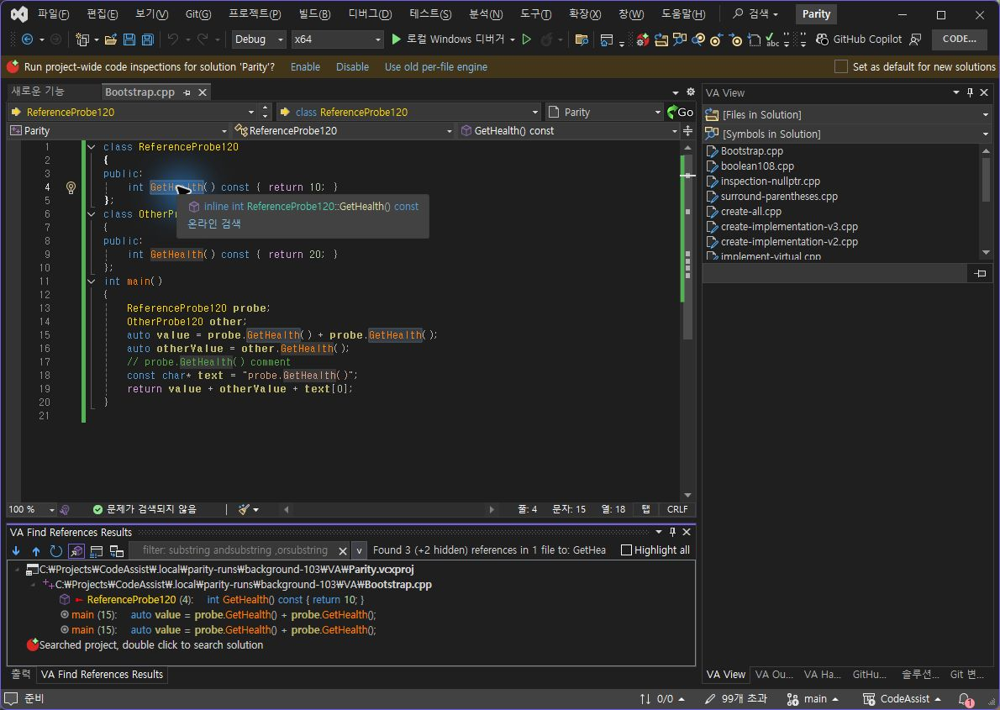
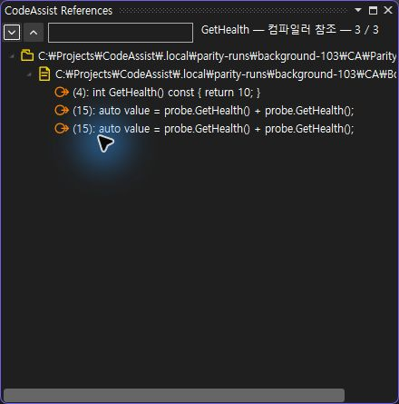

> 보관 기록입니다. 아래 결과는 원문 작성 시점의 내용이며, 이번 편집에서 제품 테스트를 다시 실행하지 않았습니다.

0.0.110 참조 경계 대조

## VA·CA 0.0.110 — 참조 경계 실제 대조

## 같은 입력·실행 결과

동일한 저장된 C++ 코드의 GetHealth 정의 4:6–4:15를 선택하고 실제 Alt+Shift+F 입력. 두 제품 모두 기본 표시 결과 3개(정의 4행, 호출 15행 두 개). 다른 클래스의 동명 함수 및 주석·문자열은 기본 표시 결과에서 제외됩니다.

| 대조 | VA | CA |
| --- | --- | --- |
| 첫 호출 선택 | 15:21→15:30 | 15:21→15:30 |
| 두 번째 호출 선택 | 15:41→15:50 | 15:41→15:50 |

## 실제 촬영

VA: 3개 + 숨겨진 2개

CA: 기본 결과 3개

## 남은 차이

VA의 숨겨진 참조 2개 표시 및 상세 필터와 같은 기능을 CA에서 확인하지 못했습니다. 결과 창 배치도 VA 하단 도킹 / CA 부동 창으로 다릅니다. 전체 VA-F002 통과로 처리하지 않습니다.

## 검사 종료 상태

양쪽 시험 코드를 원본으로 복원하고 저장했습니다. 편집기 본문과 백업 일치, 디스크 SHA256도 양쪽 8A9D8AD69A16FB6813230BE6B2DB5A5717D5DEB55B426B092465777AF2884188 일치.

계산·판정 데이터 · 검사 코드 · VA 위치 근거 · CA 위치 근거

XERJ: 미사용 — 이번 작업은 GUI 실행 대조이며 코드 검색 불필요.

## 원문과 편집 이력

[보존된 원문 열기](../assets/imports/docs/validation/reference-boundaries-110/index.html)

- 원문 SHA-256: `9f186b63aa4d460507d83ad6a2bac903e15f1b5c8ebe5f1f738b0a0dc6854ee5`
- 표시 날짜는 원본 파일의 수정 시각입니다. 작업 완료 시각은 원문에 있는 값을 기준으로 확인합니다.
