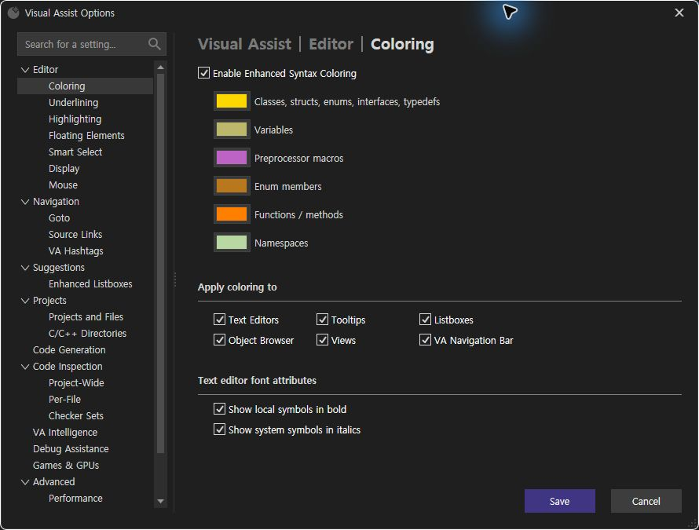
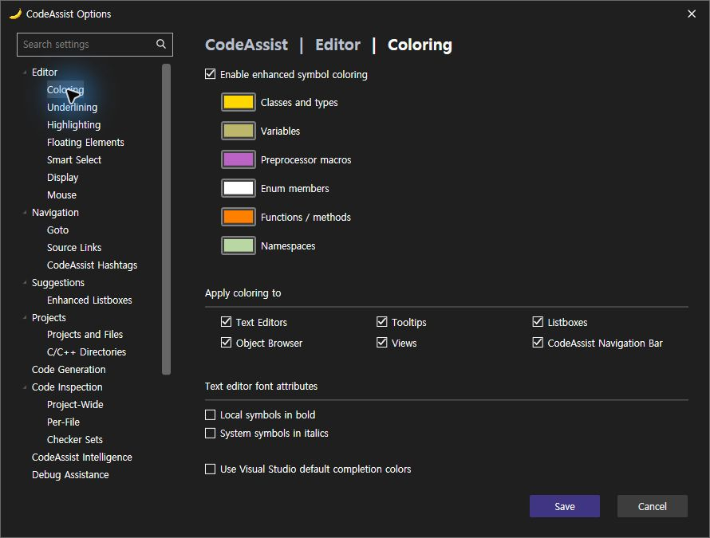
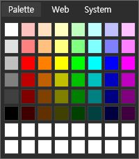
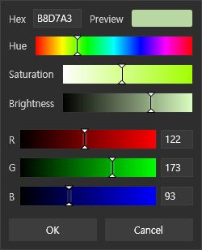
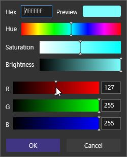

> 보관 기록입니다. 아래 결과는 원문 작성 시점의 내용이며, 이번 편집에서 제품 테스트를 다시 실행하지 않았습니다.

색상 팝업 재검증 0.0.152

## 0.0.152 — 색상 팝업 수정·실행 검사

검사 2026-10-24T07:36:25.515562+09:00 / 제안 20–30분 / 경과 1114초

색상 팝업 실행 검사 **90% (9/10)**, 이 팝업의 구조 체크 **90% (9/10)**. 제품 전체 VA 동기화율을 뜻하지 않습니다. 선택 옵션의 기존 양쪽 근거 확보는 **83.33% (10/12)**이며 새 전체 통과로 계산하지 않았습니다.

## 현재 실행 결과

| 검사 | 결과 | 근거 |
| --- | --- | --- |
| Palette opens | 통과 | 관측 666 |
| Web tab | 통과 | 관측 679 |
| System tab | 통과 | 관측 678 |
| System/Web/Palette roundtrip then custom editor | 통과 | 관측 681 |
| Custom editor from fresh/reopened palette | 통과 | 관측 698 |
| Mouse Red127 => Hex7FFFFF / RGB127,255,255 | 통과 | 관측 699 |
| Custom OK and Save persist slot1 | 통과 | 관측 703 |
| Palette reopens after saved selection | 통과 | 관측 697 |
| Cancel discards custom draft | 통과 | 관측 676 |
| Physical Tab focus moves to Hue | 미판정 | 관측 673 |

RGB 마우스 변경 127/255/255 → 7FFFFF, OK·옵션 저장 및 재열림 확인. 원래 enum #B88020과 사용자 팔레트를 복원했습니다. 다른 설정 차이는 없었습니다.

## 색상 옵션

VA

CA 0.0.152

## 팔레트

VA

CA 0.0.152

## 사용자 색상 편집

VA

CA 0.0.152

## 남은 항목

실제 Tab 키 이동과 Hex 문자 입력은 확인되지 않았습니다. UIA 값 입력도 cached app state 오류였습니다. 이 항목을 제품 오류 수정 완료 또는 VA 일치로 계산하지 않습니다. 탭 왕복·취소 후 재열림·저장 후 재열림은 이번 설치본에서 성공했습니다. 이전 실패 원인의 인과관계까지 입증한 것은 아닙니다.

전체 범위에는 스니펫·실제 키 누름 유지 반복 및 기존 QuickInfo/Undo/UI 차이와 전체 기능 재검증이 남아 있습니다. 전체 동기화율은 이 부분 검사로 산출하지 않습니다.

회귀 427/427 (100%), 설치 DLL 6/6 일치. 문서/도움말 기반 부분 명세108/108 (100%)는 전체 역분석 완료율과 구분합니다.

XERJ: 사용 — 검색 누락이 있어 현재 소스는 rg/파일 읽기로 확인. 하위 에이전트1개는 pending_init이며 실행하지 않았습니다.

원시 요약 · 저장값 · 복원값 · 로드 DLL · 테스트

## 원문과 편집 이력

[보존된 원문 열기](../assets/imports/docs/validation/options-152/index.html)

- 원문 SHA-256: `1a880ca341b741ab6c3d7950251306933fbf6e527799f203e76872ec05b562a6`
- 표시 날짜는 원본 파일의 수정 시각입니다. 작업 완료 시각은 원문에 있는 값을 기준으로 확인합니다.
