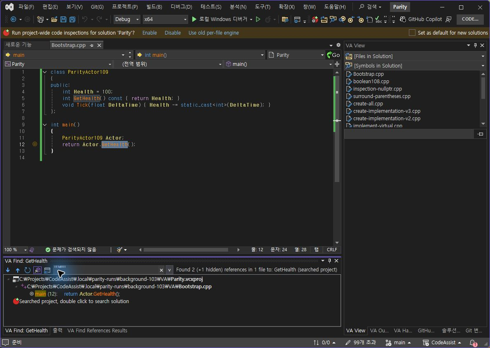
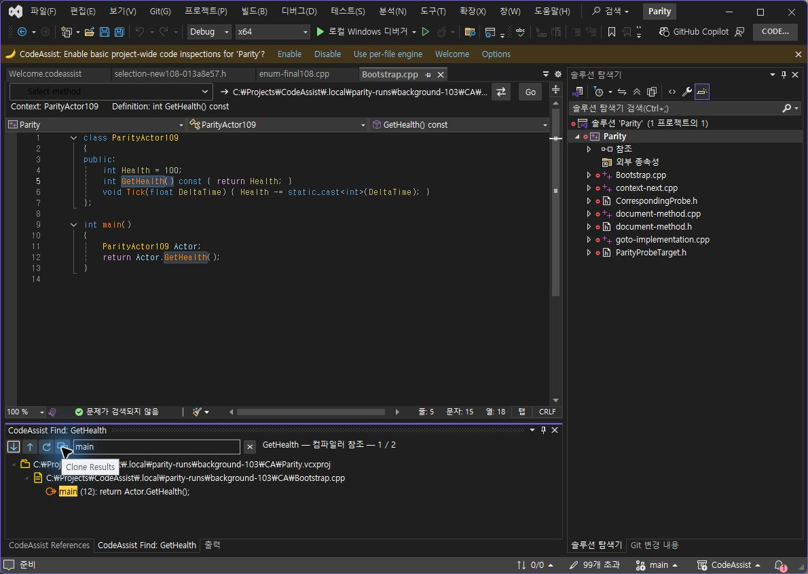
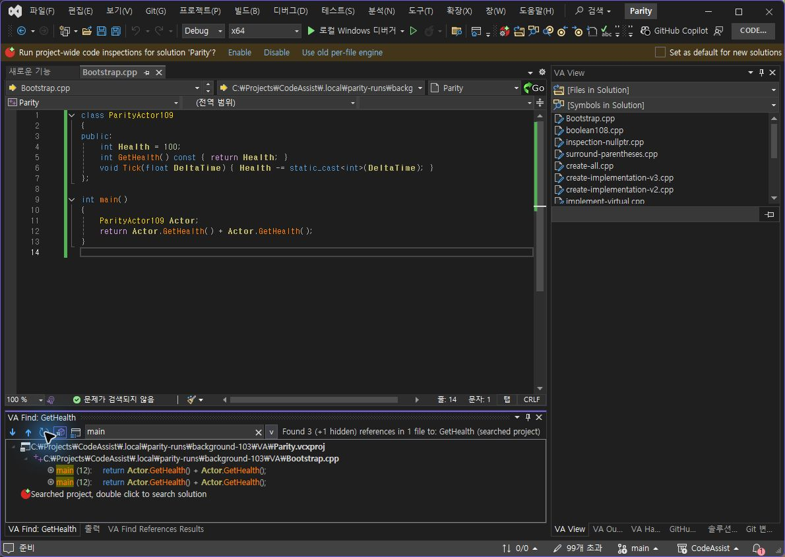
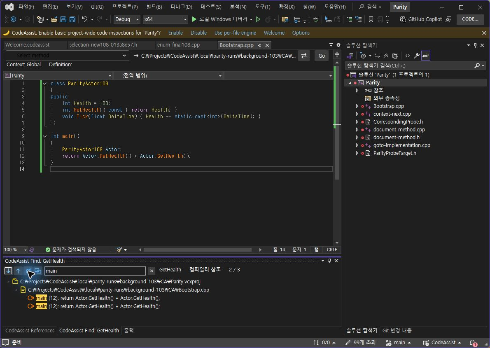
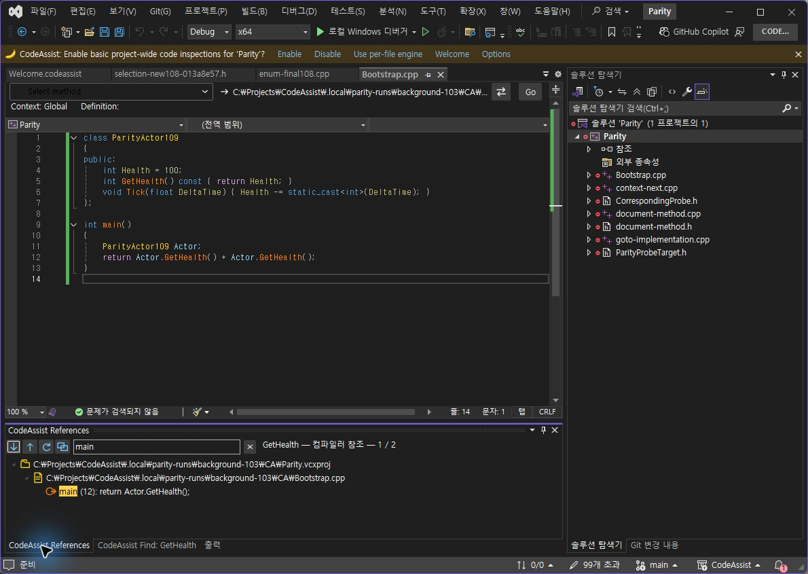

> 보관 기록입니다. 아래 결과는 원문 작성 시점의 내용이며, 이번 편집에서 제품 테스트를 다시 실행하지 않았습니다.

0.0.114 참조 새로 고침·복제

## CA 0.0.114 — 실제 참조 새로 고침·결과 복제

## 수정한 버튼

다음·이전 버튼 옆에 직접 그린 새로 고침 화살표와 겹친 창 복제 아이콘을 추가했습니다. 새로 고침은 원래 검색 문서·위치·심볼을 유지한 실제 재검색입니다. 복제 버튼은 해당 창의 결과 배열·필터·검색 콜백을 별도로 보존합니다. 재검색 실패는 이전 결과를 새 통과로 바꾸지 않고 오류로 표시하도록 구현했습니다. 실패 분기는 이번 실행에서 검증하지 않았습니다.

## 실제 동일 입력 대조

| 검사 | VA | CA 0.0.114 |
| --- | --- | --- |
| main 필터 상태에서 복제 버튼 클릭 | main·표시 한 행 유지 | main·표시 한 행 유지 |
| 같은 문서에 호출 하나 추가 후 새로 고침 | 전체 2→3, 표시 1→2행 | 전체 2→3, 표시 1→2행 |

VA 복제 — 검색어·결과 유지

CA 복제 — 해당 창 상태 유지

VA 실제 변경 후 새로 고침

CA 실제 변경 후 새로 고침

## 복제 탭 독립성

CA 복제 탭을 새로 고친 뒤 원본 탭으로 전환했습니다. 복제는 2/3, 원본은 기존 1/2를 유지했습니다. 이 독립성 확인은 CA 단독 추가 검사이며 VA와 비교한 표본 수에는 더하지 않았습니다.

## 환경 및 복구

VA 10.9.2630.0 / CA 0.0.114 / VS 17.14.37531.7. 동일한 저장 코드임을 두 편집기 본문으로 확인했습니다. 검사 후 양쪽 원본 본문·저장 상태·디스크 SHA256 8A9D8AD69A16FB6813230BE6B2DB5A5717D5DEB55B426B092465777AF2884188을 확인했습니다. 새로 고친 복제 결과는 시험 당시 스냅샷이며 원본 복구 이후의 현재 참조 결과로 해석하지 않습니다.

## 남은 차이

- 상속·오버라이드 참조 표시와 전체 프로젝트 표시 버튼은 아직 없습니다.

- 숨김 참조·종류 필터와 전체 의미 분석 동등성은 미완료입니다.

- 검색 위치 변경·실패 처리 분기, 다른 복제 진입 경로, 여러 VS 버전의 생명주기 검증이 남았습니다.

- 이번 복제·새로 고침 표본으로 전체 VA-F002나 전체 제품 통과를 선언하지 않습니다.

VS2019·Modern 빌드 성공, Core 317/317(100%) 통과, 검사 프로필 바이너리 6/6 해시 일치.

계산 데이터 · 시험 코드 · VA 실행 본문 · CA 실행 본문 · 설치 해시 · 테스트 로그

XERJ: 사용 — 참조 명령·결과 창·컴파일러 재검색 경로를 검색하고 현재 소스를 확인했습니다. 전체 목표는 진행 중입니다.

## 원문과 편집 이력

[보존된 원문 열기](../assets/imports/docs/validation/references-114/index.html)

- 원문 SHA-256: `919209ea995ea4770509f1a9b0d620ad6522036141dff5a49865dd594f752793`
- 표시 날짜는 원본 파일의 수정 시각입니다. 작업 완료 시각은 원문에 있는 값을 기준으로 확인합니다.
