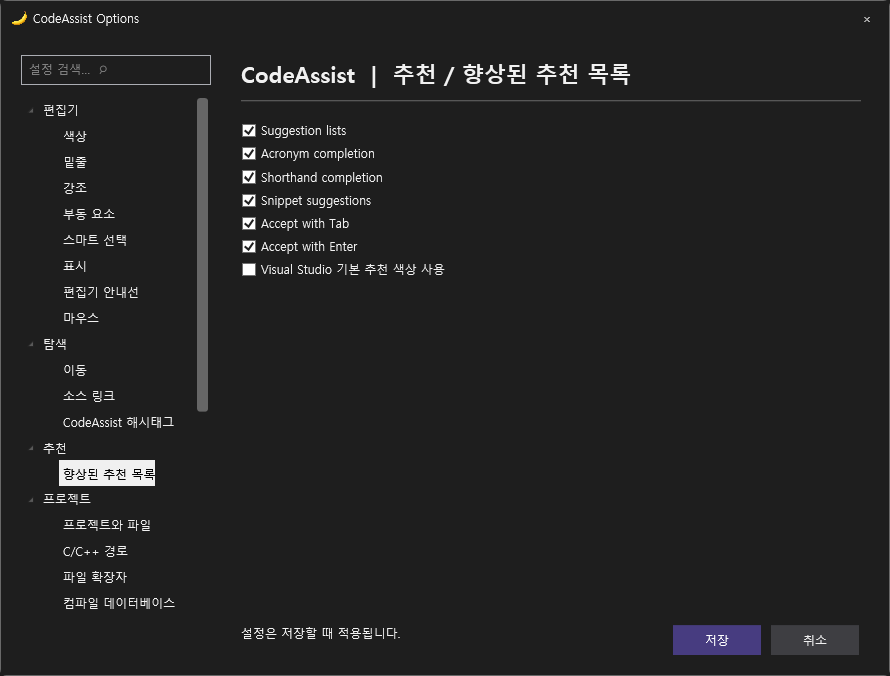
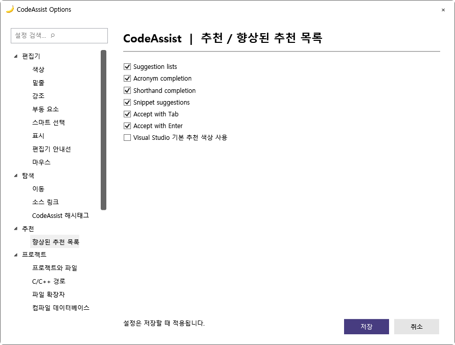

> 보관 기록입니다. 아래 결과는 원문 작성 시점의 내용이며, 이번 편집에서 제품 테스트를 다시 실행하지 않았습니다.

원래 항목 범위를 유지한 결과입니다. 전체 완수 여부를 축소한 기준으로 바꾸지 않습니다.

| 번호 | 요청 | 상태 | 결과와 남은 범위 |
| --- | --- | --- | --- |
| 1 | 확인된 오류 3종 수정 | 완수 | 심볼19개 확인 · Alt+Shift+O로 프로젝트 파일3개 확인 · 문맥 정의 오선택 수정 남음: |
| 2 | 부분 구현 보완 | 부분 완료 | 설명 위주 옵션3페이지를 실제 설정 연결 · Tab/Enter 추천 확정 설정 · 전체 키 바인딩 적용 검사 통과 · 실제 편집기14개 및 생성C++6개 통과 남음: 리팩터링 전체 지원 범위·참조 갱신·Undo 및 모든 옵션 완성 |
| 3 | 108개 실제 VA 기능 대조 | 미완료 | 남음: 108개 전체 동일 입력·설정·예외 처리 대조 |
| 4 | Unreal 성능 측정 | 부분 완료 | 지정 실제 프로젝트 소스 인덱싱497.92ms 남음: VA와 IDE 시작·엔진 인덱싱·타이핑·검색 응답 전체 대조 |
| 5 | UI 마무리 | 부분 완료 | VA 실제 옵션 화면 대조 · 추천 옵션 다크·라이트 렌더 및 테마 전환 남음: 전체 옵션 배치와 VA 라이트 기본 색상 대조 |

소스252개·실제 편집기14개·생성 C++6개 통과. 전체 제품 유사도 미산정, 부분 대응108/108·전체 검증완료0/108.

번호별 원자료 · 키 적용 결과 · 실제 편집기 결과 · Unreal 인덱싱 · 패키지 · 설치

## 원문과 편집 이력

[보존된 원문 열기](../assets/imports/docs/comparison-0.0.79.html)

- 원문 SHA-256: `439ba32ee2666796020fa7a47107609bbd0dfe7c55bc639d9c5be8dd453c1480`
- 표시 날짜는 원본 파일의 수정 시각입니다. 작업 완료 시각은 원문에 있는 값을 기준으로 확인합니다.
