> 보관 기록입니다. 아래 결과는 원문 작성 시점의 내용이며, 이번 편집에서 제품 테스트를 다시 실행하지 않았습니다.

VA·CA 실제 대조 141

## VA·CA 실행 대조 — 최신 설치 0.0.141

전체 작업 진행 중입니다. 선별 출력 표본은 **5/6개 · 83.33%** 일치했습니다. 이는 제품 전체 동기화율이 아닙니다. 서로 다른 버전의 실행 근거를 명시하며 현재 버전 전체 통과로 합산하지 않습니다.

| 지표 | 개수·백분율 | 범위 |
| --- | --- | --- |
| 선별 출력 일치 | 5/6 · 83.33% | 138 색상 4건, 140 # 입력 1건, 141 툴팁 1건(차이) |
| 최신141 심볼 텍스트 | 8/8 · 100% | 같은 검색어의 이름 순서 4개·정의 미리보기 4개 |
| 12개 옵션 중 양쪽 출력 근거 확보 | 4/12 · 33.33% | 한 상태 이상 비교, 완전 통과율 아님 |
| 12개 옵션 중 표본 On/Off 일치 | 2/12 · 16.67% | 138 Object Browser·Views. 전체 입력 인증 아님 |
| Core 회귀 | 401/401 · 100% | CA 자체 검사; VA 동등성 아님 |
| 문서 부분 명세 확보 | 108/108 · 100% | 전체 역분석 완료율과 구분 |
| 전체 기능 gate 인증 | 0/108 · 0% | 전체 인증 미확보; 구현률 0%라는 뜻 아님 |

## 최신141 심볼 순서·정의 — 클래스 축약·헤더·버튼 보정

VA

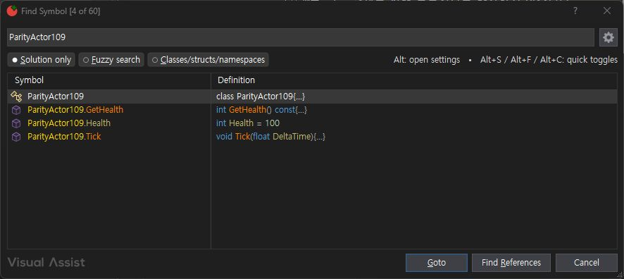

CA

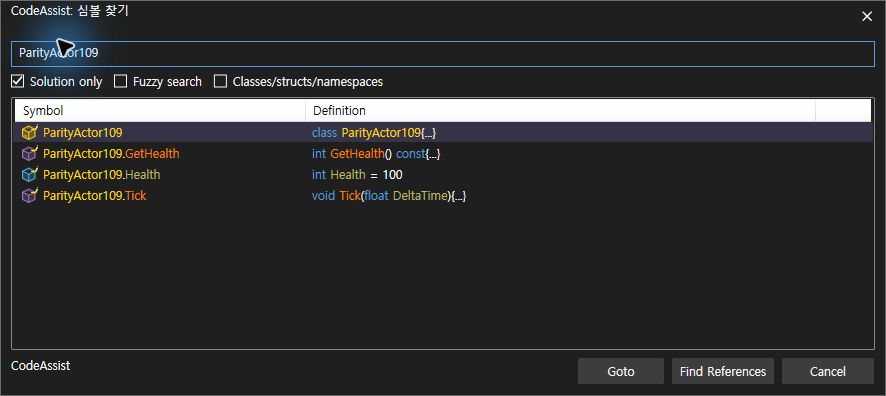

## Views 끄기 — 새 검색 결과

VA

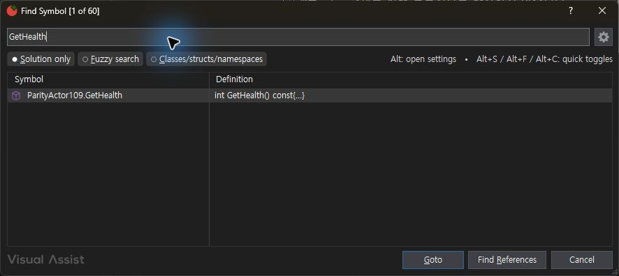

CA

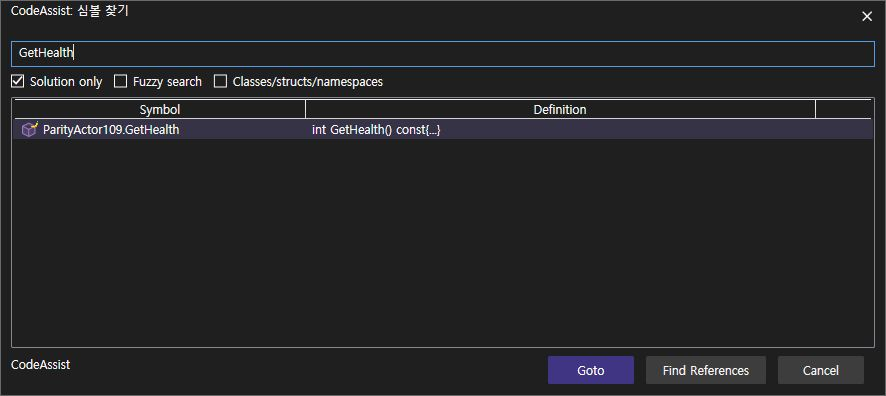

## Object Browser 켜기

VA

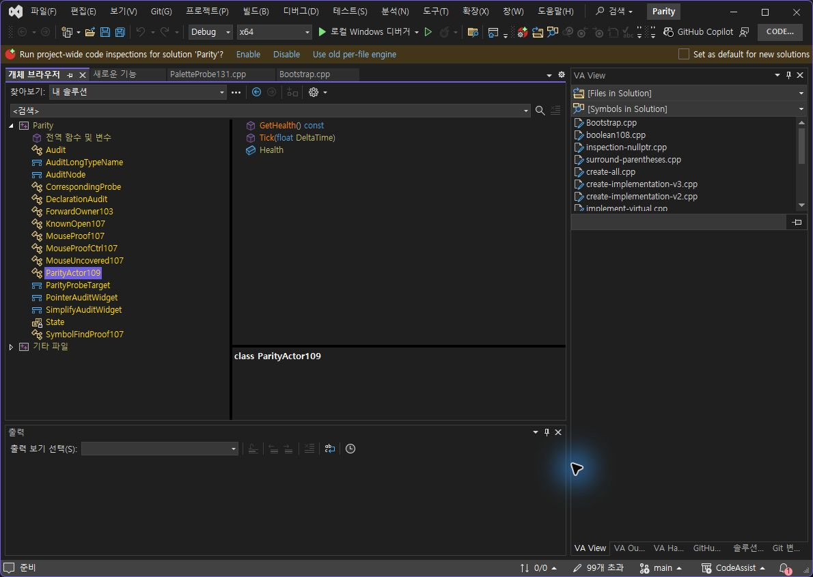

CA

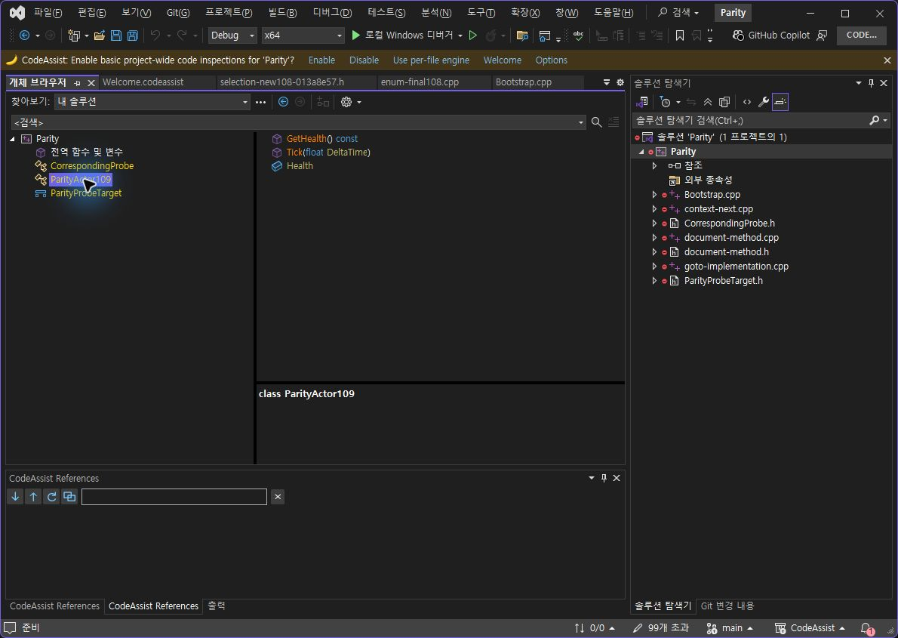

## Object Browser 끄기 — 접고 새로 펼친 결과

VA

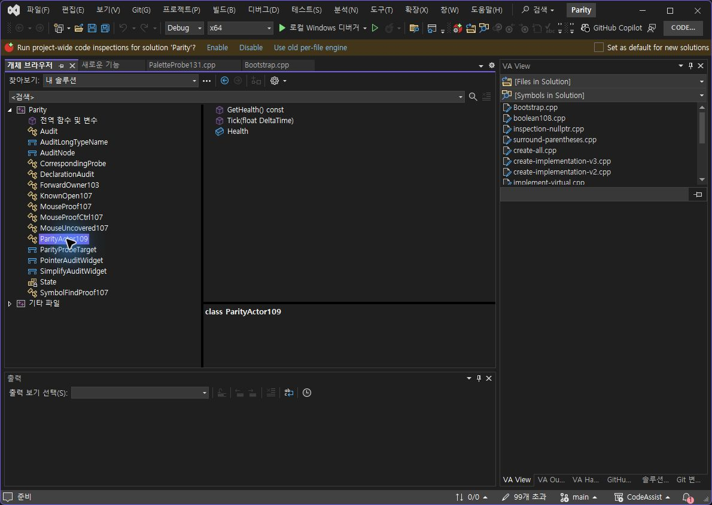

CA

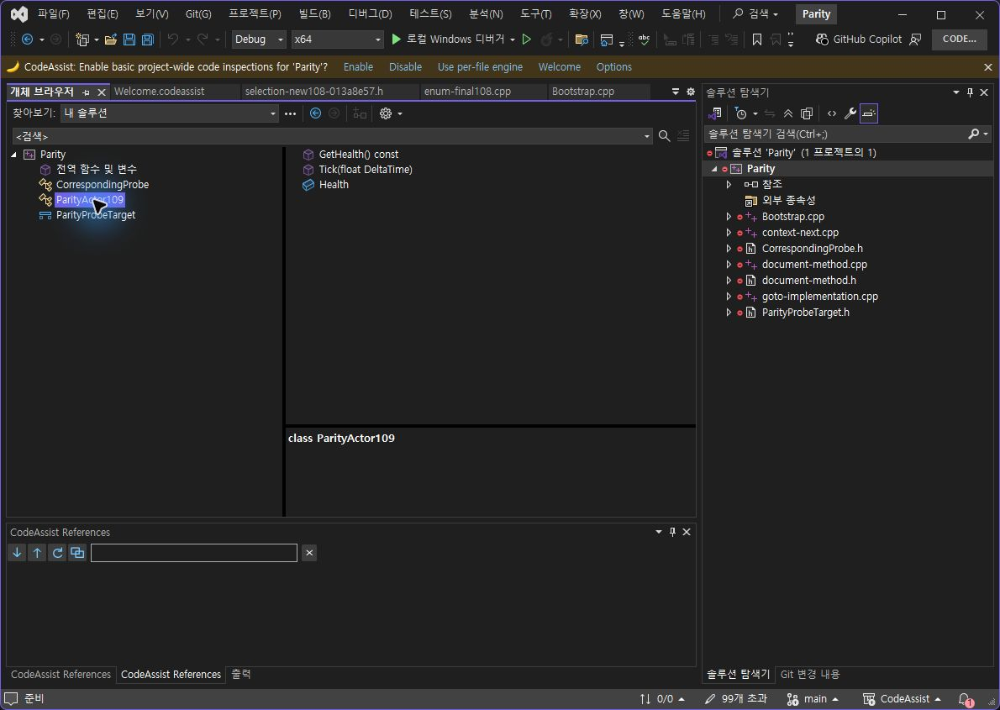

## # 감싸기 실제 키 입력 — 수정 후 전체 문자열·선택 일치

VA

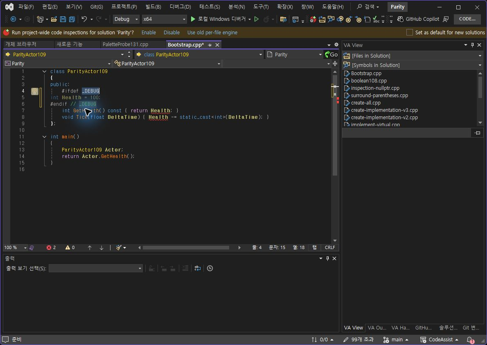

CA

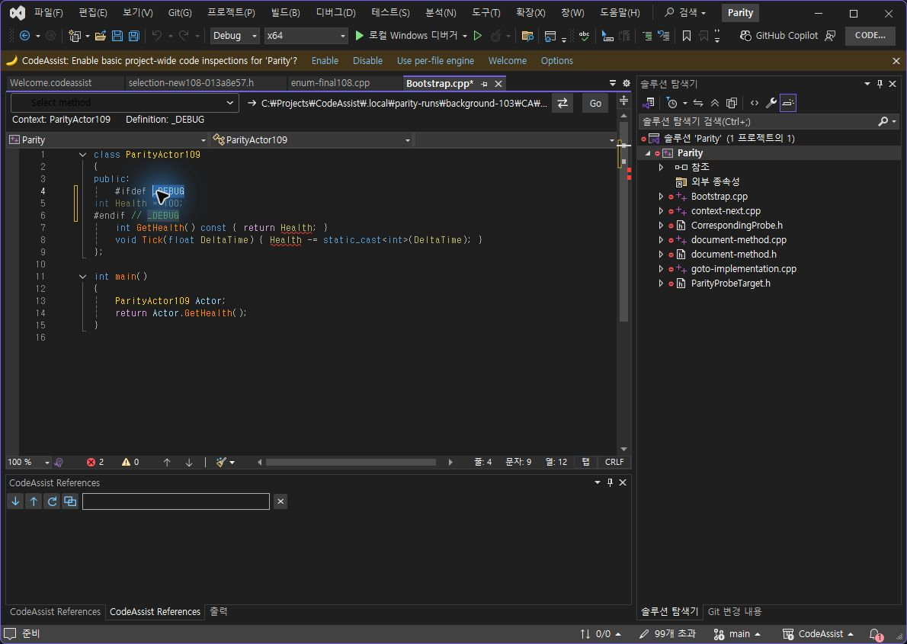

입력·선택 동일성, 출력 문자열·선택 일치를 JSON으로 기록했습니다. 138에서는 빈 줄 하나가 추가되는 차이를 재현했고 140에서 수정했습니다. 양쪽 문서는 Undo로 원본 복원을 확인했습니다.

## 툴팁 — 후보 조회 수정, 행 구성 차이는 남음

VA

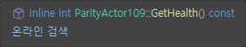

CA

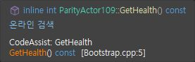

실행 로그에서 제공자는 호출되지만 잘못된 질의로 후보가 0개였습니다. 정확한 이름 조회로 수정한 141에서 후보 1개 및 실제 추가 정보 표시를 확인했습니다. 기본 VS 정보와 CA 추가 행이 함께 표시되므로 VA와 전체 일치로 처리하지 않았습니다. Off·사용자 색상 대조가 필요합니다.

최신141에서 헤더의 왼쪽 정렬은 반영됐지만 밝은 기본 헤더 테마가 나타났습니다. 이 회귀를 발견했고 테마 스타일 상속 보정·재검증이 필요합니다. 헤더 디자인은 통과로 계산하지 않습니다.

## 남은 12개 옵션별 상태

| 옵션 | 상태 |
| --- | --- |
| Surround # | On 문자열·선택 일치, Off 남음 |
| With Snippets | VA On/Off 기록, CA 사용자 스니펫 대조 남음 |
| Overloaded arrow | 과거 On 증거, 최신 On/Off 재검증 남음 |
| Double key repeat | 실제 held-key 반복 입력 검증 남음 |
| Enum member color | 실제 색상 변경 대조 남음 |
| Namespace color | 실제 색상 변경 대조 남음 |
| Text Editors | 독립 On/Off 대조 남음 |
| Tooltips | 호출 불능 수정·실행 확인, VA와 행 구성 다름·Off 남음 |
| Listboxes | 독립 On/Off 대조 남음 |
| Object Browser | 138에서 표본 On/Off 일치 |
| Views | 138에서 표본 On/Off 일치 |
| Navigation Bar | 독립 On/Off 대조 남음 |

## 실행·검증 근거

패키지 · 설치 · 실제 CLR 로드 · 401개 회귀 검사 · VS2019·현행 VS 빌드 · 산출 JSON

VA는 옵션 저장 뒤 실제 종료가 발생했습니다. Windows 오류 로그로 확인하고 검사 프로필을 복구했습니다. 종료 원인을 추정해 제품 결함이나 도구 결함으로 단정하지 않습니다. With Snippets는 켜짐으로 복원 저장했으며 그 뒤 VA가 다시 종료되어 다음 재실행 확인이 남았습니다.

제안 시간: 20~30분. 기록 시점: 2026-10-24T04:24:44.079896+09:00 / 경과 31.2분. 전체 요청은 미완료이며 목표를 유지합니다.

XERJ: 사용 — NavigationEntry·SearchSymbols 검색 후 현재 소스와 실제 실행 로그로 확인.

## 원문과 편집 이력

[보존된 원문 열기](../assets/imports/docs/validation/options-141/index.html)

- 원문 SHA-256: `0eadaaf4f1ea3d7385fa4fe9795b060ee3fd0fb4a20b6e6e228a06d192d34d1d`
- 표시 날짜는 원본 파일의 수정 시각입니다. 작업 완료 시각은 원문에 있는 값을 기준으로 확인합니다.
