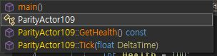
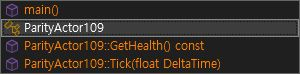
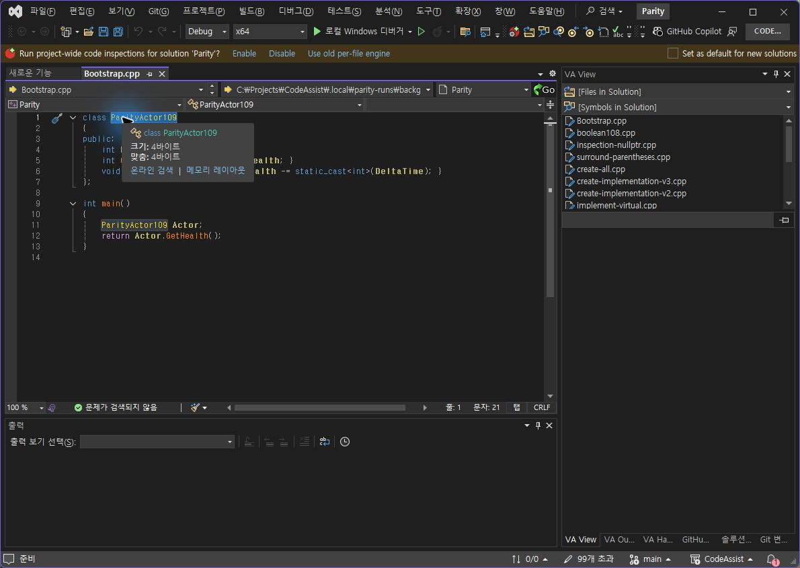
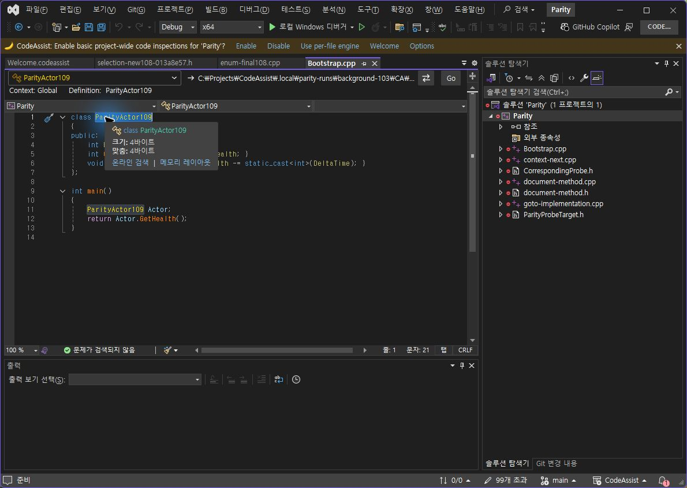

> 보관 기록입니다. 아래 결과는 원문 작성 시점의 내용이며, 이번 편집에서 제품 테스트를 다시 실행하지 않았습니다.

0.0.104 팝업 선택 상태·재선택 대조

## 0.0.104 팝업 강조·동일 항목 재선택

CA 검사 프로필 0.0.104 설치: 6/6 바이너리 일치. VS2019·Modern 빌드와 패키지 검증 통과.

## VA / 수정 전 CA102 / 현재 CA104

확인한 시각 요소 2/2(100%): 이전 선택 행의 회색 채움 제거, 현재 강조 행의 테마 전경색 적용. 전체 UI 유사도가 아닙니다. 일반 함수 글자색(CA 주황 / VA 금색)은 여전히 다르며 라이트 IDE에서의 실제 대조도 남았습니다.

## 동일 항목 Enter 재확정

양쪽 클래스 이름 내부 클릭 → Alt+M → Enter. VA와 CA104 모두 ParityActor109 선택, anchor 1:7 / active 1:21. 시나리오 일치 1/1(100%). CA103의 빈 선택 1:9 결과는 실패 기록으로 보존했습니다.

정확한 실행 결과·촬영 해시 · VA 선택 · CA104 선택 · CA103 실패 · 설치 검증 · 빌드

## 전체 목표는 진행 중

이번 CA102 실행에서는 GetHealth·Tick·main·class 4/4 대상의 위치·선택 문자열이 일치했습니다. [각 원본과 실행 근거](../assets/imports/docs/validation/method-102/index.html)를 참조하십시오. CA102의 4/4를 CA104의 새 실행으로 계산하지 않습니다.

남은 항목: 일반 행의 색상 정책, 라이트 테마 실행 대조, 누락 옵션·아래쪽 레이아웃, 전체 108개 기능의 현재 버전 실제 대조. 문서 부분 명세 확보율 108/108(100%)는 전체 역분석 완료율과 다릅니다.

제안 시간 10~15분. 추가 결함 수정·설치로 상한 초과. XERJ: 사용 — 메서드 색상·설정 후보 검색 후 현재 소스·실행 화면 확인.

## 원문과 편집 이력

[보존된 원문 열기](../assets/imports/docs/validation/popup-104/index.html)

- 원문 SHA-256: `e51ccb5841ffe505c49342fd2bbc3eb9953ac9805e6a87d64776ed2518ea7c7a`
- 표시 날짜는 원본 파일의 수정 시각입니다. 작업 완료 시각은 원문에 있는 값을 기준으로 확인합니다.
