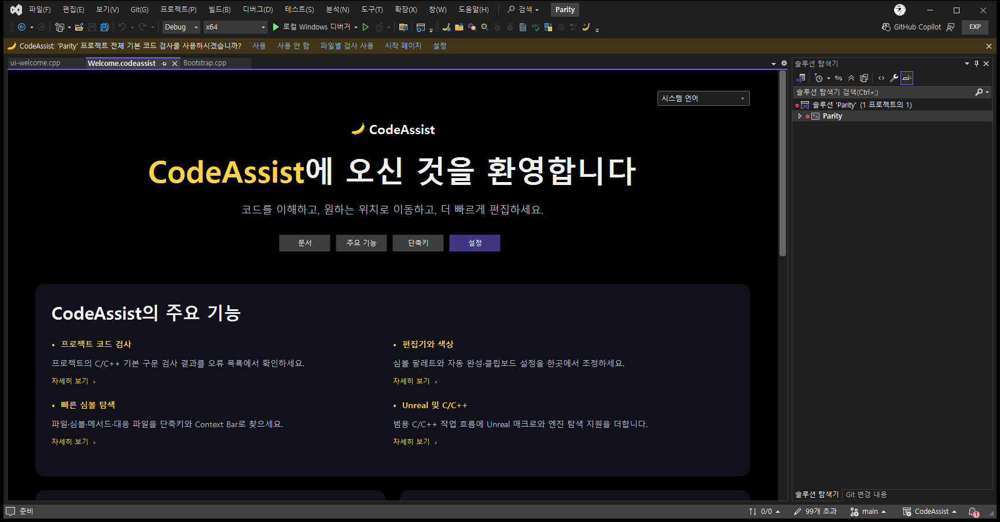
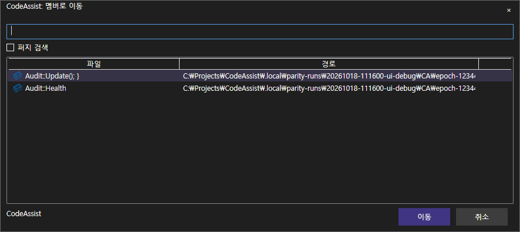

> 보관 기록입니다. 아래 결과는 원문 작성 시점의 내용이며, 이번 편집에서 제품 테스트를 다시 실행하지 않았습니다.

CodeAssist 0.0.89 실행 디버깅

## 0.0.89 직접 실행 디버깅

실제 CA 별도 VS에서 재현·수정·재실행했습니다. VA는 이전 실행 기준 화면을 참조했습니다. 이번 작업에서 두 제품을 새로 동시 촬영한 것은 아닙니다.

| 작업 | 결과·범위 |
| --- | --- |
| 미촬영 화면 | Welcome 문서 탭·전체 IDE 상단 촬영 추가. 자동완성 모든 상태·모든 테마의 실실행 촬영은 남음. |
| 실패 검사 조사 | 멤버 이동이 Health 필드에서 실행되던 입력을 Audit 타입으로 수정. 변수 추출을 일반 빠른 작업에 연결한 기존 시나리오는 전용 구현 검증이 아님을 확인. |
| Display 옵션 | 메서드 이름순/등장순 정렬을 실제 목록 코드에 연결. 열 표시 설정을 Display에도 배치. Quick Info 세부 옵션·탐색 표시줄 상하 위치 등은 미구현. |
| 테마·언어 | 실제 창의 ‘멤버로 이동’ 한국어 제목 확인. 영어 다크/라이트 WPF 렌더 및 열린 뷰 리소스 전환 검사 각각 통과. 실제 VS 테마 전환과 구분. |
| 기능 검증 | 설정 직렬화·복사 포함 테스트 11/11 통과. 멤버 창 2개 결과 표시, Welcome 탭 표시. 단축키는 패키지 등록 24개 확인이며 물리 입력 검증은 미실행. |
| 재실행·기록 | 최종 5개 시나리오 실행 완료. 화면 관찰 4개, Quick Actions는 팝업 미관찰 1개. 이를 5개 기능 통과로 간주하지 않음. |

## Display: VA 이전 실화면 / 수정 CA 최신 실화면

VA build2630 · 이전 올바른 페이지 촬영

CA 0.0.89 · 이번 실제 VS 촬영

## Welcome: 실제 문서 탭

CA 0.0.89 · 실제 VS 전체 창, Welcome·툴바·안내 바

## 멤버 이동: 한국어 제목·2개 결과

수정된 입력과 현재 문서 심볼 병합 적용 후 실제 실행

## 보조 테마 렌더 — 실제 IDE 촬영 아님

영어 Dark · 독립 WPF 렌더

영어 Light · 독립 WPF 렌더

## 추가로 발견한 차이

멤버 목록에 Update(); }처럼 선언 뒤 텍스트가 붙는 서명 표시가 관찰됐습니다. 멤버 목록 생성 시 Kind를 전달하지 않아 기본 아이콘을 쓰는 코드도 확인했습니다. 이 두 항목은 이번 수정본에 남아 있으며 후속 수정 대상입니다. 0.0.89는 실험용 VS 프로필에만 적용했습니다. 기존 일반 VS는 계속 이전 버전을 사용하므로 사용자가 일반 VS에서 테스트하려면 새 설치 파일 적용이 필요합니다.

## 동기화 수치와 남은 작업

이전 0.0.88의 26/66개 분류(39.39%)에서 계산한 픽셀 점수 74.02%는 과거 기준이며 최신 전체 유사도로 재사용하지 않습니다. 최신 전체 UI·기능 동기화율은 미확정입니다. 이번 관찰 화면 4/5개(80%)는 촬영·관찰 비율이며 기능 일치율이 아닙니다.

VA 재촬영, 나머지 고유 명령·화면 40개 분류의 관찰, Quick Info 세부 설정과 리팩터링 전용 동작, 물리 단축키, 모든 테마·자동완성 상태 비교가 남아 있습니다.

검증 요약·실행 DLL 해시 · 원본 실행 기록 · 이전 점수 제외 시나리오 · [이전 108개 대조](../assets/imports/docs/ui-comparison-0.0.88.html)

최신 계열 설치 파일 · VS2019 설치 파일

제안 시간: 10분 · 실제 보고서 완료까지 7분 58초 · 2026-10-18 11:15:20 KST. XERJ 사용 — 현재 소스와 실행으로 확인.

[최신 0.0.90 UI·기능 자동 점검 결과](../assets/imports/docs/debug-0.0.90.html)

## 원문과 편집 이력

[보존된 원문 열기](../assets/imports/docs/debug-0.0.89.html)

- 원문 SHA-256: `1a6f5f7db48ecd931313783d3f6a36ebcd001d19e8e2628673a4f540977091e5`
- 표시 날짜는 원본 파일의 수정 시각입니다. 작업 완료 시각은 원문에 있는 값을 기준으로 확인합니다.
