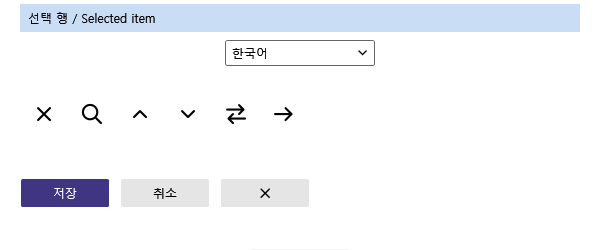
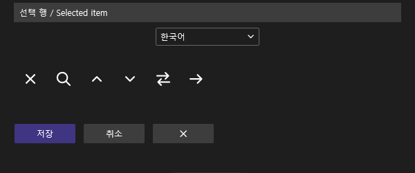
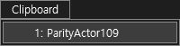
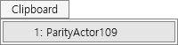

> 보관 기록입니다. 아래 결과는 원문 작성 시점의 내용이며, 이번 편집에서 제품 테스트를 다시 실행하지 않았습니다.

0.0.108 메뉴 선택 팔레트 수정

## 0.0.108 메뉴 선택 팔레트

메서드 목록과 클립보드 메뉴 2개 사용처를 일반 버튼 팔레트에서 분리했습니다. 라이트 #C9DDF5 / 다크 #3D3D3D. 현재 VS 검사 프로필 0.0.108 설치, 6/6 바이너리 일치, 양쪽 VS용 빌드 통과.

## 제품 ProductTheme 코드의 WPF 렌더링

VS 리소스 키를 대체한 렌더러입니다. 실제 IDE 라이트 캡처가 아닙니다.

## 설치된 CA108 실제 다크 메뉴

## 이전 VA·CA107 라이트 비교 기준

이전 실행을 새 버전 통과로 계산하지 않습니다.

## 아직 완료되지 않은 검증

이번 테마 메뉴 입력은 적용 후 화면이 다크로 남는 경우가 반복됐습니다. 검색 팝업 입력도 본창 필터로 전달되는 현상을 확인했습니다. 잘못 입력된 문자와 필터는 복구했고, VA 본문은 원본과 같고 saved=true인 것을 확인했습니다. 새 버전의 실제 IDE 라이트·메서드 목록 팔레트는 미검증입니다. 다크 메뉴 촬영이나 오프스크린 렌더를 라이트 실행 통과로 합산하지 않습니다.

이번 새 전체 기능 동등성 확정: 0/108. 이는 구현율 0%라는 뜻이 아닙니다. 문서 부분 명세 확보 108/108(100%)와 구분합니다. 전체 목표는 진행 중입니다.

정확한 범위·해시 · 설치 바이너리 · 빌드 · VA 복구 상태

XERJ: 사용 — 공통 팔레트 검색 후 현재 소스 확인.

후속 실행: 팝업 입력 경로를 복구해 실제 라이트 재검증을 수행했습니다. [후속 원본 촬영·판정](../assets/imports/docs/validation/theme-live-108/index.html)을 참조하십시오. 이 페이지의 미완료 표기는 당시 상태입니다.

## 원문과 편집 이력

[보존된 원문 열기](../assets/imports/docs/validation/theme-108/index.html)

- 원문 SHA-256: `686faf4ea8cb071b4802a6578ea95accbb5c122445c59918400d0edcc3ad0286`
- 표시 날짜는 원본 파일의 수정 시각입니다. 작업 완료 시각은 원문에 있는 값을 기준으로 확인합니다.
