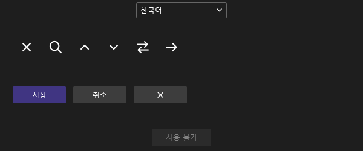
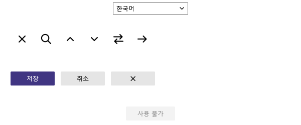
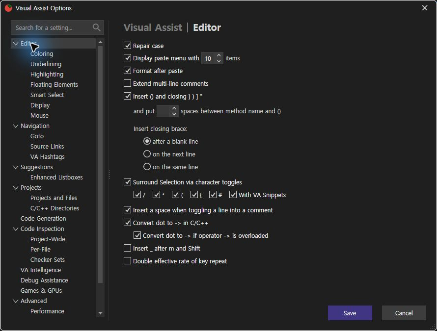
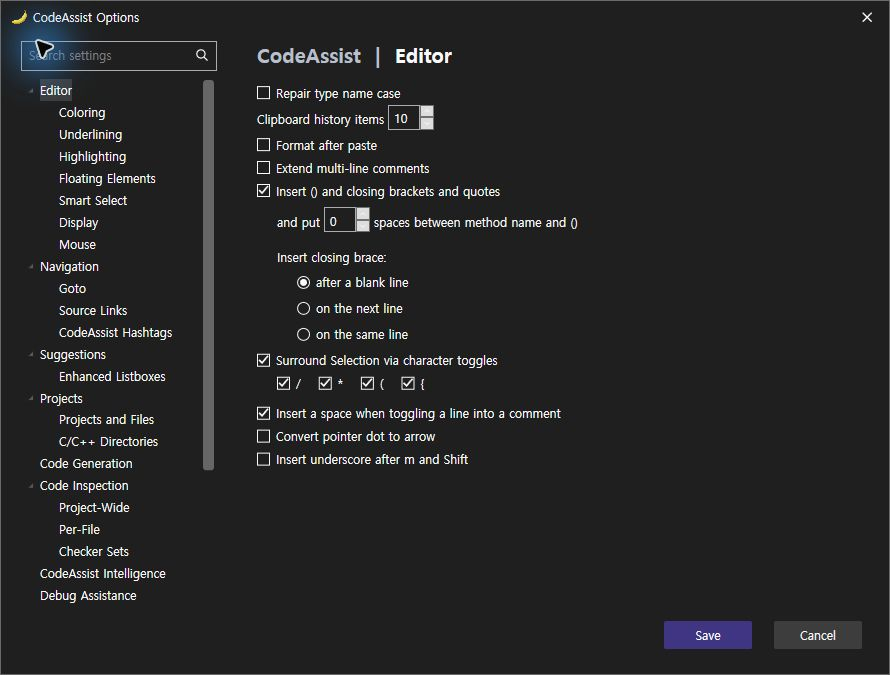
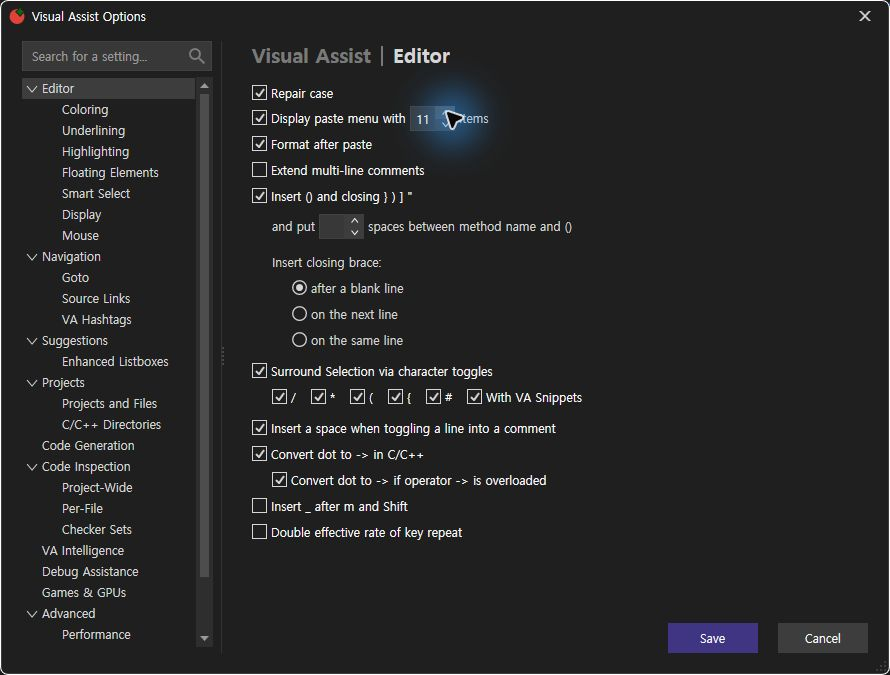
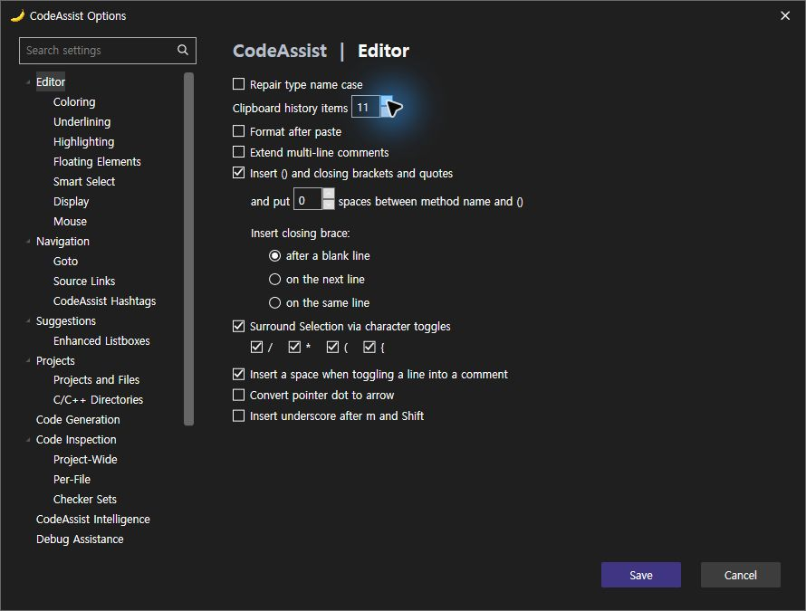
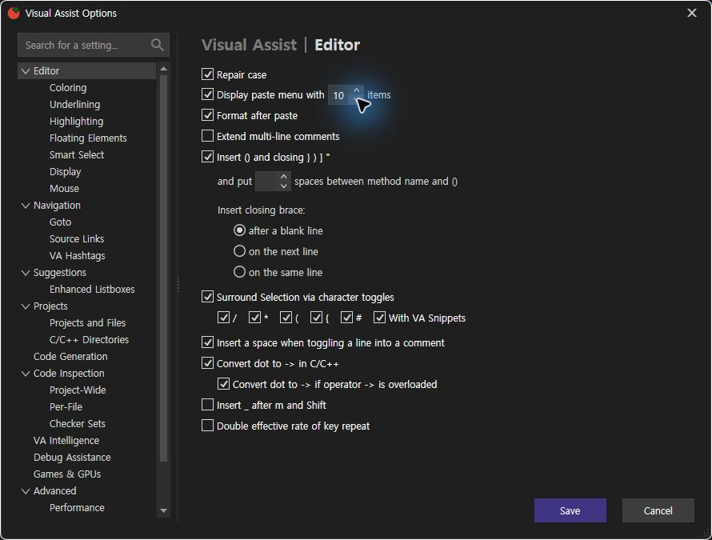
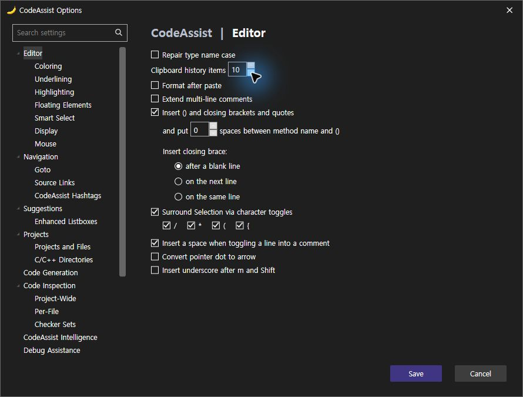

> 보관 기록입니다. 아래 결과는 원문 작성 시점의 내용이며, 이번 편집에서 제품 테스트를 다시 실행하지 않았습니다.

CodeAssist 0.0.101 아이콘·버튼

## 0.0.101 아이콘·버튼 정리

텍스트 기호로 표시하던 6종(닫기·검색·위·아래·대응 파일·경로 화살표)을 직접 그린 WPF 벡터로 교체했습니다. 기존 도구 모음 SVG는 이미 벡터 자산이며 이번 수정 대상에 포함하지 않았습니다.

공통 버튼에 호버·눌림·키보드 포커스·비활성 상태를 추가했습니다. 이름 변경 2개와 스니펫 삽입 1개 기본 버튼을 공통 스타일로 변경했습니다. 기존 창 크기·그룹 순서·배치 좌표는 변경하지 않았습니다.

확인된 기호 아이콘 교체: 6/6(100%). 기본 Button 직접 생성 경로 정리: 3/3(100%). 이 수치는 전체 제품의 VA 유사도가 아닙니다. CA 검사 프로필 0.0.101 설치 완료: 6개 바이너리 해시 일치. 아래 실제 실행 증거를 참조하십시오. 전체 제품 동등성 검증은 미완료입니다.

## 실제 WPF 오프스크린 렌더링

제품 ProductTheme 클래스를 추출하고 VS 리소스 키만 대체한 STA 렌더러로 생성했습니다. 실제 IDE 캡처가 아닙니다.

VS2019·Modern 빌드 · 렌더링 실행 · 패키지 검증

설치 파일: installers/0.0.101/. XERJ: 사용 — 아이콘·리소스 후보 검색 후 실제 소스 확인.

## 설치된 VA · CA 직접 실행 대조

양쪽 동일 Editor 페이지를 Computer Use로 촬영했습니다. 창 크기는 모두 890×675입니다. 검색·닫기·스피너 벡터가 표시됩니다. 색·레이아웃 전체 일치로 판정하지 않습니다.

### VA 원본

### CA 0.0.101

동일 숫자 증가·감소 클릭: VA 10→11→10 / CA 10→11→10. 해당 두 동작 일치 2/2(100%). CA 벡터 닫기 클릭으로 옵션 창이 실제 닫힘도 확인했습니다(CA 단독 검사).

미일치: 붙여넣기 메뉴 활성화 체크박스, surround의 #·snippets 항목, 오버로드 포인터 변환 하위 옵션, 키 반복률, Suggestions 전체 항목이 남습니다. 이들 차이를 통과로 합산하지 않았습니다.

동작 결과·촬영 SHA256 · 설치 바이너리 검증

추가 재검증: CA101에서 실제 Alt+M 입력 후 메서드 팝업이 관찰되지 않았습니다. 이 기록은 보존하며, 이후 편집기를 실제 클릭한 조건에서 CA101·CA102 모두 팝업이 열렸습니다. [후속 검증·수정 결과](../assets/imports/docs/validation/method-102/index.html)를 참조하십시오. 읽기 전용 실행 상태

### 동일 입력 결과

제안 시간: 10~15분. 전체 목표는 진행 중입니다. 문서 기반 부분 명세: 108/108(100%), 전체 역분석 완료율과 다릅니다. XERJ: 사용 — TryOpenMethodList 검색 후보를 현재 소스·VSCT로 확인.

정정: VA 옵션 취소 이후 검사 프로세스 종료 및 APPCRASH가 확인됐습니다. 정상 취소 복귀로 통과 처리하지 않습니다. 원인은 미확인입니다.

## 원문과 편집 이력

[보존된 원문 열기](../assets/imports/docs/validation/icons-101/index.html)

- 원문 SHA-256: `f3a7d72408a52b42187a4d86a7a27e70723fc84b0c02d88d1232de40317c8e0e`
- 표시 날짜는 원본 파일의 수정 시각입니다. 작업 완료 시각은 원문에 있는 값을 기준으로 확인합니다.
