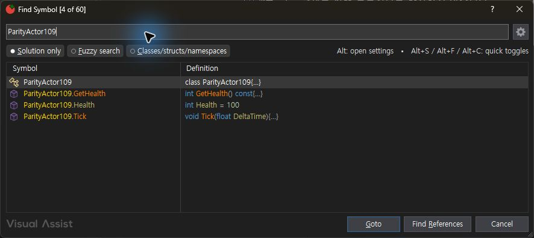
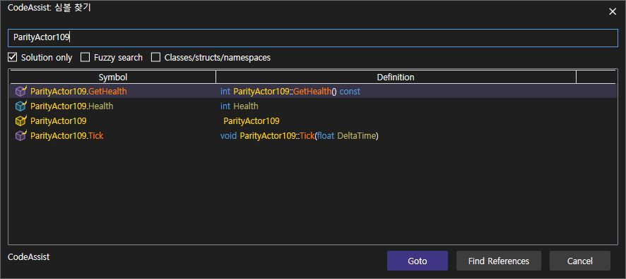

> 보관 기록입니다. 아래 결과는 원문 작성 시점의 내용이며, 이번 편집에서 제품 테스트를 다시 실행하지 않았습니다.

VA·CA 137 색상 실행 대조

## VA·CA 0.0.137 실제 색상 대조 — 진행 중

2026-10-24 KST. CA PID41724 / VA PID29556. 현재 설치·CLR 모듈 로드 근거는 loaded137.json. 현재 보고는 전체 제품 인증이 아닙니다.

## 동일 검색어: ParityActor109

VA — Views 켜짐

CA 0.0.137 — Views 켜짐

타입·함수·변수 및 기본형 키워드의 색상 분리가 관찰됩니다. 항목 순서, Definition 내용, 아이콘, 선택 강조 및 헤더 정렬은 차이가 남아 있으므로 이 화면 전체를 일치 통과로 계산하지 않습니다.

## VA Views 끄기 후 검색 결과 재생성

Listboxes는 켜진 상태로 유지했습니다. 검색어를 GetHealth로 바꾸어 새 결과를 생성하자 일반 글자색이 확인됐습니다. 이전 캐시 화면의 잔여 색상만으로 옵션 연결 실패라고 판단하지 않습니다. 원래 Views 켜짐으로 복원했습니다.

## 자동 검사와 한계

| 범위 | 개수·백분율 | 근거 |
| --- | --- | --- |
| CA Core 회귀 | 386/386 · 100% | TRX / VA 동등성 아님 |
| 네이티브 색상 어댑터 합성 통합 검사 | 16/16 · 100% | 실행 로그 / 실제 VS·VA 동등성 아님 |
| 설치된 Core 팔레트 실행 | 19/19 · 100% | JSON / UI 동등성 아님 |
| 문서 기반 부분 명세 확보 | 108/108 · 100% | 전체 역분석·실행 검증 완료율과 구분 |
| 전체 기능 동등성 인증 | 0/108 · 0% | 전체 gate 인증 미확보. 구현률 0%라는 의미가 아닙니다. |

135에서 서명 뒤쪽이 사라지는 회귀를 재현했고, 글자 폭 계산의 높이를 수직 이동으로 사용하는 오류를 수정했습니다. 수정 전 15/16 → 수정 후 16/16. 실제 화면에서도 서명 전체 표시를 확인했으나 전체 옵션 12개 인증은 진행 중입니다.

## 남은 작업

심볼 목록 순서·Definition·아이콘·레이아웃 차이 수정, 최신137의 끄기 대조, 툴팁 실제 실행 대조, 감싸기·키 반복·namespace/enum·나머지 색상 대상의 동일 입력 검증. 과거 버전의 통과를 최신 버전의 새 통과로 합산하지 않습니다.

XERJ: 사용 — SymbolNameTextBlock 검색 수행. 반환 후보에 직접 일치가 없어 현재 소스를 직접 확인했습니다.

## 원문과 편집 이력

[보존된 원문 열기](../assets/imports/docs/validation/color-runs-135/index.html)

- 원문 SHA-256: `81d9e608b42f584f71a1baafd984b8948e3cf96e60cb76164aff85c546a1d621`
- 표시 날짜는 원본 파일의 수정 시각입니다. 작업 완료 시각은 원문에 있는 값을 기준으로 확인합니다.
