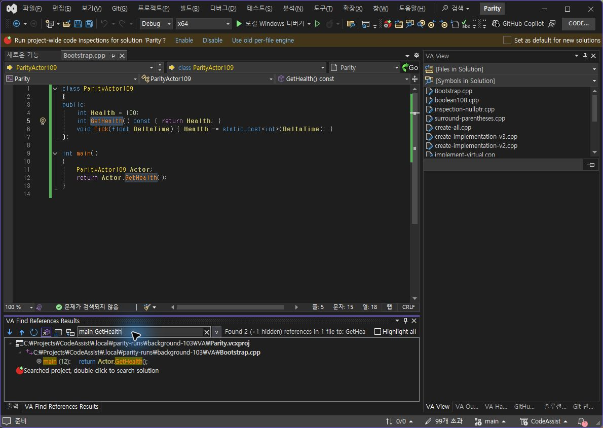
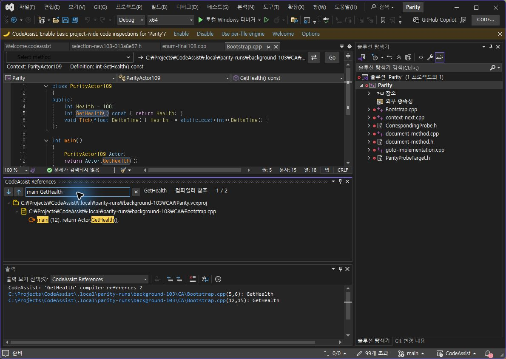
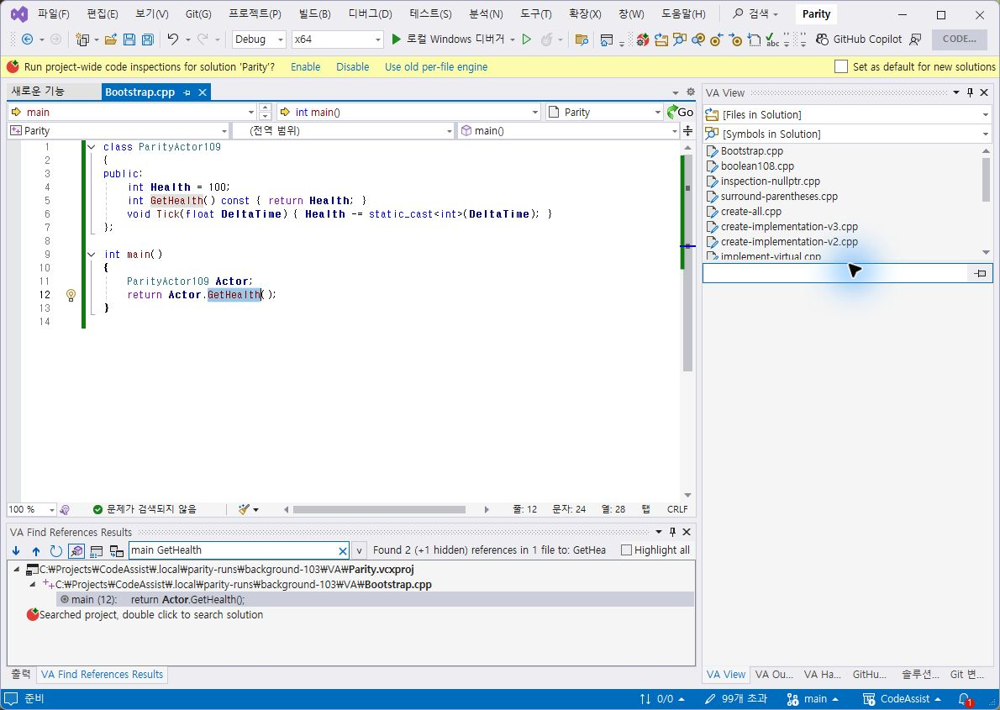
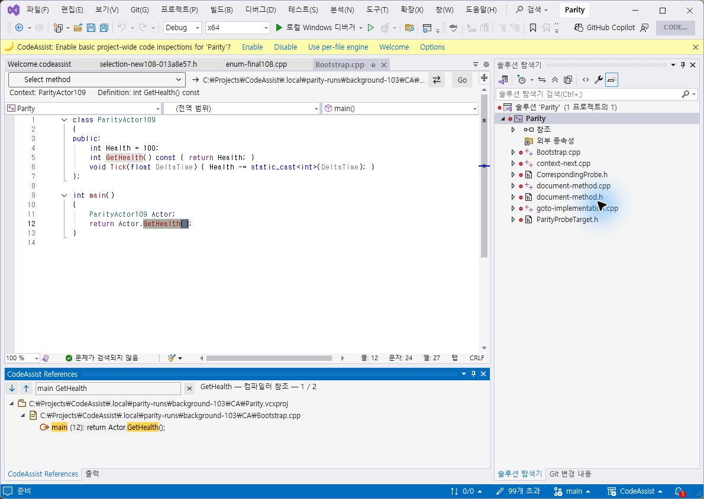
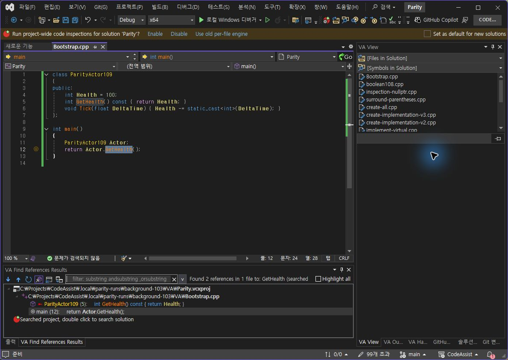
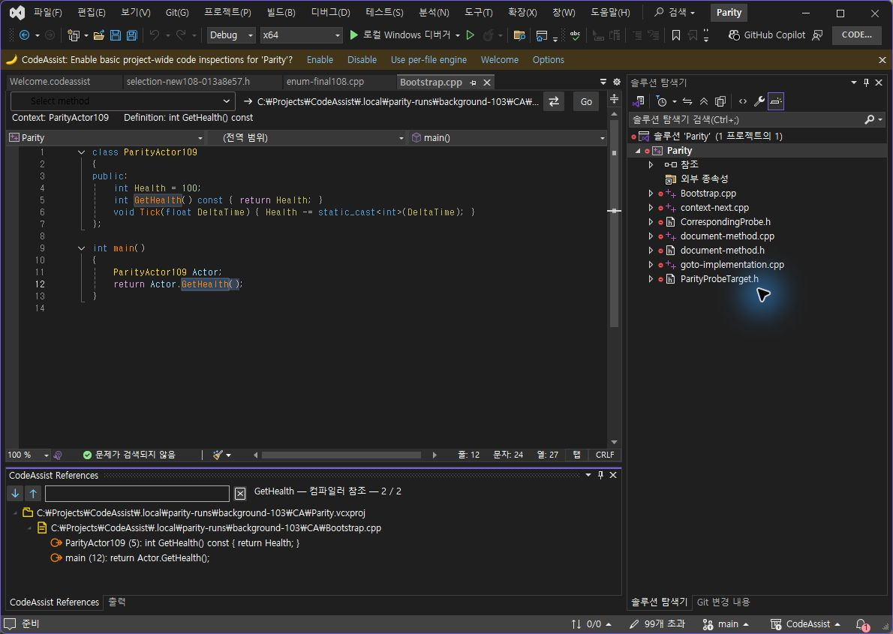

> 보관 기록입니다. 아래 결과는 원문 작성 시점의 내용이며, 이번 편집에서 제품 테스트를 다시 실행하지 않았습니다.

참조 문맥·강조·탭 배치 0.0.113

## CA 0.0.113 — 참조 문맥·검색어 강조·하단 탭 그룹

## 이번 수정

전역 함수 main 및 클래스 문맥을 결과 행과 필터에 포함했습니다. 문맥 계산을 참조 행마다 수행하던 방식에서 파일당 한 번으로 변경했습니다. 검색어는 결과 본문에서 노란 배경으로 강조합니다. 직접 그린 벡터 아이콘을 유지하며 실제 검사 프로필에서 참조 창을 출력 창과 같은 하단 탭 그룹으로 옮겼습니다.

## 같은 입력·안정 상태 대조

동일하게 저장된 Bootstrap.cpp의 GetHealth를 검색한 뒤 main GetHealth 필터 입력. 입력 직후 VA는 이전 두 행을 잠시 유지했으므로 해당 화면(관찰667)은 통과 근거에서 제외했습니다. 후속 관찰668에서 호출 12행 한 개로 반영된 것을 확인했습니다. CA도 후속 관찰679로 결과를 확인했습니다.

| 검사 | VA | CA 0.0.113 |
| --- | --- | --- |
| main GetHealth 필터 표시 | 12행 한 개 | 12행 한 개 |
| 필터 결과 더블클릭 | 12:15→12:24 GetHealth | 12:15→12:24 GetHealth |

VA 안정된 필터 결과

CA 함수 문맥·검색어 강조

## 실제 라이트 테마 대조

VA 라이트

CA 라이트

## 다크 복구·하단 배치

현재 두 1190×845 창에서 참조 영역 외곽은 약 x7,y625,w822,h189이며 허용 오차 4px로 위치·크기를 확인했습니다. 출력과 같은 탭 그룹 여부도 촬영으로 확인했습니다. 검사 프로필에서 수동 적용한 배치이며 새 프로필 기본 배치나 재시작 후 유지까지 인증한 결과는 아닙니다.

VA 원래 다크 복구, 필터 지움

CA 원래 다크 복구, 필터 지움

## 남은 차이

- VA 전체 도구 모음·숨겨진 참조·검색 범위 제어는 아직 동일하지 않습니다.

- 검색어 색조·선택 행·구문 색상·아이콘 세부 모양도 차이가 있습니다.

- 문맥은 C++ 어휘 분석 보조 기능입니다. 복잡한 문법·다른 언어의 완전한 문맥 판정으로 인증하지 않습니다.

- 다른 창과 전체 기능·버전·단축키 검증은 계속 필요합니다.

## 빌드·설치 및 원본 보존

Core 테스트 317/317(100%), VS2019·Modern 빌드 성공. 검사 프로필 설치 바이너리 6/6 해시 일치. 양쪽 시험 파일 원본 SHA256 8A9D8AD69A16FB6813230BE6B2DB5A5717D5DEB55B426B092465777AF2884188 유지.

계산·판정 · 테스트 · 설치 해시 · VA 실행 범위 · CA 실행 범위

XERJ: 사용 — 문맥·범위 탐색 구현 후보를 검색하고 현재 소스로 확인했습니다. 전체 목표는 진행 중입니다.

## 원문과 편집 이력

[보존된 원문 열기](../assets/imports/docs/validation/references-113/index.html)

- 원문 SHA-256: `58eaf20d80914e25afa97d47062698d76f4223b785571763ba05bec9b9c97696`
- 표시 날짜는 원본 파일의 수정 시각입니다. 작업 완료 시각은 원문에 있는 값을 기준으로 확인합니다.
