> 보관 기록입니다. 아래 결과는 원문 작성 시점의 내용이며, 이번 편집에서 제품 테스트를 다시 실행하지 않았습니다.

VA·CA 실제 대조 — 현재0.0.99 / 탐색0.0.98

## 실제 선택 단축키 대조·검사기 보완

갱신 2026-10-23T01:40:11.339275+09:00

전체 목표는 진행 중입니다. 새 Windows 보안 창(PID29376)이 입력을 차단하여 사용자 직접 처리를 요청했습니다. 원인 미확정 차이를 제품 실패나 통과로 계산하지 않습니다.

## 같은 입력에서 관찰한 차이

같은 파일의1행7열에서 Alt+Shift+]를 입력했습니다. VA는 클래스 선언 전체, CA0.0.99는 클래스 이름을 선택했습니다. 화면뿐 아니라 읽기 전용 DTE 관찰기로 실제 선택 문자열·양끝 위치를 확인했습니다. 관찰기는 입력·편집·명령 실행·화면 활성화를 하지 않습니다.

VA: 클래스 선언 전체 선택

[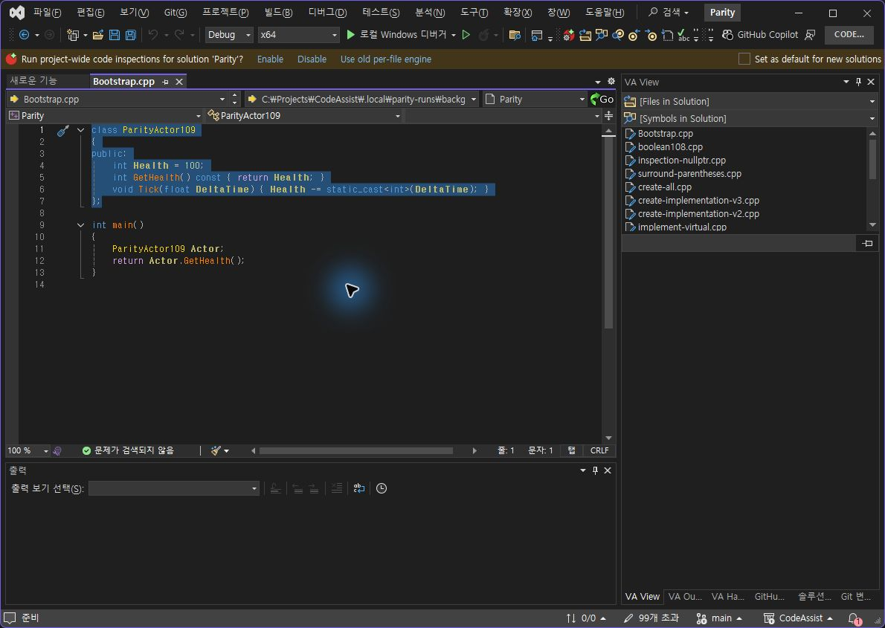](../assets/imports/docs/validation/live-109/computer-use/request-156-1.jpg)

CA0.0.99: 클래스 이름 선택

[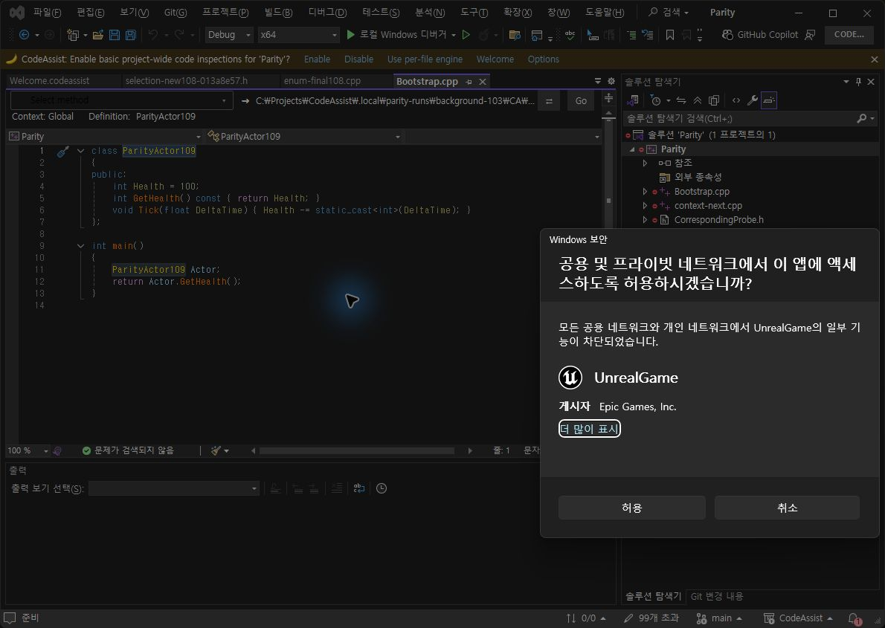](../assets/imports/docs/validation/live-109/computer-use/request-164-1.jpg)

다만 VA의 실제 명령 등록을 읽으니 비블록 확장·축소에는 키 배정이 없고 블록 확장·축소에만 Alt+] / Alt+[가 있었습니다. CA에는 네 조합이 배정되어 있습니다. 따라서 동일 명령이 실행됐다고 볼 수 없어 **기능 판정은 보류**합니다. 등록이 없는 키가 어떤 경로로 블록 선택에 도달했는지는 아직 확정하지 않았습니다.

| 원본 명령 | 실제 VA 배정 |
| --- | --- |
| VisualAssist.SmartSelectExtend | 배정 없음 |
| VisualAssist.SmartSelectShrink | 배정 없음 |
| VisualAssist.SmartSelectExtendBlock | 텍스트 편집기::Alt+] |
| VisualAssist.SmartSelectShrinkBlock | 텍스트 편집기::Alt+[ |

공식 문서상 기본 조합은 [VA Keyboard Shortcuts](https://www.wholetomato.com/documentation/configuration/keyboard-shortcuts)와 대조했습니다. 문서 기본값과 현재 검사 프로필의 배정값을 구분합니다.

## 자동 검사기 수정

실제 설치 명령 이름은 VisualAssist.*입니다. 기존 검사기는 VAssistX.*를 기준으로 탐색하여 새 이름을 누락할 수 있었습니다. 두 접두어만 같은 정확한 명령 이름으로 해석하도록 보완했습니다. 다른 확장의 유사 이름·누락·모호한 결과는 거절합니다.

- 명령 해석 회귀6/6 통과.

- 실제 저장된 VA명령4/4개의 이름 해석 통과.

- 검사기 빌드 성공. 새 검사기 명령을 VS에서 실행한 것으로 계산하지 않습니다.

- BackgroundWorker의 목록 수집도 두 접두어를 인식합니다. 다른 레거시 직접 실행 경로는 추가 점검이 필요합니다.

이번 물리 키 양쪽 입력 시도는 이전 Alt+M을 포함해 **2/22개·9.09%**입니다. 이전 목록 열기 관찰만 일치1/22개·4.55%로 유지하며, 새 판정보류를 일치로 더하지 않습니다. 전체 제품 동기화율이 아닙니다.

이번 판정·원시 결과 · VA실제 선택·키 배정 · CA실제 선택·키 배정 · 실제 목록 이름 해석 · 검사기 빌드

제안 시간10~15분. 시작2026-10-23 01:27:39 KST. 이번 결과 기록2026-10-23T01:40:11.339275+09:00. 화면 실행 검증은 보안 창 처리 후 계속합니다. XERJ검색 사용, 오래된 검색 결과는 현재 소스로 보완했습니다.

---

## 현재 검사 설치: CA0.0.99 — 옵션 배치 수정·실행 확인

갱신 2026-10-23T01:26:51.255445+09:00

전체 목표는 진행 중입니다. 아래 원본과 수정 화면을 대조했습니다. 이후의0.0.98 탐색 기록은 해당 버전의 실행 증거로 보존했으며0.0.99의 새 통과로 계산하지 않습니다.

## 이번 결과

- 두 옵션 페이지에 한정한 구조 체크 **9/14항목,64.29%**. 모든 UI의 유사도가 아닙니다.

- CA입력 검증·종속 항목·취소 동작 **4/4개,100%**. VA기능 일치율이 아닙니다.

- 현재 설치 바이너리6/6 일치, VS2019·Modern 빌드 통과, 회귀288/288통과.

- 원본VA프로세스21064는 옵션 종료 시점에 충돌 이벤트를 남겼습니다. 원인은 미확인입니다. 새 검사 프로세스52636으로 재시작했습니다.

- 저장된 환경 설정은 변경하지 않았습니다. 검사 입력값은 취소했습니다.

## Editor — 원본과 현재 설치

VA 현재 Editor

[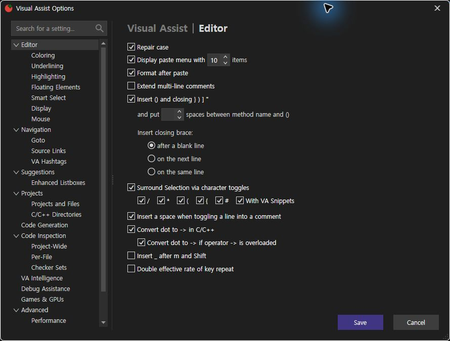](../assets/imports/docs/validation/live-109/computer-use/request-126-2.jpg)

CA0.0.99 Editor: 유효 숫자10 복원 후

[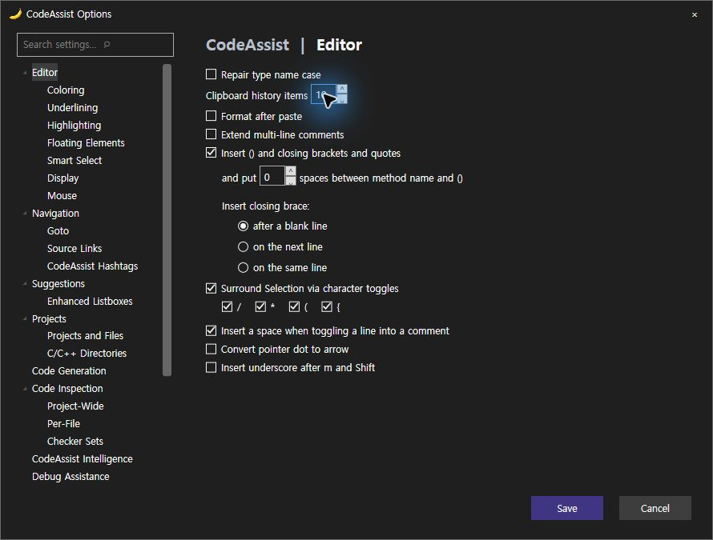](../assets/imports/docs/validation/live-109/computer-use/request-147-2.jpg)

## Suggestions — 원본과 현재 설치

VA 현재 Suggestions

[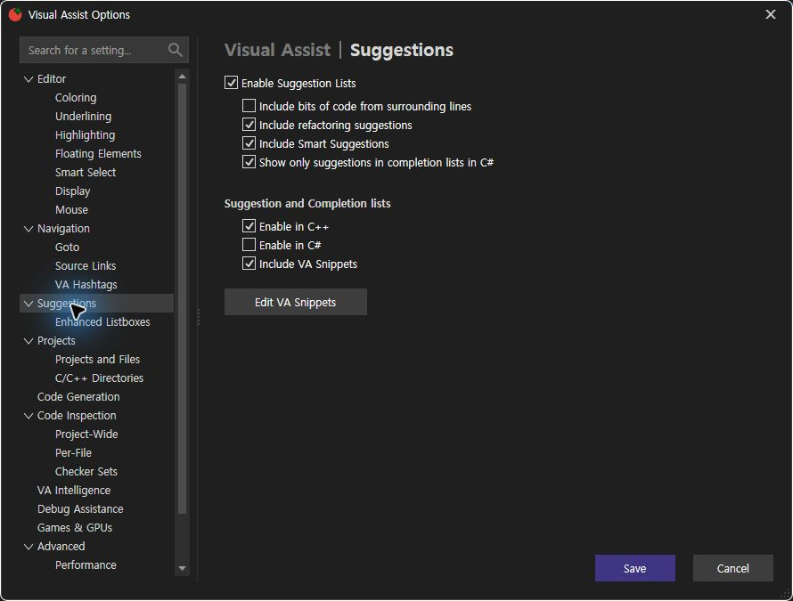](../assets/imports/docs/validation/live-109/computer-use/request-127-2.jpg)

CA0.0.99 Suggestions: 지원 설정 그룹 재배치

[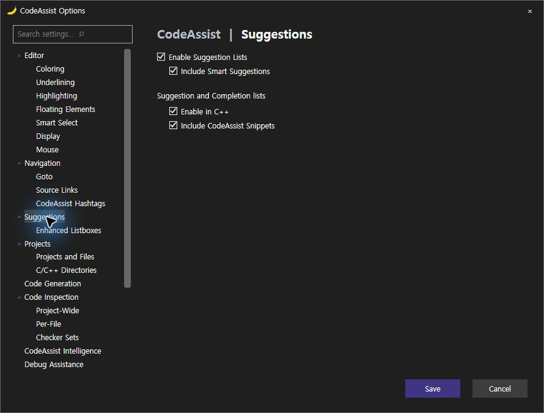](../assets/imports/docs/validation/live-109/computer-use/request-148-2.jpg)

## 구조 체크: 각1점

누락 항목은 불일치로 계산했습니다. 같은 틀과 일부 설정 배치를 맞췄다는 의미이며, 모든 옵션 동등성으로 해석하지 않습니다.

| 구조 기준 | 판정 |
| --- | --- |
| 외곽 크기890×675 | 일치 |
| 왼쪽 검색·트리 / 오른쪽 본문 배치 | 일치 |
| 상단 섹션 제목 위치·활성 제목 강조 | 일치 |
| Editor 기본 체크박스 순서 | 일치 |
| 클립보드 수 같은 줄 증감 입력 | 일치 |
| 메서드 괄호 공백 같은 줄 증감 입력 | 일치 |
| 닫는 괄호3개 라디오 그룹·들여쓰기 | 일치 |
| Suggestions 추천 그룹과 C++완성 그룹 분리 | 일치 |
| 하단 오른쪽 저장·취소 배치 | 일치 |
| 붙여넣기 메뉴 활성화 체크박스 | 차이 / 미구현 |
| 둘러싸기 # / 스니펫 항목 | 차이 / 미구현 |
| 연산자 오버로드 변환 하위 옵션 | 차이 / 미구현 |
| 키 반복 속도 옵션 | 차이 / 미구현 |
| Suggestions 전체 항목·스니펫 편집 버튼 | 차이 / 미구현 |

## 실제 CA동작 검사

| 검사 | 결과 | 실행 증거 |
| --- | --- | --- |
| 범위 밖 클립보드 수0 → Save 비활성 | 확인 | 관찰138 |
| 10으로 복원 → Save 활성 | 확인 | 관찰147 |
| 추천 목록 끄기 → Smart 하위 항목 비활성 | 확인 | 관찰149 |
| Escape 취소 → 옵션 닫힘 | 확인 | 관찰150 |

이번 구조·동작 원시 결과 · 실제 설치 확인 · 회귀 검사 · VA프로세스 충돌 이벤트

제안 시간10~15분. 시작2026-10-23 01:13:48 KST, 이번 기록 완료2026-10-23T01:26:51.255445+09:00. 전체 목표는 미완료입니다.

---

## 아래는 직전0.0.98 검사 기록입니다

## VA·CA 실제 화면·탐색 대조 — CA0.0.98

갱신 2026-10-23T01:13:21.621784+09:00

지속 목표는 진행 중입니다. Computer Use 연결 복구와 검사 프로필 최신 설치를 확인했습니다. Windows 보안 창은 종료되어 검사를 재개했습니다. 전체108개 검증 완료를 뜻하지 않습니다.

## 현재 확인한 결과

- 메서드 목록 네 항목의 실제 도착 위치: **4/4, 100%** 일치.

- 이 목록에 한정한 자체 UI 체크: **8/9, 88.89%**. 글자색·선택 강조색 차이가 남아 있습니다. 전체 UI 유사도 점수가 아닙니다.

- 실제 키 입력 관찰: Alt+M **1/22, 4.55%**. 나머지 키는 이번 실행에서 통과 처리하지 않았습니다.

- 설치 바이너리 **6/6** 일치. VS2019·Modern 빌드 통과. 실제 IDE 대조는 VS2022입니다.

- 회귀 테스트 **288/288** 통과. 이를 VA 기능 일치 점수에 합산하지 않습니다.

- 문서 기반 부분 명세 **108/108, 100%**. 전체 역분석 완료율이 아닙니다.

## 실제 선택 결과

동일한 C++ 파일 SHA256 8a9d8ad69a16fb6813230be6b2db5a5717d5deb55b426b092465777af2884188를 사용했습니다. 행·문자 위치는 선택 후 안정된 상태에서 다시 관찰했습니다. VA와 CA의 실제 실행 결과만 대조했습니다.

| 항목 | VA 행:문자 | CA0.0.98 행:문자 | 판정 | 실행 근거 |
| --- | --- | --- | --- | --- |
| GetHealth | 5:15 | 5:15 | 일치 | VA · CA |
| Tick | 6:11 | 6:11 | 일치 | VA · CA |
| ParityActor109 | 1:21 | 1:21 | 일치 | VA · CA |
| main | 9:9 | 9:9 | 일치 | VA · CA |

이전 CA0.0.97의 클래스 선택은 2행2열이었고, VA의 실제 선택은1행21열이었습니다. 0.0.98에서 식별자 끝으로 수정하고 재검증했습니다.

## 실제 목록: 이름·아이콘과 남은 색상 차이

VA 원본: 기본 글자색·선택 글자색

CA0.0.98: 심볼 색상은 표시되나 원본과 세부 차이

[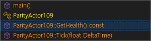](../assets/imports/docs/validation/live-109/computer-use/request-120-2.jpg)

## 클래스 이동 수정 후

VA: 1행21열

[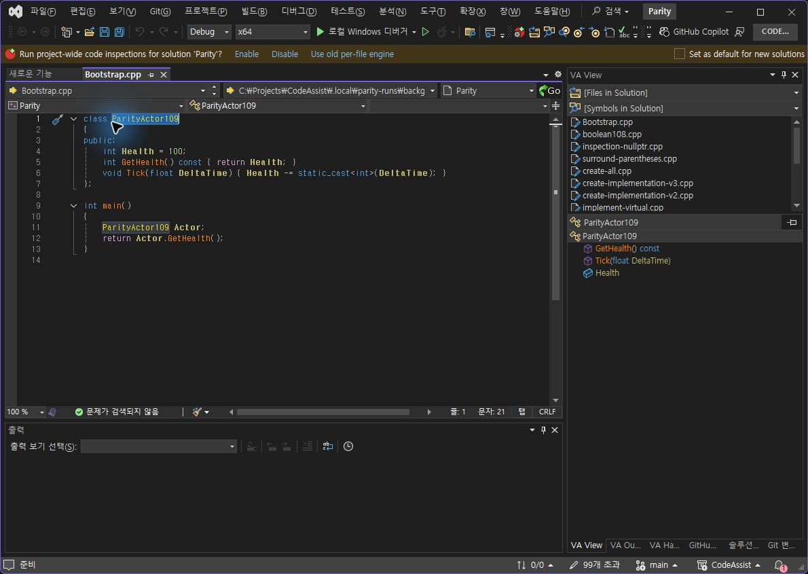](../assets/imports/docs/validation/live-109/computer-use/request-100-1.jpg)

CA0.0.98: 1행21열

[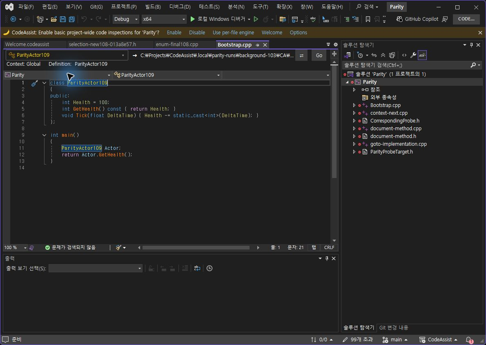](../assets/imports/docs/validation/live-109/computer-use/request-111-1.jpg)

## Tick 이동 대조

VA: 6행11열

[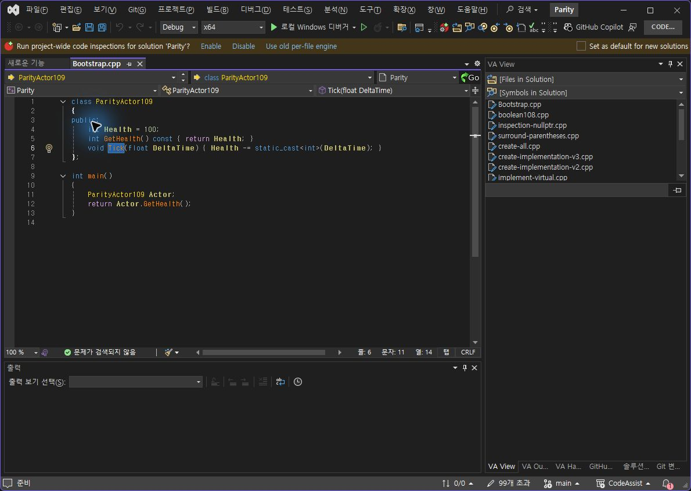](../assets/imports/docs/validation/live-109/computer-use/request-093-1.jpg)

CA0.0.98: 6행11열

[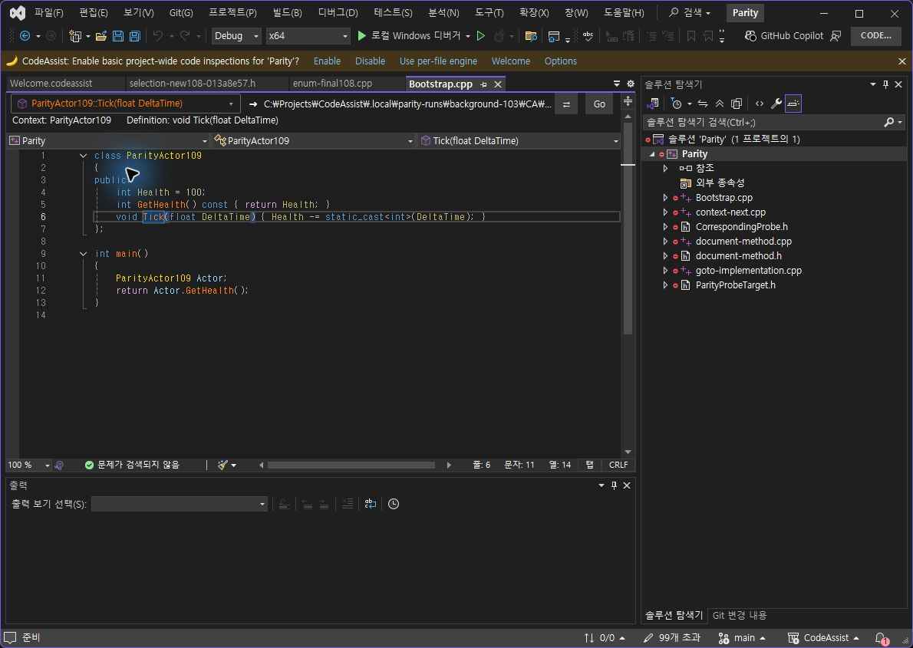](../assets/imports/docs/validation/live-109/computer-use/request-121-1.jpg)

## 한정된 UI 판정표

각 항목 동일 가중치1점, 위치·크기 허용8px. 전체 제품 점수로 사용하지 않습니다.

| 항목 | 판정 |
| --- | --- |
| Alt+M으로 작은 목록 열기 | 일치 |
| 왼쪽 탐색 막대 앵커: 기존 촬영 차이 6×3px | 일치 |
| 너비: VA 299px / CA 300px | 일치 |
| 높이: VA 74px / CA 82px, 허용 8px | 일치 |
| 클래스 포함 4개 항목 | 일치 |
| 표시 이름·서명·순서 4/4 | 일치 |
| 클래스/함수 아이콘 종류 | 일치 |
| 기본 글자색·선택 강조색 | 차이 |
| 접근성 이름에 실제 표시 이름 노출 | 일치 |

## 아직 다른 Editor 옵션 구성

VA Editor

[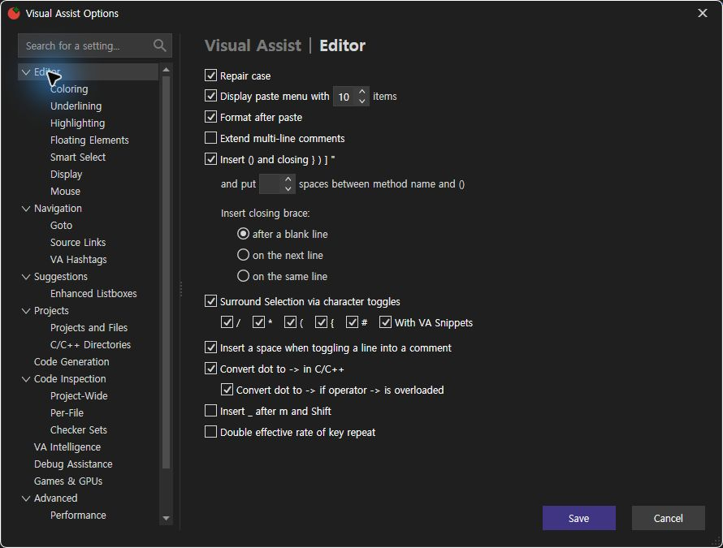](../assets/imports/docs/validation/live-109/computer-use/request-025-5.jpg)

CA0.0.95 관찰: 이후 옵션 소스 미수정, 최신 화면 재확인 필요

[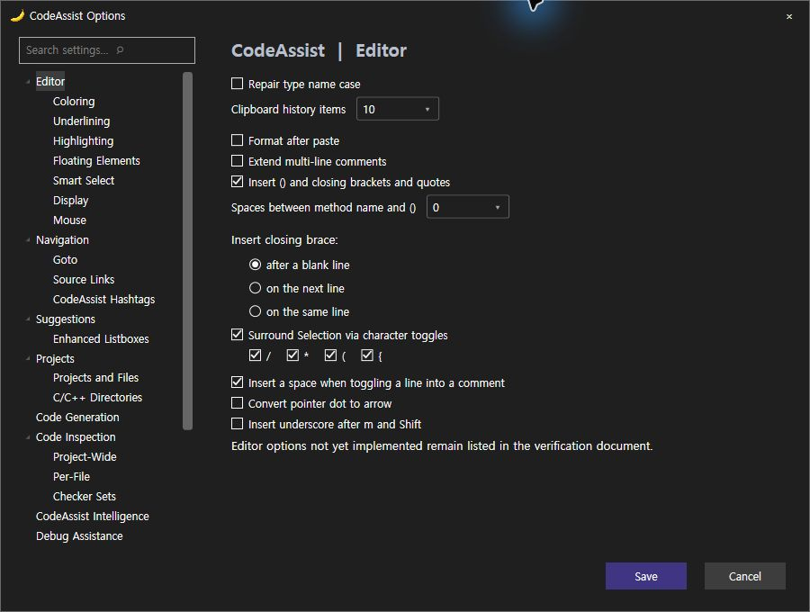](../assets/imports/docs/validation/live-109/computer-use/request-021-5.jpg)

## 아직 다른 Suggestions 옵션 구성

VA Suggestions

[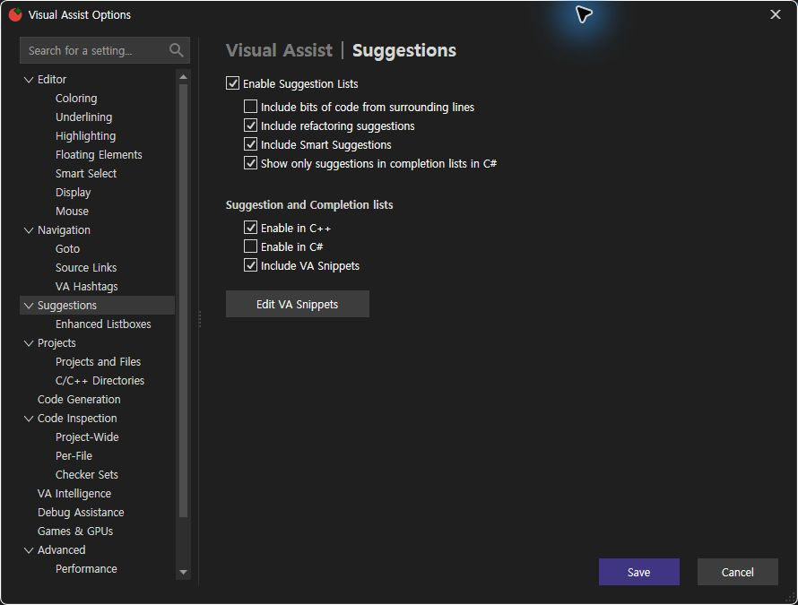](../assets/imports/docs/validation/live-109/computer-use/request-018-5.jpg)

CA0.0.95 관찰: 이후 옵션 소스 미수정, 최신 화면 재확인 필요

[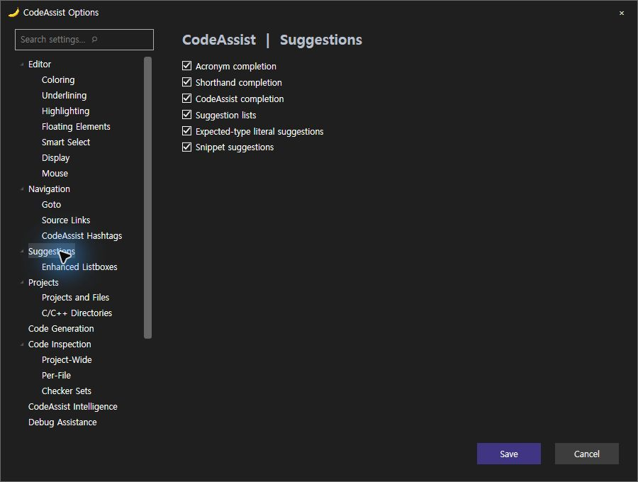](../assets/imports/docs/validation/live-109/computer-use/request-023-5.jpg)

## 108개 전체 범위

현재 회차에서 모든 조건을 인증한 기능은 **0/108(0%)**입니다. 이는 미구현률이 아니라 전체 조건 검증 완료 개수입니다. 한 목록의4개 이동 일치를108개 전체 일치율로 바꾸지 않습니다. 과거17/108 기록도 현재 버전 점수로 재사용하지 않습니다.

| ID | 기능 | 현재 회차 |
| --- | --- | --- |
| VA-F001 | Find by Context | 현재 회차 실행 미완료 |
| VA-F002 | Find References | 현재 회차 실행 미완료 |
| VA-F003 | Find Symbol in Solution | 현재 회차 실행 미완료 |
| VA-F004 | GoTo Implementation | 현재 회차 실행 미완료 |
| VA-F005 | GoTo Member | 현재 회차 실행 미완료 |
| VA-F006 | GoTo Related | 현재 회차 실행 미완료 |
| VA-F007 | Highlight Current Line | 현재 회차 실행 미완료 |
| VA-F008 | List Methods in File | 부분 실행: 목록4항목 실제 탐색 일치; 전체 경계·설정 조건 미검증 |
| VA-F009 | Move Scope | 현재 회차 실행 미완료 |
| VA-F010 | Navigate Back and Forward | 현재 회차 실행 미완료 |
| VA-F011 | Open Corresponding File | 현재 회차 실행 미완료 |
| VA-F012 | Open File in Solution | 현재 회차 실행 미완료 |
| VA-F013 | VA Hashtags | 현재 회차 실행 미완료 |
| VA-F014 | VA Navigation Bar | 현재 회차 실행 미완료 |
| VA-F015 | Access to Refactoring Commands | 현재 회차 실행 미완료 |
| VA-F016 | Change Signature | 현재 회차 실행 미완료 |
| VA-F017 | Convert Between Pointer and Instance | 현재 회차 실행 미완료 |
| VA-F018 | Encapsulate Field | 현재 회차 실행 미완료 |
| VA-F019 | Extract Method | 현재 회차 실행 미완료 |
| VA-F020 | Introduce Variable | 현재 회차 실행 미완료 |
| VA-F021 | Move Implementation to Header File | 현재 회차 실행 미완료 |
| VA-F022 | Move Implementation to Source File | 현재 회차 실행 미완료 |
| VA-F023 | Move Method Implementations to Source File | 현재 회차 실행 미완료 |
| VA-F024 | Move Selection to New File | 현재 회차 실행 미완료 |
| VA-F025 | Rename | 현재 회차 실행 미완료 |
| VA-F026 | Rename Files | 현재 회차 실행 미완료 |
| VA-F027 | Simplify Instance Declaration | 현재 회차 실행 미완료 |
| VA-F028 | Add Forward Declaration | 현재 회차 실행 미완료 |
| VA-F029 | Add Member | 현재 회차 실행 미완료 |
| VA-F030 | Add Missing Case Statements | 현재 회차 실행 미완료 |
| VA-F031 | Add Similar Member | 현재 회차 실행 미완료 |
| VA-F032 | Add Using Directive | 현재 회차 실행 미완료 |
| VA-F033 | Add include Directive | 현재 회차 실행 미완료 |
| VA-F034 | Add/Remove Braces | 현재 회차 실행 미완료 |
| VA-F035 | Create Declaration | 현재 회차 실행 미완료 |
| VA-F036 | Create File | 현재 회차 실행 미완료 |
| VA-F037 | Create from Usage | 현재 회차 실행 미완료 |
| VA-F038 | Create Implementation | 현재 회차 실행 미완료 |
| VA-F039 | Create Method Implementations | 현재 회차 실행 미완료 |
| VA-F040 | Document Method | 현재 회차 실행 미완료 |
| VA-F041 | Implement Interface / Virtual Methods | 현재 회차 실행 미완료 |
| VA-F042 | Acronyms | 현재 회차 실행 미완료 |
| VA-F043 | Auto-Extend Multi-Line Comments | 현재 회차 실행 미완료 |
| VA-F044 | Enhanced Listboxes | 현재 회차 실행 미완료 |
| VA-F045 | Format After Paste | 현재 회차 실행 미완료 |
| VA-F046 | Insert () and Closing Brackets and Quotes | 현재 회차 실행 미완료 |
| VA-F047 | Insert _ After m and Shift | 현재 회차 실행 미완료 |
| VA-F048 | Multiple Clipboards | 현재 회차 실행 미완료 |
| VA-F049 | Reset Editor Zoom | 현재 회차 실행 미완료 |
| VA-F050 | Shorthand | 현재 회차 실행 미완료 |
| VA-F051 | Smart Select | 현재 회차 실행 미완료 |
| VA-F052 | Smart Suggestions | 현재 회차 실행 미완료 |
| VA-F053 | Sort Selected Lines | 현재 회차 실행 미완료 |
| VA-F054 | Suggestion Lists | 현재 회차 실행 미완료 |
| VA-F055 | Surround Selection | 현재 회차 실행 미완료 |
| VA-F056 | Surround With | 현재 회차 실행 미완료 |
| VA-F057 | Column Indicator | 현재 회차 실행 미완료 |
| VA-F058 | Context Field | 현재 회차 실행 미완료 |
| VA-F059 | Definition Field | 현재 회차 실행 미완료 |
| VA-F060 | Enhanced Syntax Coloring | 현재 회차 실행 미완료 |
| VA-F061 | Local Symbols in Bold | 현재 회차 실행 미완료 |
| VA-F062 | Highlight Find Results | 현재 회차 실행 미완료 |
| VA-F063 | Highlight Matching Words | 현재 회차 실행 미완료 |
| VA-F064 | Highlight References to Symbol Under Cursor | 현재 회차 실행 미완료 |
| VA-F065 | Parameter Info | 현재 회차 실행 미완료 |
| VA-F066 | Print in Color | 현재 회차 실행 미완료 |
| VA-F067 | Quick Info | 현재 회차 실행 미완료 |
| VA-F068 | System Symbols in Italics | 현재 회차 실행 미완료 |
| VA-F069 | Convert Dot to -> | 현재 회차 실행 미완료 |
| VA-F070 | Highlight Files in Output Window | 현재 회차 실행 미완료 |
| VA-F071 | Highlight Matching Braces and Parentheses | 현재 회차 실행 미완료 |
| VA-F072 | Highlight Mismatching Braces and Parentheses | 현재 회차 실행 미완료 |
| VA-F073 | Repair Case | 현재 회차 실행 미완료 |
| VA-F074 | Underline Spelling Errors | 현재 회차 실행 미완료 |
| VA-F075 | Underline Unknown Symbols | 현재 회차 실행 미완료 |
| VA-F076 | Code Inspection Settings | 현재 회차 실행 미완료 |
| VA-F077 | Code Issues in the Editor | 현재 회차 실행 미완료 |
| VA-F078 | Quick Fixes in the Editor | 현재 회차 실행 미완료 |
| VA-F079 | Quick Fixes in a Tool Window | 현재 회차 실행 미완료 |
| VA-F080 | VA Snippets | 현재 회차 실행 미완료 |
| VA-F081 | for Refactoring | 현재 회차 실행 미완료 |
| VA-F082 | for Smart Suggestions | 현재 회차 실행 미완료 |
| VA-F083 | for Surround With | 현재 회차 실행 미완료 |
| VA-F084 | with Shortcuts | 현재 회차 실행 미완료 |
| VA-F085 | Create from Selection | 현재 회차 실행 미완료 |
| VA-F086 | Environment Placeholders | 현재 회차 실행 미완료 |
| VA-F087 | Input Placeholders | 현재 회차 실행 미완료 |
| VA-F088 | Reserved Strings | 현재 회차 실행 미완료 |
| VA-F089 | Address Resolver | 현재 회차 실행 미완료 |
| VA-F090 | PDB Explorer | 현재 회차 실행 미완료 |
| VA-F091 | VA Memory View | 현재 회차 실행 미완료 |
| VA-F092 | VA Step Filter | 현재 회차 실행 미완료 |
| VA-F093 | VA Outline | 현재 회차 실행 미완료 |
| VA-F094 | VA View | 현재 회차 실행 미완료 |
| VA-F095 | Simple Link Patterns | 현재 회차 실행 미완료 |
| VA-F096 | Complex Link Patterns | 현재 회차 실행 미완료 |
| VA-F097 | Connect to FogBugz and GitHub | 현재 회차 실행 미완료 |
| VA-F098 | Preview Files | 현재 회차 실행 미완료 |
| VA-F099 | Open Hyperlinks in an External Browser | 현재 회차 실행 미완료 |
| VA-F100 | Custom Plug-ins | 현재 회차 실행 미완료 |
| VA-F101 | Context Menus | 현재 회차 실행 미완료 |
| VA-F102 | Custom File Extensions | 현재 회차 실행 미완료 |
| VA-F103 | Keyboard Shortcuts | 현재 회차 실행 미완료 |
| VA-F104 | Mouse | 현재 회차 실행 미완료 |
| VA-F105 | Multiple Platforms | 현재 회차 실행 미완료 |
| VA-F106 | Non-Microsoft Build Processes | 현재 회차 실행 미완료 |
| VA-F107 | Parse Concurrency | 현재 회차 실행 미완료 |
| VA-F108 | Options Dialog | 부분 관찰: Editor/Suggestions 구성 차이; 모든 페이지·저장 검증 필요 |

## 다음 반복 검증

- 목록 기본 글자색·선택 강조색을 원본과 맞추고 다크/라이트 테마를 대조합니다.

- Editor/Suggestions 옵션 그룹·항목·위치를 맞추고 실제 토글 적용을 검사합니다.

- 다른 기능 시나리오·물리 단축키를 확대합니다. 실패·미판정·미실행·무반응을 통과로 계산하지 않습니다.

[100%에 최대한 가까워질 때까지 반복 검증하는 지속 목표](../assets/imports/docs/validation/live-parity-goal.md)

기계 판독 결과 · 현재 설치 검증 · 현재 회귀 테스트 · [이전 비교 기록](../assets/imports/docs/validation/live-109/index-before-098.html) · 원본 촬영 해시

사용 — DocumentMemberMenu 검색은 신규 파일을 누락하여 현재 파일 직접 읽기로 보완; 검색 결과를 실행 증거로 취급하지 않음

이번 재개 시작2026-10-23 01:00:16 KST. 최초 상태 점검 예상1분 이내였고, 보안 창 종료 확인 후 설치·실행 검증으로 이어졌습니다. 전체 목표는 미완료입니다. 이 기록의 갱신 시각은 위와 같습니다.

## 원문과 편집 이력

[보존된 원문 열기](../assets/imports/docs/validation/live-109/index-before111.html)

- 원문 SHA-256: `feb92a1848e2648611536af660f1452df33459c3e9074e9ee5522b9aea6f0593`
- 표시 날짜는 원본 파일의 수정 시각입니다. 작업 완료 시각은 원문에 있는 값을 기준으로 확인합니다.
