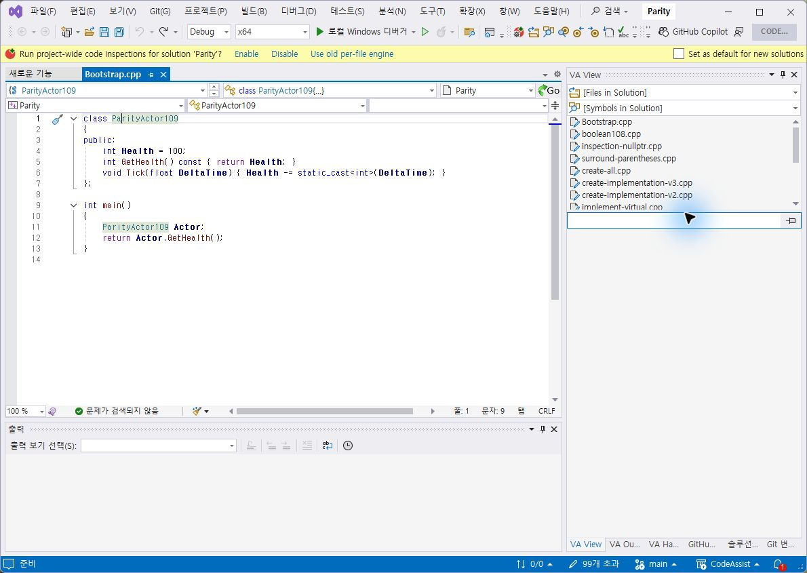
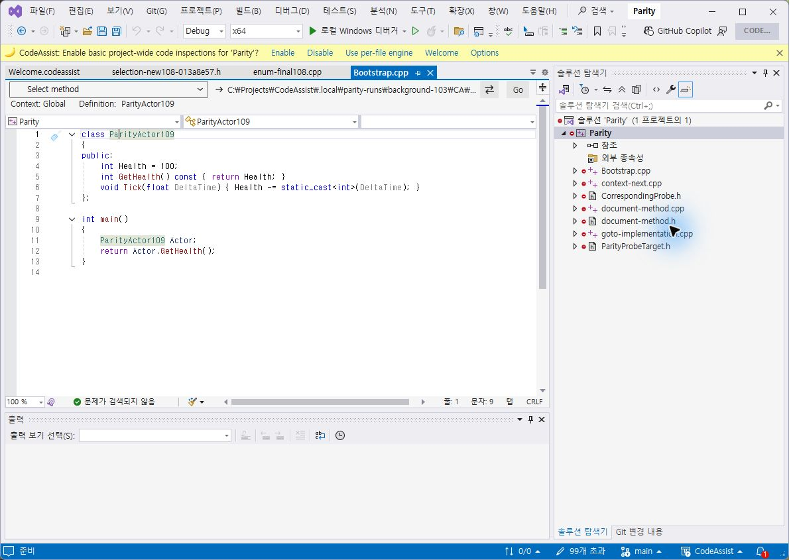
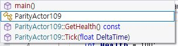
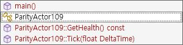
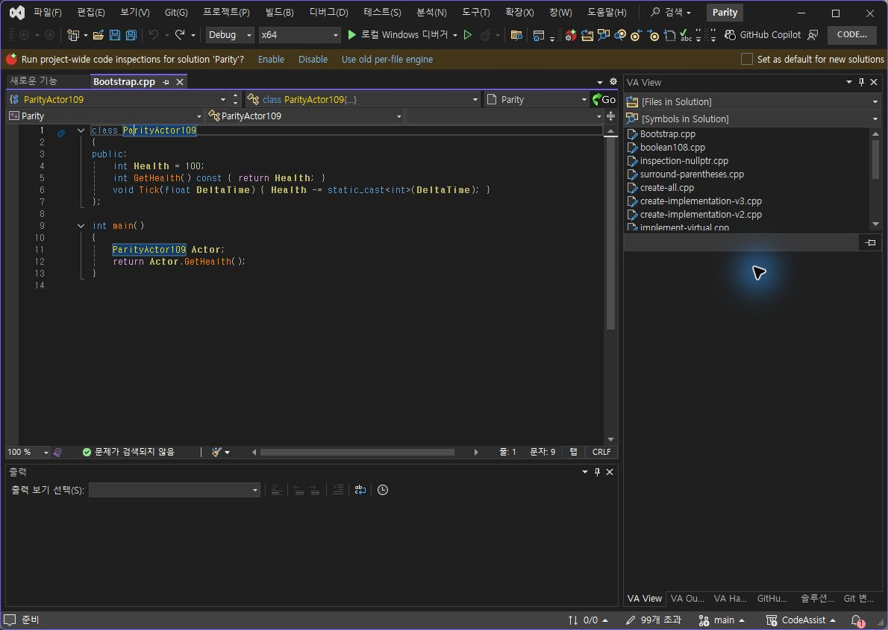
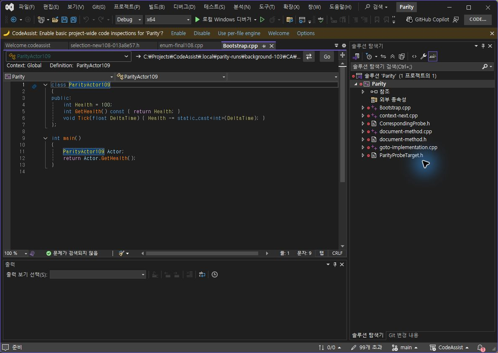

> 보관 기록입니다. 아래 결과는 원문 작성 시점의 내용이며, 이번 편집에서 제품 테스트를 다시 실행하지 않았습니다.

0.0.109 라이트 대비·테마 갱신

## 0.0.109 실제 라이트 대비 · 다크 복귀

기본 팔레트에만 라이트용 색상을 적용하고 사용자 지정 색상은 보존했습니다. VS 테마 변경 이벤트에서 편집기 분류 색상을 다시 적용합니다. 추천·메서드 목록도 같은 기본 팔레트 정책을 사용하지만 추천 팝업 자체의 새 실행 검증은 남아 있습니다.

## VA / CA 실제 라이트 편집기

CA 기본 타입은 어두운 청록, 함수는 어두운 빨강, 변수는 검정으로 표시됩니다. 기본 라이트 색상 4종의 흰 배경 대비 4.5:1 이상, 사용자 지정 색상 보존, 다크 색상 유지 등을 포함해 Core 301/301 테스트가 통과했습니다. 세부 굵기·동일 RGB 전체 일치로 확대하지 않습니다.

## VA / CA 라이트 메서드 선택

클립보드와 메서드 선택 팔레트를 분리해 메서드는 양쪽 모두 흰 선택 배경입니다. VA의 파란 테두리와 CA의 회색 테두리 등 세부 차이는 남았습니다.

## 다크 복구 후

테마 변경 뒤 CA의 기본 노랑·주황으로 복귀하는 것을 실제 확인했습니다. 양쪽 검사 프로필은 원래 다크로 복구했습니다.

이번 수정 항목 확인 3/3(100%): 라이트 가독성, 다크 복귀, 메서드 흰 선택 배경. 전체 제품 동기화율이 아닙니다. VS2019·Modern 빌드 통과, 검사 프로필 설치 바이너리 6/6 일치.

미완료: 선택 테두리·글꼴 차이, 실제 추천 팝업 재실행, 누락 옵션과 다른 메뉴, 전체 108개 기능의 현재 버전 실행 대조. 문서 부분 명세 확보율 108/108(100%)는 전체 역분석 완료율과 다릅니다.

판정 범위·촬영 해시 · 테스트 · 빌드 · 설치 검증

XERJ: 사용 — 분류 색상·호출 경로 검색 후 소스 및 실제 테마 전환으로 확인.

## 원문과 편집 이력

[보존된 원문 열기](../assets/imports/docs/validation/contrast-109/index.html)

- 원문 SHA-256: `c1a54bd25acc345844fc7d18e066f85fbe4a6aa4a5c0f6aaf4aa3ab456487c66`
- 표시 날짜는 원본 파일의 수정 시각입니다. 작업 완료 시각은 원문에 있는 값을 기준으로 확인합니다.
