> 보관 기록입니다. 아래 결과는 원문 작성 시점의 내용이며, 이번 편집에서 제품 테스트를 다시 실행하지 않았습니다.

108개 화면 대조

## 108개 자동 화면 수집·대조

{"expectedBeforeAfter": 432, "validBeforeAfter": 432, "captureCoveragePercent": 100.0, "counts": {"captured": 432}, "featureSimilarity": null, "warning": "Capture coverage is not functional pass rate or visual similarity. Dialog images are additional and counted separately.", "dialogImageGroups": {"VA": {"uniqueImages": 14, "duplicateGroups": [["feature-001", "feature-002", "feature-004", "feature-007", "feature-008", "feature-010", "feature-011", "feature-013", "feature-014", "feature-015"], ["feature-045", "feature-047", "feature-052", "feature-054", "feature-057", "feature-058", "feature-059", "feature-060", "feature-061", "feature-062", "feature-063", "feature-064", "feature-065", "feature-067", "feature-068", "feature-070", "feature-071", "feature-072", "feature-074", "feature-075", "feature-076", "feature-077", "feature-078", "feature-079", "feature-081", "feature-082", "feature-084", "feature-086", "feature-087", "feature-088", "feature-092", "feature-093", "feature-094", "feature-095", "feature-096", "feature-097", "feature-099", "feature-100", "feature-101", "feature-102", "feature-103", "feature-104", "feature-105", "feature-106", "feature-107", "feature-108"], ["feature-056", "feature-080", "feature-083"]]}, "CA": {"uniqueImages": 52, "duplicateGroups": [["feature-001", "feature-010", "feature-011", "feature-103"], ["feature-002", "feature-007", "feature-062", "feature-063", "feature-064", "feature-071", "feature-072"], ["feature-008", "feature-014", "feature-015", "feature-057", "feature-058", "feature-059", "feature-065", "feature-067", "feature-093", "feature-094", "feature-101"], ["feature-016", "feature-023"], ["feature-027", "feature-034"], ["feature-045", "feature-047", "feature-084", "feature-086", "feature-087", "feature-088", "feature-108"], ["feature-052", "feature-054", "feature-082"], ["feature-056", "feature-083"], ["feature-060", "feature-061", "feature-068"], ["feature-074", "feature-075"], ["feature-076", "feature-079"], ["feature-077", "feature-078"], ["feature-095", "feature-096", "feature-097", "feature-099", "feature-100"], ["feature-102", "feature-105"]]}}, "validDialogImages": 162, "totalValidImages": 594}

전체 유사도 미확인. 화면별 원본 링크를 열어 확대할 수 있습니다. 스크린샷만으로 기능 통과를 인증하지 않습니다.

| 항목 | VA | CA |
| --- | --- | --- |
| feature-001 Feature 1 | VA / before / captured      VA / dialog / captured      VA / after / captured   | CA / before / captured  [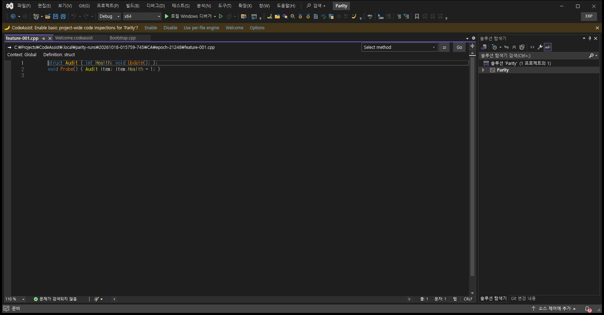](../assets/imports/docs/validation/automated-runner-20261018/20261018-015759-745/screenshots/CA-feature-001-before.png)    CA / dialog / captured      CA / after / captured  [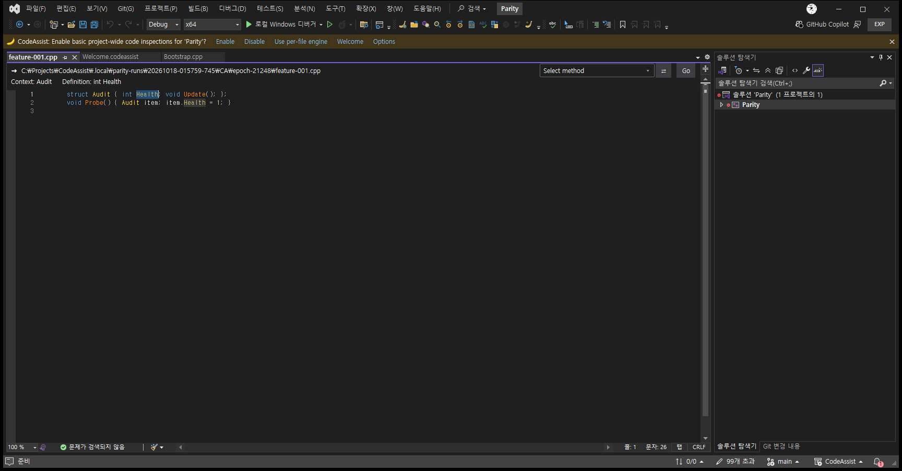](../assets/imports/docs/validation/automated-runner-20261018/20261018-015759-745/screenshots/CA-feature-001-after.png) |
| feature-002 Feature 2 | VA / before / captured      VA / dialog / captured  [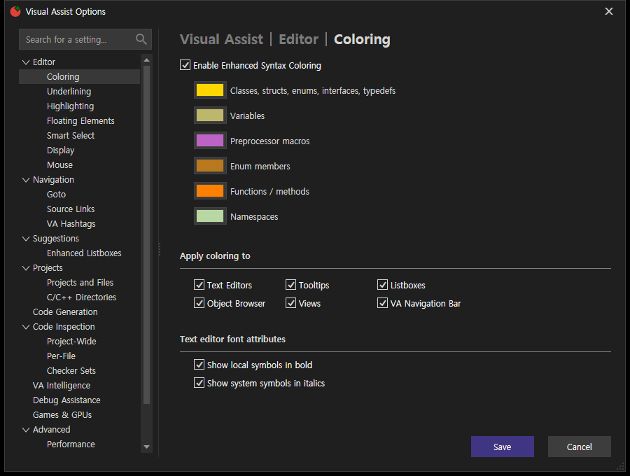](../assets/imports/docs/validation/automated-runner-20261018/20261018-015759-745/screenshots/VA-feature-002-dialog.png)    VA / after / captured  [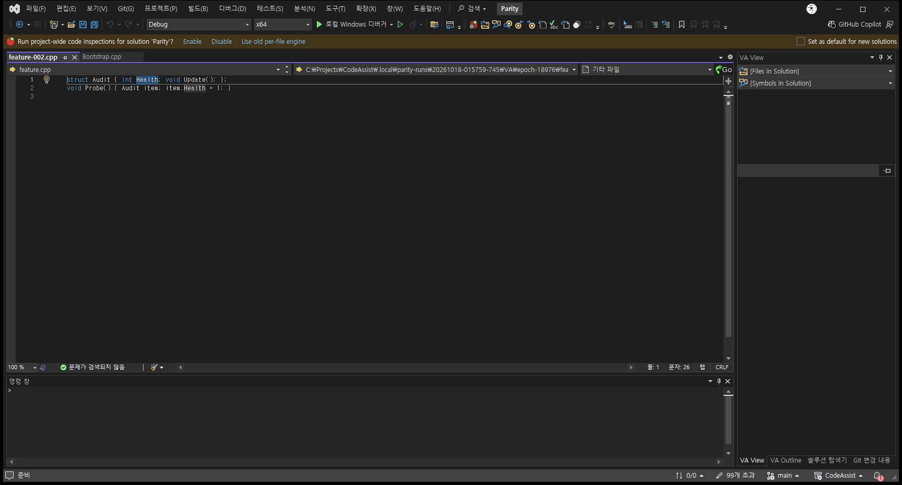](../assets/imports/docs/validation/automated-runner-20261018/20261018-015759-745/screenshots/VA-feature-002-after.png) | CA / before / captured      CA / dialog / captured      CA / after / captured   |
| feature-003 Feature 3 | VA / before / captured      VA / dialog / captured  [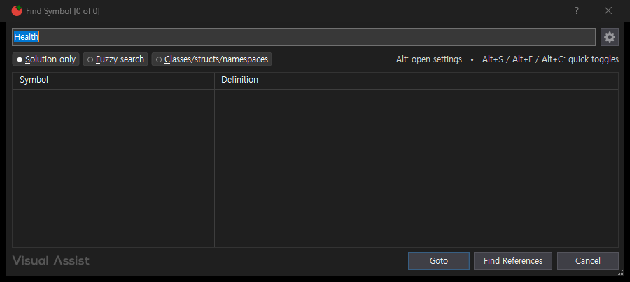](../assets/imports/docs/validation/automated-runner-20261018/20261018-015759-745/screenshots/VA-feature-003-dialog.png)    VA / after / captured  [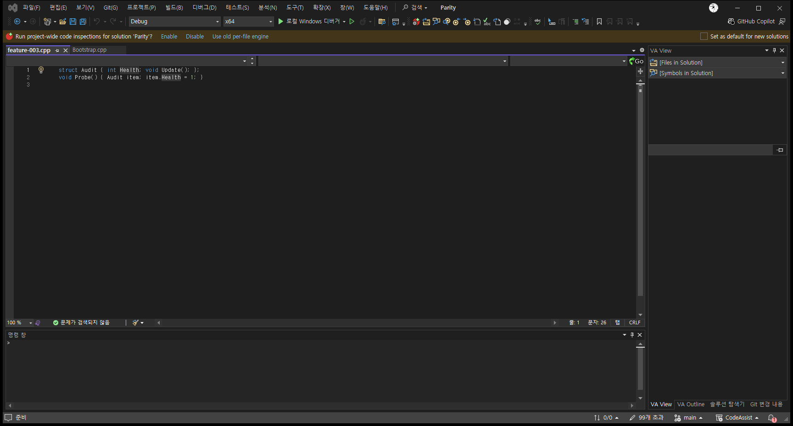](../assets/imports/docs/validation/automated-runner-20261018/20261018-015759-745/screenshots/VA-feature-003-after.png) | CA / before / captured      CA / dialog / captured  [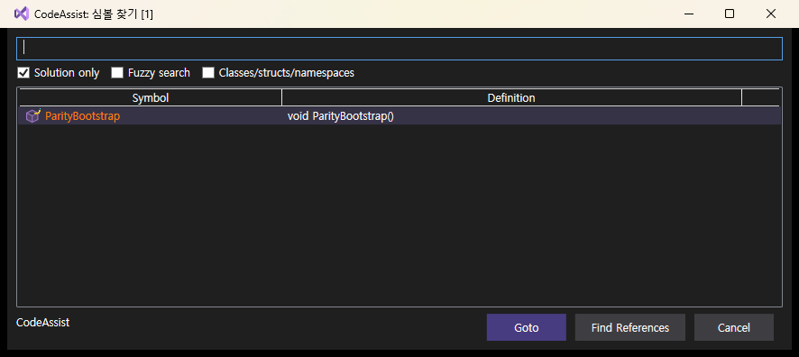](../assets/imports/docs/validation/automated-runner-20261018/20261018-015759-745/screenshots/CA-feature-003-dialog.png)    CA / after / captured   |
| feature-004 Feature 4 | VA / before / captured      VA / dialog / captured      VA / after / captured  [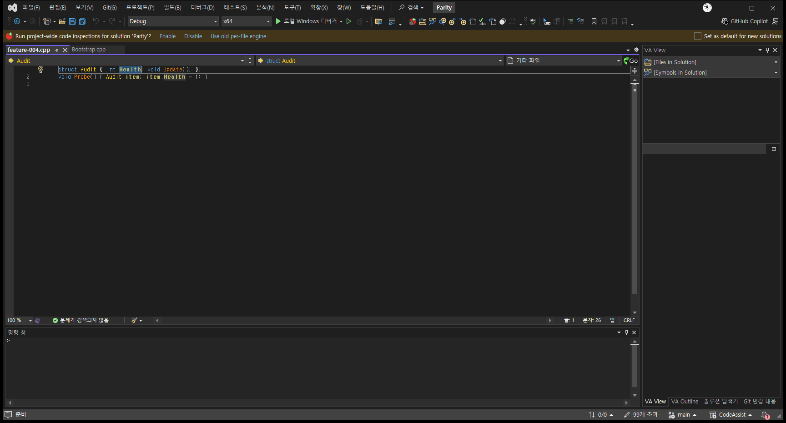](../assets/imports/docs/validation/automated-runner-20261018/20261018-015759-745/screenshots/VA-feature-004-after.png) | CA / before / captured      CA / dialog / captured  [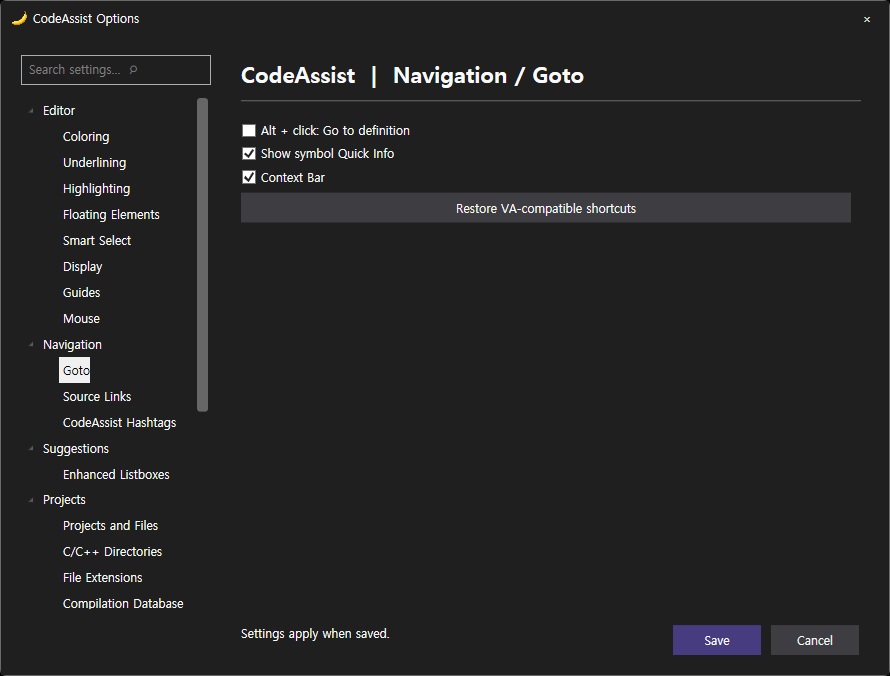](../assets/imports/docs/validation/automated-runner-20261018/20261018-015759-745/screenshots/CA-feature-004-dialog.png)    CA / after / captured   |
| feature-005 Feature 5 | VA / before / captured      VA / dialog / missing    VA / after / captured   | CA / before / captured      CA / dialog / captured  [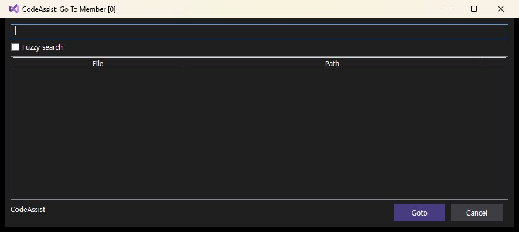](../assets/imports/docs/validation/automated-runner-20261018/20261018-015759-745/screenshots/CA-feature-005-dialog.png)    CA / after / captured   |
| feature-006 Feature 6 | VA / before / captured      VA / dialog / captured  [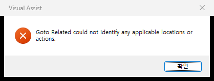](../assets/imports/docs/validation/automated-runner-20261018/20261018-015759-745/screenshots/VA-feature-006-dialog.png)    VA / after / captured  [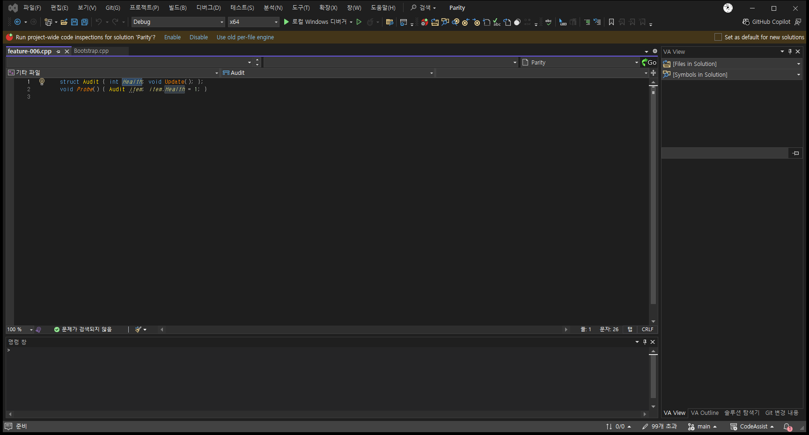](../assets/imports/docs/validation/automated-runner-20261018/20261018-015759-745/screenshots/VA-feature-006-after.png) | CA / before / captured      CA / dialog / captured  [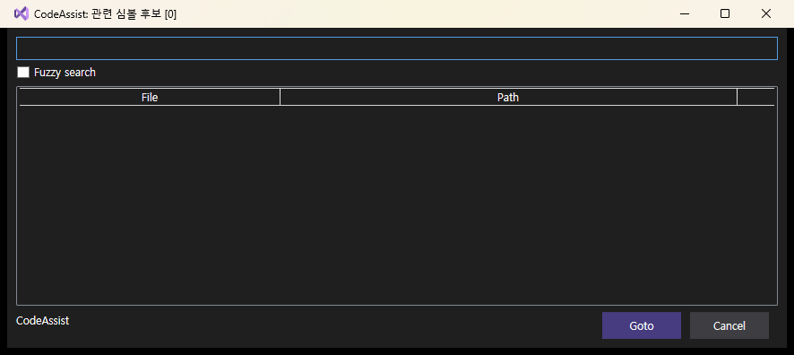](../assets/imports/docs/validation/automated-runner-20261018/20261018-015759-745/screenshots/CA-feature-006-dialog.png)    CA / after / captured   |
| feature-007 Feature 7 | VA / before / captured      VA / dialog / captured      VA / after / captured   | CA / before / captured      CA / dialog / captured      CA / after / captured   |
| feature-008 Feature 8 | VA / before / captured      VA / dialog / captured      VA / after / captured   | CA / before / captured      CA / dialog / captured      CA / after / captured   |
| scope-next Feature 9 | VA / before / captured      VA / dialog / missing    VA / after / captured   | CA / before / captured      CA / dialog / missing    CA / after / captured   |
| feature-010 Feature 10 | VA / before / captured      VA / dialog / captured      VA / after / captured   | CA / before / captured      CA / dialog / captured      CA / after / captured   |
| feature-011 Feature 11 | VA / before / captured  [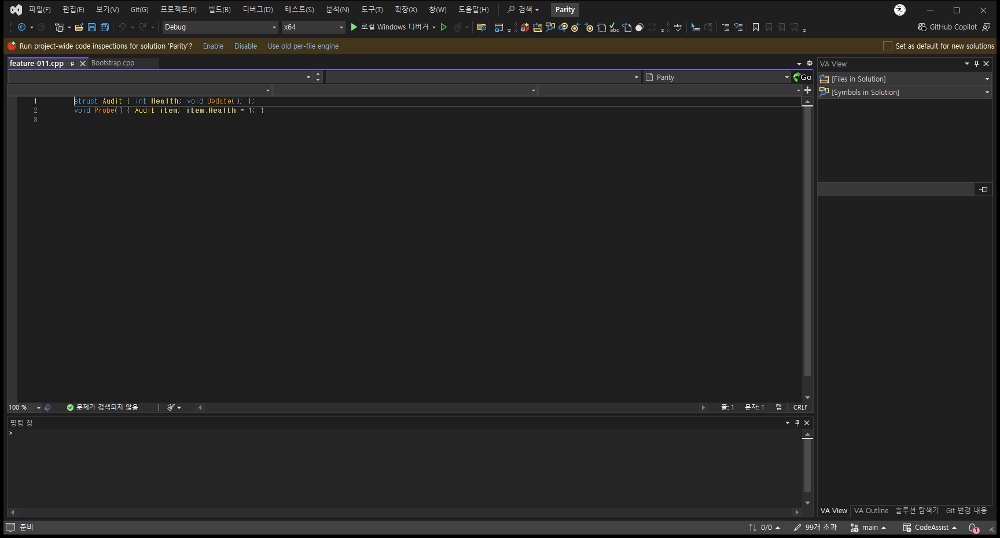](../assets/imports/docs/validation/automated-runner-20261018/20261018-015759-745/screenshots/VA-feature-011-before.png)    VA / dialog / captured      VA / after / captured   | CA / before / captured      CA / dialog / captured  [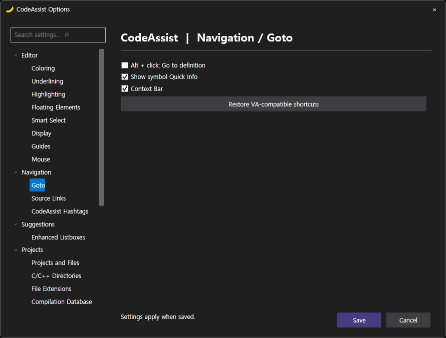](../assets/imports/docs/validation/automated-runner-20261018/20261018-015759-745/screenshots/CA-feature-011-dialog.png)    CA / after / captured   |
| feature-012 Feature 12 | VA / before / captured  [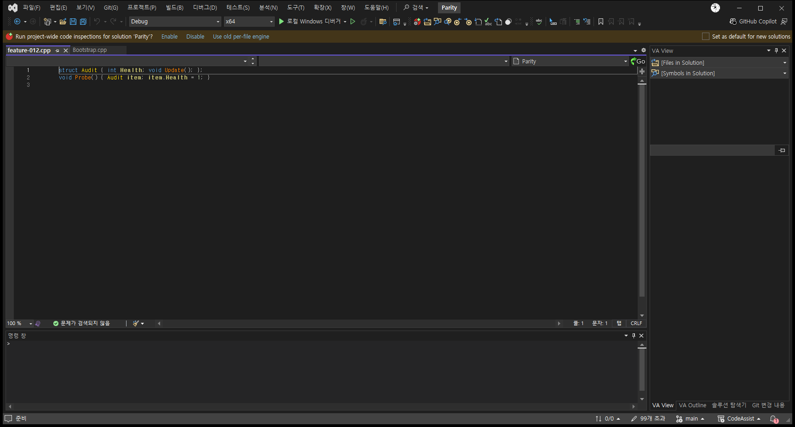](../assets/imports/docs/validation/automated-runner-20261018/20261018-015759-745/screenshots/VA-feature-012-before.png)    VA / dialog / captured  [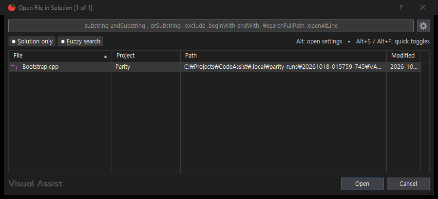](../assets/imports/docs/validation/automated-runner-20261018/20261018-015759-745/screenshots/VA-feature-012-dialog.png)    VA / after / captured   | CA / before / captured      CA / dialog / captured  [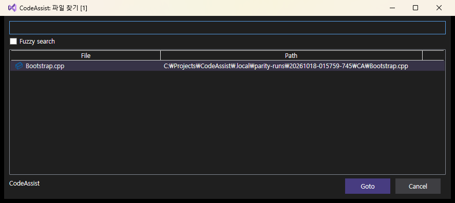](../assets/imports/docs/validation/automated-runner-20261018/20261018-015759-745/screenshots/CA-feature-012-dialog.png)    CA / after / captured   |
| feature-013 Feature 13 | VA / before / captured      VA / dialog / captured      VA / after / captured  [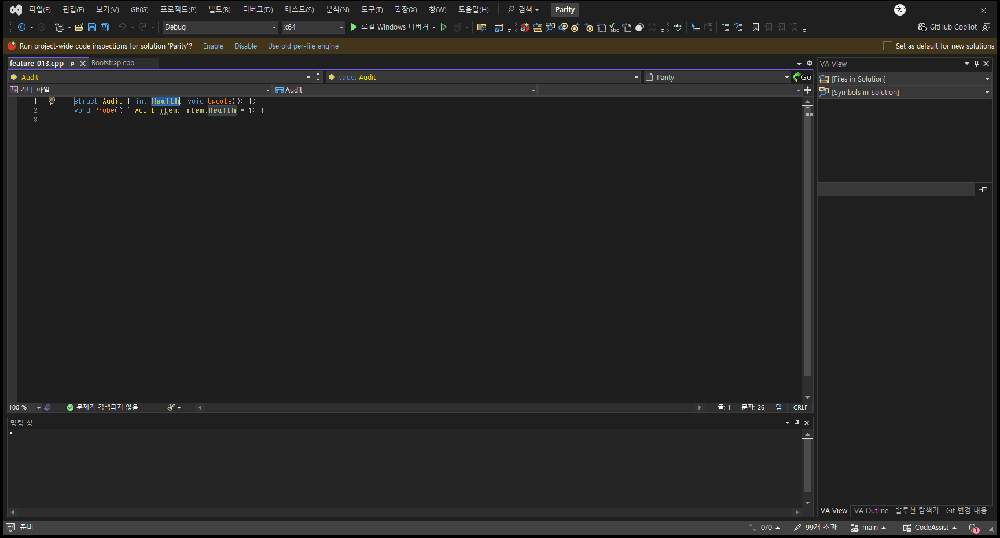](../assets/imports/docs/validation/automated-runner-20261018/20261018-015759-745/screenshots/VA-feature-013-after.png) | CA / before / captured      CA / dialog / captured  [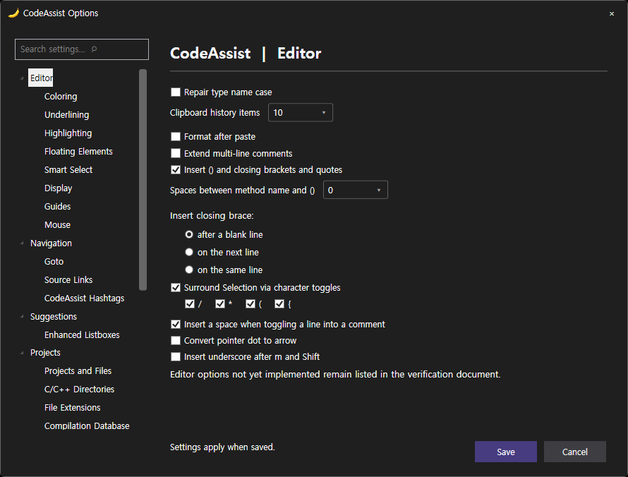](../assets/imports/docs/validation/automated-runner-20261018/20261018-015759-745/screenshots/CA-feature-013-dialog.png)    CA / after / captured   |
| feature-014 Feature 14 | VA / before / captured  [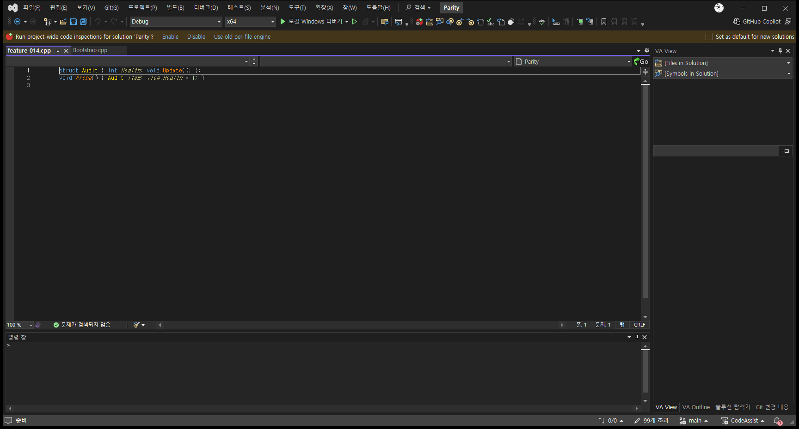](../assets/imports/docs/validation/automated-runner-20261018/20261018-015759-745/screenshots/VA-feature-014-before.png)    VA / dialog / captured      VA / after / captured   | CA / before / captured      CA / dialog / captured      CA / after / captured   |
| feature-015 Feature 15 | VA / before / captured      VA / dialog / captured      VA / after / captured   | CA / before / captured      CA / dialog / captured      CA / after / captured   |
| feature-016 Feature 16 | VA / before / captured      VA / dialog / missing    VA / after / captured  [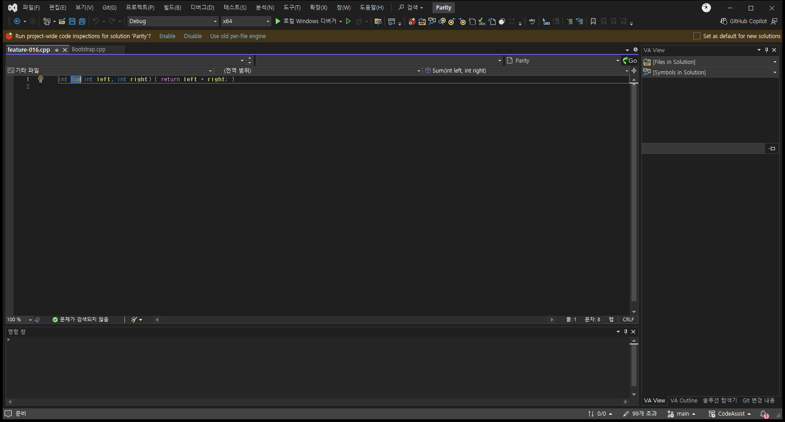](../assets/imports/docs/validation/automated-runner-20261018/20261018-015759-745/screenshots/VA-feature-016-after.png) | CA / before / captured      CA / dialog / captured      CA / after / captured   |
| feature-017 Feature 17 | VA / before / captured      VA / dialog / missing    VA / after / captured   | CA / before / captured      CA / dialog / captured  [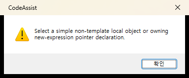](../assets/imports/docs/validation/automated-runner-20261018/20261018-015759-745/screenshots/CA-feature-017-dialog.png)    CA / after / captured   |
| feature-018 Feature 18 | VA / before / captured  [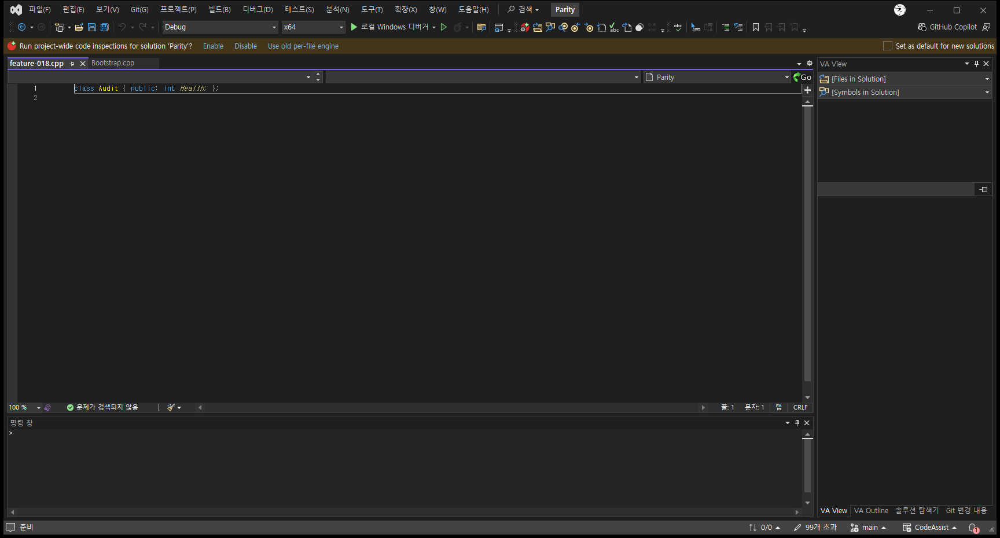](../assets/imports/docs/validation/automated-runner-20261018/20261018-015759-745/screenshots/VA-feature-018-before.png)    VA / dialog / missing    VA / after / captured  [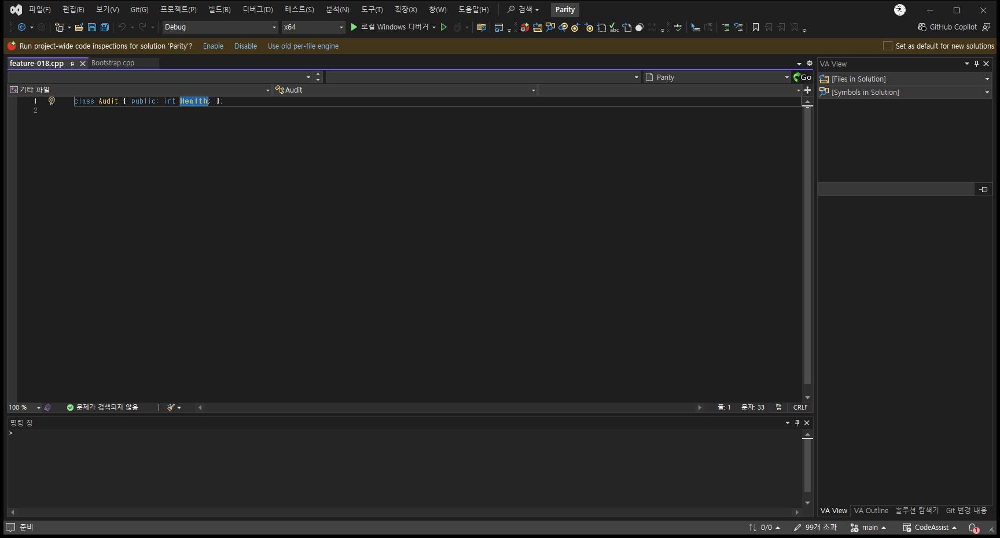](../assets/imports/docs/validation/automated-runner-20261018/20261018-015759-745/screenshots/VA-feature-018-after.png) | CA / before / captured      CA / dialog / captured  [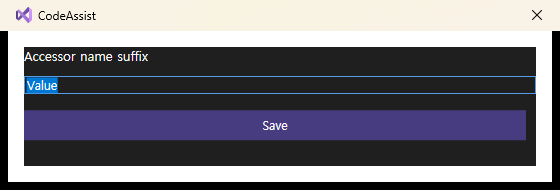](../assets/imports/docs/validation/automated-runner-20261018/20261018-015759-745/screenshots/CA-feature-018-dialog.png)    CA / after / captured   |
| feature-019 Feature 19 | VA / before / captured      VA / dialog / captured  [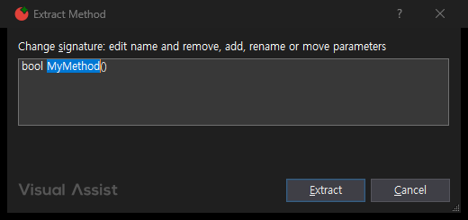](../assets/imports/docs/validation/automated-runner-20261018/20261018-015759-745/screenshots/VA-feature-019-dialog.png)    VA / after / captured  [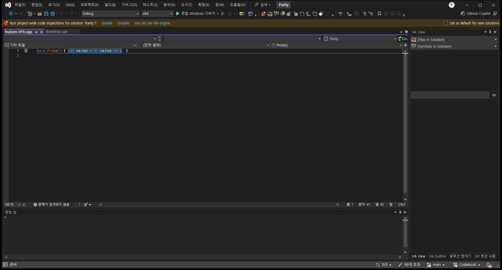](../assets/imports/docs/validation/automated-runner-20261018/20261018-015759-745/screenshots/VA-feature-019-after.png) | CA / before / captured      CA / dialog / captured  [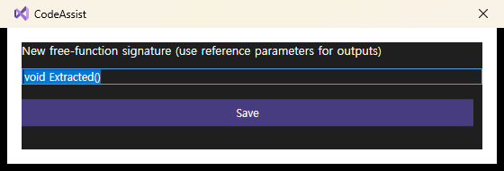](../assets/imports/docs/validation/automated-runner-20261018/20261018-015759-745/screenshots/CA-feature-019-dialog.png)    CA / after / captured  [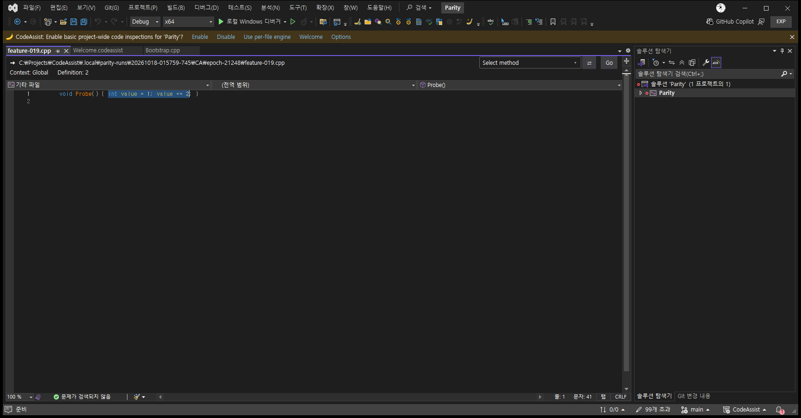](../assets/imports/docs/validation/automated-runner-20261018/20261018-015759-745/screenshots/CA-feature-019-after.png) |
| feature-020 Feature 20 | VA / before / captured      VA / dialog / missing    VA / after / captured   | CA / before / captured      CA / dialog / missing    CA / after / captured   |
| feature-021 Feature 21 | VA / before / captured      VA / dialog / missing    VA / after / captured   | CA / before / captured      CA / dialog / missing    CA / after / captured   |
| feature-022 Feature 22 | VA / before / captured      VA / dialog / missing    VA / after / captured   | CA / before / captured      CA / dialog / missing    CA / after / captured   |
| feature-023 Feature 23 | VA / before / captured      VA / dialog / missing    VA / after / captured   | CA / before / captured      CA / dialog / captured      CA / after / captured   |
| feature-024 Feature 24 | VA / before / captured      VA / dialog / missing    VA / after / captured   | CA / before / captured      CA / dialog / captured  [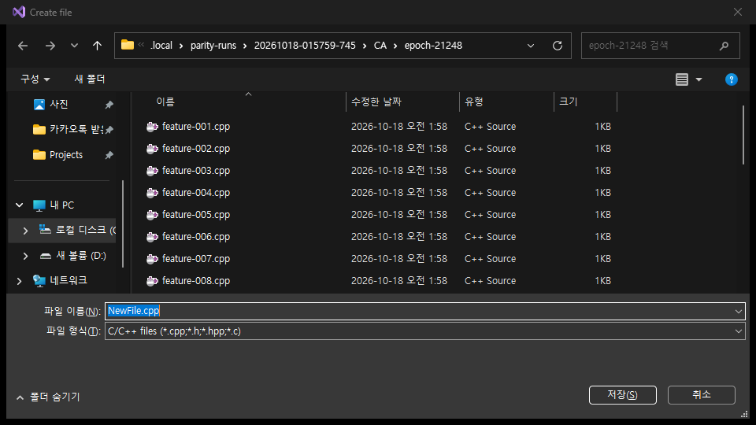](../assets/imports/docs/validation/automated-runner-20261018/20261018-015759-745/screenshots/CA-feature-024-dialog.png)    CA / after / captured   |
| feature-025 Feature 25 | VA / before / captured      VA / dialog / missing    VA / after / captured  [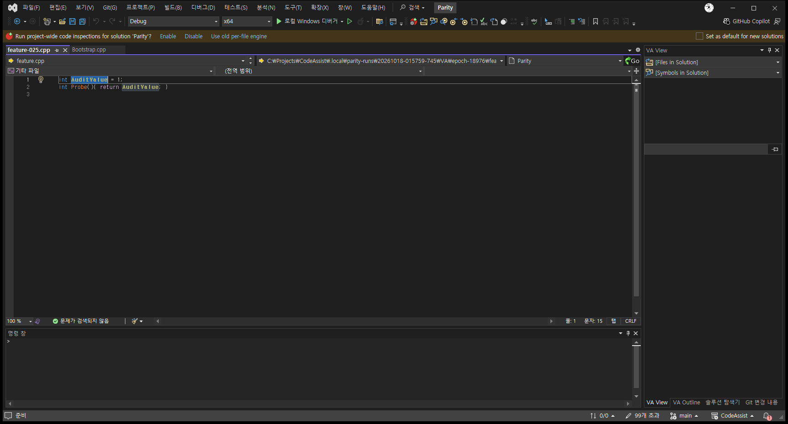](../assets/imports/docs/validation/automated-runner-20261018/20261018-015759-745/screenshots/VA-feature-025-after.png) | CA / before / captured      CA / dialog / captured  [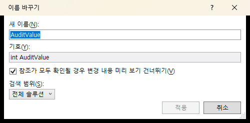](../assets/imports/docs/validation/automated-runner-20261018/20261018-015759-745/screenshots/CA-feature-025-dialog.png)    CA / after / captured  [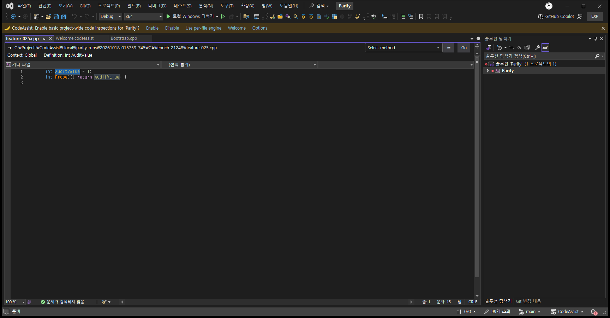](../assets/imports/docs/validation/automated-runner-20261018/20261018-015759-745/screenshots/CA-feature-025-after.png) |
| feature-026 Feature 26 | VA / before / captured      VA / dialog / captured  [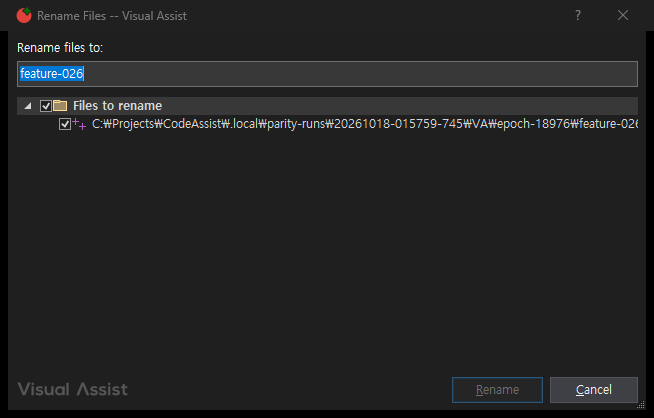](../assets/imports/docs/validation/automated-runner-20261018/20261018-015759-745/screenshots/VA-feature-026-dialog.png)    VA / after / captured   | CA / before / captured      CA / dialog / captured  [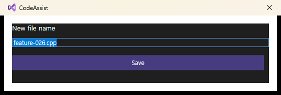](../assets/imports/docs/validation/automated-runner-20261018/20261018-015759-745/screenshots/CA-feature-026-dialog.png)    CA / after / captured   |
| feature-027 Feature 27 | VA / before / captured      VA / dialog / missing    VA / after / captured   | CA / before / captured      CA / dialog / captured  [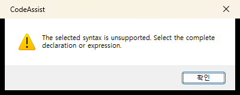](../assets/imports/docs/validation/automated-runner-20261018/20261018-015759-745/screenshots/CA-feature-027-dialog.png)    CA / after / captured   |
| feature-028 Feature 28 | VA / before / captured      VA / dialog / missing    VA / after / captured   | CA / before / captured      CA / dialog / captured  [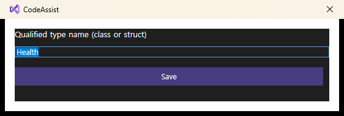](../assets/imports/docs/validation/automated-runner-20261018/20261018-015759-745/screenshots/CA-feature-028-dialog.png)    CA / after / captured   |
| feature-029 Feature 29 | VA / before / captured      VA / dialog / missing    VA / after / captured   | CA / before / captured      CA / dialog / captured  [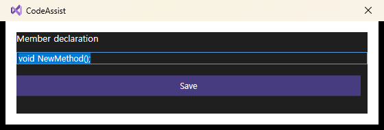](../assets/imports/docs/validation/automated-runner-20261018/20261018-015759-745/screenshots/CA-feature-029-dialog.png)    CA / after / captured   |
| feature-030 Feature 30 | VA / before / captured      VA / dialog / missing    VA / after / captured   | CA / before / captured      CA / dialog / captured  [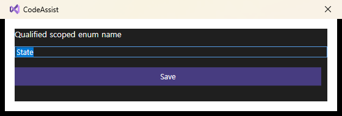](../assets/imports/docs/validation/automated-runner-20261018/20261018-015759-745/screenshots/CA-feature-030-dialog.png)    CA / after / captured   |
| feature-031 Feature 31 | VA / before / captured      VA / dialog / missing    VA / after / captured   | CA / before / captured      CA / dialog / captured  [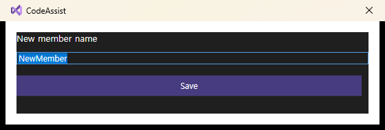](../assets/imports/docs/validation/automated-runner-20261018/20261018-015759-745/screenshots/CA-feature-031-dialog.png)    CA / after / captured   |
| feature-032 Feature 32 | VA / before / captured      VA / dialog / missing    VA / after / captured   | CA / before / captured      CA / dialog / captured  [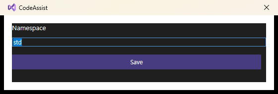](../assets/imports/docs/validation/automated-runner-20261018/20261018-015759-745/screenshots/CA-feature-032-dialog.png)    CA / after / captured   |
| feature-033 Feature 33 | VA / before / captured      VA / dialog / missing    VA / after / captured   | CA / before / captured      CA / dialog / captured  [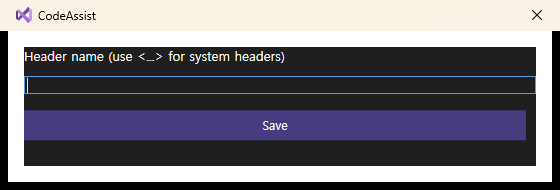](../assets/imports/docs/validation/automated-runner-20261018/20261018-015759-745/screenshots/CA-feature-033-dialog.png)    CA / after / captured   |
| feature-034 Feature 34 | VA / before / captured      VA / dialog / missing    VA / after / captured   | CA / before / captured      CA / dialog / captured      CA / after / captured   |
| feature-035 Feature 35 | VA / before / captured  [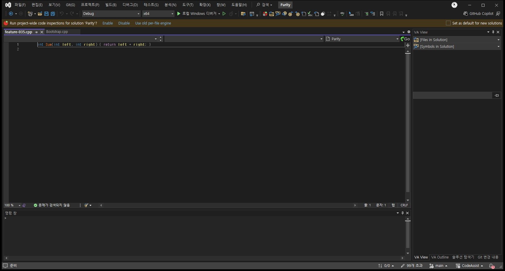](../assets/imports/docs/validation/automated-runner-20261018/20261018-015759-745/screenshots/VA-feature-035-before.png)    VA / dialog / missing    VA / after / captured  [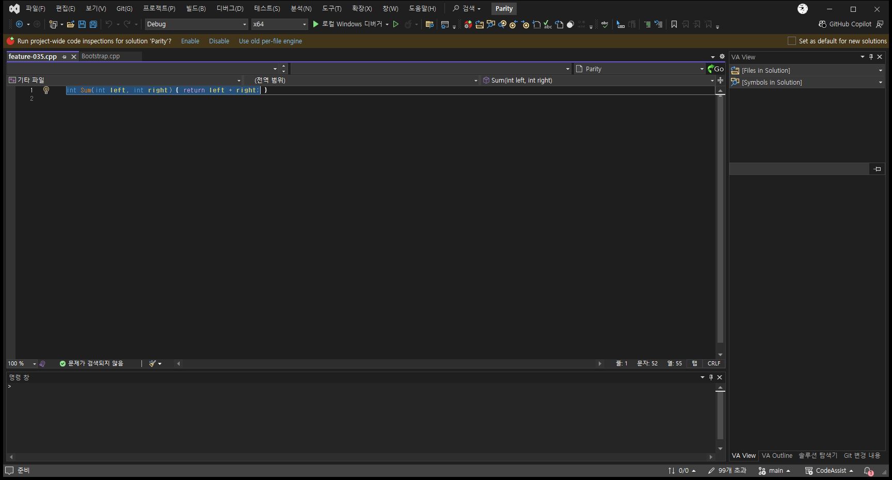](../assets/imports/docs/validation/automated-runner-20261018/20261018-015759-745/screenshots/VA-feature-035-after.png) | CA / before / captured      CA / dialog / captured  [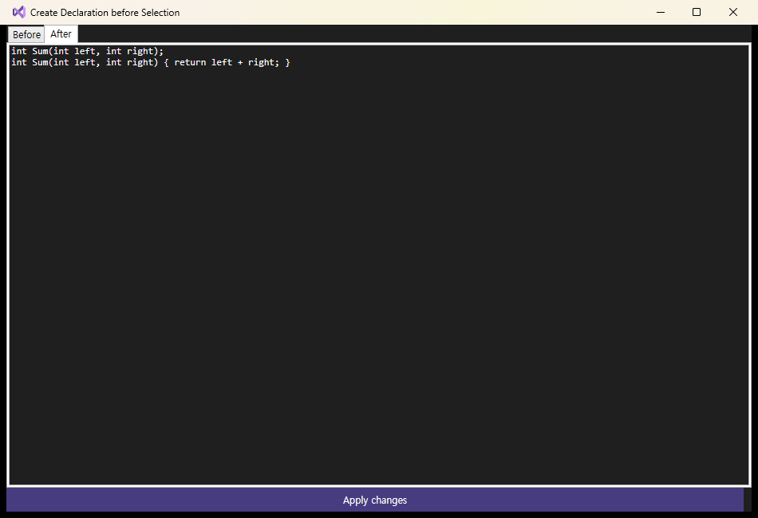](../assets/imports/docs/validation/automated-runner-20261018/20261018-015759-745/screenshots/CA-feature-035-dialog.png)    CA / after / captured  [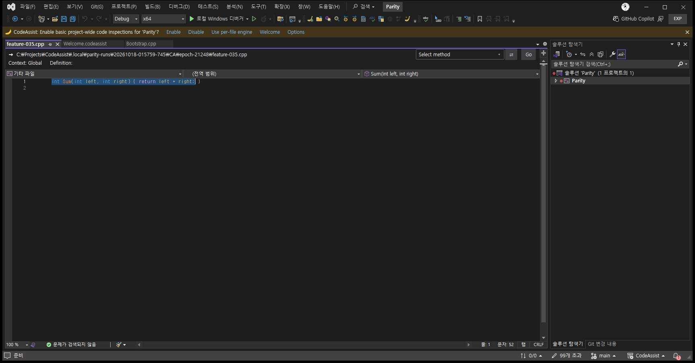](../assets/imports/docs/validation/automated-runner-20261018/20261018-015759-745/screenshots/CA-feature-035-after.png) |
| feature-036 Feature 36 | VA / before / captured      VA / dialog / captured  [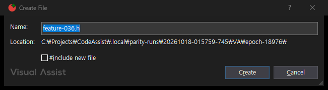](../assets/imports/docs/validation/automated-runner-20261018/20261018-015759-745/screenshots/VA-feature-036-dialog.png)    VA / after / captured   | CA / before / captured      CA / dialog / captured  [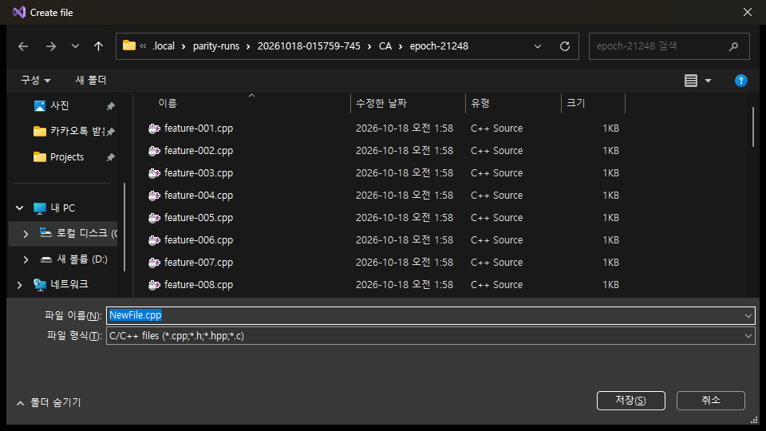](../assets/imports/docs/validation/automated-runner-20261018/20261018-015759-745/screenshots/CA-feature-036-dialog.png)    CA / after / captured   |
| feature-037 Feature 37 | VA / before / captured      VA / dialog / missing    VA / after / captured   | CA / before / captured      CA / dialog / missing    CA / after / captured   |
| feature-038 Feature 38 | VA / before / captured  [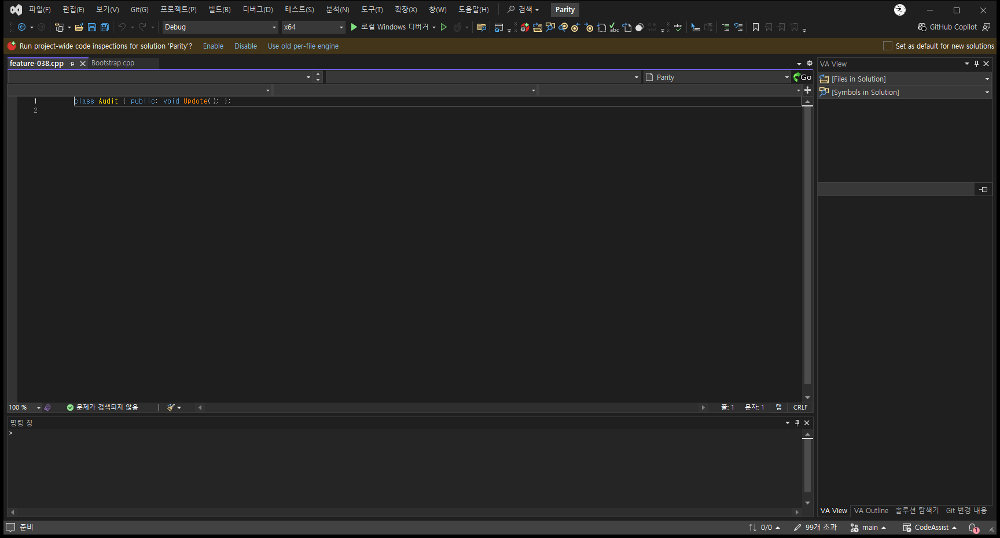](../assets/imports/docs/validation/automated-runner-20261018/20261018-015759-745/screenshots/VA-feature-038-before.png)    VA / dialog / missing    VA / after / captured   | CA / before / captured      CA / dialog / captured      CA / after / captured   |
| feature-039 Feature 39 | VA / before / captured      VA / dialog / missing    VA / after / captured   | CA / before / captured      CA / dialog / captured      CA / after / captured   |
| feature-040 Feature 40 | VA / before / captured      VA / dialog / missing    VA / after / captured   | CA / before / captured      CA / dialog / missing    CA / after / captured   |
| feature-041 Feature 41 | VA / before / captured      VA / dialog / missing    VA / after / captured   | CA / before / captured      CA / dialog / captured      CA / after / captured   |
| acronym Feature 42 | VA / before / captured      VA / dialog / missing    VA / after / captured   | CA / before / captured      CA / dialog / missing    CA / after / captured   |
| comment-continuation Feature 43 | VA / before / captured      VA / dialog / missing    VA / after / captured   | CA / before / captured      CA / dialog / missing    CA / after / captured   |
| completion Feature 44 | VA / before / captured      VA / dialog / missing    VA / after / captured   | CA / before / captured      CA / dialog / missing    CA / after / captured   |
| feature-045 Feature 45 | VA / before / captured      VA / dialog / captured      VA / after / captured   | CA / before / captured      CA / dialog / captured      CA / after / captured   |
| pair-insert Feature 46 | VA / before / captured      VA / dialog / missing    VA / after / captured   | CA / before / captured      CA / dialog / missing    CA / after / captured   |
| feature-047 Feature 47 | VA / before / captured      VA / dialog / captured      VA / after / captured   | CA / before / captured      CA / dialog / captured      CA / after / captured   |
| feature-048 Feature 48 | VA / before / captured      VA / dialog / missing    VA / after / captured   | CA / before / captured      CA / dialog / captured      CA / after / captured   |
| reset-zoom Feature 49 | VA / before / captured      VA / dialog / missing    VA / after / captured   | CA / before / captured      CA / dialog / missing    CA / after / captured   |
| shorthand Feature 50 | VA / before / captured      VA / dialog / missing    VA / after / captured   | CA / before / captured      CA / dialog / missing    CA / after / captured   |
| smart-select Feature 51 | VA / before / captured      VA / dialog / missing    VA / after / captured   | CA / before / captured      CA / dialog / missing    CA / after / captured   |
| feature-052 Feature 52 | VA / before / captured      VA / dialog / captured      VA / after / captured   | CA / before / captured      CA / dialog / captured      CA / after / captured   |
| feature-053 Feature 53 | VA / before / captured      VA / dialog / captured      VA / after / captured   | CA / before / captured      CA / dialog / captured      CA / after / captured   |
| feature-054 Feature 54 | VA / before / captured      VA / dialog / captured      VA / after / captured   | CA / before / captured      CA / dialog / captured      CA / after / captured   |
| surround-word Feature 55 | VA / before / captured      VA / dialog / missing    VA / after / captured   | CA / before / captured      CA / dialog / missing    CA / after / captured   |
| feature-056 Feature 56 | VA / before / captured      VA / dialog / captured      VA / after / captured   | CA / before / captured      CA / dialog / captured      CA / after / captured   |
| feature-057 Feature 57 | VA / before / captured      VA / dialog / captured      VA / after / captured   | CA / before / captured      CA / dialog / captured      CA / after / captured   |
| feature-058 Feature 58 | VA / before / captured      VA / dialog / captured      VA / after / captured   | CA / before / captured      CA / dialog / captured      CA / after / captured   |
| feature-059 Feature 59 | VA / before / captured      VA / dialog / captured      VA / after / captured   | CA / before / captured      CA / dialog / captured      CA / after / captured   |
| feature-060 Feature 60 | VA / before / captured      VA / dialog / captured      VA / after / captured   | CA / before / captured      CA / dialog / captured      CA / after / captured   |
| feature-061 Feature 61 | VA / before / captured      VA / dialog / captured      VA / after / captured   | CA / before / captured      CA / dialog / captured      CA / after / captured   |
| feature-062 Feature 62 | VA / before / captured      VA / dialog / captured      VA / after / captured   | CA / before / captured      CA / dialog / captured      CA / after / captured   |
| feature-063 Feature 63 | VA / before / captured      VA / dialog / captured      VA / after / captured   | CA / before / captured      CA / dialog / captured      CA / after / captured   |
| feature-064 Feature 64 | VA / before / captured      VA / dialog / captured      VA / after / captured   | CA / before / captured      CA / dialog / captured      CA / after / captured   |
| feature-065 Feature 65 | VA / before / captured      VA / dialog / captured      VA / after / captured   | CA / before / captured      CA / dialog / captured      CA / after / captured   |
| feature-066 Feature 66 | VA / before / captured      VA / dialog / captured      VA / after / captured   | CA / before / captured      CA / dialog / captured      CA / after / captured   |
| feature-067 Feature 67 | VA / before / captured      VA / dialog / captured      VA / after / captured   | CA / before / captured      CA / dialog / captured      CA / after / captured   |
| feature-068 Feature 68 | VA / before / captured      VA / dialog / captured      VA / after / captured   | CA / before / captured      CA / dialog / captured      CA / after / captured   |
| dot-to-arrow Feature 69 | VA / before / captured      VA / dialog / missing    VA / after / captured   | CA / before / captured      CA / dialog / missing    CA / after / captured   |
| feature-070 Feature 70 | VA / before / captured      VA / dialog / captured      VA / after / captured   | CA / before / captured      CA / dialog / captured      CA / after / captured   |
| feature-071 Feature 71 | VA / before / captured      VA / dialog / captured      VA / after / captured   | CA / before / captured      CA / dialog / captured      CA / after / captured   |
| feature-072 Feature 72 | VA / before / captured      VA / dialog / captured      VA / after / captured   | CA / before / captured      CA / dialog / captured      CA / after / captured   |
| repair-case Feature 73 | VA / before / captured      VA / dialog / missing    VA / after / captured   | CA / before / captured      CA / dialog / missing    CA / after / captured   |
| feature-074 Feature 74 | VA / before / captured      VA / dialog / captured      VA / after / captured   | CA / before / captured      CA / dialog / captured      CA / after / captured   |
| feature-075 Feature 75 | VA / before / captured      VA / dialog / captured      VA / after / captured   | CA / before / captured      CA / dialog / captured      CA / after / captured   |
| feature-076 Feature 76 | VA / before / captured      VA / dialog / captured      VA / after / captured   | CA / before / captured      CA / dialog / captured      CA / after / captured   |
| feature-077 Feature 77 | VA / before / captured      VA / dialog / captured      VA / after / captured   | CA / before / captured      CA / dialog / captured      CA / after / captured   |
| feature-078 Feature 78 | VA / before / captured      VA / dialog / captured      VA / after / captured   | CA / before / captured      CA / dialog / captured      CA / after / captured   |
| feature-079 Feature 79 | VA / before / captured      VA / dialog / captured      VA / after / captured   | CA / before / captured      CA / dialog / captured      CA / after / captured   |
| feature-080 Feature 80 | VA / before / captured      VA / dialog / captured      VA / after / captured   | CA / before / captured      CA / dialog / captured      CA / after / captured   |
| feature-081 Feature 81 | VA / before / captured      VA / dialog / captured      VA / after / captured   | CA / before / captured      CA / dialog / captured      CA / after / captured   |
| feature-082 Feature 82 | VA / before / captured      VA / dialog / captured      VA / after / captured   | CA / before / captured      CA / dialog / captured      CA / after / captured   |
| feature-083 Feature 83 | VA / before / captured      VA / dialog / captured      VA / after / captured   | CA / before / captured      CA / dialog / captured      CA / after / captured   |
| feature-084 Feature 84 | VA / before / captured      VA / dialog / captured      VA / after / captured   | CA / before / captured      CA / dialog / captured      CA / after / captured   |
| feature-085 Feature 85 | VA / before / captured      VA / dialog / missing    VA / after / captured   | CA / before / captured      CA / dialog / captured      CA / after / captured   |
| feature-086 Feature 86 | VA / before / captured      VA / dialog / captured      VA / after / captured   | CA / before / captured      CA / dialog / captured      CA / after / captured   |
| feature-087 Feature 87 | VA / before / captured      VA / dialog / captured      VA / after / captured   | CA / before / captured      CA / dialog / captured      CA / after / captured   |
| feature-088 Feature 88 | VA / before / captured      VA / dialog / captured      VA / after / captured   | CA / before / captured      CA / dialog / captured      CA / after / captured   |
| feature-089 Feature 89 | VA / before / captured      VA / dialog / captured      VA / after / captured   | CA / before / captured      CA / dialog / captured      CA / after / captured   |
| feature-090 Feature 90 | VA / before / captured      VA / dialog / captured      VA / after / captured   | CA / before / captured      CA / dialog / captured      CA / after / captured   |
| feature-091 Feature 91 | VA / before / captured      VA / dialog / missing    VA / after / captured   | CA / before / captured      CA / dialog / captured      CA / after / captured   |
| feature-092 Feature 92 | VA / before / captured      VA / dialog / captured      VA / after / captured   | CA / before / captured      CA / dialog / captured      CA / after / captured   |
| feature-093 Feature 93 | VA / before / captured      VA / dialog / captured      VA / after / captured   | CA / before / captured      CA / dialog / captured      CA / after / captured   |
| feature-094 Feature 94 | VA / before / captured      VA / dialog / captured      VA / after / captured   | CA / before / captured      CA / dialog / captured      CA / after / captured   |
| feature-095 Feature 95 | VA / before / captured      VA / dialog / captured      VA / after / captured   | CA / before / captured      CA / dialog / captured      CA / after / captured   |
| feature-096 Feature 96 | VA / before / captured      VA / dialog / captured      VA / after / captured   | CA / before / captured      CA / dialog / captured      CA / after / captured   |
| feature-097 Feature 97 | VA / before / captured      VA / dialog / captured      VA / after / captured   | CA / before / captured      CA / dialog / captured      CA / after / captured   |
| feature-098 Feature 98 | VA / before / captured      VA / dialog / captured      VA / after / captured   | CA / before / captured      CA / dialog / captured      CA / after / captured   |
| feature-099 Feature 99 | VA / before / captured      VA / dialog / captured      VA / after / captured   | CA / before / captured      CA / dialog / captured      CA / after / captured   |
| feature-100 Feature 100 | VA / before / captured      VA / dialog / captured      VA / after / captured   | CA / before / captured      CA / dialog / captured      CA / after / captured   |
| feature-101 Feature 101 | VA / before / captured      VA / dialog / captured      VA / after / captured   | CA / before / captured      CA / dialog / captured      CA / after / captured   |
| feature-102 Feature 102 | VA / before / captured      VA / dialog / captured      VA / after / captured   | CA / before / captured      CA / dialog / captured      CA / after / captured   |
| feature-103 Feature 103 | VA / before / captured      VA / dialog / captured      VA / after / captured   | CA / before / captured      CA / dialog / captured      CA / after / captured   |
| feature-104 Feature 104 | VA / before / captured      VA / dialog / captured      VA / after / captured   | CA / before / captured      CA / dialog / captured      CA / after / captured   |
| feature-105 Feature 105 | VA / before / captured      VA / dialog / captured      VA / after / captured   | CA / before / captured      CA / dialog / captured      CA / after / captured   |
| feature-106 Feature 106 | VA / before / captured      VA / dialog / captured      VA / after / captured   | CA / before / captured      CA / dialog / captured      CA / after / captured   |
| feature-107 Feature 107 | VA / before / captured      VA / dialog / captured      VA / after / captured   | CA / before / captured      CA / dialog / captured      CA / after / captured   |
| feature-108 Feature 108 | VA / before / captured      VA / dialog / captured      VA / after / captured   | CA / before / captured      CA / dialog / captured      CA / after / captured   |

## 원문과 편집 이력

[보존된 원문 열기](../assets/imports/docs/validation/automated-runner-20261018/20261018-015759-745/screenshots.html)

- 원문 SHA-256: `b9f5c73e2a0b6f5ad8a035aa1ff6136b8f2b932499951d99bd8bbb68bab184e4`
- 표시 날짜는 원본 파일의 수정 시각입니다. 작업 완료 시각은 원문에 있는 값을 기준으로 확인합니다.
