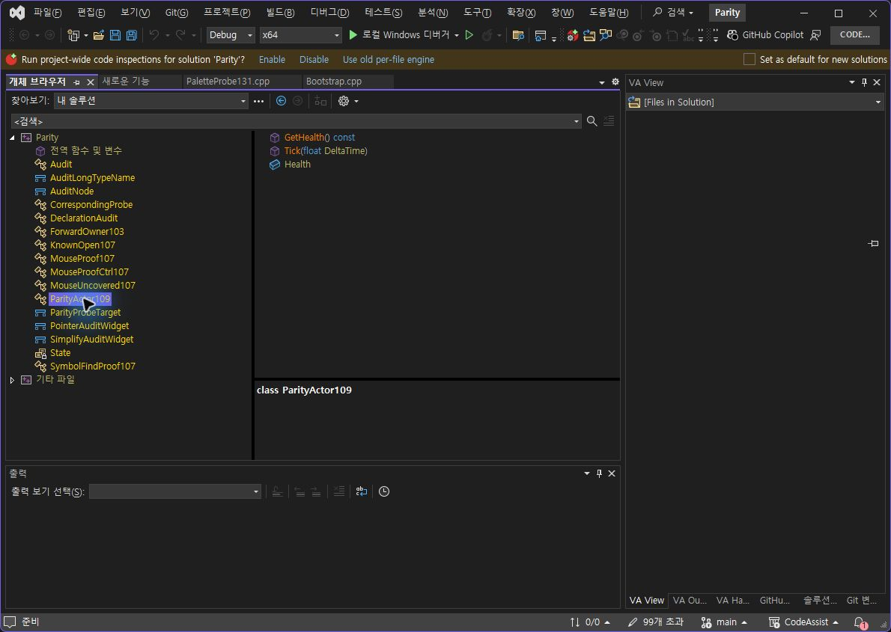
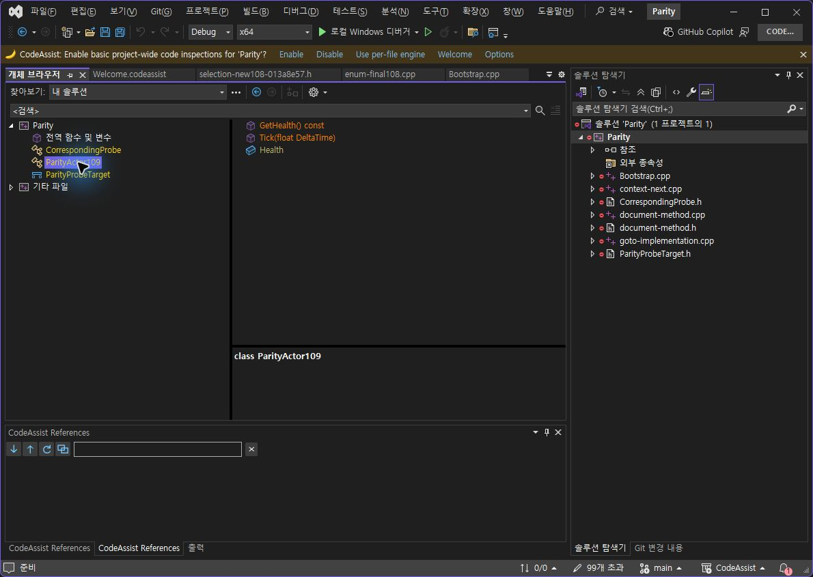
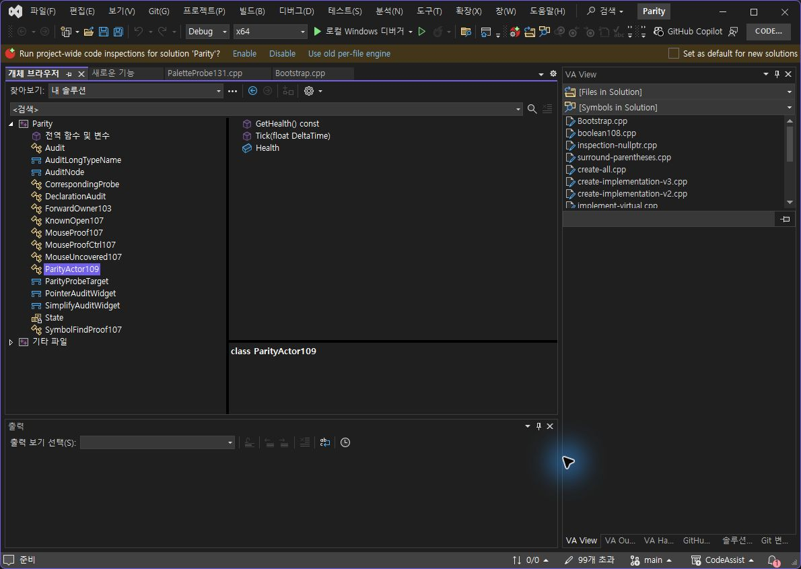
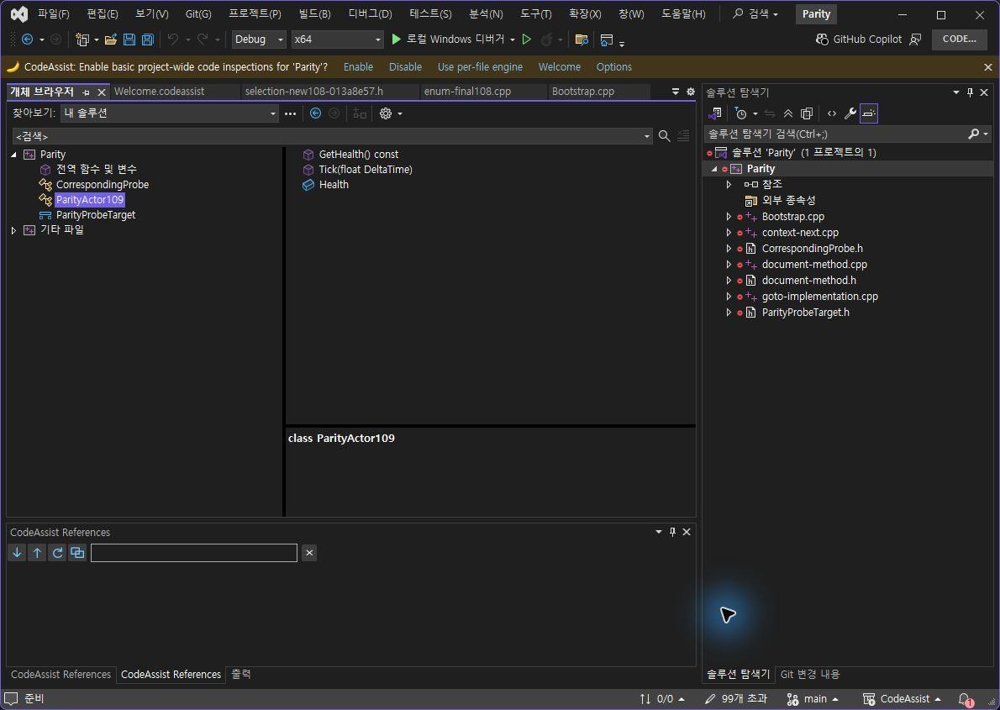
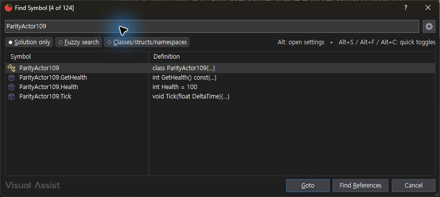
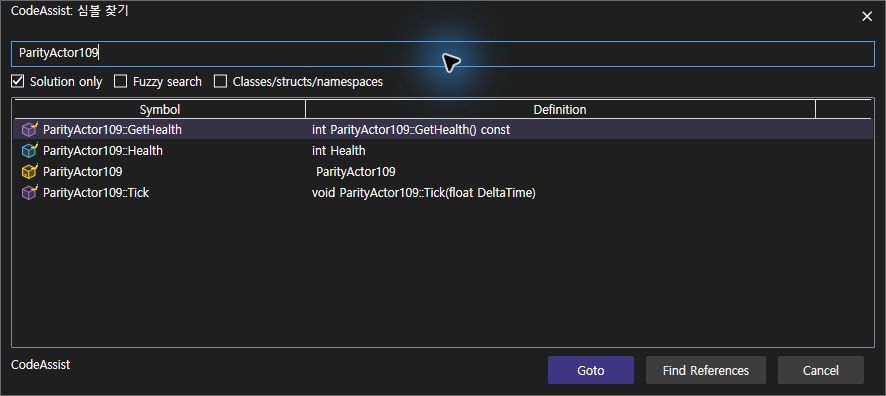
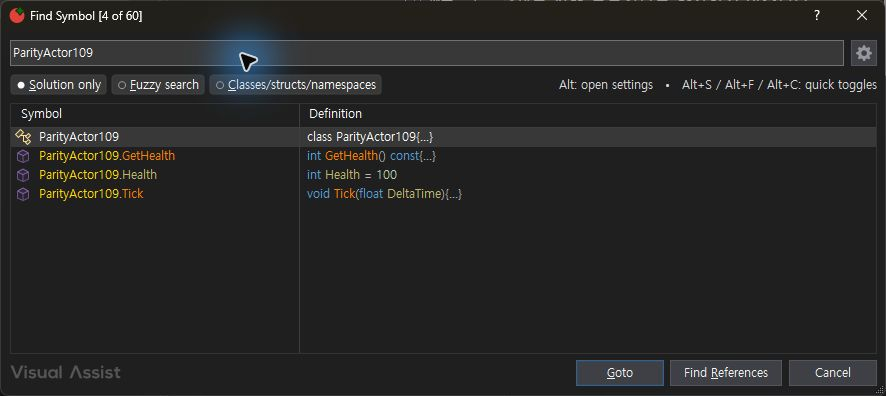
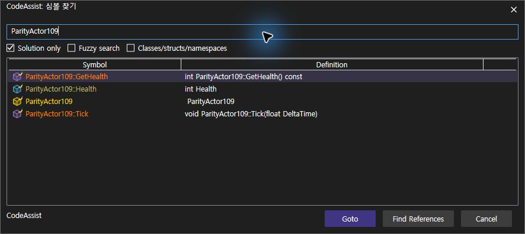
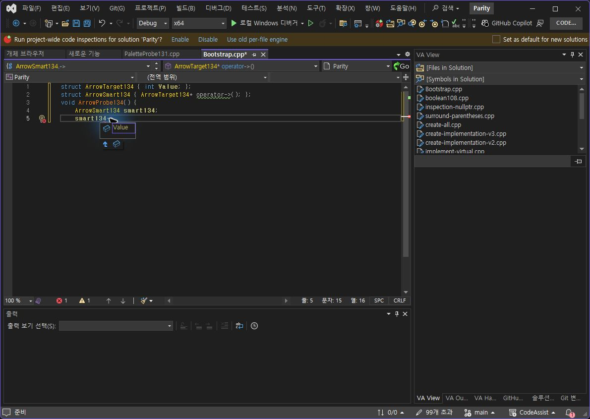
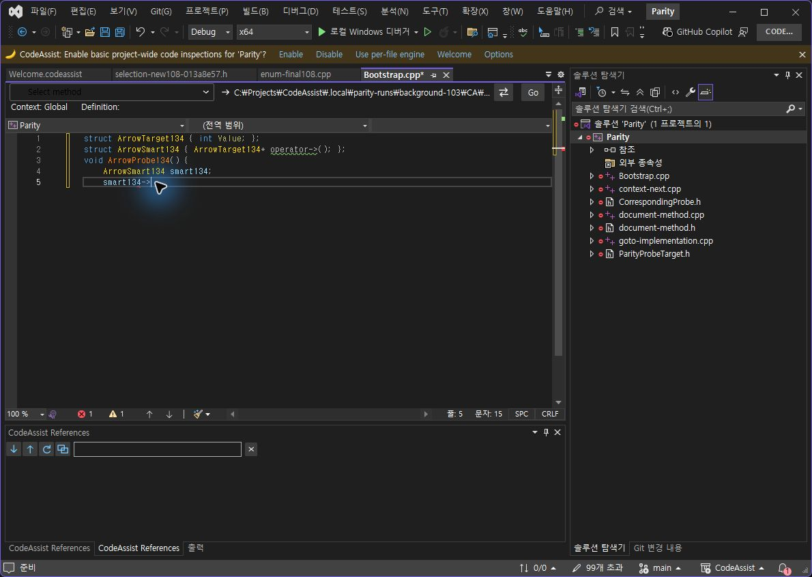

> 보관 기록입니다. 아래 결과는 원문 작성 시점의 내용이며, 이번 편집에서 제품 테스트를 다시 실행하지 않았습니다.

CA 0.0.134 실제 대조

## CA 0.0.134 — 실제 VA 대조

보안창은 해제됐습니다. 개체 브라우저 색상 출력 및 Views 꺼짐 표시 오류 수정은 실행 확인했습니다. 전체 요청 완수는 아닙니다.

## 대조 결과

**이번 표본 2/5개 일치 · 40%**, 차이 3개입니다. 12개 중 실제 대조에 착수한 옵션은 **3/12개 · 25%**입니다. 전체 제품 동기화율 또는 12개 옵션 전체의 기능 일치율로 해석하지 않습니다.

| 표본 | 판정 | 상세 |
| --- | --- | --- |
| 개체 브라우저 켜짐 | 차이 | 네이티브 색상 적용은 동작함. CA는 함수 서명 전체를 같은 색으로 칠하고, VA는 키워드·인수를 분리함 |
| 개체 브라우저 꺼짐 | 차이 | 우측 멤버는 양쪽 기본색. 좌측 형식은 VA 색상 유지, CA 기본색으로 변경 |
| Views 꺼짐 | 일치 | 동일 검색어 ParityActor109의 심볼 이름을 양쪽 기본 글자색으로 표시. CA의 검은 글자 오류를 134에서 수정·재검증. 정렬·설명 형식은 이 색상 판정에서 제외 |
| Views 켜짐 | 차이 | CA는 전체 한정 이름을 같은 색으로 칠함. VA는 소유 형식·멤버를 분리함 |
| 오버로드 화살표 켜짐 | 일치 | 동일 전체 본문 확인 → 실제 period 키 → smart134-> 포함 전체 출력 정확히 일치. 꺼짐은 VA 종료로 미판정 |

전체 108개와 신규 옵션 12개의 완전 동등성 인증은 완료되지 않았습니다. 기존 130의 # 통과를 134의 새 통과로 합산하지 않았습니다.

## 수정 및 자동 검사

Views 꺼짐에서 TextBlock의 기본 검정색으로 돌아가던 오류를 수정했습니다. 이제 VS 테마의 ToolWindowText 색상을 사용합니다. 빌드·패키지·설치·CLR 모듈을 확인했고 현재 화면에서도 기본 글자색을 확인했습니다.

코어 회귀 **378/378 · 100%**, 설치본 코어 검사 **19/19 · 100%**, 네이티브 어댑터 통합 검사 **12/12 · 100%**. 이들은 VA 동기화율이 아닙니다. 설치본 19개 검사는 133 실행 기록이며 134의 새 실행으로 재계산하지 않습니다. 어댑터 소스는 134에서도 동일합니다.

## 실행 오류와 복원

VA는 설정 저장 후 두 차례 종료됐습니다. 이벤트 1000의 KERNELBASE.dll 및 예외 0xe0434352는 확인했지만 원인은 특정하지 않았습니다. 실패한 꺼짐 검사는 통과 처리하지 않았습니다. 마지막 복원 저장 후 즉시 접근성 검사를 하지 않은 경우 프로세스가 유지됐지만, 이것만으로 원인을 확정하지 않습니다.

VA/CA 문서는 2/2 원문 일치를 확인했습니다. CA 저장 상태 · VA 저장 상태. CA 화살표 주 스위치는 원래 꺼짐, VA 붙여넣기 서식·오버로드 스위치는 원래 켜짐, 색상 대상은 양쪽 원래 켜짐으로 복원했습니다.

## 근거

화살표 동일 입력·출력 · CA 입력 · VA 입력 · CA 출력 · VA 출력 · 134 빌드 · 패키지 · 설치본 · 실제 로드 · 코어 검사 · 네이티브 검사 · 집계·시간

문서 부분 명세 108/108 · 100%이며 전체 역분석 완료율이 아닙니다. XERJ 사용 — 후보 검색 후 현재 소스 확인. 설치 파일: installers/0.0.134/.

## object-browser

VA

CA

## object-browser-off

VA

CA

## views-off

VA

CA

## views-on

VA

CA

## arrow-on

VA

CA

## 원문과 편집 이력

[보존된 원문 열기](../assets/imports/docs/validation/options-134/index.html)

- 원문 SHA-256: `04a24932232b3bfd9f5e218b5bd1305127eed5dfc7a8b06335dd81898789d90e`
- 표시 날짜는 원본 파일의 수정 시각입니다. 작업 완료 시각은 원문에 있는 값을 기준으로 확인합니다.
