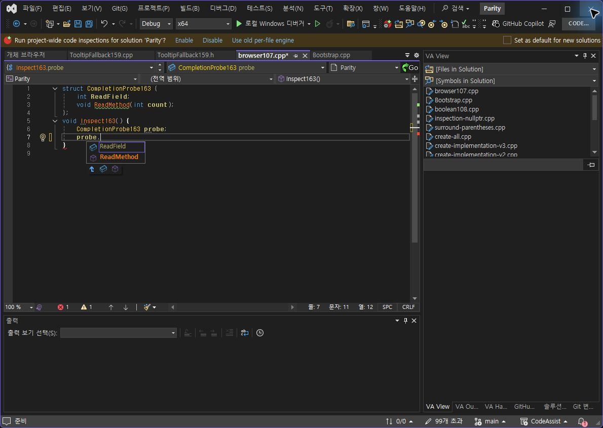
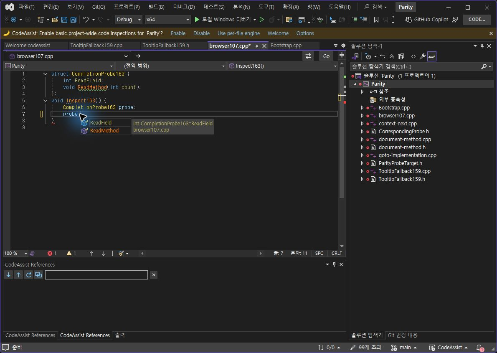
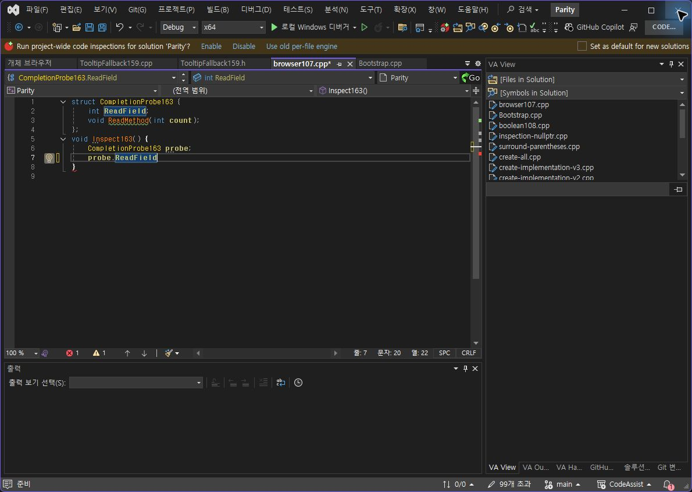
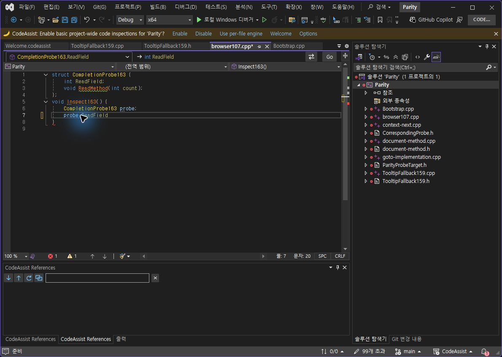
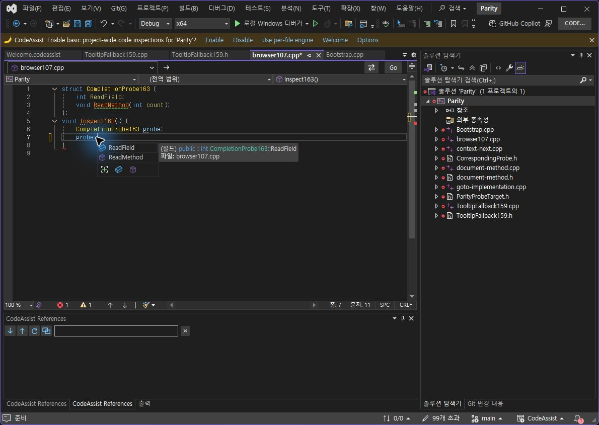
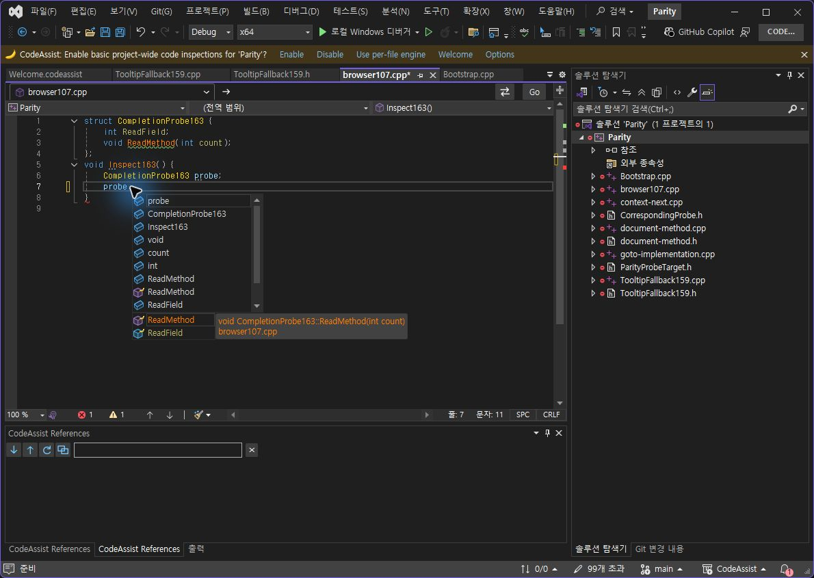

> 보관 기록입니다. 아래 결과는 원문 작성 시점의 내용이며, 이번 편집에서 제품 테스트를 다시 실행하지 않았습니다.

VA·CA 최신 멤버 추천 수정165

## 최신 멤버 추천 누락·혼입·중복 수정

최종 설치0.0.165. Computer Use로 VA와 동일한 소스·입력을 대조했습니다.

**이번 추천 동작 표본5/5개(100%) 일치**: 후보 집합, 순서와 기본 선택, 색상 역할, Tab 후 전체 문서, 커서. **선정 옵션 누적 On/Off 표본10/12개(83.33%)는 유지**하며 이번 후보 수정으로 임의 증가시키지 않습니다. 제품 전체 동기화율이나 UI 전체 일치율이 아닙니다.

## 실행으로 확인한 원인과 수정

수정 전 CA162는 로컬 변수 probe의 타입을 정확히 CompletionProbe163으로 찾았지만 멤버 후보0개를 보고했습니다. 저장 인덱스만 조회하고 열린 파일의 최신 선언을 반영하지 않았습니다. 열린 문서의 최신 타입·멤버를 저장 데이터보다 우선하고, 최신 파일에서 없어진 멤버는 저장 데이터에서 제외했습니다. 상속과 오버로드도 유지합니다.

중간 CA163은 최신 멤버2개를 얻었지만 비동기 컴파일러 결과가 일반 변수·텍스트·키워드와 중복 후보를 섞어11개가 됐습니다. LSP의 멤버 종류만 허용하고 같은 삽입 이름을 한 번 표시하도록 수정했습니다. 선언 위치를 최근 사용으로 오인해 순서가 뒤집히던 것도 제거했습니다. 최종 CA165 로그는 컴파일러 응답 전후 모두2개입니다.

## 같은 입력과 결과

동일 browser107.cpp에 ReadField와 ReadMethod를 가진 구조체를 사용했습니다. 양쪽에서 probe 뒤에 물리 period, Ctrl+Space, Tab을 입력했습니다. VA 프로필에 CA 확장이 없음을 CLR 모듈 검사로 확인했고 CA는 실제 로드 DLL이 설치 패키지와 같음을 검사했습니다.

| 기준 | VA | CA165 |
| --- | --- | --- |
| 후보 집합 | ReadField, ReadMethod | 동일2개, 전역/중복 없음 |
| 기본 선택 | ReadField 먼저 | 동일 |
| 색상 역할 | 필드 카키색·함수 주황색 | 동일 범주. JPEG 픽셀 RGB 일치 판정 아님 |
| Tab 전체 문서 | probe.ReadField 삽입 | 전체 문자열 정확히 일치 |
| Tab 커서 | 7행20열, 선택 없음 | 정확히 일치 |

VA 기준 목록

CA165 최종 목록

VA Tab

CA165 Tab

CA162 수정 전 — 색상 미적용

CA163 중간 실패 — 혼입·중복

## 통과하지 않은 차이

VA의 하단 필터 버튼은 CA 추천 창에 없고, 설명의 형식·강조 방식도 다릅니다. 최초 period 입력만으로 팝업이 유지되는지는 추가 검증이 필요합니다. Ctrl+Space의 동일 입력 결과만 이번 표본으로 통과했습니다. 새 프로젝트의 저장 인덱스0개 조건에서 제공자가 조기에 반환하는 것도 다음 수정 대상입니다. 아이콘은 CA 자체 배지를 유지했으며 모양 완전 일치로 채점하지 않았습니다.

With Snippets는 VA의 기존 파일에 사용자 지정 SurroundWith= 항목이 없어 기본 괄호 기능으로 인과 검증할 수 없습니다. 이전에 요청한 사용자 스니펫 임시 수정 승인은 대기 중이며 원본 파일은 수정하지 않았습니다. 실제 키 홀드 반복률도 순간 키 입력 API만으로 통과시키지 않았습니다. 전체108개 최신 버전의 모든 동작·UI 인증은 계속 남아 있습니다.

## 자동 검사와 원복

새 회귀8개를 포함해448/448개(100%) 통과했습니다. 새 열린 타입, 빈 최신 파일의 오래된 멤버 제거, 상속·오버로드·외부 지역변수 제외, 약어/부분 검색 조합, LSP 전역 후보 제외를 검사합니다. VS2019 및 Modern 빌드 성공, 패키지 바이너리6개/단축키 등록48개 검사 통과. 테스트 소스는 양쪽 모두 원본 해시로 복원했고 미저장 문서는0개입니다.

문서·도움말 기반 부분 명세108/108개(100%). 전체 역분석 완료율과는 다릅니다. REA 연결 도구는 없으며 이번에는 설치 VA 실제 실행·소스·로그를 사용했습니다. XERJ는 DoubleKeyRepeat 검색에 사용했고 오래된 결과는 rg로 현재 소스를 확인했습니다.

수치·범위 JSON · 후보 수 실제 로그 · 448개 테스트 · 최종 설치 · 로드 DLL · VA 격리 · VA 전체 문서·커서 · CA 전체 문서·커서

제안 시간20~30분. 수정·설치·실행 대조·원복 기록까지24분41초, 2026-10-24 10:12:34 KST. 전체 목표는 진행 중입니다.

## 원문과 편집 이력

[보존된 원문 열기](../assets/imports/docs/validation/options-163/index.html)

- 원문 SHA-256: `b9e68ebaf3333c9d1ce21a3c040ef948ea4479923eb69f78a3fd1634f8f6c2c9`
- 표시 날짜는 원본 파일의 수정 시각입니다. 작업 완료 시각은 원문에 있는 값을 기준으로 확인합니다.
