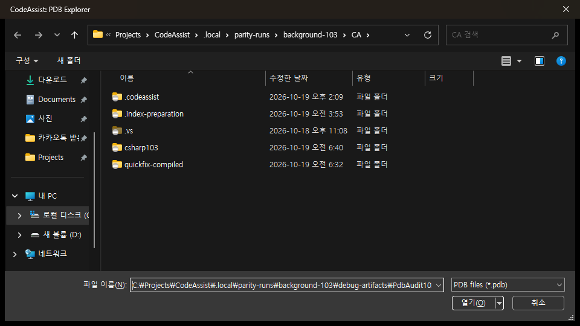

> 보관 기록입니다. 아래 결과는 원문 작성 시점의 내용이며, 이번 편집에서 제품 테스트를 다시 실행하지 않았습니다.

108 재실행 — 결과와 차단 항목

## 108개 재실행 기록

시작 2026-10-19T13:48:31+09:00 / 갱신 2026-10-19T15:46:10.135274+09:00

**전체 검사 완수 상태가 아닙니다.**

실행기 정상 종료 84/108개 (77.78%). 이 수치는 기능 검증률·일치율이 아닙니다. 실제 결과 누락·무반응·부분 확인은 아래에 별도 표시했습니다.

이전 회차 19개와 합친 실행기 종료 103/108개 (95.37%). 이전 기록을 이번 새 실행으로 계산하지 않았습니다.

실행 묶음 정상 종료 57/66개. 오류 9개.

## 입력 차단

15:38 재확인: Windows 보안 / PickerHost PID 54948 / HWND 2956066이 전면입니다. 보안 창은 조작하지 않았습니다. 사용자에게 직접 처리를 요청했으며 답변 대기 중입니다. 실제 키 입력·클립보드 경로 검사를 통과로 처리하지 않았습니다.

## 확보한 실제 결과

- Move All: 양쪽 소스 이동, 컴파일·실행·Undo 확인.

- 편집기/도구 창 빠른 수정: CA nullptr 적용, 컴파일·실행·Undo 확인.

- 색상 인쇄: 양쪽 실제 Print-to-PDF 결과, 텍스트·색상 연산 확인.

- PDB와 RVA: 동일 테스트 바이너리의 PdbTarget103 조회 확인.

- 외부 빌드: 양쪽 동일 외부 -I 컴파일·실행 통과. 현재 재검사 정의 이동은 VA 미이동 / CA 외부 헤더 도착.

- 누락 case: VA Running/Done 생성 확인. CA의 적용은 미확인.

## 기존 누적 판정과 이번 결과 구분

기존 대표 결과 엄격 일치 17/108개(15.74%), 차이 91/108개(84.26%). 이번 재실행 전체에 대한 새 일치율은 아직 산출하지 않았습니다. 이 비율을 제품 전체 또는 UI 유사도로 사용하지 않습니다. 전체 기능 인증 0/108개. 문서 일부 분석 108/108개.

[suite-move-all](../assets/imports/docs/validation/reexecution-108/jobs/suite-move-all/CA.move-all-source.apply.driver-result.png)

[suite-move-all](../assets/imports/docs/validation/reexecution-108/jobs/suite-move-all/CA.move-all-source.prepared.after.png)

[suite-tool-fix](../assets/imports/docs/validation/reexecution-108/jobs/suite-tool-fix/CA.inspection-compiled.prepared.after.png)

[suite-tool-fix](../assets/imports/docs/validation/reexecution-108/jobs/suite-tool-fix/CA.inspection-compiled.prepared.before.png)

[remaining_print108](../assets/imports/docs/validation/reexecution-108/jobs/remaining_print108/CA.print-color108.prepared.after.png)

[remaining_print108](../assets/imports/docs/validation/reexecution-108/jobs/remaining_print108/CA.print-color108.prepared.before.png)

[remaining_debugfiles108](../assets/imports/docs/validation/reexecution-108/jobs/remaining_debugfiles108/CA.address.rva.applied.png)

[remaining_debugfiles108](../assets/imports/docs/validation/reexecution-108/jobs/remaining_debugfiles108/CA.guard-action0.png)

## 108개 전체 목록

| ID | 기능 | 이번 실행 상태 | 검증 범위·부족 사항 | 새 실행 근거 | 기존 누적 대표 판정 |
| --- | --- | --- | --- | --- | --- |
| VA-F001 | Find by Context | 이전 회차 별도 실행 완료 | 동일 입력의 대표 관찰 범위. 모든 지원 언어·옵션·입력 경로 인증 아님 |  | representative-match |
| VA-F002 | Find References | 실행기 종료 | 동일 입력의 대표 관찰 범위. 모든 지원 언어·옵션·입력 경로 인증 아님 | find-references / completed | different |
| VA-F003 | Find Symbol in Solution | 이전 회차 별도 실행 완료 | 동일 입력의 대표 관찰 범위. 모든 지원 언어·옵션·입력 경로 인증 아님 |  | different |
| VA-F004 | GoTo Implementation | 이전 회차 별도 실행 완료 | 동일 입력의 대표 관찰 범위. 모든 지원 언어·옵션·입력 경로 인증 아님 |  | different |
| VA-F005 | GoTo Member | 실행기 종료 | 동일 입력의 대표 관찰 범위. 모든 지원 언어·옵션·입력 경로 인증 아님 | goto-member / completed | different |
| VA-F006 | GoTo Related | 실행기 종료 | 동일 입력의 대표 관찰 범위. 모든 지원 언어·옵션·입력 경로 인증 아님 | suite-related / completed | different |
| VA-F007 | Highlight Current Line | 실행기 종료 | 동일 입력의 대표 관찰 범위. 모든 지원 언어·옵션·입력 경로 인증 아님 | remaining_inputs108 / completed | representative-match |
| VA-F008 | List Methods in File | 실행기 종료 | 동일 입력의 대표 관찰 범위. 모든 지원 언어·옵션·입력 경로 인증 아님 | list-methods / completed | different |
| VA-F009 | Move Scope | 이전 회차 별도 실행 완료 | 동일 입력의 대표 관찰 범위. 모든 지원 언어·옵션·입력 경로 인증 아님 |  | different |
| VA-F010 | Navigate Back and Forward | 실행기 종료 | 동일 입력의 대표 관찰 범위. 모든 지원 언어·옵션·입력 경로 인증 아님 | background_next_batch / completed | different |
| VA-F011 | Open Corresponding File | 실행기 종료 | 동일 입력의 대표 관찰 범위. 모든 지원 언어·옵션·입력 경로 인증 아님 | corresponding-file / completed | representative-match |
| VA-F012 | Open File in Solution | 이전 회차 별도 실행 완료 | 동일 입력의 대표 관찰 범위. 모든 지원 언어·옵션·입력 경로 인증 아님 |  | representative-match |
| VA-F013 | VA Hashtags | 실행기 종료 | 동일 입력의 대표 관찰 범위. 모든 지원 언어·옵션·입력 경로 인증 아님 | hashtags / completed | different |
| VA-F014 | VA Navigation Bar | 실행기 종료 | 동일 입력의 대표 관찰 범위. 모든 지원 언어·옵션·입력 경로 인증 아님 | background_next_batch / completed | different |
| VA-F015 | Access to Refactoring Commands | 실행기 종료 | 동일 입력의 대표 관찰 범위. 모든 지원 언어·옵션·입력 경로 인증 아님 | background_editor_context_menu / completed | different |
| VA-F016 | Change Signature | 실행기 종료 | 동일 입력의 대표 관찰 범위. 모든 지원 언어·옵션·입력 경로 인증 아님 | background_change_signature / completed | different |
| VA-F017 | Convert Between Pointer and Instance | 실행기 종료 | 동일 입력의 대표 관찰 범위. 모든 지원 언어·옵션·입력 경로 인증 아님 | pointer-instance / completed | different |
| VA-F018 | Encapsulate Field | 실행기 종료 | 동일 입력의 대표 관찰 범위. 모든 지원 언어·옵션·입력 경로 인증 아님 | background_encapsulate / completed | different |
| VA-F019 | Extract Method | 실행기 종료 | 동일 입력의 대표 관찰 범위. 모든 지원 언어·옵션·입력 경로 인증 아님 | background_extract / completed | different |
| VA-F020 | Introduce Variable | 실행기 종료 | 동일 입력의 대표 관찰 범위. 모든 지원 언어·옵션·입력 경로 인증 아님 | remaining_introduce108 / completed | different |
| VA-F021 | Move Implementation to Header File | 실행기 종료 | 동일 입력의 대표 관찰 범위. 모든 지원 언어·옵션·입력 경로 인증 아님 | suite-to-header / completed | different |
| VA-F022 | Move Implementation to Source File | 실행기 종료 | 동일 입력의 대표 관찰 범위. 모든 지원 언어·옵션·입력 경로 인증 아님 | suite-move-source / completed | different |
| VA-F023 | Move Method Implementations to Source File | 실행기 종료 | 동일 입력의 대표 관찰 범위. 모든 지원 언어·옵션·입력 경로 인증 아님 | suite-move-all / completed | different |
| VA-F024 | Move Selection to New File | 실행기 종료 | 파일 생성 대화상자 제출/파일 이동 결과 확인 필요 | remaining_newfile108 / completed suite-file-new / error | different |
| VA-F025 | Rename | 이전 회차 별도 실행 완료 | 동일 입력의 대표 관찰 범위. 모든 지원 언어·옵션·입력 경로 인증 아님 |  | representative-match |
| VA-F026 | Rename Files | 실행기 종료 | 동일 입력의 대표 관찰 범위. 모든 지원 언어·옵션·입력 경로 인증 아님 | suite-file-rename / completed | different |
| VA-F027 | Simplify Instance Declaration | 실행기 종료 | 동일 입력의 대표 관찰 범위. 모든 지원 언어·옵션·입력 경로 인증 아님 | simplify-instance / completed | different |
| VA-F028 | Add Forward Declaration | 실행기 종료 | 동일 입력의 대표 관찰 범위. 모든 지원 언어·옵션·입력 경로 인증 아님 | background_forward_known / completed | different |
| VA-F029 | Add Member | 실행기 종료 | 동일 입력의 대표 관찰 범위. 모든 지원 언어·옵션·입력 경로 인증 아님 | background_add_member / completed | different |
| VA-F030 | Add Missing Case Statements | 실행기 종료 | VA 생성 확인, CA 적용 결과 미확인 | remaining_enum108 / completed missing-cases.valid / error | different |
| VA-F031 | Add Similar Member | 실행기 종료 | 동일 입력의 대표 관찰 범위. 모든 지원 언어·옵션·입력 경로 인증 아님 | background_similar_member / completed | different |
| VA-F032 | Add Using Directive | 실행 중 오류 | VA C# 추천 후보가 비어 수락 단계 중단. 최신 재시도는 Suggestions 옵션에서 필요한 체크박스를 관찰하지 못해 중단 | suite-csharp / error | different |
| VA-F033 | Add include Directive | 실행기 종료 | 동일 입력의 대표 관찰 범위. 모든 지원 언어·옵션·입력 경로 인증 아님 | add-include / error add-include / completed | different |
| VA-F034 | Add/Remove Braces | 실행기 종료 | 동일 입력의 대표 관찰 범위. 모든 지원 언어·옵션·입력 경로 인증 아님 | braces-add / completed | different |
| VA-F035 | Create Declaration | 실행기 종료 | 동일 입력의 대표 관찰 범위. 모든 지원 언어·옵션·입력 경로 인증 아님 | create-declaration / completed | different |
| VA-F036 | Create File | 실행기 종료 | 동일 입력의 대표 관찰 범위. 모든 지원 언어·옵션·입력 경로 인증 아님 | suite-file-create / completed | different |
| VA-F037 | Create from Usage | 실행기 종료 | 동일 입력의 대표 관찰 범위. 모든 지원 언어·옵션·입력 경로 인증 아님 | suite-usage / completed | different |
| VA-F038 | Create Implementation | 실행기 종료 | 동일 입력의 대표 관찰 범위. 모든 지원 언어·옵션·입력 경로 인증 아님 | background_create_implementation_void / completed | different |
| VA-F039 | Create Method Implementations | 실행기 종료 | 동일 입력의 대표 관찰 범위. 모든 지원 언어·옵션·입력 경로 인증 아님 | suite-create-all / completed | different |
| VA-F040 | Document Method | 실행기 종료 | 동일 입력의 대표 관찰 범위. 모든 지원 언어·옵션·입력 경로 인증 아님 | document-method / completed | different |
| VA-F041 | Implement Interface / Virtual Methods | 실행기 종료 | 동일 입력의 대표 관찰 범위. 모든 지원 언어·옵션·입력 경로 인증 아님 | background_implement_virtual / completed | different |
| VA-F042 | Acronyms | 실행기 종료 | 동일 입력의 대표 관찰 범위. 모든 지원 언어·옵션·입력 경로 인증 아님 | remaining_inputs108 / completed | different |
| VA-F043 | Auto-Extend Multi-Line Comments | 이전 회차 별도 실행 완료 | 동일 입력의 대표 관찰 범위. 모든 지원 언어·옵션·입력 경로 인증 아님 |  | representative-match |
| VA-F044 | Enhanced Listboxes | 이전 회차 별도 실행 완료 | 동일 입력의 대표 관찰 범위. 모든 지원 언어·옵션·입력 경로 인증 아님 |  | different |
| VA-F045 | Format After Paste | 이번 재실행 없음 | Windows 보안 전면 창으로 실제 붙여넣기 입력 차단 |  | different |
| VA-F046 | Insert () and Closing Brackets and Quotes | 이전 회차 별도 실행 완료 | 동일 입력의 대표 관찰 범위. 모든 지원 언어·옵션·입력 경로 인증 아님 |  | representative-match |
| VA-F047 | Insert _ After m and Shift | 실행기 종료 | 동일 입력의 대표 관찰 범위. 모든 지원 언어·옵션·입력 경로 인증 아님 | background_member_prefix_generic / completed | representative-match |
| VA-F048 | Multiple Clipboards | 이번 재실행 없음 | 실제 클립보드 기록/붙여넣기 검사가 아직 진행되지 않음 |  | different |
| VA-F049 | Reset Editor Zoom | 이전 회차 별도 실행 완료 | 동일 입력의 대표 관찰 범위. 모든 지원 언어·옵션·입력 경로 인증 아님 |  | different |
| VA-F050 | Shorthand | 실행기 종료 | 동일 입력의 대표 관찰 범위. 모든 지원 언어·옵션·입력 경로 인증 아님 | remaining_inputs108 / completed | different |
| VA-F051 | Smart Select | 이전 회차 별도 실행 완료 | 동일 입력의 대표 관찰 범위. 모든 지원 언어·옵션·입력 경로 인증 아님 |  | different |
| VA-F052 | Smart Suggestions | 실행기 종료 | 동일 입력의 대표 관찰 범위. 모든 지원 언어·옵션·입력 경로 인증 아님 | remaining_inputs108 / completed | representative-match |
| VA-F053 | Sort Selected Lines | 이전 회차 별도 실행 완료 | 동일 입력의 대표 관찰 범위. 모든 지원 언어·옵션·입력 경로 인증 아님 |  | different |
| VA-F054 | Suggestion Lists | 실행 중 오류 | 최근 추천 수락 재검사 실패 | suite-recent / error | representative-match |
| VA-F055 | Surround Selection | 이전 회차 별도 실행 완료 | 동일 입력의 대표 관찰 범위. 모든 지원 언어·옵션·입력 경로 인증 아님 |  | different |
| VA-F056 | Surround With | 실행기 종료 | 동일 입력의 대표 관찰 범위. 모든 지원 언어·옵션·입력 경로 인증 아님 | background_surround / completed | representative-match |
| VA-F057 | Column Indicator | 실행기 종료 | 동일 입력의 대표 관찰 범위. 모든 지원 언어·옵션·입력 경로 인증 아님 | background_column / completed | different |
| VA-F058 | Context Field | 실행기 종료 | 동일 입력의 대표 관찰 범위. 모든 지원 언어·옵션·입력 경로 인증 아님 | background_next_batch / completed | different |
| VA-F059 | Definition Field | 실행기 종료 | 동일 입력의 대표 관찰 범위. 모든 지원 언어·옵션·입력 경로 인증 아님 | background_next_batch / completed | different |
| VA-F060 | Enhanced Syntax Coloring | 실행기 종료 | 동일 입력의 대표 관찰 범위. 모든 지원 언어·옵션·입력 경로 인증 아님 | background_style_attributes / completed | different |
| VA-F061 | Local Symbols in Bold | 실행기 종료 | 동일 입력의 대표 관찰 범위. 모든 지원 언어·옵션·입력 경로 인증 아님 | background_style_attributes / completed | different |
| VA-F062 | Highlight Find Results | 실행기 종료 | 동일 입력의 대표 관찰 범위. 모든 지원 언어·옵션·입력 경로 인증 아님 | background_find_output_known / completed | representative-match |
| VA-F063 | Highlight Matching Words | 실행기 종료 | 동일 입력의 대표 관찰 범위. 모든 지원 언어·옵션·입력 경로 인증 아님 | background_matching_comment / completed | different |
| VA-F064 | Highlight References to Symbol Under Cursor | 실행기 종료 | 동일 입력의 대표 관찰 범위. 모든 지원 언어·옵션·입력 경로 인증 아님 | background_highlight_transaction / completed | different |
| VA-F065 | Parameter Info | 실행기 종료 | 동일 입력의 대표 관찰 범위. 모든 지원 언어·옵션·입력 경로 인증 아님 | background_info_clean_focus / completed | different |
| VA-F066 | Print in Color | 실행기 종료 | 동일 입력의 대표 관찰 범위. 모든 지원 언어·옵션·입력 경로 인증 아님 | remaining_print108 / completed | different |
| VA-F067 | Quick Info | 실행기 종료 | 동일 입력의 대표 관찰 범위. 모든 지원 언어·옵션·입력 경로 인증 아님 | background_info_clean_focus / completed | different |
| VA-F068 | System Symbols in Italics | 실행기 종료 | 동일 입력의 대표 관찰 범위. 모든 지원 언어·옵션·입력 경로 인증 아님 | background_style_attributes / completed | different |
| VA-F069 | Convert Dot to -> | 이전 회차 별도 실행 완료 | 동일 입력의 대표 관찰 범위. 모든 지원 언어·옵션·입력 경로 인증 아님 |  | different |
| VA-F070 | Highlight Files in Output Window | 실행기 종료 | 동일 입력의 대표 관찰 범위. 모든 지원 언어·옵션·입력 경로 인증 아님 | background_find_output_known / completed | different |
| VA-F071 | Highlight Matching Braces and Parentheses | 이전 회차 별도 실행 완료 | 동일 입력의 대표 관찰 범위. 모든 지원 언어·옵션·입력 경로 인증 아님 |  | representative-match |
| VA-F072 | Highlight Mismatching Braces and Parentheses | 이전 회차 별도 실행 완료 | 동일 입력의 대표 관찰 범위. 모든 지원 언어·옵션·입력 경로 인증 아님 |  | different |
| VA-F073 | Repair Case | 실행기 종료 | 동일 입력의 대표 관찰 범위. 모든 지원 언어·옵션·입력 경로 인증 아님 | background_repair_case_posted_undo / completed | different |
| VA-F074 | Underline Spelling Errors | 실행기 종료 | 동일 입력의 대표 관찰 범위. 모든 지원 언어·옵션·입력 경로 인증 아님 | background_spelling_edited / completed | different |
| VA-F075 | Underline Unknown Symbols | 이전 회차 별도 실행 완료 | 동일 입력의 대표 관찰 범위. 모든 지원 언어·옵션·입력 경로 인증 아님 |  | different |
| VA-F076 | Code Inspection Settings | 실행기 종료 | 동일 입력의 대표 관찰 범위. 모든 지원 언어·옵션·입력 경로 인증 아님 | background_inspection_level / completed | different |
| VA-F077 | Code Issues in the Editor | 실행기 종료 | 동일 입력의 대표 관찰 범위. 모든 지원 언어·옵션·입력 경로 인증 아님 | background_inspection_nullptr / completed suite-editor-fix / completed | different |
| VA-F078 | Quick Fixes in the Editor | 실행기 종료 | 동일 입력의 대표 관찰 범위. 모든 지원 언어·옵션·입력 경로 인증 아님 | suite-editor-fix / completed | representative-match |
| VA-F079 | Quick Fixes in a Tool Window | 실행기 종료 | 동일 입력의 대표 관찰 범위. 모든 지원 언어·옵션·입력 경로 인증 아님 | suite-tool-fix / completed | different |
| VA-F080 | VA Snippets | 실행기 종료 | 동일 입력의 대표 관찰 범위. 모든 지원 언어·옵션·입력 경로 인증 아님 | background_snippet_shared / completed | different |
| VA-F081 | for Refactoring | 실행기 종료 | 동일 입력의 대표 관찰 범위. 모든 지원 언어·옵션·입력 경로 인증 아님 | background_refactor_template / completed | different |
| VA-F082 | for Smart Suggestions | 실행기 종료 | 동일 입력의 대표 관찰 범위. 모든 지원 언어·옵션·입력 경로 인증 아님 | background_smart_template_designated / completed | different |
| VA-F083 | for Surround With | 실행기 종료 | 동일 입력의 대표 관찰 범위. 모든 지원 언어·옵션·입력 경로 인증 아님 | background_snippet_surround / completed | different |
| VA-F084 | with Shortcuts | 실행기 종료 | 목록 촬영 범위. 실제 단축키 수락 전체 검증 아님 | background_abbreviation_popup / completed | different |
| VA-F085 | Create from Selection | 실행기 종료 | 동일 입력의 대표 관찰 범위. 모든 지원 언어·옵션·입력 경로 인증 아님 | background_created_snippet_roundtrip_fixed / completed | different |
| VA-F086 | Environment Placeholders | 실행기 종료 | 동일 입력의 대표 관찰 범위. 모든 지원 언어·옵션·입력 경로 인증 아님 | background_snippet_shared / completed | representative-match |
| VA-F087 | Input Placeholders | 실행기 종료 | 동일 입력의 대표 관찰 범위. 모든 지원 언어·옵션·입력 경로 인증 아님 | background_snippet_input_year / completed | different |
| VA-F088 | Reserved Strings | 실행기 종료 | 동일 입력의 대표 관찰 범위. 모든 지원 언어·옵션·입력 경로 인증 아님 | background_snippet_shared / completed | different |
| VA-F089 | Address Resolver | 실행기 종료 | 동일 입력의 대표 관찰 범위. 모든 지원 언어·옵션·입력 경로 인증 아님 | remaining_debugfiles108 / completed suite-address / error | different |
| VA-F090 | PDB Explorer | 실행기 종료 | 동일 입력의 대표 관찰 범위. 모든 지원 언어·옵션·입력 경로 인증 아님 | remaining_debugfiles108 / completed suite-pdb / completed | different |
| VA-F091 | VA Memory View | 실행기 종료 | 메모리 뷰의 실제 내용·동일 디버기 주소 비교 추가 확인 필요 | suite-debug / completed | different |
| VA-F092 | VA Step Filter | 실행기 종료 | 원본 Step Filter history-shape 오류. 실행기 종료와 기능 통과는 다름 | suite-debug / completed | different |
| VA-F093 | VA Outline | 실행기 종료 | 동일 입력의 대표 관찰 범위. 모든 지원 언어·옵션·입력 경로 인증 아님 | outline / completed | different |
| VA-F094 | VA View | 실행기 종료 | 동일 입력의 대표 관찰 범위. 모든 지원 언어·옵션·입력 경로 인증 아님 | suite-view / completed | different |
| VA-F095 | Simple Link Patterns | 실행기 종료 | 동일 입력의 대표 관찰 범위. 모든 지원 언어·옵션·입력 경로 인증 아님 | background_actual_link_patterns / completed | different |
| VA-F096 | Complex Link Patterns | 실행기 종료 | 동일 입력의 대표 관찰 범위. 모든 지원 언어·옵션·입력 경로 인증 아님 | background_actual_link_patterns / completed | different |
| VA-F097 | Connect to FogBugz and GitHub | 실행기 종료 | 동일 입력의 대표 관찰 범위. 모든 지원 언어·옵션·입력 경로 인증 아님 | background_issue_mock / completed | different |
| VA-F098 | Preview Files | 실행기 종료 | 동일 입력의 대표 관찰 범위. 모든 지원 언어·옵션·입력 경로 인증 아님 | suite-preview / completed | different |
| VA-F099 | Open Hyperlinks in an External Browser | 이전 회차 별도 실행 완료 | 동일 입력의 대표 관찰 범위. 모든 지원 언어·옵션·입력 경로 인증 아님 |  | representative-match |
| VA-F100 | Custom Plug-ins | 실행기 종료 | 동일 입력의 대표 관찰 범위. 모든 지원 언어·옵션·입력 경로 인증 아님 | background_custom_plugin / completed | different |
| VA-F101 | Context Menus | 실행기 종료 | 동일 입력의 대표 관찰 범위. 모든 지원 언어·옵션·입력 경로 인증 아님 | background_editor_context_menu / completed | different |
| VA-F102 | Custom File Extensions | 실행기 종료 | CA 확장자 인덱싱 확인. VA 정의 이동은 E_FAIL/미이동 | remaining_configuration_clean108 / completed | different |
| VA-F103 | Keyboard Shortcuts | 이번 재실행 없음 | Windows 보안 전면 창으로 실제 22개 키 입력 재검사 보류 |  | different |
| VA-F104 | Mouse | 이전 회차 별도 실행 완료 | 동일 입력의 대표 관찰 범위. 모든 지원 언어·옵션·입력 경로 인증 아님 |  | different |
| VA-F105 | Multiple Platforms | 실행기 종료 | 동일 입력의 대표 관찰 범위. 모든 지원 언어·옵션·입력 경로 인증 아님 | background_platform_inspect / completed suite-platform / completed | different |
| VA-F106 | Non-Microsoft Build Processes | 실행기 종료 | 동일 입력의 대표 관찰 범위. 모든 지원 언어·옵션·입력 경로 인증 아님 | remaining_external_cleanup108 / completed suite-external / error | different |
| VA-F107 | Parse Concurrency | 실행기 종료 | 동일 입력의 대표 관찰 범위. 모든 지원 언어·옵션·입력 경로 인증 아님 | remaining_configuration_clean108 / completed | representative-match |
| VA-F108 | Options Dialog | 실행기 종료 | 동일 입력의 대표 관찰 범위. 모든 지원 언어·옵션·입력 경로 인증 아님 | background_options_pages / completed | different |

## 시간·검색

제안 시간: 첫 결과 10분 이내. 전체 완료 시각을 보장한 추정은 아니었습니다. 실제 경과 117.7분. 전체 검사 미완료이므로 완료 시각으로 표시하지 않습니다.

사용 — BackgroundWorker native command refactor 검색. 누락 결과는 rg·현재 소스·실행 결과로 보완

기계 판독 결과 / 새 근거 해시 목록

## 원문과 편집 이력

[보존된 원문 열기](../assets/imports/docs/validation/reexecution-108/index.html)

- 원문 SHA-256: `17e35a410fc12395cd90ad6242363902990c498ebc95b72831af65822c3bdf2a`
- 표시 날짜는 원본 파일의 수정 시각입니다. 작업 완료 시각은 원문에 있는 값을 기준으로 확인합니다.
