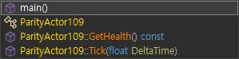
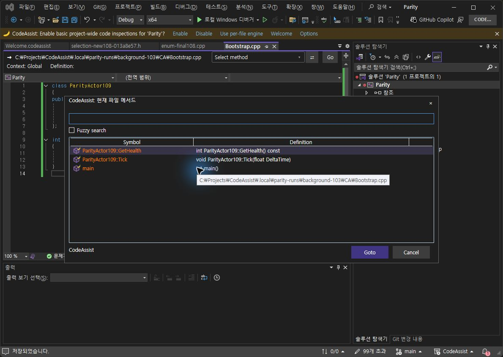
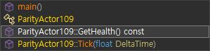
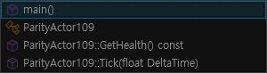

> 보관 기록입니다. 아래 결과는 원문 작성 시점의 내용이며, 이번 편집에서 제품 테스트를 다시 실행하지 않았습니다.

VA·CA 실제 화면 비교 및 0.0.96 재검증

## VA·CA 실제 화면 비교 — 수정과 재검증

시작 2026-10-22T23:45:22+09:00 · 갱신 2026-10-23T00:59:59.999819+09:00

**전체 검증 완료 상태가 아닙니다.**

Computer Use 연결 복구, CA 0.0.95→0.0.96 적용, 6개 설치 바이너리 해시 확인을 완료했습니다. Alt+M UI를 실제 원본과 대조하여 수정했습니다. 현재 Windows 보안 창이 최종 이동 검증 클릭을 차단하여 사용자 직접 처리를 기다리고 있습니다.

## 실제 실행으로 확인한 결과

- 0.0.95: CA Alt+M은 큰 메서드 대화상자, VA는 작은 드롭다운이었습니다.

- 0.0.96: CA도 왼쪽 탐색 막대의 드롭다운으로 열리고, 클래스 포함 목록 이름·순서 **4/4개(100%)**가 관찰한 VA 목록과 같습니다.

- 이 팝업에만 적용한 초기 자체 UI 체크는 **7/9개(77.78%)**입니다. 전체 제품이나 모든 UI의 유사도가 아닙니다.

- 실제 Alt+M으로 목록이 열린 키 입력 관찰은 **1/22개(4.55%)**입니다. 전체 기능 작동·전체 단축키 검증률로 해석하지 않습니다.

- 원본 GetHealth 이동은 5행 15열입니다. 새 CA의 최종 이동 클릭은 보안 창으로 차단되어 미검증입니다.

- 회귀 테스트 **288/288개 통과**, 신규 회귀 3개. 단위 테스트 통과를 VA 일치로 계산하지 않습니다.

- VS2019·Modern 빌드 성공. 실제 IDE 검증은 이 PC의 VS2022 범위입니다.

## Editor 옵션: 틀은 가깝지만 세부 항목 차이

VA 10.9.2630.0 / Editor

CA 0.0.95 / Editor

## Suggestions 옵션: 그룹 구성과 항목 차이

VA / Suggestions

CA 0.0.95 / Suggestions

## Alt+M 수정 전

VA 작은 드롭다운 / 클래스 포함 4항목

CA 0.0.95 큰 대화상자 / 메서드 3항목

## Alt+M 수정 후 실제 촬영

VA 299×74 드롭다운

CA 0.0.96 300×82 드롭다운

## 단일 팝업 자체 UI 체크

각 항목 1점, 기하 차이 허용 8px. 같은 텍스트·목록 구조와 실제 프레임을 대상으로 한 제한된 체크이며 픽셀 일치율이 아닙니다.

| 확인 항목 | 판정 |
| --- | --- |
| 단축키 Alt+M으로 작은 드롭다운 열기 | 일치 |
| 탐색 막대 왼쪽 앵커 위치: 차이 6×3px | 일치 |
| 팝업 너비: VA 299px / CA 300px | 일치 |
| 팝업 높이: VA 74px / CA 82px | 일치 |
| 클래스를 포함한 4개 항목 | 일치 |
| 동일한 이름·서명·정렬 순서 | 일치 |
| 클래스/메서드 아이콘 종류 | 일치 |
| 타입·함수 이름의 세부 텍스트 색상 | 차이 |
| 접근성 목록 이름이 표시 이름으로 노출됨 | 차이 |

## 미완료와 다음 재검증

- Windows 보안 창을 사용자가 직접 처리한 뒤 새 CA의 GetHealth 선택·최종 이동 좌표를 재검증합니다.

- 0.0.97 접근성 표시 이름·심볼 색상 수정 후보를 적용하고 실제 목록 이름과 색상을 재검증합니다. 현재 설치는 0.0.96입니다.

- 타입/함수 글자색은 0.0.97 후보 소스에 반영했고, 실제 설치 화면에서 색상·테마·색상 끄기 동작을 확인해야 합니다.

- 나머지 키 입력, 다른 탐색·추천·리팩터링 동작, 옵션 페이지, 라이트 테마를 확대 검증합니다.

## 108개 기준표: 이번 회차 범위

이번 회차는 메서드 목록과 옵션 화면의 일부 경로 관찰입니다. 108개 전체 새 실행 완료로 계산하지 않습니다. 기존 대표 일치 17/108(15.74%)는 CA 0.0.94 기록이며 현재 0.0.96의 제품 동기화율이 아닙니다. 문서 부분 명세 확보는 108/108(100%), 전체 역분석 완료를 뜻하지 않습니다.

| ID | 기능 | 이번 회차 |
| --- | --- | --- |
| VA-F001 | Find by Context | 이번 회차 미실행 |
| VA-F002 | Find References | 이번 회차 미실행 |
| VA-F003 | Find Symbol in Solution | 이번 회차 미실행 |
| VA-F004 | GoTo Implementation | 이번 회차 미실행 |
| VA-F005 | GoTo Member | 이번 회차 미실행 |
| VA-F006 | GoTo Related | 이번 회차 미실행 |
| VA-F007 | Highlight Current Line | 이번 회차 미실행 |
| VA-F008 | List Methods in File | 부분 관찰: UI 수정·목록 4항목 확인, 최종 이동 보류 |
| VA-F009 | Move Scope | 이번 회차 미실행 |
| VA-F010 | Navigate Back and Forward | 이번 회차 미실행 |
| VA-F011 | Open Corresponding File | 이번 회차 미실행 |
| VA-F012 | Open File in Solution | 이번 회차 미실행 |
| VA-F013 | VA Hashtags | 이번 회차 미실행 |
| VA-F014 | VA Navigation Bar | 이번 회차 미실행 |
| VA-F015 | Access to Refactoring Commands | 이번 회차 미실행 |
| VA-F016 | Change Signature | 이번 회차 미실행 |
| VA-F017 | Convert Between Pointer and Instance | 이번 회차 미실행 |
| VA-F018 | Encapsulate Field | 이번 회차 미실행 |
| VA-F019 | Extract Method | 이번 회차 미실행 |
| VA-F020 | Introduce Variable | 이번 회차 미실행 |
| VA-F021 | Move Implementation to Header File | 이번 회차 미실행 |
| VA-F022 | Move Implementation to Source File | 이번 회차 미실행 |
| VA-F023 | Move Method Implementations to Source File | 이번 회차 미실행 |
| VA-F024 | Move Selection to New File | 이번 회차 미실행 |
| VA-F025 | Rename | 이번 회차 미실행 |
| VA-F026 | Rename Files | 이번 회차 미실행 |
| VA-F027 | Simplify Instance Declaration | 이번 회차 미실행 |
| VA-F028 | Add Forward Declaration | 이번 회차 미실행 |
| VA-F029 | Add Member | 이번 회차 미실행 |
| VA-F030 | Add Missing Case Statements | 이번 회차 미실행 |
| VA-F031 | Add Similar Member | 이번 회차 미실행 |
| VA-F032 | Add Using Directive | 이번 회차 미실행 |
| VA-F033 | Add include Directive | 이번 회차 미실행 |
| VA-F034 | Add/Remove Braces | 이번 회차 미실행 |
| VA-F035 | Create Declaration | 이번 회차 미실행 |
| VA-F036 | Create File | 이번 회차 미실행 |
| VA-F037 | Create from Usage | 이번 회차 미실행 |
| VA-F038 | Create Implementation | 이번 회차 미실행 |
| VA-F039 | Create Method Implementations | 이번 회차 미실행 |
| VA-F040 | Document Method | 이번 회차 미실행 |
| VA-F041 | Implement Interface / Virtual Methods | 이번 회차 미실행 |
| VA-F042 | Acronyms | 이번 회차 미실행 |
| VA-F043 | Auto-Extend Multi-Line Comments | 이번 회차 미실행 |
| VA-F044 | Enhanced Listboxes | 이번 회차 미실행 |
| VA-F045 | Format After Paste | 이번 회차 미실행 |
| VA-F046 | Insert () and Closing Brackets and Quotes | 이번 회차 미실행 |
| VA-F047 | Insert _ After m and Shift | 이번 회차 미실행 |
| VA-F048 | Multiple Clipboards | 이번 회차 미실행 |
| VA-F049 | Reset Editor Zoom | 이번 회차 미실행 |
| VA-F050 | Shorthand | 이번 회차 미실행 |
| VA-F051 | Smart Select | 이번 회차 미실행 |
| VA-F052 | Smart Suggestions | 이번 회차 미실행 |
| VA-F053 | Sort Selected Lines | 이번 회차 미실행 |
| VA-F054 | Suggestion Lists | 이번 회차 미실행 |
| VA-F055 | Surround Selection | 이번 회차 미실행 |
| VA-F056 | Surround With | 이번 회차 미실행 |
| VA-F057 | Column Indicator | 이번 회차 미실행 |
| VA-F058 | Context Field | 이번 회차 미실행 |
| VA-F059 | Definition Field | 이번 회차 미실행 |
| VA-F060 | Enhanced Syntax Coloring | 이번 회차 미실행 |
| VA-F061 | Local Symbols in Bold | 이번 회차 미실행 |
| VA-F062 | Highlight Find Results | 이번 회차 미실행 |
| VA-F063 | Highlight Matching Words | 이번 회차 미실행 |
| VA-F064 | Highlight References to Symbol Under Cursor | 이번 회차 미실행 |
| VA-F065 | Parameter Info | 이번 회차 미실행 |
| VA-F066 | Print in Color | 이번 회차 미실행 |
| VA-F067 | Quick Info | 이번 회차 미실행 |
| VA-F068 | System Symbols in Italics | 이번 회차 미실행 |
| VA-F069 | Convert Dot to -> | 이번 회차 미실행 |
| VA-F070 | Highlight Files in Output Window | 이번 회차 미실행 |
| VA-F071 | Highlight Matching Braces and Parentheses | 이번 회차 미실행 |
| VA-F072 | Highlight Mismatching Braces and Parentheses | 이번 회차 미실행 |
| VA-F073 | Repair Case | 이번 회차 미실행 |
| VA-F074 | Underline Spelling Errors | 이번 회차 미실행 |
| VA-F075 | Underline Unknown Symbols | 이번 회차 미실행 |
| VA-F076 | Code Inspection Settings | 이번 회차 미실행 |
| VA-F077 | Code Issues in the Editor | 이번 회차 미실행 |
| VA-F078 | Quick Fixes in the Editor | 이번 회차 미실행 |
| VA-F079 | Quick Fixes in a Tool Window | 이번 회차 미실행 |
| VA-F080 | VA Snippets | 이번 회차 미실행 |
| VA-F081 | for Refactoring | 이번 회차 미실행 |
| VA-F082 | for Smart Suggestions | 이번 회차 미실행 |
| VA-F083 | for Surround With | 이번 회차 미실행 |
| VA-F084 | with Shortcuts | 이번 회차 미실행 |
| VA-F085 | Create from Selection | 이번 회차 미실행 |
| VA-F086 | Environment Placeholders | 이번 회차 미실행 |
| VA-F087 | Input Placeholders | 이번 회차 미실행 |
| VA-F088 | Reserved Strings | 이번 회차 미실행 |
| VA-F089 | Address Resolver | 이번 회차 미실행 |
| VA-F090 | PDB Explorer | 이번 회차 미실행 |
| VA-F091 | VA Memory View | 이번 회차 미실행 |
| VA-F092 | VA Step Filter | 이번 회차 미실행 |
| VA-F093 | VA Outline | 이번 회차 미실행 |
| VA-F094 | VA View | 이번 회차 미실행 |
| VA-F095 | Simple Link Patterns | 이번 회차 미실행 |
| VA-F096 | Complex Link Patterns | 이번 회차 미실행 |
| VA-F097 | Connect to FogBugz and GitHub | 이번 회차 미실행 |
| VA-F098 | Preview Files | 이번 회차 미실행 |
| VA-F099 | Open Hyperlinks in an External Browser | 이번 회차 미실행 |
| VA-F100 | Custom Plug-ins | 이번 회차 미실행 |
| VA-F101 | Context Menus | 이번 회차 미실행 |
| VA-F102 | Custom File Extensions | 이번 회차 미실행 |
| VA-F103 | Keyboard Shortcuts | 이번 회차 미실행 |
| VA-F104 | Mouse | 이번 회차 미실행 |
| VA-F105 | Multiple Platforms | 이번 회차 미실행 |
| VA-F106 | Non-Microsoft Build Processes | 이번 회차 미실행 |
| VA-F107 | Parse Concurrency | 이번 회차 미실행 |
| VA-F108 | Options Dialog | 부분 관찰: Editor/Suggestions 화면 비교. 저장·모든 옵션 동작 인증 아님 |

## 지속 목표

[VA·CA 반복 검증 지속 목표](../assets/imports/docs/validation/live-parity-goal.md) — UI·기능·실제 단축키를 비교하고 차이를 수정·재검증하여 검증된 일치율을 100%에 최대한 가깝게 높입니다. 실패·미판정·미실행을 통과로 계산하지 않습니다. 목표는 활성 상태이며 아직 달성하지 않았습니다.

## 시간·검색·근거

제안 시간: 첫 점검 결과 10분 이내. 현재 경과 74.6분. 전체 미완료이므로 완료 시각으로 보고하지 않습니다.

사용 — ContextBar/NavigationCommands/KeyboardCompatibility 검색, 현재 소스와 실행 화면으로 검증

기계 판독 결과 · 촬영·실행 근거 해시 · 설치 바이너리 확인 · 회귀 테스트

## 원문과 편집 이력

[보존된 원문 열기](../assets/imports/docs/validation/live-109/index-before-098.html)

- 원문 SHA-256: `68480de1060eb92d376318e0129540ff1838e10942768ca5ff46c14c169bebc9`
- 표시 날짜는 원본 파일의 수정 시각입니다. 작업 완료 시각은 원문에 있는 값을 기준으로 확인합니다.
