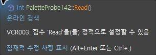
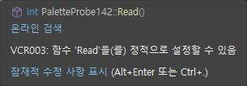
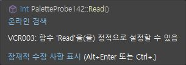
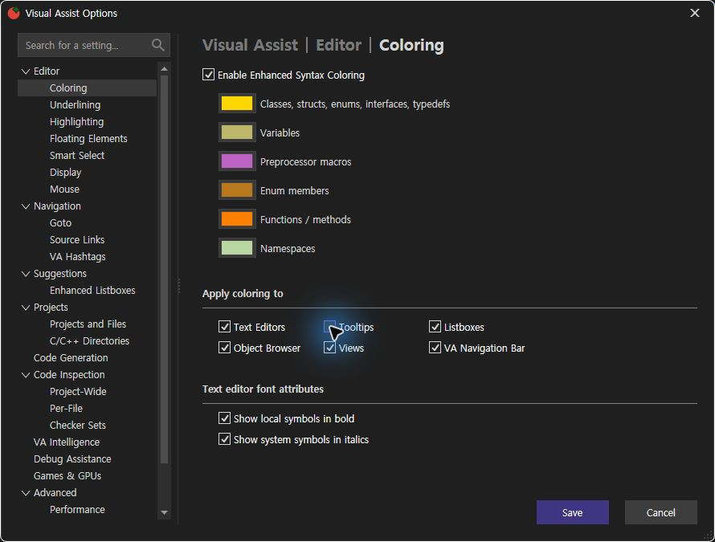
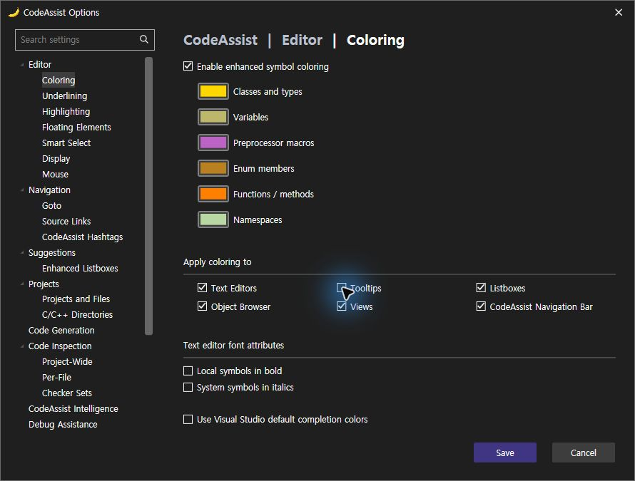

> 보관 기록입니다. 아래 결과는 원문 작성 시점의 내용이며, 이번 편집에서 제품 테스트를 다시 실행하지 않았습니다.

QuickInfo 중복 수정·실제 대조158

## 0.0.158 — 툴팁 중복 원인 수정·실제 대조

이번 관측 툴팁 결함 해결 **100% (3/3)**. 제품 전체 동기화율이 아닙니다. 전체 작업은 진행 중이며 색상 토글의 기능 효과·키 누름 유지·나머지 범위는 별도로 남아 있습니다.

| 결함 | 현재 판정 | 근거 |
| --- | --- | --- |
| 다른 파일의 Read 후보 제거 | 해결 확인 | 현재 Query candidates=1 및 현재 선언 범위 회귀 |
| 불필요한 CodeAssist 제목·파일 경로 제거 | 해결 확인 | 710과761/775 화면 비교 |
| 기본 서명과 CA 서명 중복 제거 | 해결 확인 | 761/775 추가 int Read() 없음 및 suppressed nativeSignature=True 로그 |

## 확인된 원인

C++ 기본 서명의 cppFunction/namespace 표시 문자열에 U+200B·U+200C 문자가 포함돼 단순 이름·괄호 비교가 실패했습니다. 표시 비교에서 Unicode Format 문자를 제거하되 기본 모델은 그대로 유지했습니다. 현재 로그에서 `QuickInfoFallback suppressed nativeSignature=True`와 화면에서 추가 서명 소멸을 확인했습니다.

## Tooltips On — 같은 Read 선언

VA

CA158

## Tooltips Off — 같은 Read 선언

VA

CA158

같은 browser107.cpp의 바이트 일치: True. 실제 On/Off 저장과 양쪽 촬영을 수행했지만 이 기본 C++ 툴팁에서는 가시적 색상 변화가 확인되지 않았습니다. 따라서 이 무변화를 토글 기능 완전 통과로 올리지 않습니다.

## 수정 전 CA

## 설정·복원

VA Off 저장 전

CA Off 저장 전

현재 두 설정은 모두 On으로 복원했습니다. CA 저장값 · VA 저장값. VA는 설정 저장 후 프로세스 종료가 관측돼 PID 소멸 확인 후 검사 프로필만 복구했습니다. 원인을 추정하거나 통과로 계산하지 않습니다.

## 키 입력 근거

편집기 Right 실제 입력: 커서 열11→12, 파일 내용 동일. 색상 팝업 Tab은 Hex 포커스 보고가 유지돼 미판정입니다. 공식 키 API의 Right20 묶음은 실제3칸 이동이어서 실제 누름 유지 속도 검사 대용으로 쓰지 않습니다.

반복 입력 기준값 · 단일 키 전 · 단일 키 후

## 범위별 수치

CA 공통 회귀 **436/436 (100%)**, 설치 DLL6/6 일치. 기존 선택 옵션 양쪽 근거 **10/12 (83.33%)**, 기존 표본 On/Off 일치7/12 (58.33%)를 유지했습니다. 전체 제품 동기화율은 아직 확정되지 않았습니다. 문서·도움말 기반 부분 명세108/108 (100%)는 전체 역분석 완료율과 구분합니다.

## 다음 동일 입력 시나리오

기본 VS가 보지 못하는 별도 헤더 선언의 ReadHiddenTooltip159를 양쪽에 동일하게 준비했습니다. 이 제품 자체 폴백 툴팁의 On/Off 효과를 검사할 예정이며 아직 실행 통과가 아닙니다. 시나리오

제안20–30분 / 기록2026-10-24T08:33:32.955172+09:00 / 경과1642초. XERJ: 사용 — 누락은 현재 소스로 보완.

원시 결과 · 실제 로드 DLL · 436 회귀 결과 · 실행 로그

## 원문과 편집 이력

[보존된 원문 열기](../assets/imports/docs/validation/options-158/index.html)

- 원문 SHA-256: `a061cc68b56bbcb34792509b1788662a45927198c32d740f7260336eb82d9fb8`
- 표시 날짜는 원본 파일의 수정 시각입니다. 작업 완료 시각은 원문에 있는 값을 기준으로 확인합니다.
