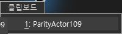
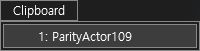
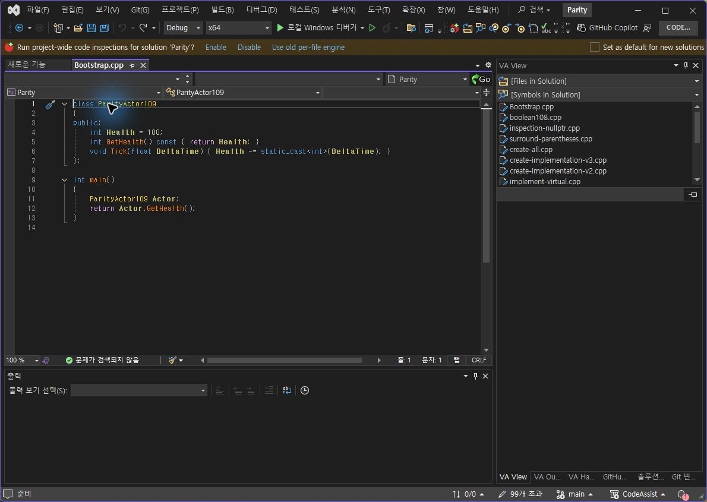
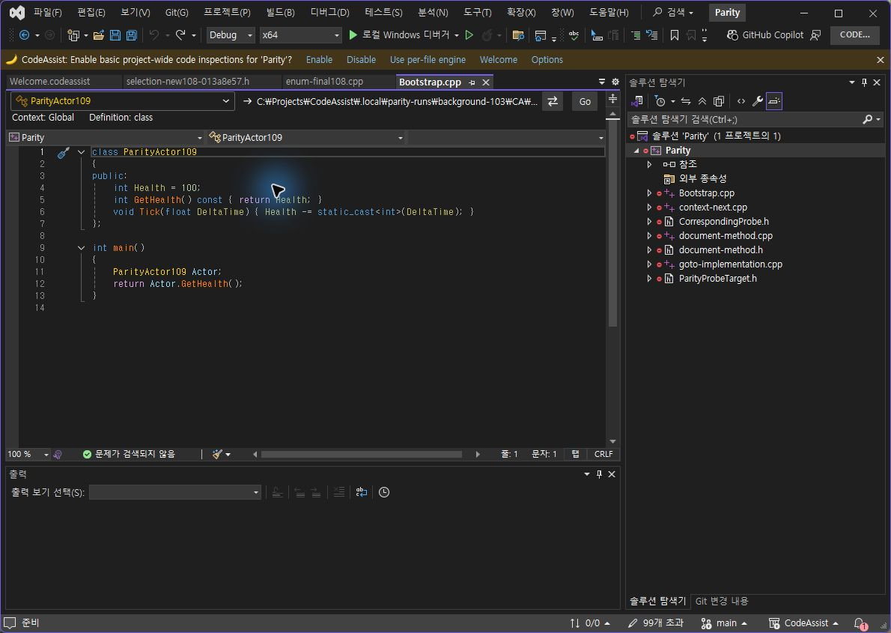
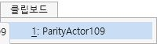
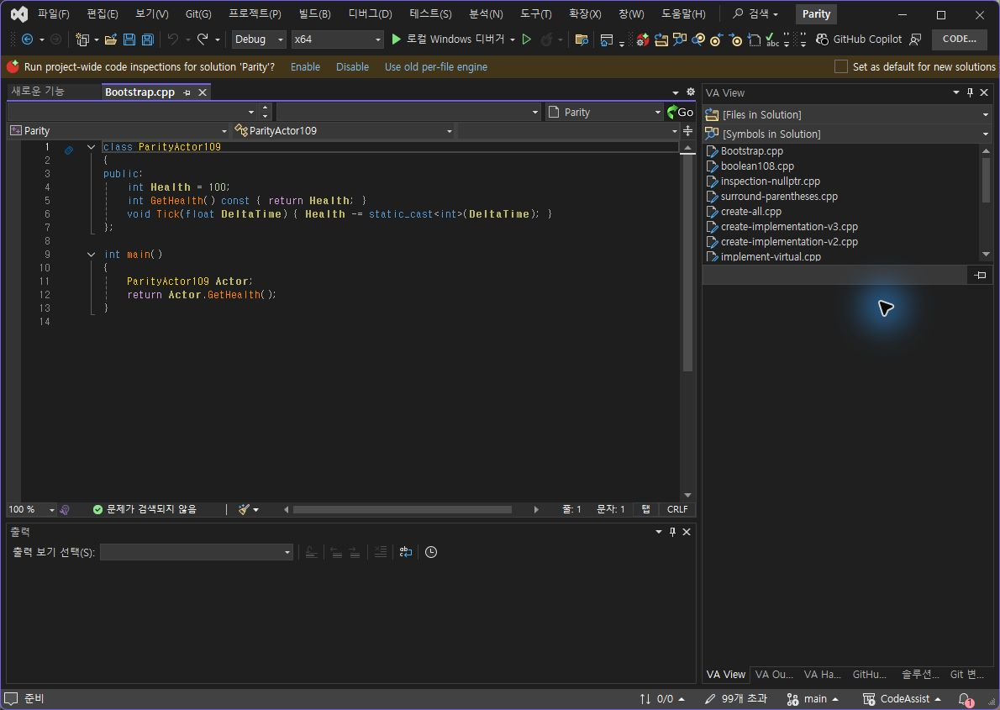
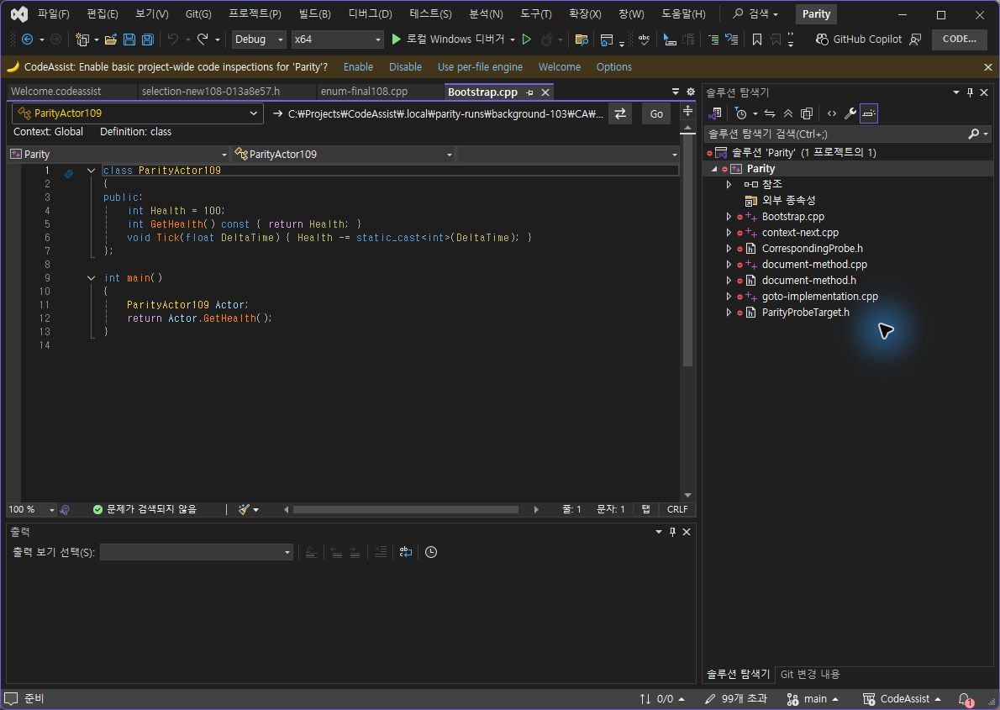

> 보관 기록입니다. 아래 결과는 원문 작성 시점의 내용이며, 이번 편집에서 제품 테스트를 다시 실행하지 않았습니다.

동일 조건 취소·라이트 대조 107

## 0.0.107 동일 조건 취소 · 실제 라이트 테마 대조

새 실제 시나리오: 양쪽 Ctrl+Home으로 1행1열·선택 없음 배치. 전체 본문 및 선택 상태가 같은 것을 읽기 전용 DTE로 확인한 뒤 Ctrl+Shift+V → Escape. 양쪽 본문·선택 범위가 실행 전후 유지됐습니다. 새 동일 조건 대조 1/1(100%) 일치.

이전 클릭 대조와 합친 클립보드 시나리오 누적은 2/2입니다. 이전 실행을 이번 새 통과로 계산하지 않습니다. 전체 제품 동기화율이 아닙니다. [이전 보고서](../assets/imports/docs/validation/clipboard-107/index.html)의 취소 제외 기록은 당시 결과로 보존합니다.

## 실제 VS 라이트 테마

검사 프로필 각각 도구 → 테마 → 밝게를 선택했습니다. 같은 클립보드 메뉴 촬영 결과: 양쪽 메뉴가 밝은 배경·어두운 글자로 표시됩니다. VA는 선택 행이 연한 파랑, CA는 회색입니다. 이 디자인 차이는 미일치로 남깁니다.

## 원래 다크 테마 복구

검사 프로필 둘을 도구 → 테마 → 어둡게로 복구하고 실제 화면을 확인했습니다.

미완료: 라이트 선택 팔레트, 메뉴 높이 5px, 다른 옵션·메뉴·전체 108개 기능의 현재 버전 실행 대조. 문서 부분 명세 확보 108/108(100%)는 전체 역분석 완료율이 아닙니다. 전체 목표는 진행 중입니다.

결과·촬영 해시 · VA 실행 전 · VA 실행 후 · CA 실행 전 · CA 실행 후

XERJ: 미사용 — 이번 단계는 GUI 실행 대조로 코드 검색 불필요.

## 원문과 편집 이력

[보존된 원문 열기](../assets/imports/docs/validation/cancel-light-107/index.html)

- 원문 SHA-256: `077b37cf71bc04333add88e2c7f3c020228f1d74a8ff723da6bd4e4721e3287e`
- 표시 날짜는 원본 파일의 수정 시각입니다. 작업 완료 시각은 원문에 있는 값을 기준으로 확인합니다.
