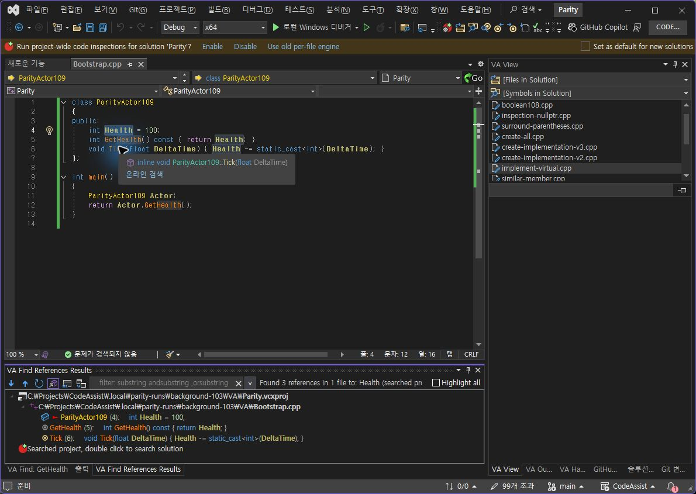
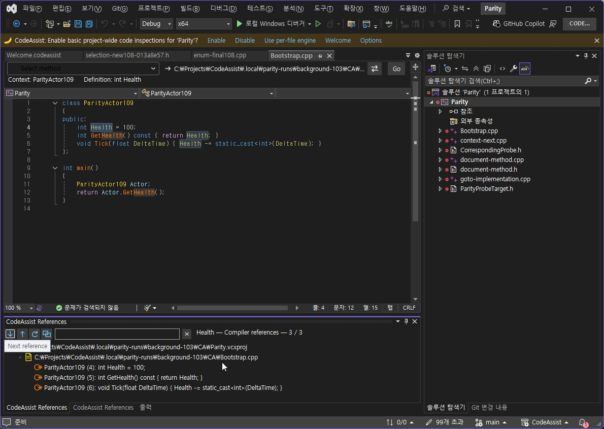
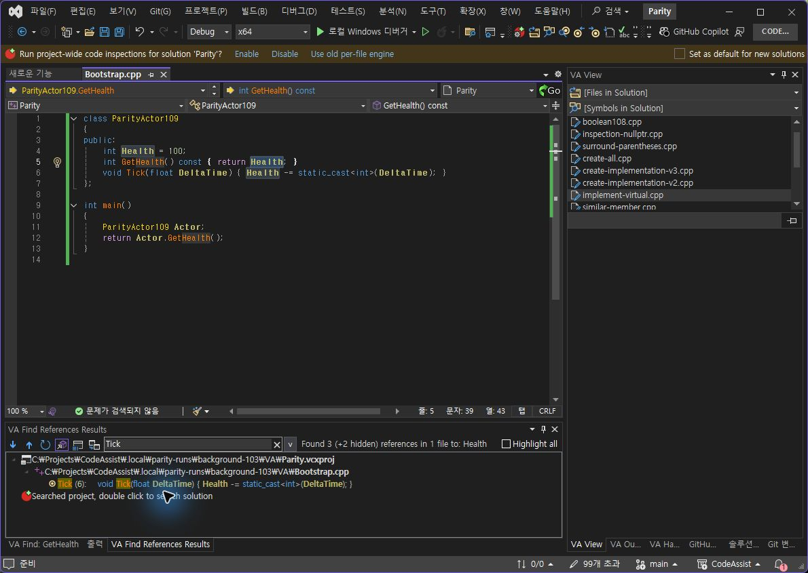
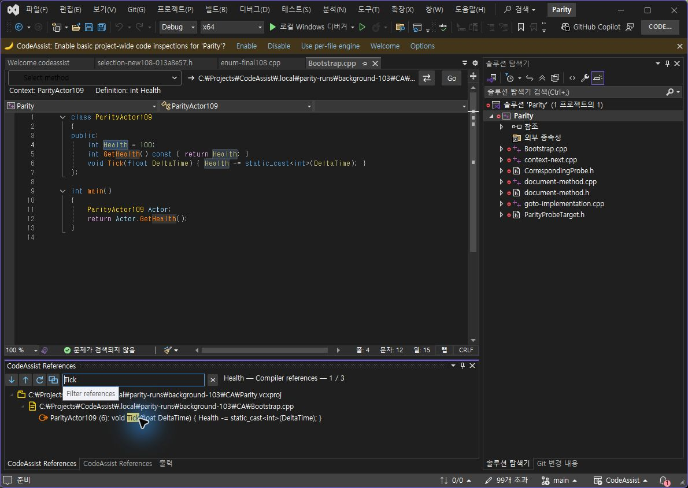
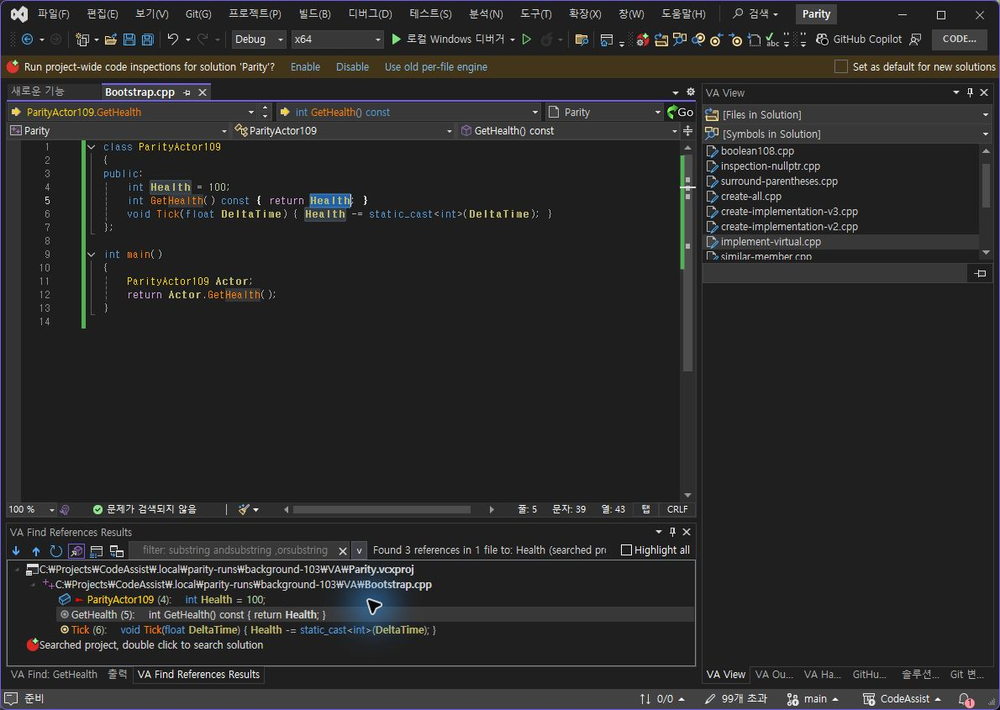
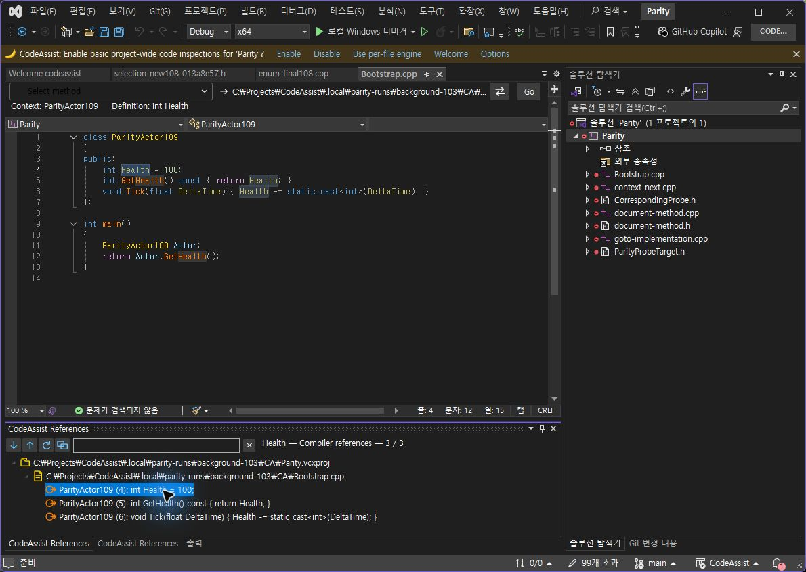

> 보관 기록입니다. 아래 결과는 원문 작성 시점의 내용이며, 이번 편집에서 제품 테스트를 다시 실행하지 않았습니다.

실제 VA CA 대조 0.0.121

## 실제 VA·CA 0.0.121 대조

Computer Use로 실제 선택·Alt+Shift+F·필터·F8 입력을 수행했습니다. 저장된 DTE 읽기 결과에서 Health 입력 문서·선택 범위가 동일함을 확인했습니다. 파일 내용은 변경하지 않았습니다.

시도 3개 중 대표 결과 2개 일치(66.67%), 1개 재검증. 판정된 2개에서는 2/2 일치입니다. 전체 기능 인증은 0/108이며 제품 전체 동기화율이 아닙니다.

Health 참조 행은 양쪽 4·5·6, Tick 필터 후에는 양쪽 6행입니다. F8은 VA 5행·CA 4행이었지만 CA의 최초 결과 선택이 확실히 성립했는지 확인되지 않아 오류나 통과로 단정하지 않았습니다.

## 현재 화면의 차이

- CA 참조 창에 상속·오버라이드 참조 표시 토글이 없습니다.

- CA 참조 창에 전체 프로젝트 참조 표시 토글이 없습니다.

- VA의 전체 강조 체크박스가 CA 참조 창에 없습니다.

- CA 문맥·메서드 표시줄의 행 수와 배치가 VA와 다릅니다.

- Health 결과의 소속 이름이 다릅니다. VA는 GetHealth/Tick, CA는 ParityActor109로 표시합니다.

- 현재 CA 프로필에서 제품 도구 모음이 보이지 않습니다. 구현 자체가 없다고 단정하지 않았습니다.

CA의 영어 UI는 현재 언어 설정 확인 전까지 번역 결함으로 단정하지 않았습니다. 다른 작업과의 입력 충돌 오류는 감지되지 않았습니다. 가려진 VA 관찰866의 잘못된 CA 이미지는 비교에서 제외했습니다.

## 同一 Health 검색

VA

CA 0.0.121

## 동일 Tick 필터

VA

CA 0.0.121

## F8 관찰 — 재검증 필요

VA

CA 0.0.121

결과·제한 JSON · VA 동일 입력 근거 · CA 동일 입력 근거

## 원문과 편집 이력

[보존된 원문 열기](../assets/imports/docs/validation/live-paired-121/index.html)

- 원문 SHA-256: `c3d6adddb61e64c4ec37a41fc92a9c81e1c1c2cc3ea888a8f929c02d5dd6635e`
- 표시 날짜는 원본 파일의 수정 시각입니다. 작업 완료 시각은 원문에 있는 값을 기준으로 확인합니다.
