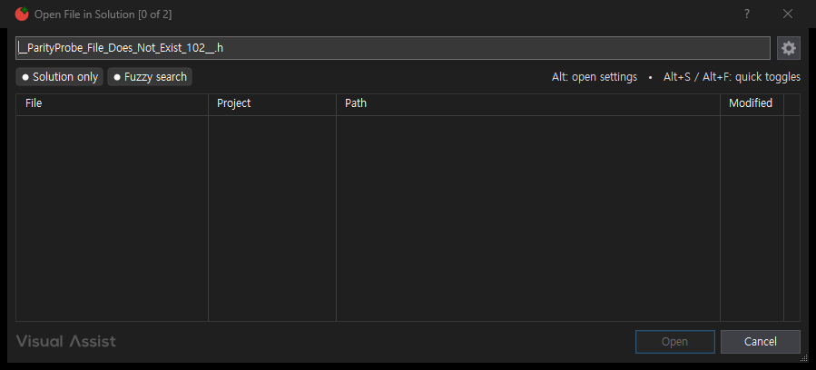
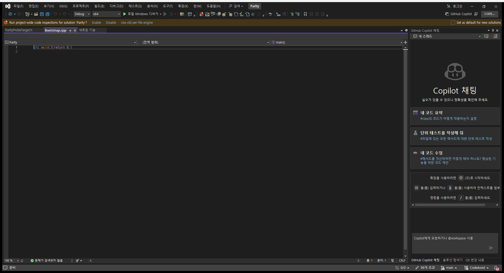
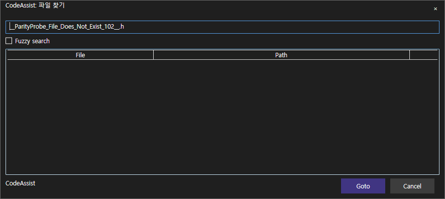
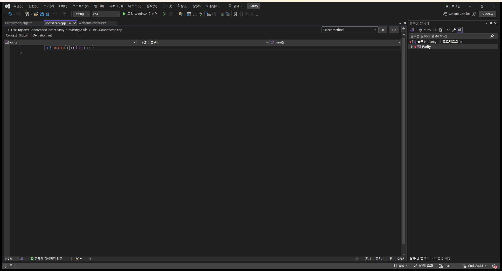

> 보관 기록입니다. 아래 결과는 원문 작성 시점의 내용이며, 이번 편집에서 제품 테스트를 다시 실행하지 않았습니다.

파일 찾기 추가 경계 검사

## 없는 파일 검색: 추가 시나리오 통과

동일 파일 찾기 검사 코드를 재사용했습니다. 새 기능 하나를 검증한 것으로 중복 집계하지 않습니다.

입력: __ParityProbe_File_Does_Not_Exist_102__.h 검색 후 취소. 기대 결과: 결과 0개, Bootstrap.cpp의 전체 경로와 원래 내용 유지.

VA·CA 모두 결과 수 0과 기존 편집 문서 경로·내용 보존을 확인했습니다. 기존 정상 파일 열기 시나리오도 재실행해 통과했습니다. 결과 수를 1로 바꾼 음성 판정도 통과로 인정하지 않았습니다.

실제 예상·결과 · 시간 비교

```
{
  "scenario": "Missing file search returns zero results and Cancel preserves original editor file/content",
  "result": "representative-match",
  "newFeature": false,
  "feature": "VA-F012",
  "pairedExecutionMs": 1585.53,
  "positiveRegressionMs": 2286.9,
  "proposedSeconds": 120,
  "elapsedSeconds": 87,
  "finishedAt": "2026-10-18T22:24:23.009444+09:00",
  "previousScenarioTotalSeconds": 303,
  "previousScenarioExecutionMs": 1813.39,
  "overall": {
    "matches": 5,
    "differences": 7,
    "unverified": 96,
    "total": 108
  },
  "negativeAssertionTest": "one nonzero result is rejected"
}
```

## VA

```
{
  "token": "80a62f0c119a49869db69f49d7152279",
  "role": "VA",
  "pid": 23468,
  "status": "complete",
  "hostUnsafe": false,
  "before": {
    "file": "C:\\Projects\\CodeAssist\\.local\\parity-runs\\single-file-101\\VA\\Bootstrap.cpp"
  },
  "after": {
    "file": "C:\\Projects\\CodeAssist\\.local\\parity-runs\\single-file-101\\VA\\Bootstrap.cpp",
    "contents": "int main(){return 0;}\r\n"
  },
  "expectedFile": "C:\\Projects\\CodeAssist\\.local\\parity-runs\\single-file-101\\VA\\Bootstrap.cpp",
  "expectedFileOpen": true,
  "expectedContent": "int main(){return 0;}\r\n",
  "driver": {
    "query": "__ParityProbe_File_Does_Not_Exist_102__.h",
    "submitted": true,
    "button": "Cancel",
    "resultCount": 0,
    "driver": "native HWND controls"
  },
  "error": null,
  "measuredActionMs": 476
}
```

[](../assets/imports/docs/validation/file-navigation-102/run/file-search-no-match/VA/searched-dialog.png)[](../assets/imports/docs/validation/file-navigation-102/run/file-search-no-match/VA/opened-editor.png)

## CA

```
{
  "token": "80a62f0c119a49869db69f49d7152279",
  "role": "CA",
  "pid": 31460,
  "status": "complete",
  "hostUnsafe": false,
  "before": {
    "file": "C:\\Projects\\CodeAssist\\.local\\parity-runs\\single-file-101\\CA\\Bootstrap.cpp"
  },
  "after": {
    "file": "C:\\Projects\\CodeAssist\\.local\\parity-runs\\single-file-101\\CA\\Bootstrap.cpp",
    "contents": "int main(){return 0;}\r\n"
  },
  "expectedFile": "C:\\Projects\\CodeAssist\\.local\\parity-runs\\single-file-101\\CA\\Bootstrap.cpp",
  "expectedFileOpen": true,
  "expectedContent": "int main(){return 0;}\r\n",
  "driver": {
    "query": "__ParityProbe_File_Does_Not_Exist_102__.h",
    "submitted": true,
    "button": "Cancel",
    "resultCount": 0,
    "labels": [
      "×",
      "CodeAssist: 파일 찾기",
      "Fuzzy search",
      "Goto",
      "Cancel",
      "CodeAssist",
      "File",
      "Path"
    ]
  },
  "error": null,
  "measuredActionMs": 510
}
```

[](../assets/imports/docs/validation/file-navigation-102/run/file-search-no-match/CA/searched-dialog.png)[](../assets/imports/docs/validation/file-navigation-102/run/file-search-no-match/CA/opened-editor.png)

## 원문과 편집 이력

[보존된 원문 열기](../assets/imports/docs/file-navigation-102.html)

- 원문 SHA-256: `564e91b59d7826553032d0ab1c57a1d5dfcb6bd64057d5f1e36b17c42156fdc2`
- 표시 날짜는 원본 파일의 수정 시각입니다. 작업 완료 시각은 원문에 있는 값을 기준으로 확인합니다.
