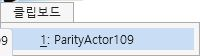
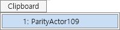
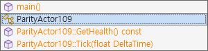
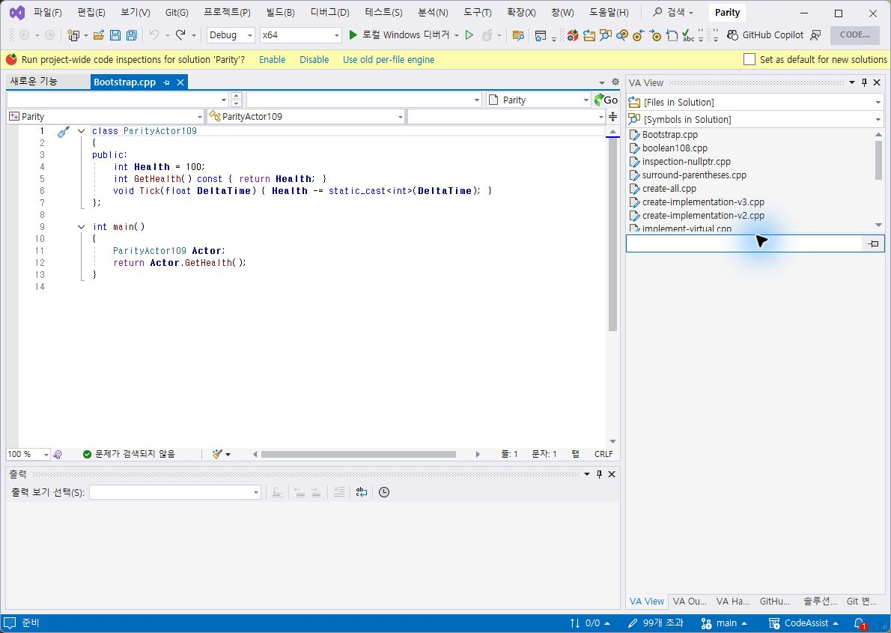
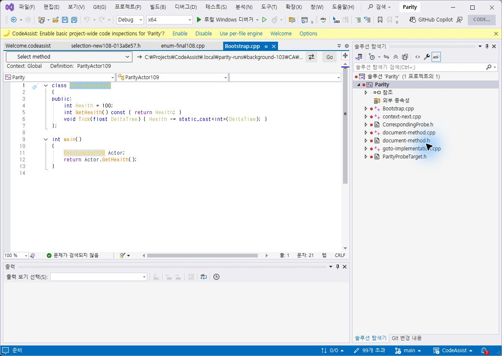
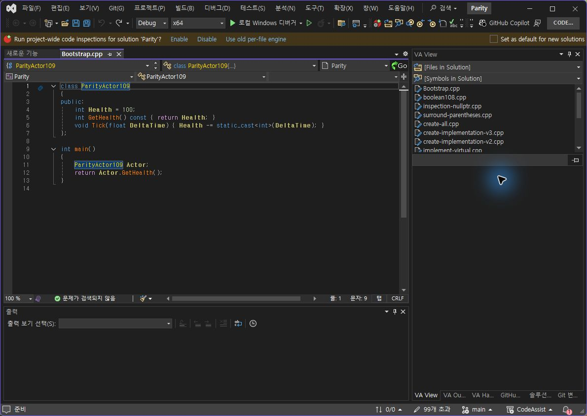
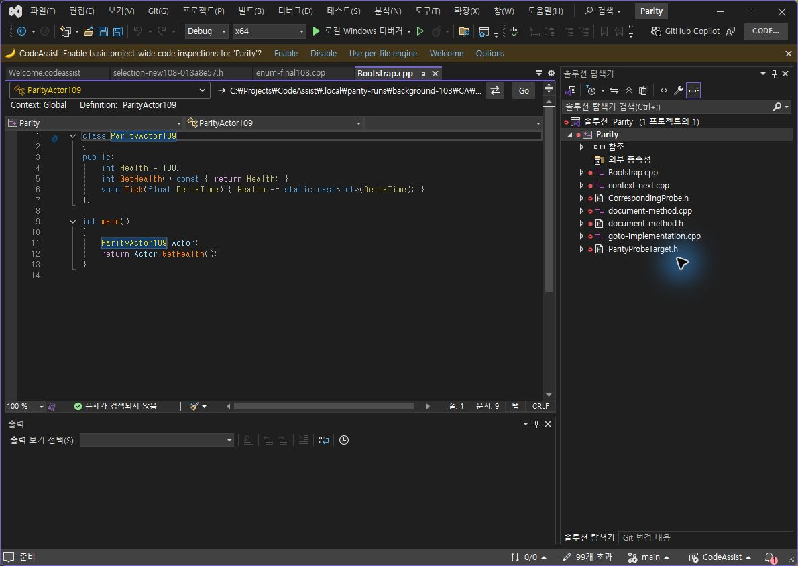

> 보관 기록입니다. 아래 결과는 원문 작성 시점의 내용이며, 이번 편집에서 제품 테스트를 다시 실행하지 않았습니다.

0.0.108 실제 라이트 재검증

## 0.0.108 실제 IDE 라이트 재검증

Computer Use 팝업 좌표 전달 방식을 바로잡아 양쪽 프로필의 실제 라이트 전환을 확인했습니다. 설치 바이너리 재확인 6/6 일치.

## VA / CA 클립보드 선택 행

선택 배경이 양쪽 모두 연한 파랑 계열로 표시됩니다. 높이·헤더 언어·테두리 세부 차이는 남아 있습니다.

## VA / CA 메서드 선택 행

VA는 흰 배경과 파란 테두리, CA는 파란 채움입니다. 두 팝업을 같은 팔레트로 처리해서는 완전히 맞지 않습니다. 실제 라이트 촬영 범위 2/2(100%), 선택 배경 기준 일치 1/2(50%)이며 전체 UI 유사도가 아닙니다.

## 라이트 코드 대비 차이

CA의 노란 심볼은 흰 배경에서 대비가 낮습니다. VA의 어두운 타입 색상과 차이가 있으며 미수정으로 기록합니다.

## 원래 다크 테마 복구

남은 작업: 메서드 선택 스타일 분리, 라이트 심볼 대비, 메뉴 세부 치수·누락 옵션, 전체 기능의 현재 실행 대조. 문서 부분 명세 108/108(100%)는 전체 역분석 완료율과 다릅니다.

판정 범위·촬영 해시 · 설치 재확인 · [재현 가능한 팝업 좌표 방식](../assets/imports/docs/validation/computer-use-popup-coordinates.md)

XERJ: 미사용 — 이번 단계는 GUI 재검증으로 코드 검색 불필요.

## 원문과 편집 이력

[보존된 원문 열기](../assets/imports/docs/validation/theme-live-108/index.html)

- 원문 SHA-256: `fd63cfddea426df08f6bdda24e190ec2953d093ad323cd97d3eadc33d636afe8`
- 표시 날짜는 원본 파일의 수정 시각입니다. 작업 완료 시각은 원문에 있는 값을 기준으로 확인합니다.
