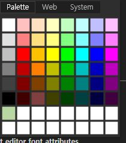
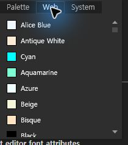
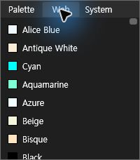
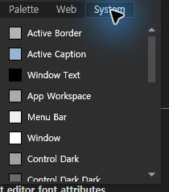
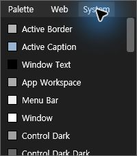
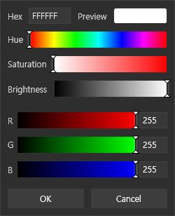
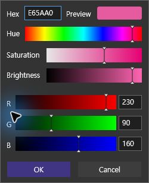
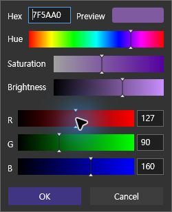
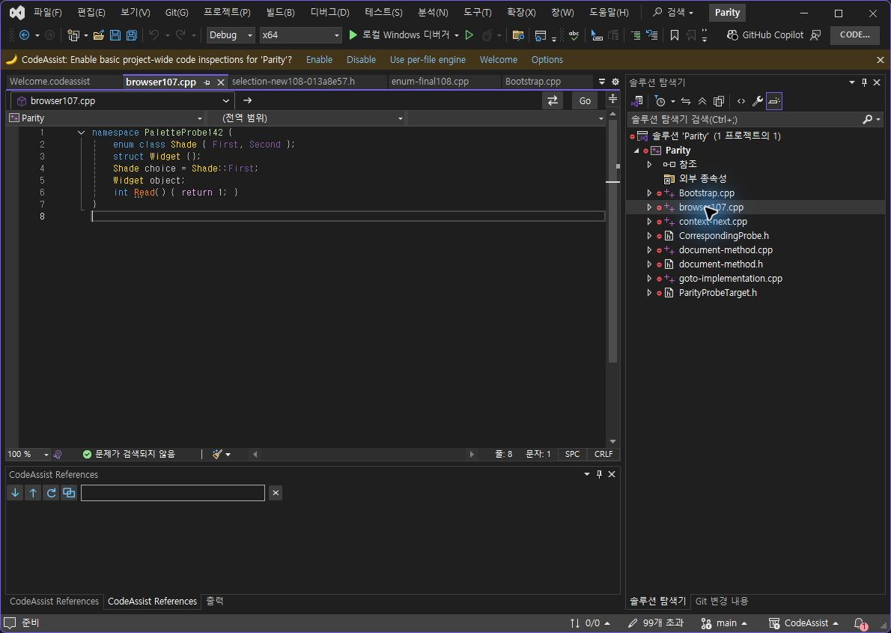

> 보관 기록입니다. 아래 결과는 원문 작성 시점의 내용이며, 이번 편집에서 제품 테스트를 다시 실행하지 않았습니다.

색상 선택기 수정·검증151

## CA0.0.151 색상 선택기

실제 설치·CLR 모듈 확인. 기록 2026-10-24T07:14:18+09:00.

**이 선택기의 배치·구조 체크9/10(90%)**, 동일 가중치10기준. 제품 전체 UI 유사도가 아닙니다. **이번 실제 조작7/10(70%)**. 통과하지 못한3개를 아래에 그대로 남깁니다. 선정 옵션 대조 근거10/12(83.33%)는 기존 범위이며 이번 검사로 전체 인증하지 않았습니다.

## 수정

VA 참고 Palette/Web/System,8×8칸·사용자 슬롯16개, Hex·미리보기·HSV·RGB와 OK/Cancel을 구현했습니다. Web/System 왼쪽 정렬, 테마 배경, RGB 막대도 수정했습니다. 한국어·영어 문자열은 기존 XML 언어표에 추가했습니다. VS2019/Modern 빌드 및 코드 테스트427/427 통과.

## 남은 실제 동작

| Palette popup opens | pass |
| --- | --- |
| Web tab switches | pass |
| System tab switches | pass |
| Custom slot opens from fresh palette | pass |
| Hex E65AA0 updates RGB230/90/160 | pass |
| Mouse slider sets Red127 / Hex7F5AA0 | pass |
| OK + options Save persists enum/custom slot | pass |
| Right click after tab roundtrip | not-passed: popup closed once; cause unconfirmed |
| Keyboard Tab focus on slider | unverified: focused element did not confirm movement |
| Reopen swatch after saved selection | not-passed: hover/click did not reopen; cause unconfirmed |

탭을 돌린 뒤 우클릭한 한 번은 팝업이 닫혔고, 새로 연 팔레트에서는 열렸습니다. 저장 후 다시 클릭했을 때도 팝업이 열리지 않았습니다. 앱/입력 도구 원인은 미확인입니다. 키보드 포커스도 통과 처리하지 않았습니다. 150에서 확인한 취소 동작은 새151 통과로 합산하지 않았습니다.

## 배치 채점

- Palette/Web/System order: 일치

- 8x8 swatch grid: 일치

- 16 custom slots: 일치

- Popup screenshot outer dimensions within4px: 차이 있음

- Named-color swatches left, names right: 일치

- Custom editor250x308: 일치

- Hex and Preview top row: 일치

- Hue/Saturation/Brightness order: 일치

- RGB ramps with numeric fields: 일치

- OK/Cancel bottom row: 일치

VA 팔레트 캡처210×238, CA200×228로 외곽 차이가 남습니다. 사용자 편집기는 양쪽250×308입니다. 내부 구조를 평가했으며 픽셀 점수로 레이아웃을 대신하지 않았습니다. 라이트 테마의 실제 실행은 이번에 검증하지 않았습니다.

## 저장·복원

슬라이더로 만든 #7F5AA0이 enum과 사용자 슬롯에 저장됐고 코드 편집기 화면도 촬영했습니다. 원복 화면 입력이 적용되지 않아, 저장된 검사 CA만 종료하고 원래 enum/namespace/사용자 팔레트 값만 설정 파일에서 복원 후 재실행했습니다. 시험 선택값을 남겨두지 않았습니다. 종료 요청의 지연도 있었으며 원인은 미확인입니다.

판정JSON · 427테스트 · 호환빌드 · 설치해시 · 실행DLL · 실제저장값 · 복원값

VA-palette (210, 238)

CA-palette-151 (200, 228)

VA-web (210, 238)

CA-web-151 (200, 228)

VA-system (210, 238)

CA-system-151 (200, 228)

VA-custom (250, 308)

CA-custom-151 (250, 308)

CA-slider-151 (250, 308)

CA-editor-151 (1190, 845)

문서·도움말 기반 부분 명세108/108(100%). 전체 역분석 완료율이 아닙니다. XERJ 사용: ColorChoice 검색·현재소스 확인.

제안20~30분. 이번 기록까지 30.1분. 전체 목표 미완료, 발견된 차이를 계속 수정합니다.

## 원문과 편집 이력

[보존된 원문 열기](../assets/imports/docs/validation/options-151/index.html)

- 원문 SHA-256: `b3c8e3d853360b62aabd45e3d2bb2a5ae2549765231377194b6b0333a32a83a8`
- 표시 날짜는 원본 파일의 수정 시각입니다. 작업 완료 시각은 원문에 있는 값을 기준으로 확인합니다.
