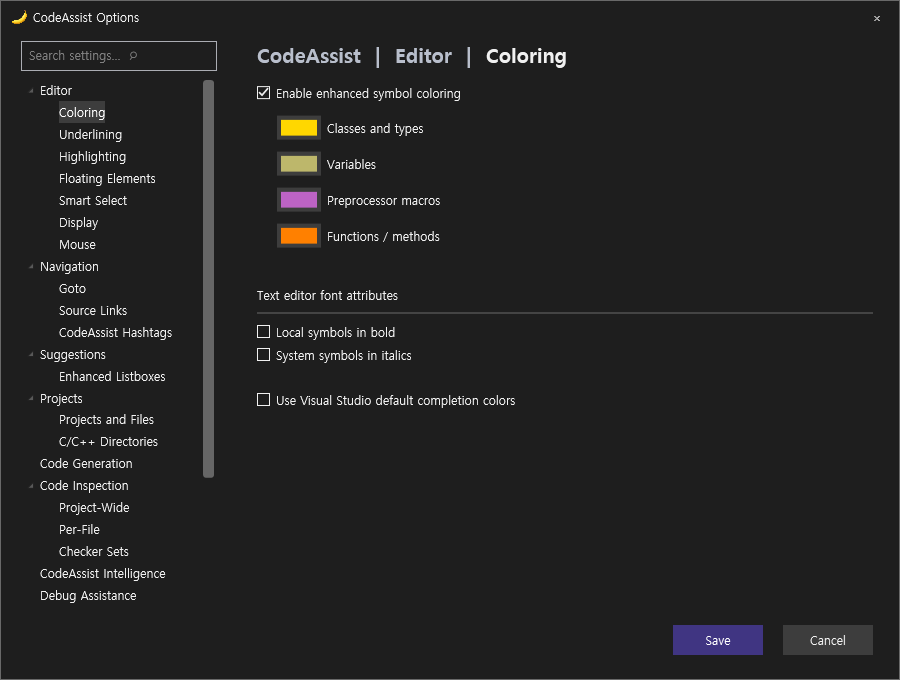
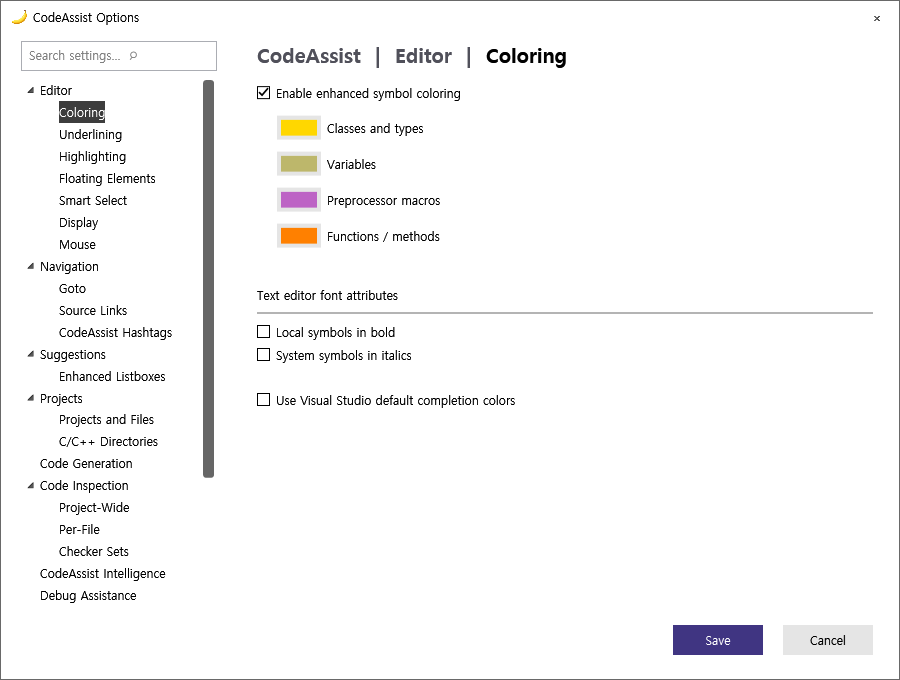
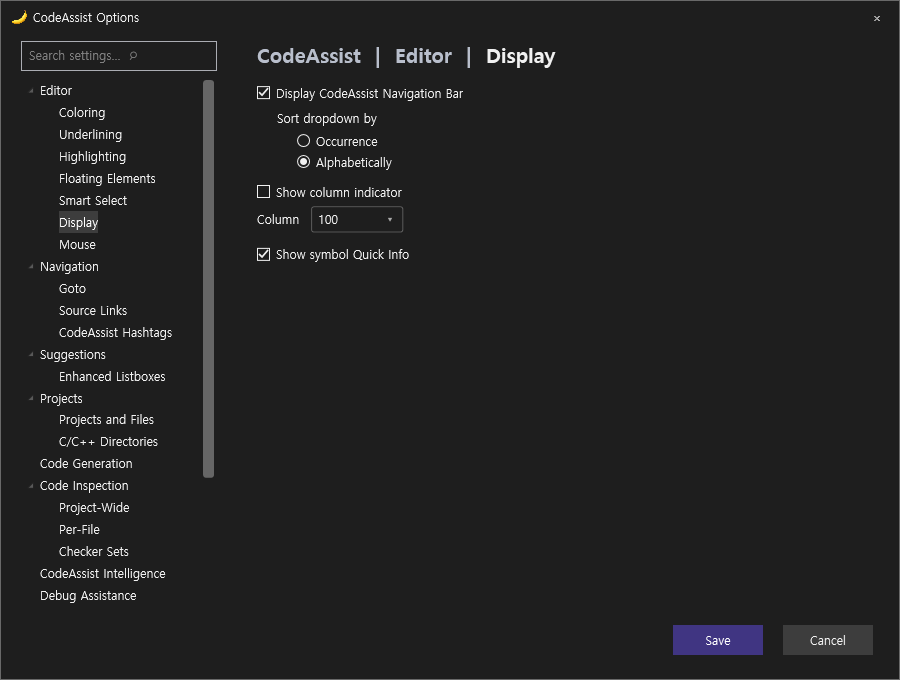
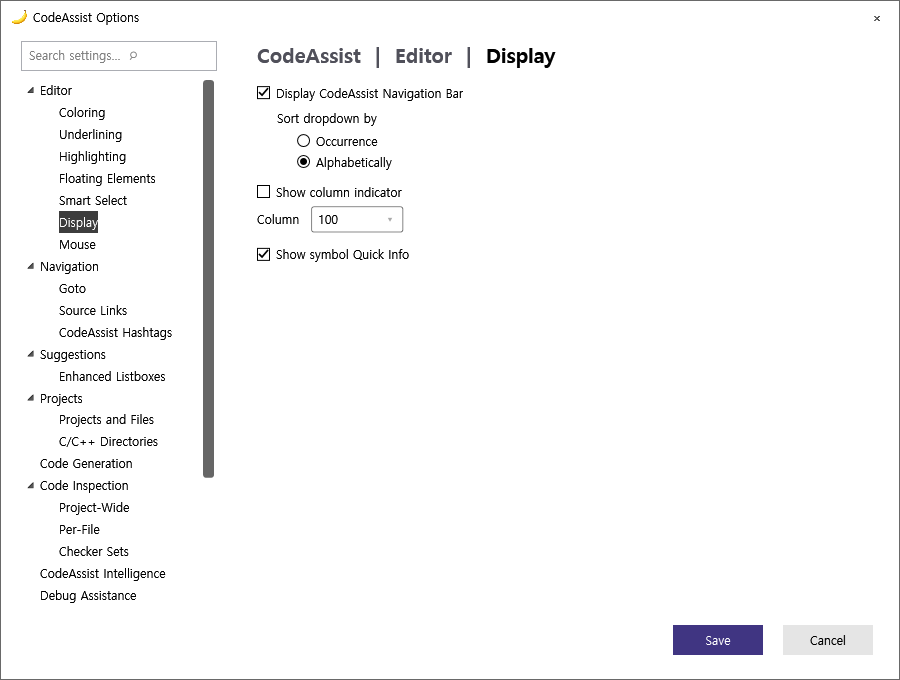
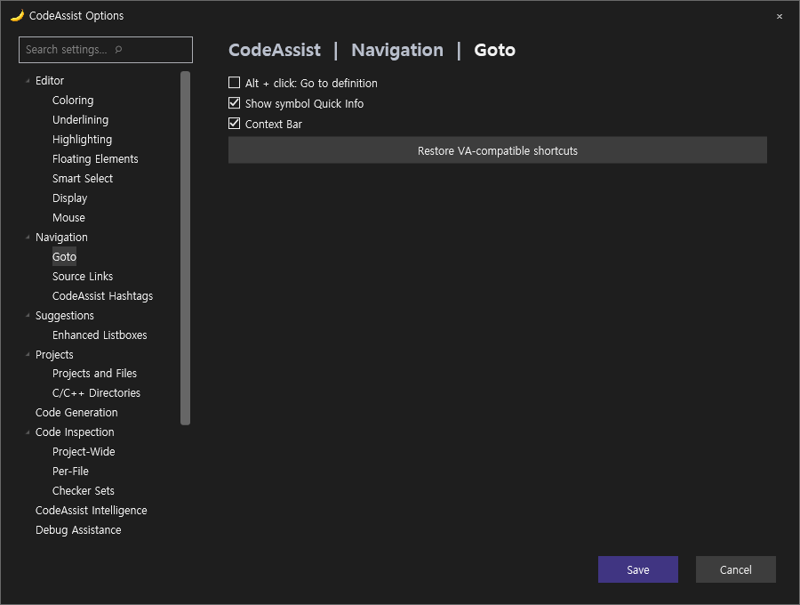
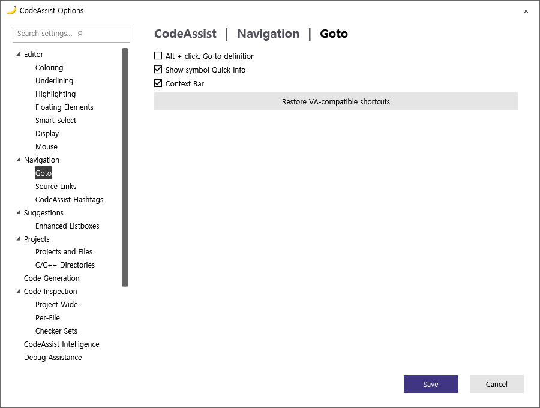
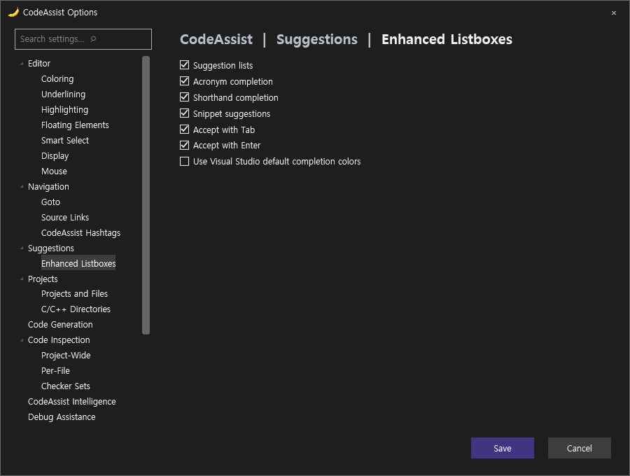
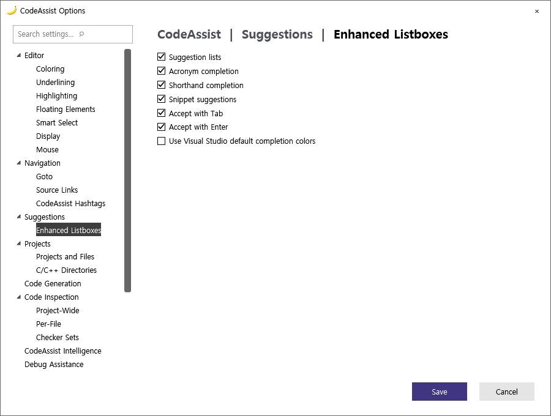

> 보관 기록입니다. 아래 결과는 원문 작성 시점의 내용이며, 이번 편집에서 제품 테스트를 다시 실행하지 않았습니다.

CodeAssist 0.0.90 UI·기능 자동 점검

## 0.0.90 UI·기능 자동 점검

**UI 픽셀 유사도 74.03% · 비교 가능한 26/66개 분류(39.39%)**. 이전 74.02%와 수치 차이는 0.01%p뿐이며 전체 UI가 크게 같아졌다는 의미가 아닙니다.

최신 CA 전체 카탈로그 108개 + 추가 14개 = **122/122 시나리오 실행**. 옵션 **17/17 페이지 관찰**. 팝업 열기·취소는 기능 검증 통과가 아닙니다.

| 검증 | 결과 |
| --- | --- |
| 코드·회귀 테스트 | 272/272 통과(100%) · VA 동기화율과 별도 |
| 기존 명시적 기대값 검사 | 4/5 일치(80%) · 주석 이어쓰기 꺼짐 상태에서 기대 불일치 |
| 설정을 켠 실제 편집 재검사 | 2/3 일치(66.67%) · 주석 이어쓰기, 점→화살표 통과 / 타입 대소문자 교정 실패 |
| 보조 다크·라이트 검사 | 영어 4페이지 × 2테마 = 8개 독립 WPF 렌더·열린 뷰 리소스 전환 통과. 실제 IDE 테마 조작은 아님. |
| 배포 패키지 | VS2019·최신 계열 빌드 2/2. 최신 계열 포함 바이너리 6개 일치, 키 바인딩 등록 24개 확인. 물리 키 입력 검증과 별도. |

## 수정 전후: 멤버 목록

함수·필드 종류를 목록에 전달해 색상과 아이콘을 적용하고, 열 제목을 심볼·정의로 수정했습니다. 함수 서명은 선언 경계에서 끊어 뒤의 세미콜론·중괄호가 붙지 않도록 수정했습니다.

0.0.89 실제 VS

0.0.90 실제 VS

## 전체 대조·원본 근거

[108개 VA·CA 대조 갤러리](../assets/imports/docs/ui-comparison-0.0.90.html) · 122개 원본 실행 기록 · 검사별 판정 · 설정 통제 후 기대값·실제값 · 272개 테스트 TRX

## VA·CA 옵션 구성 조사 — 17페이지

실제로 읽은 체크박스·라디오·입력 컨트롤 이름입니다. 한국어 번역을 영어로 정규화했습니다. 문구 차이·다른 컨트롤 종류도 불일치로 잡히므로 아래 목록만으로 미구현 개수를 단정하지 않습니다. 기존 VA 실화면과 최신 CA 실화면 기준입니다.

Goto · VA 명명 컨트롤 6 / CA 4

**VA**

- Goto

- Goto Related

- Prefer implementation on Goto

- Project

- Select symbol on Goto

- Solution

**CA**

- Alt + click: Go to definition

- Context Bar

- Search settings

- Show symbol Quick Info

Highlighting · VA 명명 컨트롤 11 / CA 7

**VA**

- Background color

- Highlight current line with:

- Highlight matching words when caret is in comments and strings

- Highlight matching { and }

- Highlight mismatching { and }

- Highlight results of Quick Find and Find in Files

- Highlight solution file paths in build output window (C/C++)

- Highlight write and read references to symbol under cursor

- Highlight write references using

- Ray lines

- Thin frame

**CA**

- Highlight current line

- Highlight find results

- Highlight matching braces

- Highlight mismatching braces

- Highlight output filenames

- Highlight references under caret

- Search settings

Display · VA 명명 컨트롤 16 / CA 6

**VA**

- Alphabetically

- Bottom

- Display VA Navigation Bar:

- Display indicator after column

- Format doxygen comments in Quick Info tooltips

- Format enhanced expansion

- Keep both original and enhanced expansions

- Occurrence

- Show Quick Info tooltips for more symbols

- Show comments from source files when available

- Show tooltips for braces and structural keywords

- Switch to integrated main menu

- Top

- Use '/' in navigation bar for include paths

- Use enhanced macro expansion

- Use last active document context for miscellaneous files

**CA**

- Alphabetically

- Display VA Navigation Bar

- Occurrence

- Search settings

- Show column indicator

- Show symbol Quick Info

VA Hashtags · VA 명명 컨트롤 3 / CA 1

**VA**

- Allow VA Hashtags that consist solely of the alpha characters of hexadecimal values

- Allow hyphens in VA Hashtags

- Display global commands in the context menu of the VA Hashtags tool window

**CA**

- Search settings

Editor · VA 명명 컨트롤 20 / CA 16

**VA**

- #

- (

- *

- /

- Convert dot to -> if operator -> is overloaded

- Convert dot to -> in C/C++

- Display paste menu with

- Double effective rate of key repeat

- Extend multi-line comments

- Format after paste

- Insert after m and Shift

- Insert () and closing } ) ] "

- Insert a space when toggling a line into a comment

- Repair case

- Surround Selection via character toggles

- With VA Snippets

- after a blank line

- on the next line

- on the same line

- {

**CA**

- (

- *

- /

- Convert pointer dot to arrow

- Extend multi-line comments

- Format after paste

- Insert () and closing brackets and quotes

- Insert a space when toggling a line into a comment

- Insert underscore after m and Shift

- Repair type name case

- Search settings

- Surround Selection via character toggles

- after a blank line

- on the next line

- on the same line

- {

Enhanced Listboxes · VA 명명 컨트롤 11 / CA 8

**VA**

- Additional characters

- Allow Acronyms and Shorthand

- Bold non-inherited members

- Default Intellisense

- Display filtering toolbar when hovering

- Enter

- List non-inherited entries first

- Prefer Acronym matches

- Shrink as you type

- Tab

- Visual Assist

**CA**

- Accept with Enter

- Accept with Tab

- Acronym completion

- Search settings

- Shorthand completion

- Snippet suggestions

- Suggestion lists

- Use Visual Studio default completion colors

Coloring · VA 명명 컨트롤 9 / CA 5

**VA**

- Enable Enhanced Syntax Coloring

- Listboxes

- Object Browser

- Show local symbols in bold

- Show system symbols in italics

- Text Editors

- Tooltips

- VA Navigation Bar

- Views

**CA**

- Enable enhanced symbol coloring

- Local symbols in bold

- Search settings

- System symbols in italics

- Use Visual Studio default completion colors

Underlining · VA 명명 컨트롤 2 / CA 2

**VA**

- Underline spelling errors in comments and strings using

- Underline unrecognized symbols using

**CA**

- Enable basic file diagnostics

- Search settings

Project-Wide · VA 명명 컨트롤 5 / CA 5

**VA**

- Confirm before applying all listed quick fixes

- Parse what is in the editor before you save

- Show the Stats tab

- Show the VA Code Inspection tool window when a question needs an answer

- Skip the Unreal Engine project when including all projects

**CA**

- Ask in the notification bar

- Disable inspections

- Per-file inspection

- Project-wide basic inspection

- Search settings

Per-File · VA 명명 컨트롤 5 / CA 2

**VA**

- Enable while debugging

- Even when on battery power

- Reparse automatically

- Show ticks in vertical scroll bar

- Underline/dim code issues

**CA**

- Enable per-file inspection

- Search settings

Code Generation · VA 명명 컨트롤 3 / CA 1

**VA**

- Include default parameter values in generated C/C++ implementations

- Insert open brace on new line during Introduce Variable and Add Braces

- Maintain order in header and source files for generated C/C++ implementations

**CA**

- Search settings

Debug Assistance · VA 명명 컨트롤 3 / CA 2

**VA**

- $(SolutionDir)\.va\

- %APPDATA%\VisualAssist\

- Enable debugger integration required by VA Step Filter for native C/C++

**CA**

- Search settings

- Step filter enabled

Source Links · VA 명명 컨트롤 2 / CA 3

**VA**

- Enable Source Links

- Show action

**CA**

- Enable

- Regular expression

- Search settings

Projects and Files · VA 명명 컨트롤 6 / CA 1

**VA**

- Display project nodes in Find References results

- Display project nodes in Rename dialog references lists

- Enumerate project references thoroughly

- Parse files without extensions as headers

- if Solution is empty

- if Solution is not empty

**CA**

- Search settings

Mouse · VA 명명 컨트롤 4 / CA 2

**VA**

- Display help content on hover in options dialog

- Execute

- Override Ctrl+Shift+Wheel in text editor with

- Override Ctrl+Wheel in text editor with

**CA**

- Alt + click: Go to definition

- Search settings

C/C++ Directories · VA 명명 컨트롤 0 / CA 1

**VA**

**CA**

- Search settings

Performance · VA 명명 컨트롤 6 / CA 1

**VA**

- Do not parse files excluded by .vscode\settings.json

- Enable multithreaded parsing

- Limit the maximum number of concurrent threads to

- Parse all files when opening a project

- Use alternate directory for symbol database

- Watch for externally modified files and reparse when necessary

**CA**

- Search settings

## 보조 테마 렌더

Coloring

영어 Dark · 독립 WPF

영어 Light · 독립 WPF

Display

영어 Dark · 독립 WPF

영어 Light · 독립 WPF

Goto

영어 Dark · 독립 WPF

영어 Light · 독립 WPF

Enhanced Listboxes

영어 Dark · 독립 WPF

영어 Light · 독립 WPF

## 미완료·제한

타입 대소문자 자동 교정은 켠 상태에서도 실패했습니다. Display·Quick Info 등 VA의 세부 옵션, 리팩터링 전용 동작, 물리 단축키, 모든 자동완성·툴바·테마 상태의 동등성은 아직 완료하지 않았습니다. 최신 전체 기능 동기화율을 산출할 근거는 부족합니다.

자동 승인 검토가 일반 VS 프로필에서 추가 VA fixture 실행을 거부했습니다. 일반 VS·Unreal 프로젝트에 영향을 줄 위험이 사유였습니다. 우회하지 않고 기존 검증 VA 화면을 사용했습니다. 일반 VS는 기존 버전이며 최신 0.0.90은 Exp에만 적용했습니다.

최신 계열 설치 파일 · VS2019 설치 파일

제안 시간: 10분 · 실제 소요: 8분 46초 · 2026-10-18 11:41:04 KST. XERJ 사용 — 현재 소스·실행 근거 확인.

[레이아웃·디자인·기능·단축키 재분석: 픽셀 점수와 구분](../assets/imports/docs/similarity-audit-0.0.90.html)

[레이아웃·디자인·기능·단축키 재분석: 픽셀 점수와 구분](../assets/imports/docs/similarity-audit-0.0.90.html)

## 원문과 편집 이력

[보존된 원문 열기](../assets/imports/docs/debug-0.0.90.html)

- 원문 SHA-256: `b1b38d9e36bff72a4eb7d2332f77c7cd3ea17278de56be2a0580cab330f9c64a`
- 표시 날짜는 원본 파일의 수정 시각입니다. 작업 완료 시각은 원문에 있는 값을 기준으로 확인합니다.
