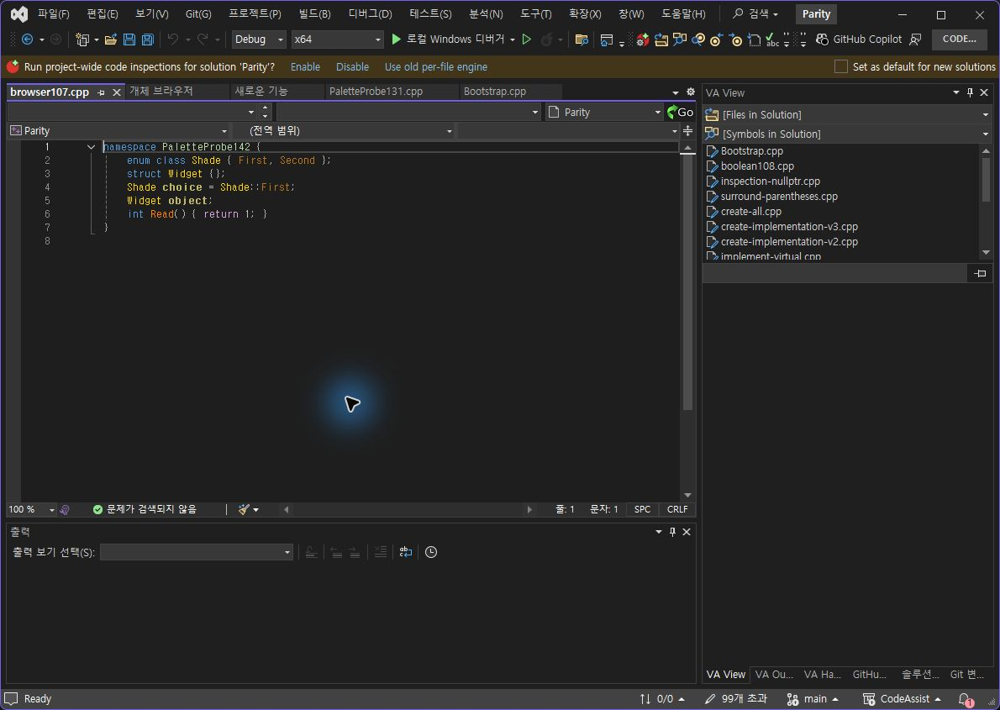
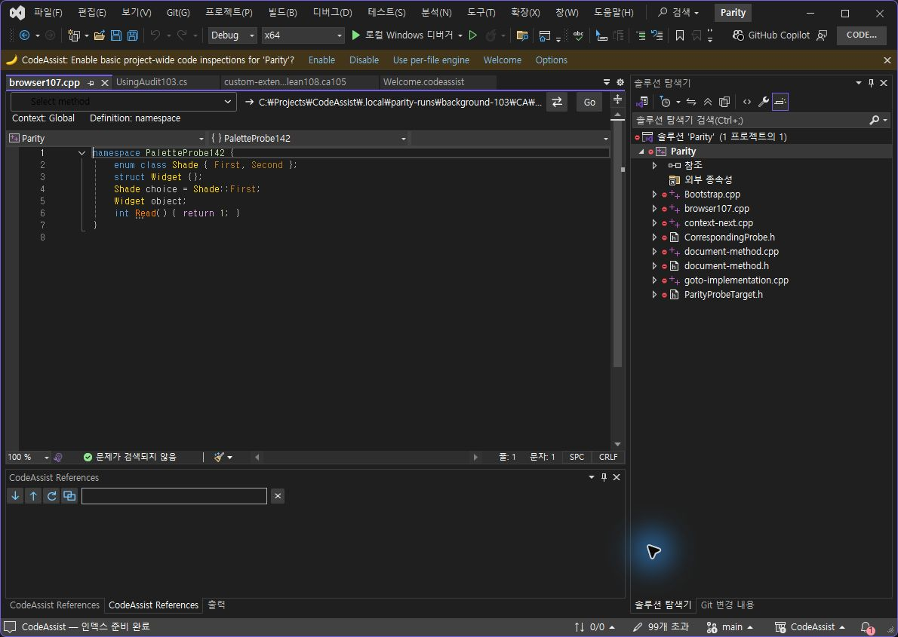
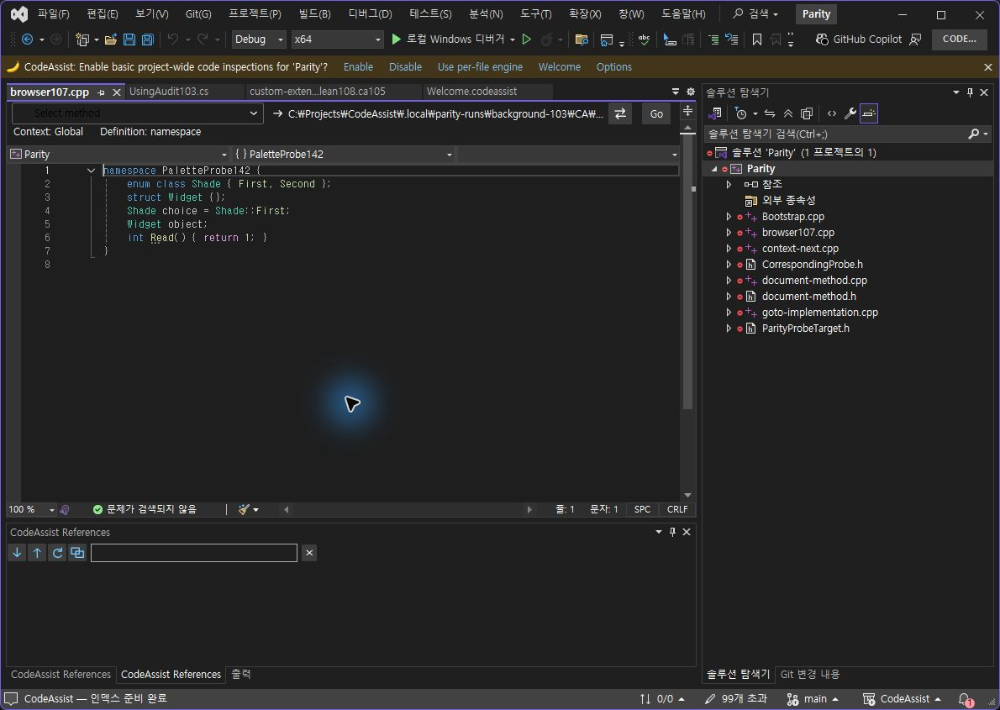
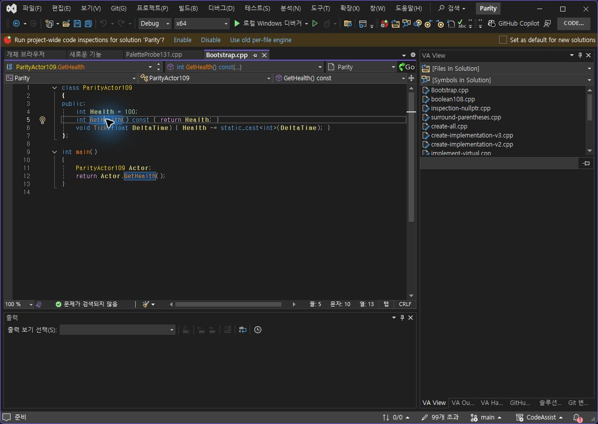
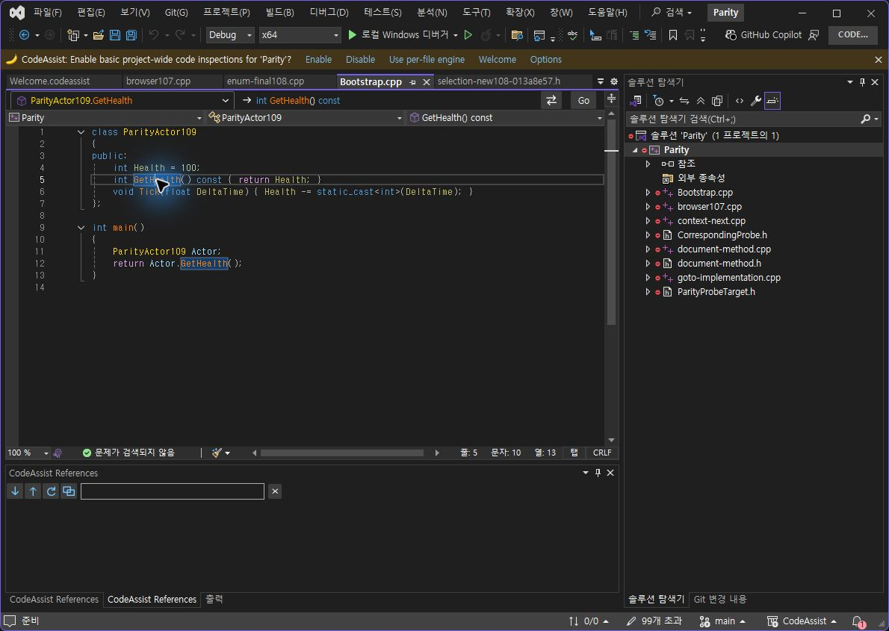
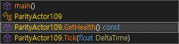
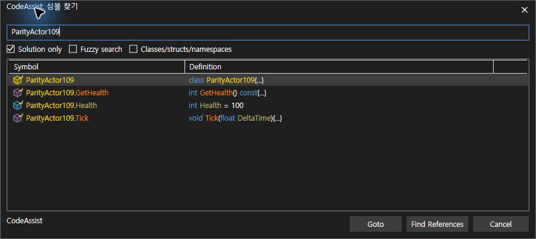

> 보관 기록입니다. 아래 결과는 원문 작성 시점의 내용이며, 이번 편집에서 제품 테스트를 다시 실행하지 않았습니다.

VA·CA 실행 대조 145

## VA·CA 실행 대조 — 최신 설치 0.0.145

전체 작업 진행 중입니다. 선별 출력 표본 **8/9개 · 88.89%** 일치. 제품 전체 동기화율이 아닙니다. 서로 다른 버전의 실행 증거를 명시하며, 과거 통과를 최신 버전 전체 인증으로 재계산하지 않습니다.

| 지표 | 개수·백분율 | 범위 |
| --- | --- | --- |
| 선별 출력 표본 | 8/9 · 88.89% | 기존6건 + Text Editors On/Off 2건 + Navigation Bar On 1건. 툴팁 구성 차이1건. |
| 12개 옵션 중 양쪽 실행 근거 | 6/12 · 50% | 한 상태 이상 비교. 완전 통과율 아님 |
| 12개 옵션 중 표본 On/Off 일치 | 3/12 · 25% | Views·Object Browser·Text Editors |
| Core 회귀 | 401/401 · 100% | Core 소스 불변. VA 동등성·UI 검사와 구분 |
| 문서 부분 명세 | 108/108 · 100% | 전체 역분석 완료율 아님 |
| 전체 gate 인증 | 0/108 · 0% | 전체 인증 미확보. 구현률0%라는 의미 아님 |

## 같은 프로젝트 소스 — 편집기 색상 켜짐

VA

CA

## 편집기 색상 끄기 — 새로 로드한 같은 소스

VA

CA

양쪽 버퍼 문자열·저장 상태를 VA · CA에서 확인했습니다. CA 프로젝트에 시험 파일이 빠져 있던 조건 차이를 보정한 뒤 비교했습니다. 최초 CA248 화면은 동일 프로젝트 조건 통과에 사용하지 않습니다. 설정은 양쪽 켜짐으로 복원했습니다. 정확 RGB 표본은 안티앨리어싱·캡처 영향으로 미판정이며 통과로 합산하지 않습니다.

## 상단 한 줄 배치·구문별 색상 — 같은 GetHealth 커서 위치

VA

CA

동일 소스·행5/열10 확인: 입력 근거. 본문 첫 줄 y좌표는 VA174, 변경 전 CA202, 최신 CA176으로 차이가 28px→2px로 줄었습니다. 이는 본문 시작 위치 하나의 측정이며 전체 레이아웃 점수가 아닙니다. 오른쪽 프로젝트 선택기·정의 열 너비·아이콘·기타 화면 대조는 남아 있습니다. 탐색 바 Off도 남아 있습니다.

## 실제 Alt+M 목록 열기 유지

CA145 동작 확인입니다. VA와 단축키 전체 동등성 통과로 계산하지 않습니다.

## 다크 헤더·회색 선택 배경 수정

141에서 발견한 밝은 헤더 회귀를 테마 스타일 상속으로 수정했고 142와145에서 실행 확인했습니다. 보라색 선택 배경은 VA처럼 회색으로 보정했습니다.

## 남은 작업

- Hash Off and custom With Snippets paired outputs

- Overloaded arrow fresh On/Off

- Physical held-key repeat

- Enum/namespace custom color changes

- Tooltip native/supplemental row difference and Off

- Listbox On/Off

- Navigation Bar Off, remaining controls and widths

- Namespace-qualified Find Symbol query returns no CA result; VA direct baseline still needed

- Whole108 requirement-level current execution comparison

검사 전용 파일·프로젝트를 수정해 조건을 맞췄으며 원본은 프로젝트, CA 시험 파일, VA 시험 파일에 보존했습니다. 이어질 색상 검사에 사용 중이며 사용자 작업 프로젝트는 변경하지 않았습니다.

## 패키지·실행 근거

패키지 · 설치 · CLR 모듈 로드 · VS2019·현행 VS 빌드 · 401개 회귀 · 계산 JSON · [이전6건 출력 근거](../assets/imports/docs/validation/options-141/index.html)

제안 시간: 20~30분. 이번 기록 시각 2026-10-24T04:55:49.460483+09:00 / 경과 29.88분. 전체 목표는 계속 진행 중입니다.

XERJ: 사용 — GridViewColumnHeader 검색 후 현재 소스·실행 화면으로 확인.

## 원문과 편집 이력

[보존된 원문 열기](../assets/imports/docs/validation/options-145/index.html)

- 원문 SHA-256: `16290b3f9f086676a7ec8680ca75a11a855c6d4bf14dc1d6bf0b0238d52e198f`
- 표시 날짜는 원본 파일의 수정 시각입니다. 작업 완료 시각은 원문에 있는 값을 기준으로 확인합니다.
