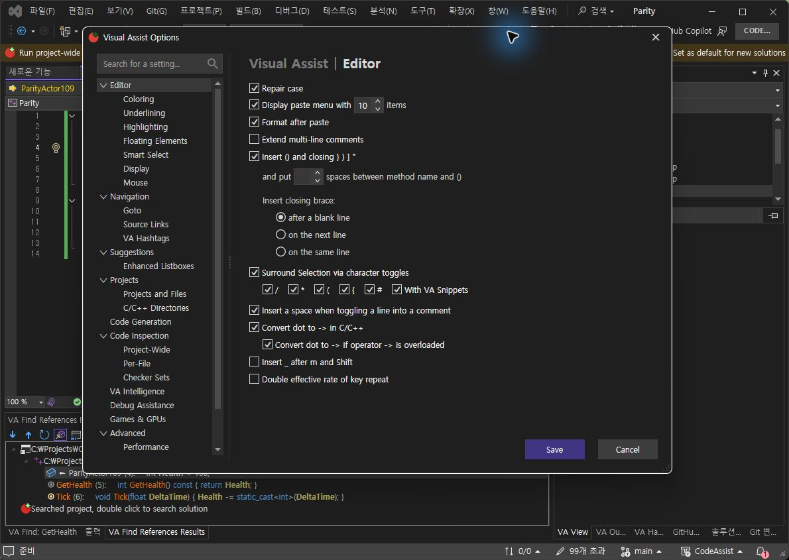
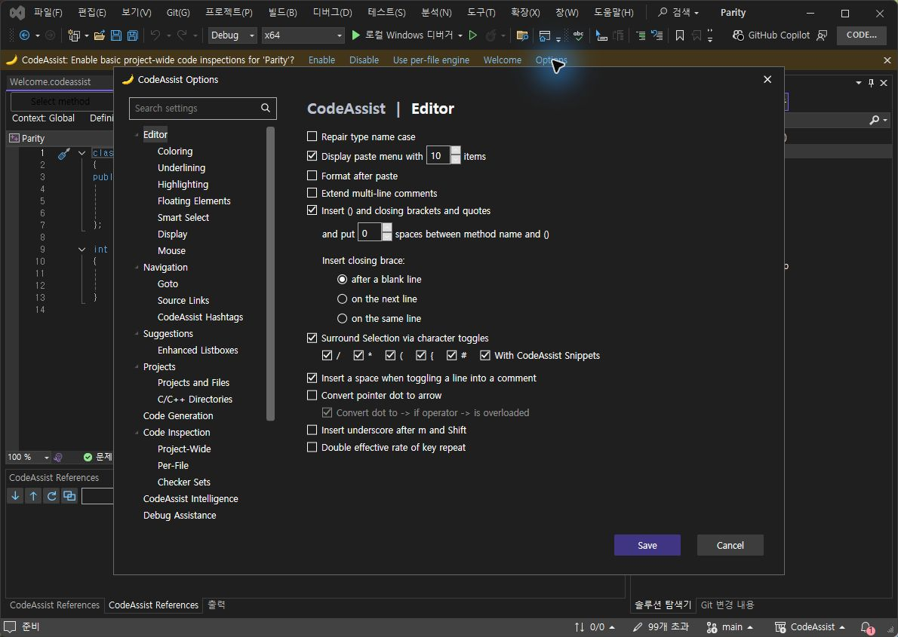
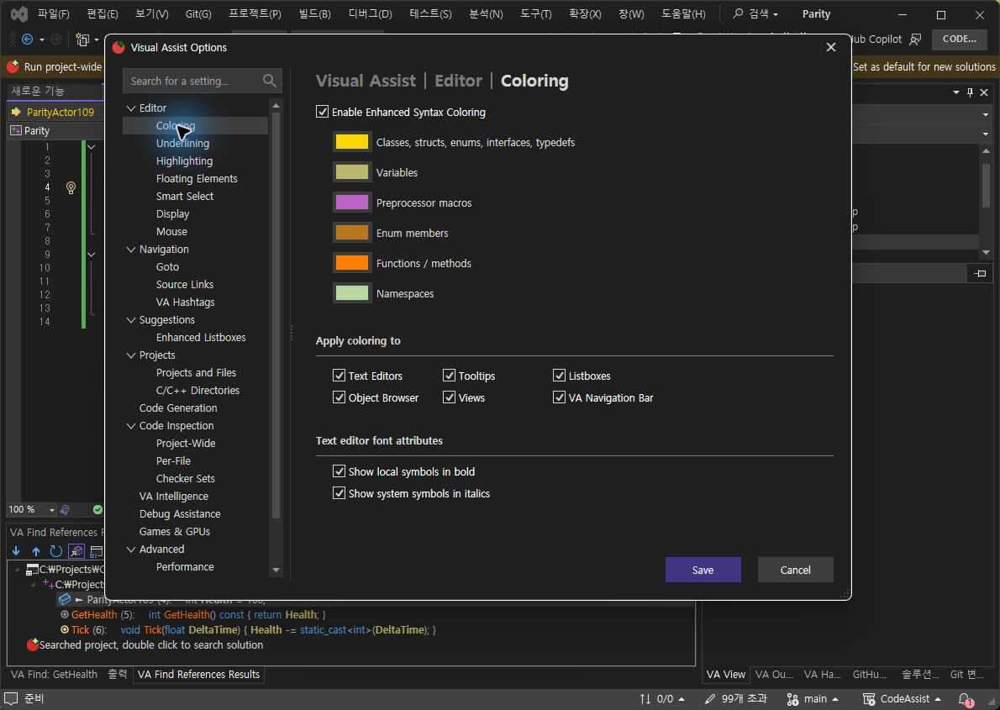
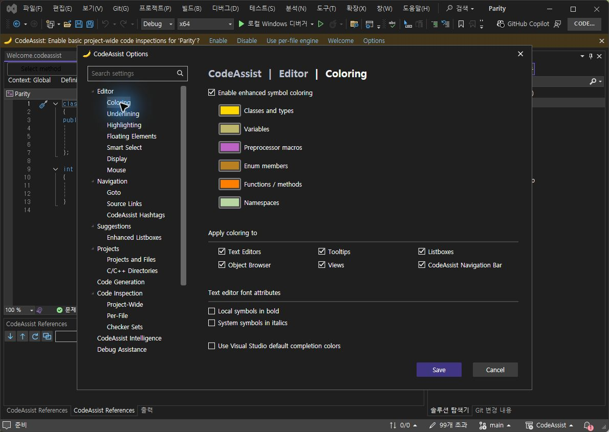
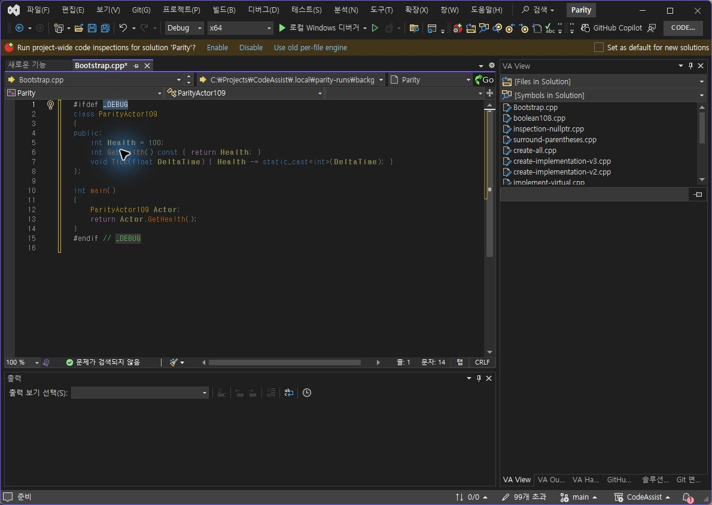
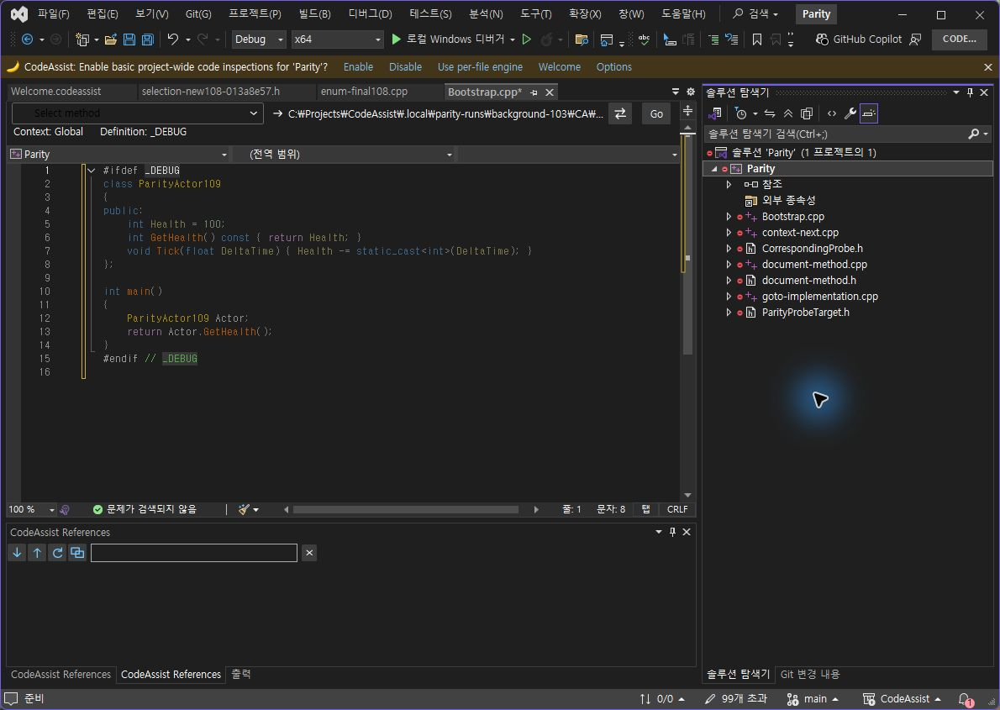
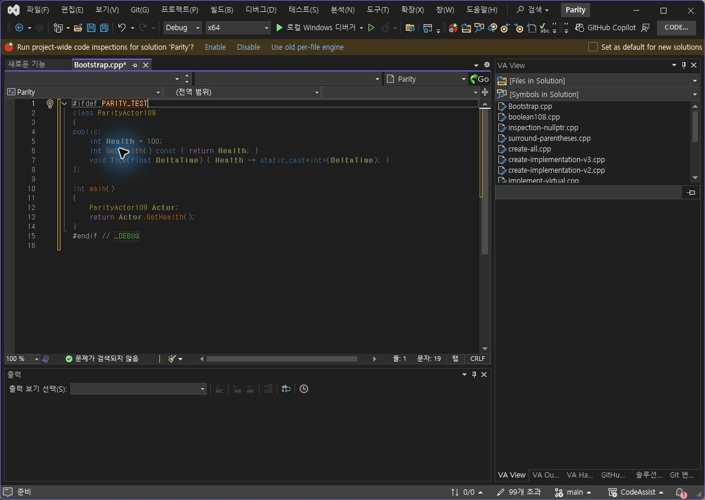
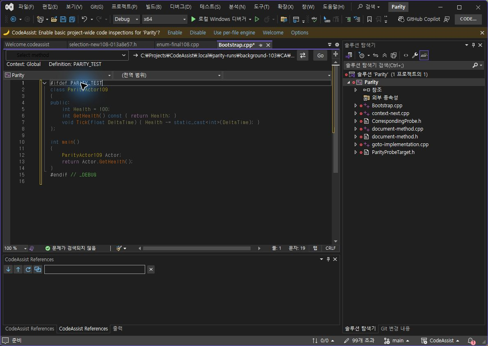
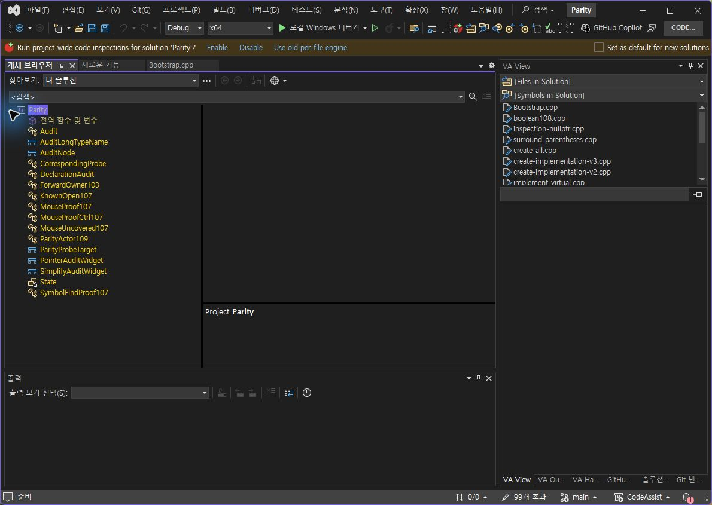
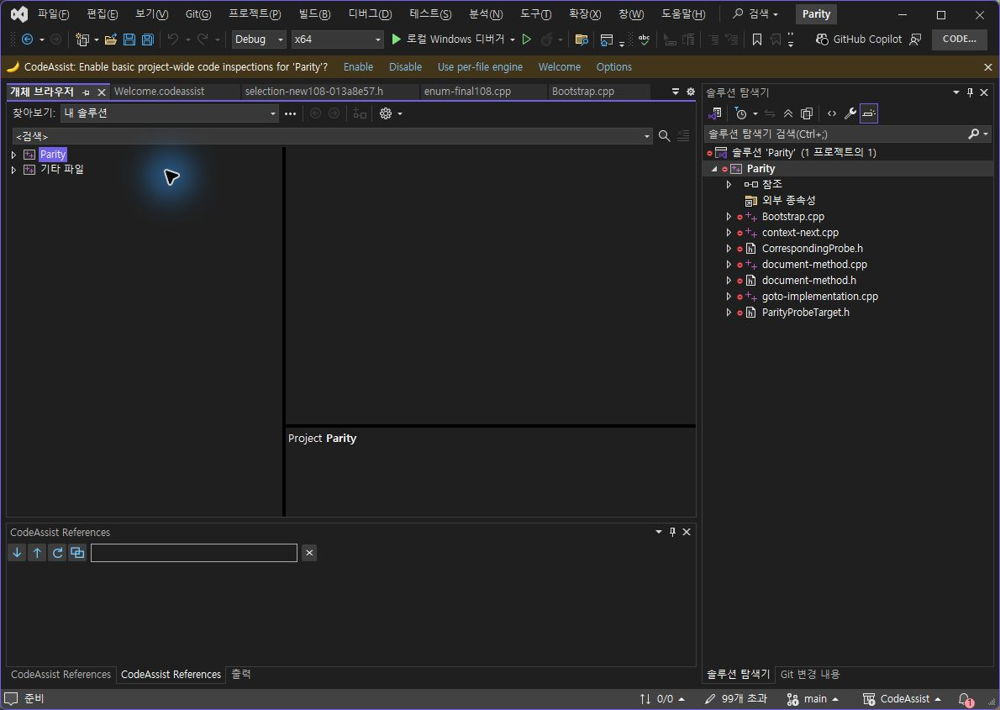

> 보관 기록입니다. 아래 결과는 원문 작성 시점의 내용이며, 이번 편집에서 제품 테스트를 다시 실행하지 않았습니다.

누락 옵션 구현·실행 대조 — 0.0.130

## 누락 옵션 구현·실행 대조 — 0.0.130

**전체 작업 미완료.** 화면에 빠졌던 12개 옵션을 추가하고 저장·처리 경로를 연결했습니다. 현재 VS의 개체 브라우저 연결 실패와 나머지 설정의 직접 실행 대조가 남아 있습니다. 소스 연결, 단위 검사, 화면 항목 존재를 실행 동등성으로 합산하지 않습니다.

| 지표 | 개수·백분율 | 범위 |
| --- | --- | --- |
| 원본 UI 항목 존재 | 32/32 · 100% | Editor 체크박스 17개, Coloring 체크박스 9개·색상 6개. 전체 디자인 점수 아님 |
| 신규 옵션 실제 대조 범위 | 2/12 · 16.67% | # 감싸기 일치 1개, 개체 브라우저 실패 1개. 10개는 직접 대조 대기 |
| # 실제 입력 결과 | 2/2 · 100% | 전체 문서 감싸기와 조건 변경. 양쪽 편집기 본문 정확 일치, 초기 선택 좌표 일치 |
| CA Core 회귀 | 364/364 · 100% | 설정 복사·오버로드 판별·분류·팔레트·기존 기능. VA 실행 일치율 아님 |
| 최신 패키지 설치 | 6/6 바이너리 일치 | 0.0.130, CLR 실제 모듈 경로·해시 확인 |

## Editor — 추가된 4개

# 감싸기, 스니펫 감싸기, 오버로드된 operator -> 변환, 키 반복 속도를 추가했습니다. 스니펫은 프로젝트 라이브러리에서 선택 문자열을 포함하는 문자 단축키를 찾습니다. 오버로드 판별은 현재 문서에 선언된 타입을 확인합니다. 반복 속도는 반복 문자·삭제·방향키 경로에 연결했으며 구두점·다른 언어 범위는 추가 확인이 필요합니다.

### VA 기준 화면

### CA 추가 후

## Coloring — 추가된 8개

열거형 멤버·네임스페이스 색상, 편집기·툴팁·추천 목록·개체 브라우저·보기 창·탐색 막대 대상을 추가했습니다. 두 색상은 분류기와 테마 팔레트에 연결했고, 대상별 설정은 각 렌더링 경로에서 확인합니다. 개체 브라우저는 아래 실패를 별도 기록했습니다. 열거형·네임스페이스 이름 가림 등 의미 분석의 추가 사례는 남아 있습니다.

### VA 기준 화면

### CA 추가 후

옵션 UI 촬영: VA 16시대 기준 화면, CA 0.0.126 적용 후 20시대 화면. 0.0.127–130은 해당 옵션 배치 변경 없이 실행 경로를 수정했습니다. 이를 새 VA UI 촬영으로 계산하지 않습니다. CA 전용 ‘Visual Studio 기본 추천 색상’ 1개는 원본 개수에서 제외했습니다. 체크 상태는 사용자 설정이며 공장 기본값 일치 판정이 아닙니다.

## # — 실제 동일 입력

양쪽 Bootstrap.cpp 전체 선택 문자열이 같은지 읽기 전용 DTE로 확인한 뒤 실제 Shift+3을 입력했습니다. 0.0.127의 끝 빈 줄 차이를 발견해 수정했고, 0.0.130은 출력과 _DEBUG 선택 좌표가 정확히 일치했습니다. PARITY_TEST로 조건을 바꾸면 끝 주석은 _DEBUG를 유지하는 VA 동작도 맞췄습니다. 포커스가 솔루션 탐색기로 옮겨져 입력되지 않은 한 시도는 유효한 기능 실패로 계산하지 않고 명시적으로 다시 선택해 검사했습니다.

### VA #

### CA #

### VA 조건 변경

### CA 조건 변경

VA # 본문·선택 · CA # 본문·선택 · VA 조건 본문 · CA 조건 본문 · VA 원상 복원 · CA 원상 복원

## 개체 브라우저 — 실패 원인 확보

현재 VS 기본 창은 LiteTreeView32를 사용합니다. 표준 SysTreeView32 콜백으로 연결된 컨트롤은 0개였습니다. 현재 옵션은 이 창에서 동작 완료가 아니며, LiteTreeView32 전용 구현·On/Off 대조가 필요합니다. 다른 컨트롤에 적용됐다고 추정하지 않습니다.

### VA 기본 개체 브라우저

### CA 기본 개체 브라우저

현재 컨트롤 종류·연결 수 로그 · 패키지 · 설치 · CLR 실제 로드 · 364개 회귀 검사 · 집계 JSON

## 후속 검증

LiteTreeView32 색상 연결을 해결하고 나머지 신규 10개 옵션을 같은 입력으로 비교해야 합니다. 키 반복의 실제 유지 입력, 스니펫 문자 단축키, 오버로드 변환 On/Off, 두 새 색상의 실제 표시, 대상별 독립 On/Off가 남아 있습니다. 이번 화면 항목 100%를 이 검사의 통과율이나 제품 전체 동기화율로 보고하지 않습니다.

시작: 2026-10-23 19:55:50 KST. 제안: 20–30분. 실행 차이 수정으로 초과했고 10분 추가 예상을 보고했습니다. 전체 작업은 미완료이며 이번 구간의 종료와 소요 시간은 집계 JSON에 기록합니다.

문서 기반 부분 명세: 108/108 (100%). 전체 동등성 인증: 0/108 (구현률 아님). XERJ: 사용 — Options/Surround 검색 후 현재 소스와 대조했습니다.

참고: [VA Surround Selection](https://www.wholetomato.com/documentation/coding-assistance/surround-selection) · [VA 포인터 변환](https://www.wholetomato.com/documentation/code-correction/convert-dot-to) · [VA 스니펫 감싸기](https://www.wholetomato.com/en/documentation/coding-assistance/surround-with)

## 원문과 편집 이력

[보존된 원문 열기](../assets/imports/docs/validation/options-126/index.html)

- 원문 SHA-256: `1d64788982afbea634c74822fdb9f742a04e5094c09cc4fbe9a777054a576487`
- 표시 날짜는 원본 파일의 수정 시각입니다. 작업 완료 시각은 원문에 있는 값을 기준으로 확인합니다.
