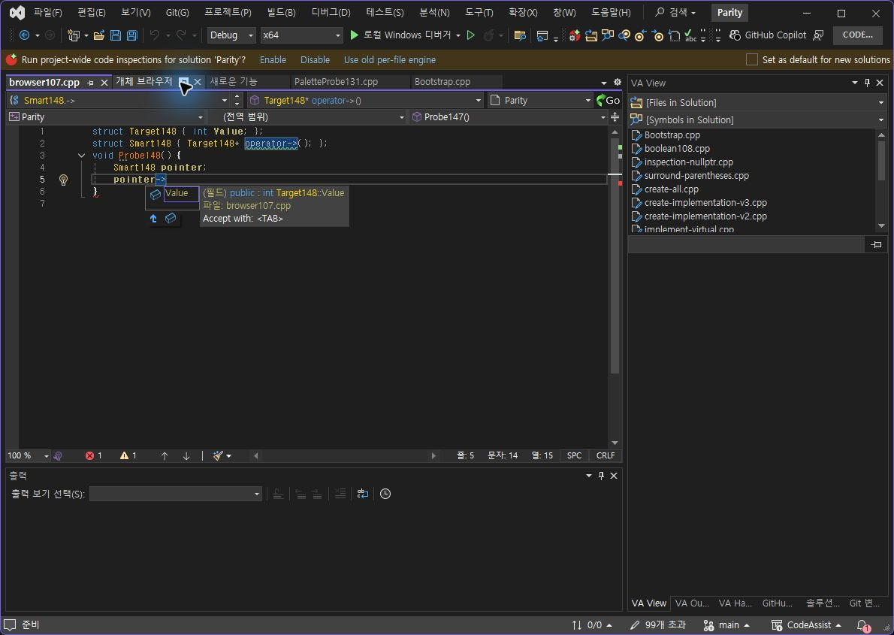
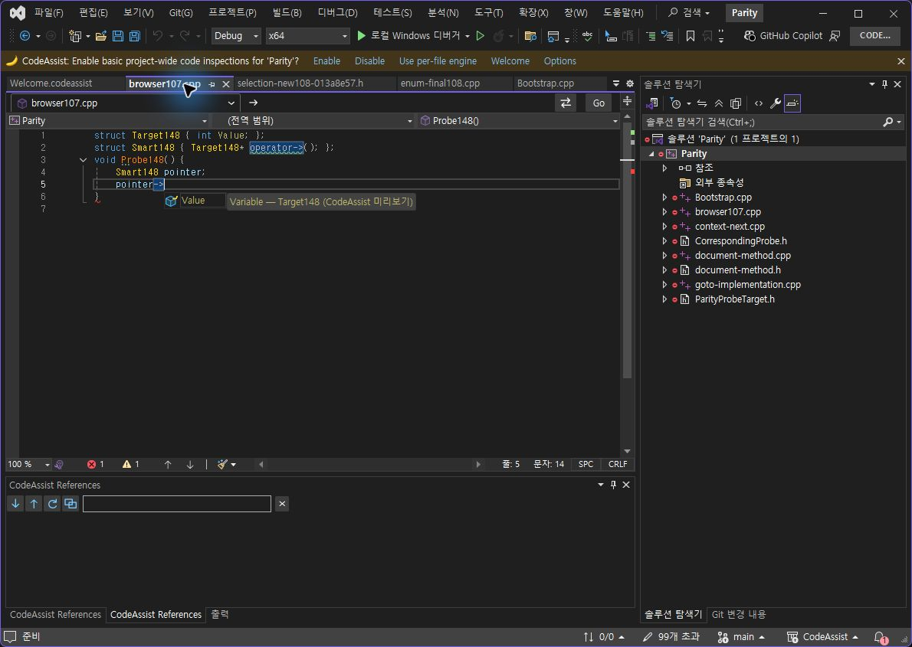
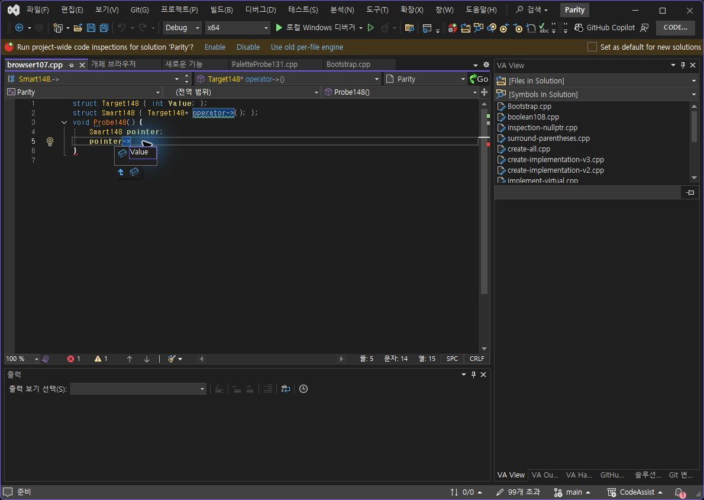
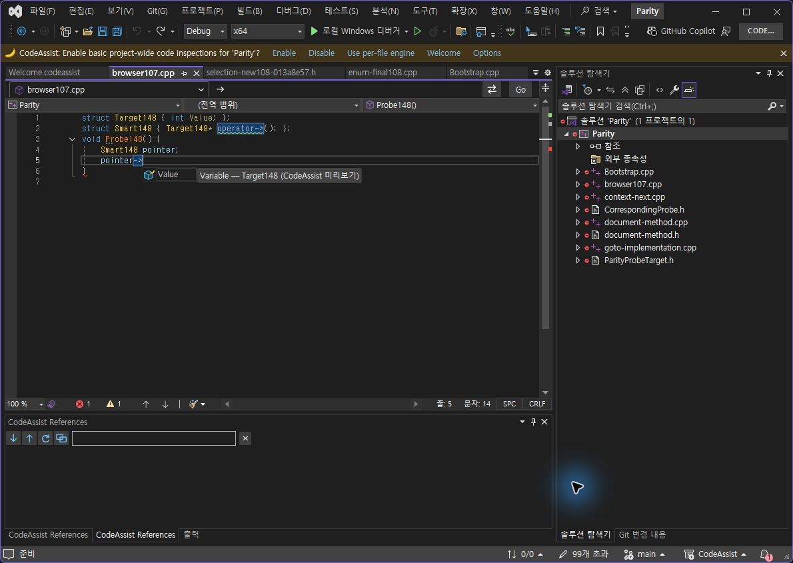
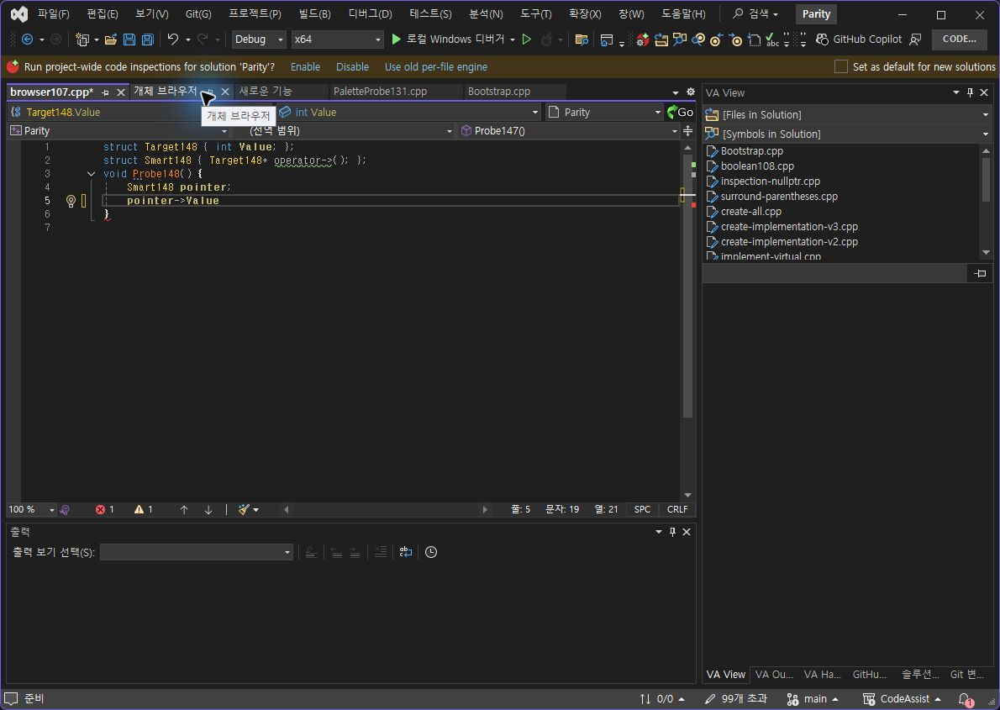
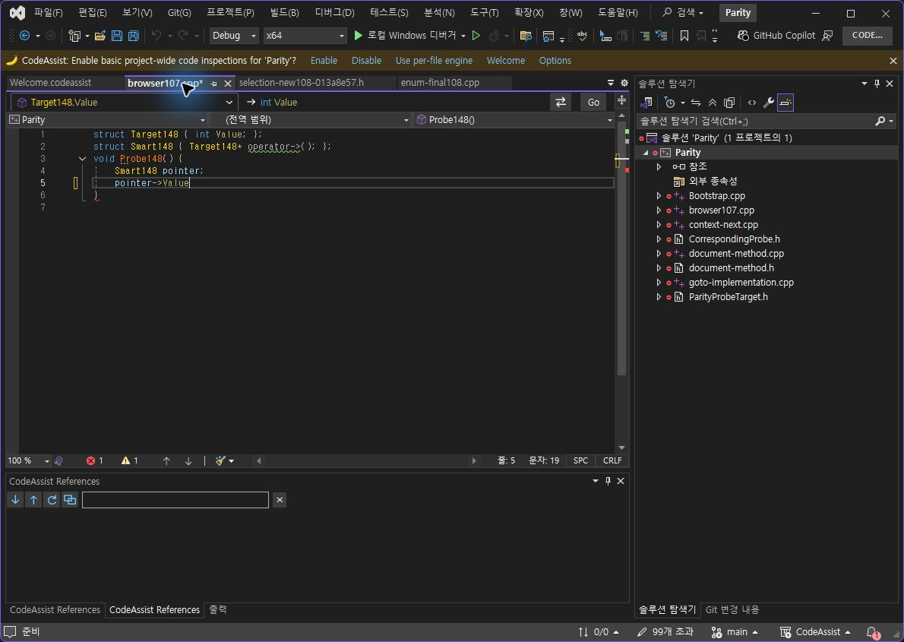
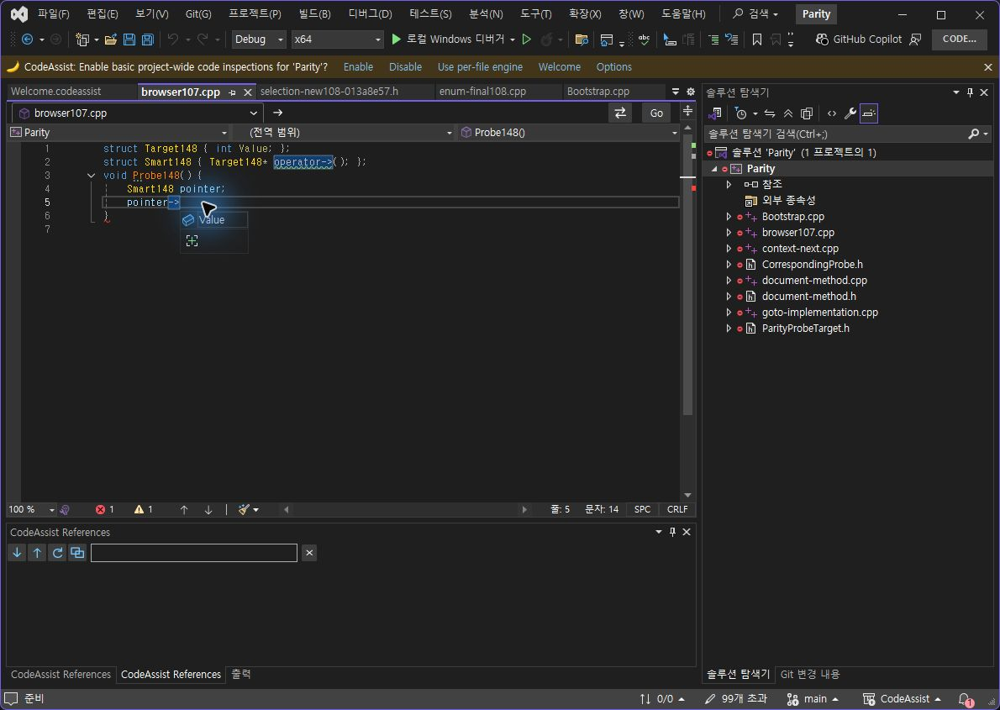
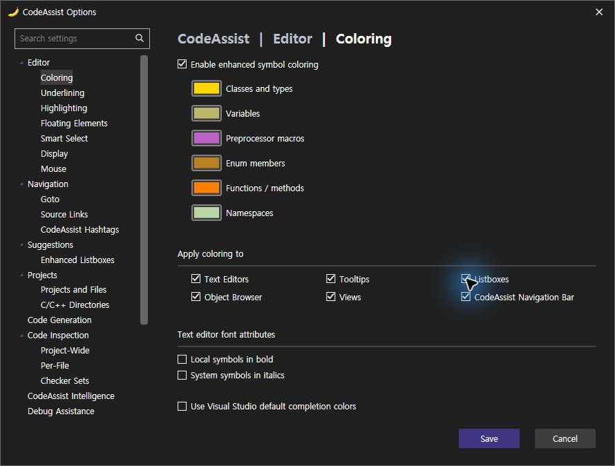

> 보관 기록입니다. 아래 결과는 원문 작성 시점의 내용이며, 이번 편집에서 제품 테스트를 다시 실행하지 않았습니다.

VA·CA 추천 색상 수정 / CA 0.0.149

## 추천 색상 누락 수정 및 실제 입력 재검증

검사 CA **0.0.149** · 2026-10-24T06:21:25+09:00

**이번 표본 3/3개(100%) 일치**: 동일 Value 후보의 색상 On·Off, Tab 삽입 전체 코드와 커서. 제품 전체 100%라는 뜻은 아닙니다. 선정 12옵션의 대조 근거 확보는 **8/12개(66.67%)**, 선정 출력 On/Off 확보는 **7/12개(58.33%)**이며 버전별 기존 근거와 이번 근거를 구분합니다.

## 원인·수정

수정 전 실행 로그는 receiver=pointer, type=빈 값, candidates=0이었습니다. 지역 변수 타입을 멤버 연산자 뒤에서 조회하는 호출 위치를 수정했습니다. operator-> 반환 타입도 따라가도록 했습니다. 수정 후 실제 로그는 type=Target148, candidates=1이며 CA 후보에 변수 색상이 적용됩니다. 빈 접두어 후보 한 개는 Ctrl+Space로 바로 삽입하지 않고 목록을 유지하며 Tab으로 확정합니다.

현대 VS 후보 복사 시 IconSource 대신 공개 IconMoniker·보조 아이콘·Suffix를 보존하도록 수정했습니다. 이 부분의 혼합 후보 화면은 별도 실측이 남아 있습니다. [SDK 근거](https://learn.microsoft.com/en-us/dotnet/api/microsoft.visualstudio.language.intellisense.completion3.iconsource?view=visualstudiosdk-2022).

## 검증 근거

- 전체 코드 테스트 **414/414(100%)**. 일반 C++ 지역 변수 . / -> 및 재귀 operator->, raw pointer 중단, 순환 중단을 포함합니다.

- VS2019·Modern 두 패키지 빌드, 설치 바이너리 6개 해시 일치, 실행 CLR 모듈 확인.

- 같은 프로젝트 포함 소스, 같은 Value 후보, Ctrl+Space 목록, 실제 Tab. 양쪽 최종 코드·선택/커서 JSON이 정확히 같습니다.

- 이전 툴팁 추가 행·목록 레이아웃·설명 차이는 통과 처리하지 않았습니다.

414 테스트 · 호환 빌드 · 설치 해시 · 실행 DLL · 수정 전 실행 로그 · 수정 후 로그 · VA Tab · CA Tab · 판정 JSON

## 12옵션 상태

| 항목 | 현재 증거·한계 | 근거 버전 |
| --- | --- | --- |
| Views | 선정 On/Off 출력 일치 | 138 |
| Object Browser | 선정 On/Off 출력 일치 | 138 |
| Text Editors | 선정 기본 색상 On/Off 일치 | 142 |
| Navigation Bar | 선정 전경색 On/Off 일치 | 145/146 |
| Hash surround | 전체 코드·선택 On/Off 일치 | 140/146 |
| Overloaded arrow | 변환 On/Off 일치, Undo 단계 수 다름 | 147 / 설치146 |
| Listboxes | 이번 Value 색상 On/Off·Tab 결과 일치, 레이아웃·설명 차이 | 현재149 |
| Tooltips | 함수에 추가 CA 행 차이 남음 | 141 / Off 타입147 |
| Enum custom color | 기본 색상 관찰만 확보, 사용자 지정값 입력·재시작 미검증 | 142 |
| Namespace custom color | 기본 색상 관찰만 확보, 사용자 지정값 입력·재시작 미검증 | 142 |
| With Snippets | CA 단일 후보 On/Off, VA 사용자 파일 시험 승인 대기 | 146 |
| Double key repeat | 개별 키 진단만, 실제 홀드 속도·원인 미검증 | 146 |

## 대조 화면

va-on

ca-on-149

va-off

ca-off-149

va-tab

ca-tab-149

ca-before-147

va-restored

ca-restored

## 복원·남은 작업

두 시험 소스는 원본 해시로 복원했고 문서 저장 상태를 확인했습니다. CA Listboxes=true, DotToArrow=false 등 기존 설정 복원. VA는 저장 후 종료되어 검사 프로필만 복구했고 재시작 후 Listboxes=true를 확인했습니다. 툴팁 중복 행, 사용자 지정 enum/namespace 색상, VA 사용자 스니펫, 실제 키 홀드 및 전체 UI/108항목 완전 동등성은 계속 진행합니다.

문서·설치 도움말 기반 부분 명세:108/108(100%). 전체 역분석 완료율 및 제품 전체 동기화율과 구분합니다. XERJ 사용: 반환 타입 검색 후 소스·로그·실행 확인.

제안 시간20~30분. 이번 기록까지 실제 22.7분. 전체 목표 미완료.

## 원문과 편집 이력

[보존된 원문 열기](../assets/imports/docs/validation/options-148/index.html)

- 원문 SHA-256: `dd6154a008681cb18b66d38dbefb6ce6fb5cd5d2c3ebcb97b951e8cabffffa8f`
- 표시 날짜는 원본 파일의 수정 시각입니다. 작업 완료 시각은 원문에 있는 값을 기준으로 확인합니다.
