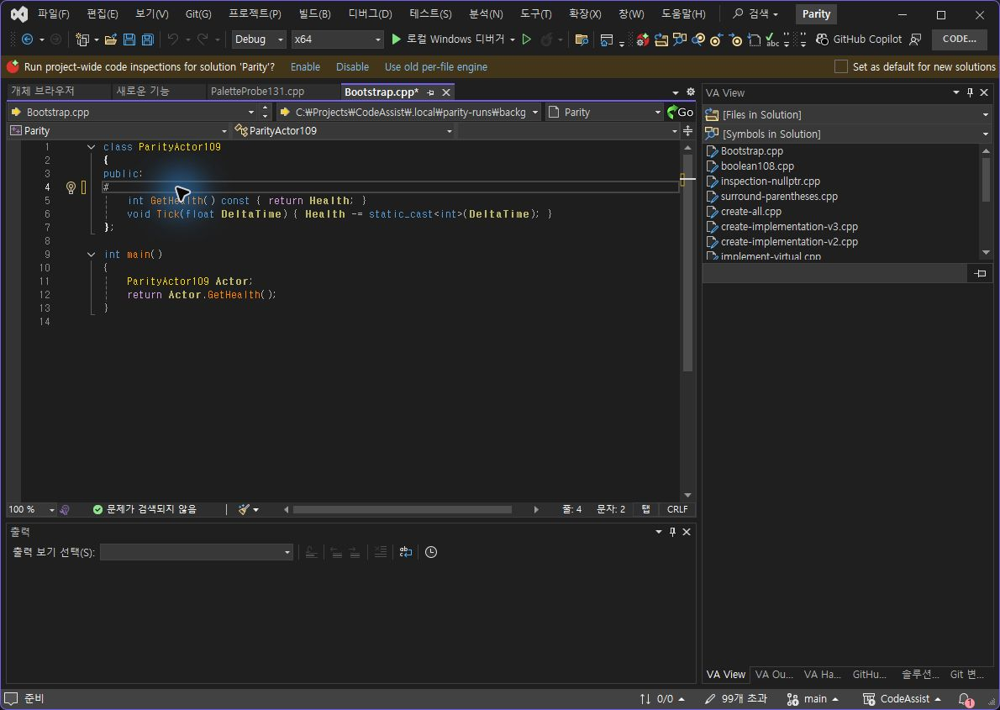
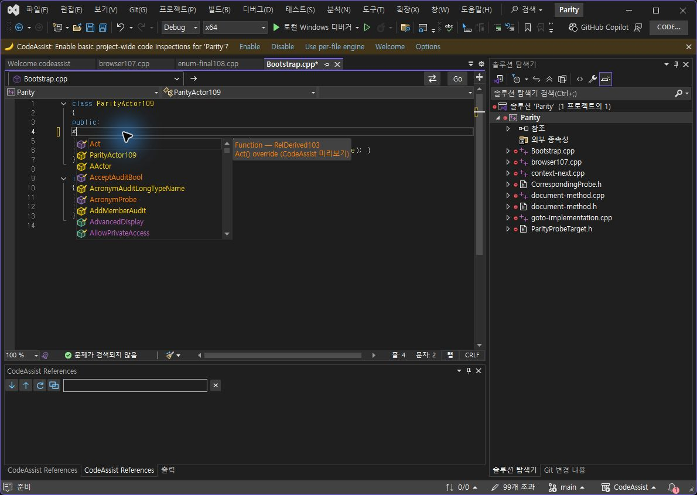
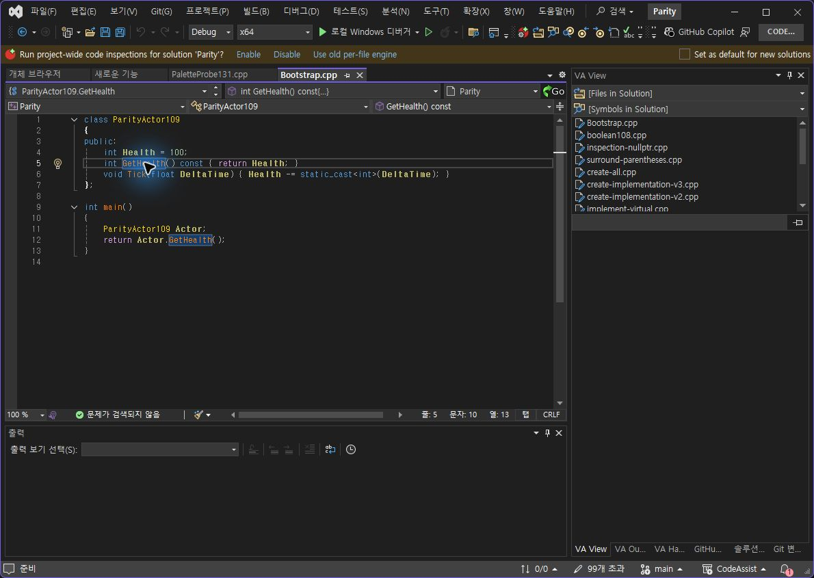
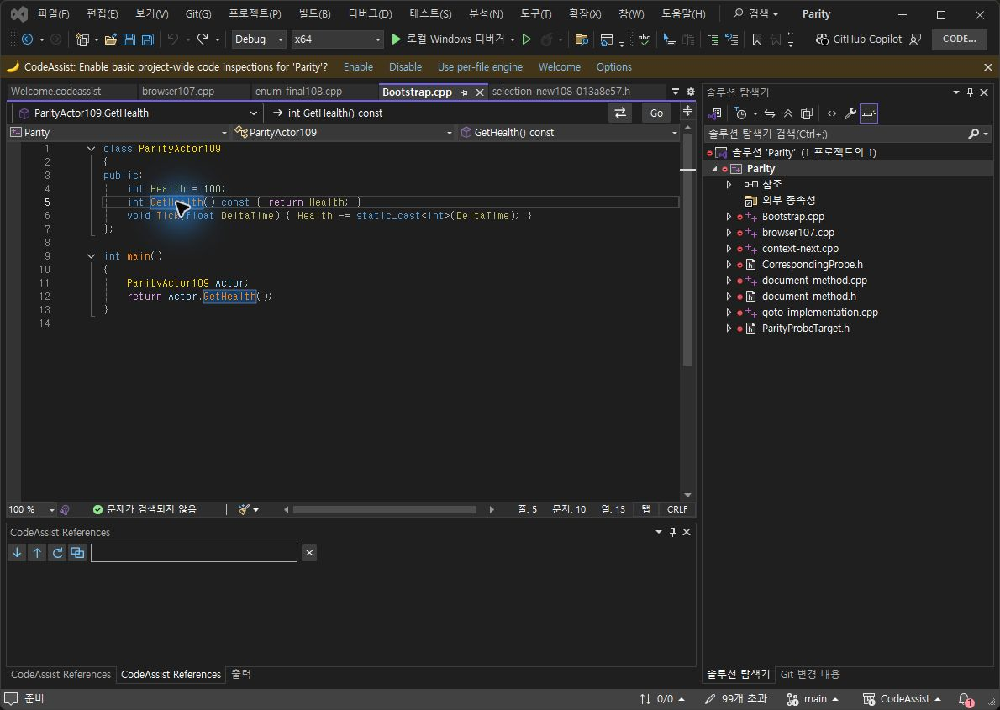
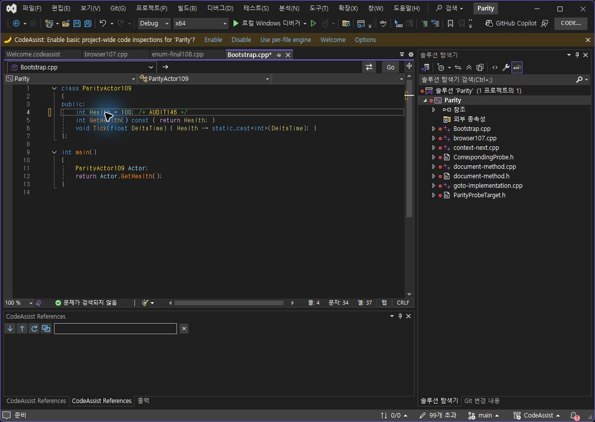
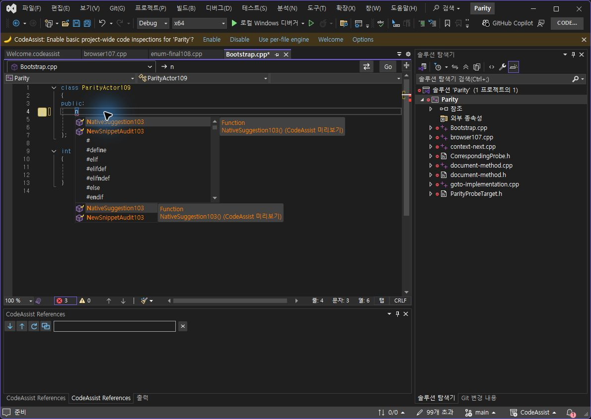
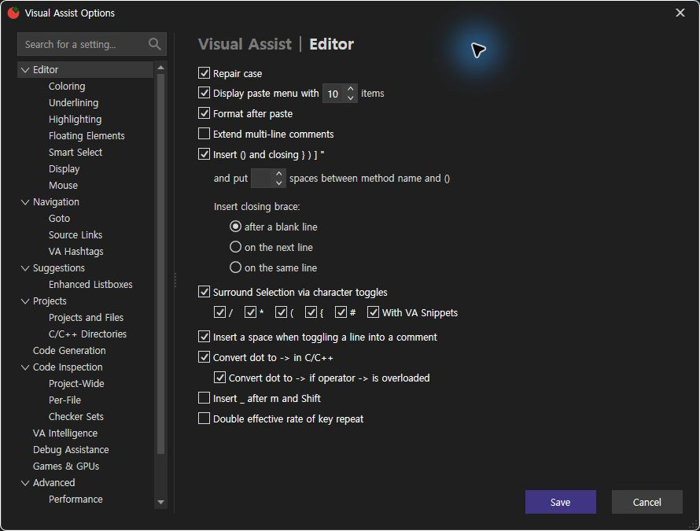

> 보관 기록입니다. 아래 결과는 원문 작성 시점의 내용이며, 이번 편집에서 제품 테스트를 다시 실행하지 않았습니다.

VA·CA 실행 대조146

## VA·CA 실제 실행 대조 — 최신 설치0.0.146

선별 출력 표본 **10/11개 · 90.91%** 일치. **제품 전체 동기화율은 아닙니다.** 서로 다른 실행 버전을 명시하고 최신 전체 인증으로 합산하지 않습니다. 전체 작업은 진행 중입니다.

| 범위 | 개수·백분율 | 한계 |
| --- | --- | --- |
| 선별 VA·CA 출력 | 10/11 · 90.91% | 기존9건 + # Off·탐색 바 Off. 툴팁 구성 차이1건 |
| 12개 옵션 중 양쪽 정식 출력 근거 | 6/12 · 50% | 한 상태 이상 비교. 전체 통과율 아님 |
| 12개 옵션 중 표본 On/Off 일치 | 5/12 · 41.67% | Views·Object Browser·Text Editors·Navigation Bar·# |
| CA 사용자 스니펫 실제 On/Off | 2/2 · 100% | CA 단일 후보 자체 검사. VA 일치율에서 제외 |
| Core 회귀 | 411/411 · 100% | VA 동등성 아님 |
| 문서 부분 명세 확보 | 108/108 · 100% | 전체 역분석 완료율 아님 |
| 전체 gate 인증 | 0/108 · 0% | 전체 인증 미확보. 구현률0%라는 의미 아님 |

## # 끄기 — 동일 코드·동일 선택·실제 Shift+3

VA

CA146

전체 문자열·선택 일치. VS 자동 들여쓰기와 문자 삽입이 Undo 두 단계로 나뉘어 각각 확인했습니다. 최종 원본 복원: VA · CA. 켜기 결과는 140 실행 근거에 보존되어 있으며 현재 새 켜기 검사로 재계산하지 않습니다.

## 탐색 바 끄기 — 같은 소스·행5·열10

VA

CA146

동일 입력 조건. 사용자 탐색 바는 일반 글자색이 됐으며 그 아래의 기본 VS 탐색 바는 판정 대상에서 제외했습니다. 켜기 결과는 [145 실행 화면](../assets/imports/docs/validation/options-145/index.html)에 보존했습니다.

## CA 사용자 스니펫 연결 수정 — 실제 On/Off

With Snippets 켜기: n 입력 → 즉시 감싸기

끄기: n 입력 → 일반 문자 대체

일반 단축어와 별개인 SurroundWith 문자 메타데이터를 해석하도록 수정했습니다. [VA 공식 문서](https://www.wholetomato.com/en/documentation/code-snippets/va-snippets-for-surround-with)의 문자 지정 방식과 대조했으며, 후보1개는 즉시 확장하고 여러 후보는 선택 메뉴를 띄우도록 구현했습니다. 실제 실행 검사는 후보1개·입력 필드 없는 경우입니다. 다중 후보·Escape·입력 필드 실행 대조는 남았습니다.

동일 선택 준비 · 켜기 출력 · 끄기 출력. CA 프로젝트 전용 시험 파일은 원본 상태로 복원했습니다. VA 사용자 스니펫 파일은 변경하지 않았습니다.

자동 승인 검토가 실제 사용자 VA Autotext 파일의 임시 변경을 차단했습니다. 해당 변경은 실행되지 않았고 명시적 승인 질문이 대기 중입니다. 승인 전에는 CA 자체 검사를 VA 일치 통과로 계산하지 않습니다.

## 반복 키 진단 — 통과 개수에서 제외

공식 입력 API의 Right+Right 연속 키다운에서 양쪽 모두 Off2칸·On1칸 이동을 관찰했습니다. 관찰값과 범위. 이는 장시간 물리 키 누름/반복 속도 검사가 아니며, 전역·환경 효과와 실제 보정 동작 원인은 격리하지 못했습니다. 반복 옵션 인증은 미완료입니다. 시험 후 양쪽 반복 보정은 원래 꺼짐으로 복원했습니다.

## 설정·코드 복원

CA 설정 · 최종 문서 저장 상태. VA #·With Snippets는 켜짐, 반복 보정은 꺼짐을 확인한 뒤 저장했습니다.

## 남은 작업

- Native VA custom SurroundWith runtime comparison requires explicit pending approval

- Multiple custom snippet candidates, Escape replacement, custom input fields runtime comparison

- Double key repeat physical hold/rate test and causal isolation

- Overloaded-arrow fresh On/Off

- Enum member / namespace custom color changes

- Tooltip supplemental rows versus VA and Off

- Listbox On/Off

- Full108 current requirement-level execution comparison

이전 단계의 검사 전용 색상 파일·프로젝트 변경은 이전 기록의 ownedFixtureChanges에 유지합니다. 이어질 색상 검사 뒤 복원이 필요합니다.

## 패키지·실행 근거

패키지 · 설치 · CLR 모듈 로드 · VS2019·현행 VS 빌드 · 411개 회귀 · 계산 JSON · [기존9건 근거](../assets/imports/docs/validation/options-145/index.html)

제안 시간20~30분. 이번 기록 시각 2026-10-24T05:32:58.989653+09:00 / 경과 36.43분. 예상 상한을 넘겼으며 반복 입력 추가 확인과 시험 설정 복원까지 포함한 실제 시간입니다. 전체 작업은 미완료로 유지합니다.

XERJ: 사용 — TrySurroundCharacter 검색 후보를 현재 소스와 실제 실행으로 확인.

## 원문과 편집 이력

[보존된 원문 열기](../assets/imports/docs/validation/options-146/index.html)

- 원문 SHA-256: `31e93b6ccca60646e8c24e7185b4893a5641c113d07849f8cddf1332bf0a9484`
- 표시 날짜는 원본 파일의 수정 시각입니다. 작업 완료 시각은 원문에 있는 값을 기준으로 확인합니다.
