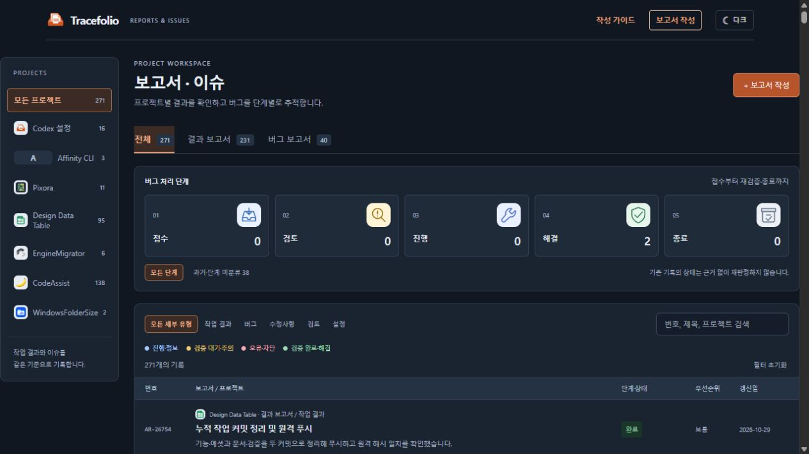
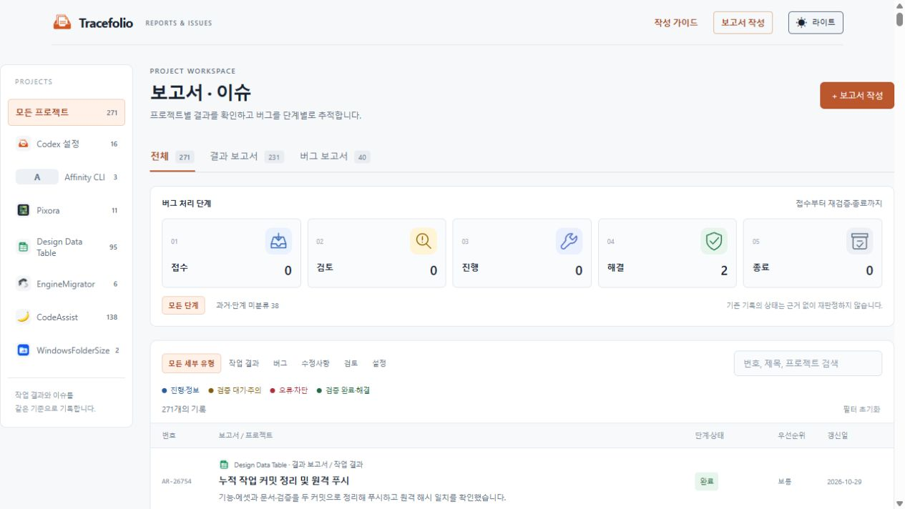

## 작업 결과

메인 보드·보고서 본문·작성 폼·가이드에 라이트/다크/시스템 테마를 적용했습니다. 첫 공개 배포와 실제 브라우저 확인을 완료했습니다.

## 변경 내용

### 적용 내용

상단 테마 버튼으로 시스템 → 라이트 → 다크를 선택합니다. 선택은 브라우저에 저장되며 페이지 이동·새로고침 후 유지됩니다. 저장소 접근이 제한되어도 전환할 수 있습니다. 접수는 수신함, 검토는 돋보기, 진행은 도구, 해결은 방패 체크, 종료는 보관함 체크 SVG로 표현했습니다. 검증 대기·주의는 노랑, 오류·차단은 빨강, 완료·해결은 초록, 진행·정보는 파랑으로 표시합니다. 문구와 아이콘을 함께 제공하며 기존 보고서 상태는 추정하여 바꾸지 않았습니다.

## 검증

단위 테스트 14개 통과. 테마 저장·선택 순환·OS 설정 추적·저장소 접근 거부를 검사했습니다. 공개 브라우저에서 두 테마 전환, 새로고침 후 다크 유지, 5개 이미지 로드, 메인 검증 대기의 노랑, 완료의 초록, 작성 폼 입력 오류의 빨강을 확인했습니다. 작성 폼·TF-1 상세·가이드의 어두운 배경 적용과 상세 단계 이미지 5개를 확인했습니다. 오류 콘솔 기록은 없었습니다. 271개 HTML/Markdown과 8,665개 내부 링크, 원문 230개와 연결 자료 4,211개 및 편집 원문 261개 보존 검사를 통과했습니다. 첫 배포 Actions 40886209925 성공. 화면 기록 후 선택 탭의 배경만 정리했으며 최종 결과 기록 배포는 별도로 확인합니다.

## 남은 사항

원본 보고서에 포함된 과거 스크린샷 자체의 색상은 보존합니다. 실제 Affinity MCP는 ECONNREFUSED로 연결할 수 없어 코드 기반 SVG로 제작했습니다. 모바일 장치의 실기기 검증은 수행하지 않았습니다.

## 작업 시간

- 제안 시간: 8–12분
- 실제로 완료된 시간: 시작 2026-10-29 22:49:15 KST. 구현·첫 배포·실제 화면 검증 및 결과 기록 495초. 기록 시각 2026-10-29T13:57:30.869Z (UTC). 최종 기록의 배포 완료 시각은 최종 안내에 따로 기록합니다.
- XERJ: 미사용 — XERJ 도구 미제공으로 소스·단위 테스트·공개 브라우저를 확인했습니다.
