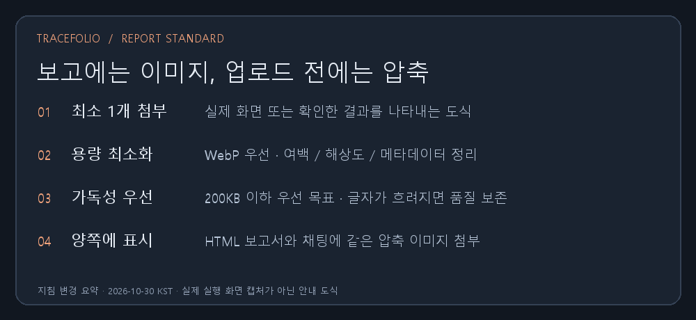

## 작업 결과

앞으로 최종 결과 보고에는 최소 1개의 실제 결과 이미지 또는 정확한 결과 도식을 채팅과 HTML 양쪽에 첨부합니다.

## 변경 내용

### 적용 내용

전역 AGENTS.md와 게시물 작성 가이드에 이미지 필수 첨부, UI 실제 화면과 비UI 도식의 구분, 공개 경로 사용, 여백·해상도·메타데이터 정리, WebP 우선 검토, 무손실 대안 및 품질 검증을 기록했습니다. 이미지당 200KB 이하를 우선 목표로 하며 판독성을 우선합니다. 이미지가 제한되면 첨부 미완료를 명시하도록 했습니다. 설치된 전역 지침은 기존 파일을 백업한 뒤 갱신했습니다.

## 검증

설치된 전역 지침과 저장소 AGENTS.md SHA-256 일치 확인. 이번 안내 도식은 실제 화면 캡처로 오인하지 않도록 지침 변경 요약임을 표시했습니다. 원본 PNG 33,520바이트를 무손실 WebP 13,386바이트로 줄였습니다. 이미지 크기는 1000×460을 유지했고 디코딩 및 실제 이미지의 글자 판독을 확인했습니다. OpenAI Docs 스킬을 참고했으며 공식 AGENTS 안내: https://learn.chatgpt.com/docs/agent-configuration/agents-md

## 남은 사항

기존 과거 보고서 전체의 이미지 재압축은 이번 요청 범위에서 수행하지 않았습니다. 새 규칙은 앞으로의 결과 보고에 적용합니다.

## 작업 시간

- 제안 시간: 2–4분
- 실제로 완료된 시간: 시작 2026-10-30 03:16:51 KST. 지침·이미지 생성 및 검증 2026-10-29T18:18:40.384Z UTC. 푸시·공개 배포 완료는 최종 안내에 구분해 기록합니다.
- XERJ: 미사용 — 코드 검색 불필요 — 보고 지침과 가이드 수정 및 이미지 파일 검증
