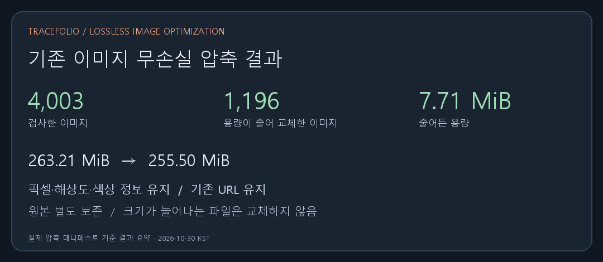

## 작업 결과

기존 래스터 이미지 4,003개를 검사하고 용량이 줄어드는 1,196개를 무손실 압축본으로 교체했습니다.

## 변경 내용

### 적용 내용

PNG는 표시용 색상·해상도 메타데이터를 보존하면서 재압축했습니다. JPEG는 재인코딩 없이 불필요한 메타데이터만 검토했고 WebP도 무손실 방식으로 확인했습니다. 용량이 늘어나는 후보는 적용하지 않았습니다. 기존 파일명과 확장자·URL을 유지했습니다. 교체 전 원본은 프로젝트 originals/image-compression 및 공용 originals/image-compression에 보존하고 Pages 패키지에서 제외했습니다. 압축 매니페스트에 원본·압축본 SHA-256, 바이트, 크기와 픽셀 해시를 기록했습니다. 과거 이관 검사는 보존된 원본의 기존 해시와 새 게시 파일 해시를 모두 검증하도록 확장했습니다.

## 검증

전체 275,994,623 → 267,911,542바이트, 8,083,081바이트(7.71MiB) 감소. 교체 1,196개 각각의 원본·압축본 디코딩 픽셀·모드·크기·ICC 및 PNG 표시 메타데이터 일치 확인. 원본 230개 보고서와 4,211개 이관 자료의 원본 해시 및 압축본 해시 검사 통과. 편집 백업 261개 보존 검사 통과. 단위 테스트 22개 통과. 원본 백업이 Pages 패키지에 포함되지 않음을 1,196개 경로에서 확인했습니다. 결과 요약 WebP는 14,372바이트이며 시각적으로 글자 판독을 확인했습니다.

## 남은 사항

2,805개는 무손실 후보가 더 작지 않아 유지했고 애니메이션 2개도 유지했습니다. 강제 해상도 축소나 손실 압축은 적용하지 않았으므로 200KB를 넘는 고해상도 화면 캡처가 남아 있습니다. Git 이력과 원본 백업은 보존하므로 저장소 전체 이력 용량이 같은 양으로 줄어드는 작업은 아닙니다.

## 작업 시간

- 제안 시간: 10–20분
- 실제로 완료된 시간: 시작 2026-10-30 07:20:42 KST. 압축·원본 보존·검증 및 기록 2026-10-29T22:28:30.129Z UTC. 최종 공개 배포 확인 시각은 최종 안내에 기록합니다.
- XERJ: 미사용 — 도구 미제공으로 파일·해시·픽셀 대조와 실행 검증을 사용했습니다.
