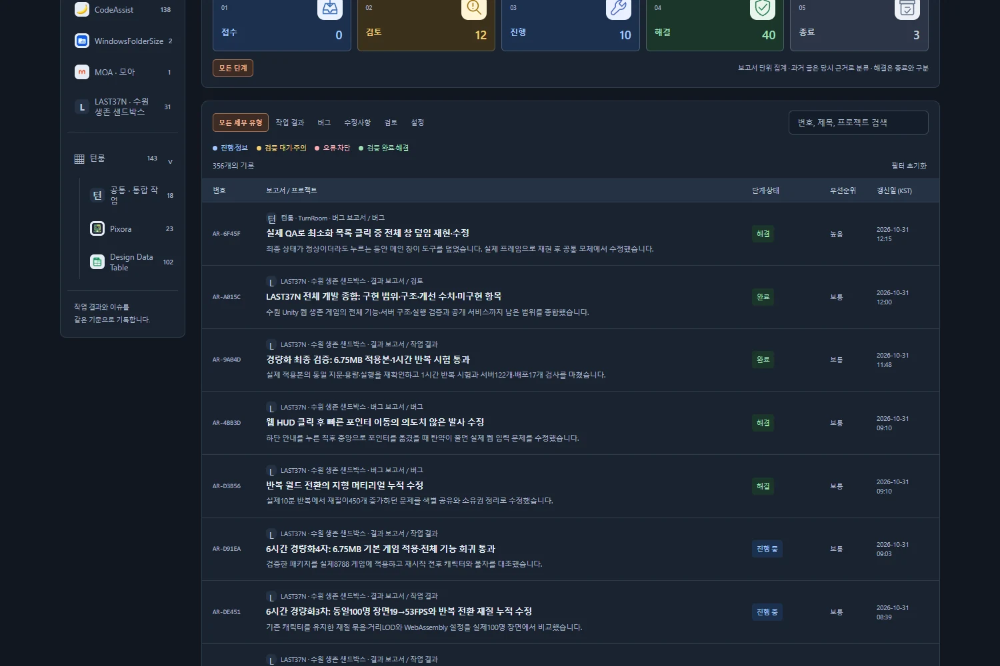

## 작업 결과

갱신일을 날짜와 시·분 두 줄로 표시하고 열 제목에 KST를 명시했습니다. 예:2026-10-31 / 12:15. 원본 ISO 시각은 time 요소의 datetime에 보존합니다.

[메인 목록](../../../index.html) · [작업 메뉴얼](2026-10-31-manual-post-updated-time-20261031033449850-v1.0.2.html)

## 변경 내용

### 적용 내용

날짜 문자열 앞10자만 표시하던 렌더링을 Asia/Seoul 시간대의 날짜·시분으로 변경했습니다. 날짜 아래에 시간을 배치해 기존 열 너비를 유지하고, 툴팁에 전체 날짜·시간과 KST를 표시합니다. CSS·필터·정렬 코드는 변경하지 않았습니다.

## 검증

실제 Chrome에서 로컬332개 원본 ISO 시각과 KST 표시를 대조했습니다. UTC 날짜 경계(18:05Z→다음날03:05), 자정(15:00Z→다음날00:00), 기존 최신순과 프로젝트 필터를 검증했습니다. 원격 변경 통합 후476개 Markdown/HTML·16262개 로컬 링크 검사가 통과했습니다.

GitHub Actions41164833761이 성공한 뒤 공개356개 목록의 날짜·시분을 전부 다시 대조했습니다. [로컬 QA](../assets/list-time-2026-10-31/qa.json) · [공개 QA](../assets/list-time-2026-10-31/public-qa.json). 실제 공개 화면을1500×1000에서 캡처하고123611B PNG를97920B WebP로 압축했으며 글자와 아이콘 표시를 직접 확인했습니다.

## 남은 사항

현재 작업 폴더에 다른 작업의 미완성 변경이 있어 커밋된 원본을 별도 복사본으로 검증했습니다. 원격 선행 커밋도 보존해 격리 저장소에서 병합했고 강제 푸시하지 않았습니다. 좁은 화면에서 갱신일 열을 숨기는 기존 반응형 정책은 유지합니다. 교훈 검토: 변경 없음 — 기존 공유 저장소의 게시 대상 대조·미완성 변경 보존 지침을 적용했습니다.

## 작업 시간

- 제안 시간: 3~5분
- 실제로 완료된 시간: 시작2026-10-31 12:28:23 KST · 구현·공개 확인 2026-10-31T03:34:49.471Z · 6.4분. 원격 선행 변경의 격리 병합과 배포 대기로 최초 예상을 초과했습니다. 최종 결과 보고서 게시 확인 시각은 채팅에 별도 표기합니다.
- XERJ: 미사용 — XERJ 연결·검색 스크립트가 제공되지 않아 rg와 현재 렌더링 소스로 위치를 확인했습니다.
