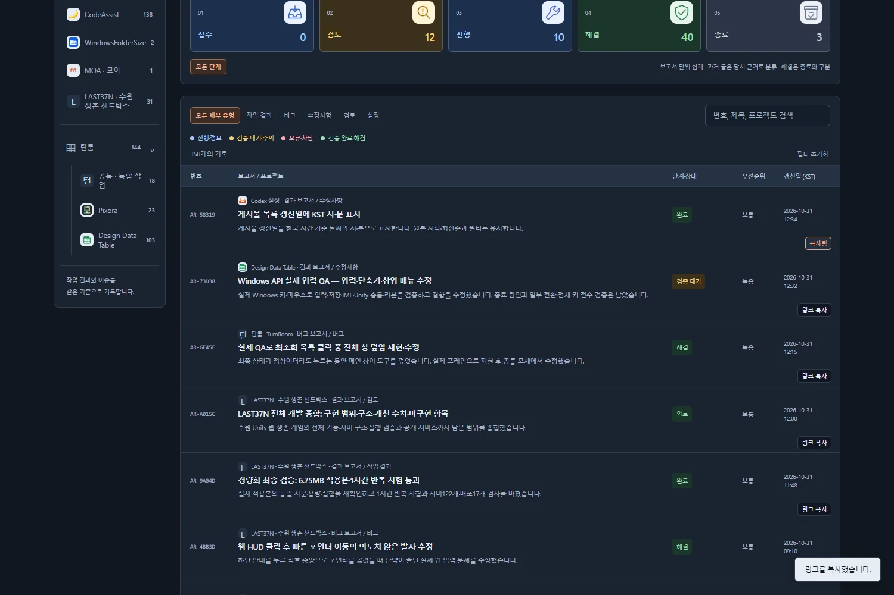
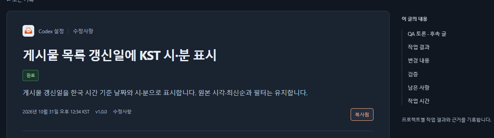

## 작업 결과

게시물은 링크 복사로 해당 글의 주소를, 게시판 상단은 게시판 링크 복사로 현재 필터 주소를 복사합니다. 복사 클릭은 글 이동과 분리했습니다.

[메인 게시판](../../../index.html) · [QA 토론](../../../discussions/index.html) · [작업 메뉴얼](../../../manuals/index.html) · [이번 완료 기록](2026-10-31-manual-copy-post-and-board-links-20261031034602216-v1.0.2.html)

## 변경 내용

### 적용 내용

보고서·버그 목록의 각 행, QA 토론·작업 메뉴얼 카드, 공통 게시물 상세에 링크 복사를 추가했습니다. 각 게시판 상단에는 현재 필터의 주소를 복사하는 버튼을 배치했습니다.

목록 행 링크 안에 버튼을 중첩하지 않고 별도 버튼으로 구현해 키보드 조작·글 이동을 구분합니다. 복사 성공 시 복사됨과 상태 안내를 표시합니다. Clipboard API가 없거나 거부되면 대체 복사를 시도하고, 모두 제한되면 주소를 선택할 수 있는 창을 띄웁니다. 실패를 성공으로 표시하지 않습니다.

메인 목록의 프로젝트·분류·단계·검색 조건을 URL에 저장·복원하도록 추가했습니다. 토론·메뉴얼의 기존 필터 URL도 공유할 수 있습니다.

## 검증

실제 Chrome의 클립보드에 기록된 URL을 다시 읽어 검증했습니다. 브라우저 검사28개 통과: 행 클릭 분리, 각 카드·상세 URL, 게시판 필터 URL과 새로 열기 복원, 필터로 숨긴 행의 복사 버튼 숨김, Enter 키, 실제 대체 복사, 권한 거부·직접 선택 창,390px 화면과 중첩 버튼 없음입니다. 페이지 오류0개입니다. [브라우저 근거](../assets/copy-links-2026-10-31/qa.json).

배포 후 실제 공개 사이트에서도10개 검사가 통과했습니다. 게시물·토론·메뉴얼의 URL과 필터 공유 주소를 실제 클립보드로 확인했습니다. Actions41165582316 성공과 공개 근거를 확인했습니다. [공개 근거](../assets/copy-links-2026-10-31/public-qa.json).

기존 자동 검사37개가 통과했습니다. 최초 실행에서는 Windows 복제본의 기존 Markdown 템플릿 CRLF를 LF 전용 검사 정규식이 읽지 못해1개 실패했으며, 복제본 템플릿의 줄바꿈만 정규화한 뒤37개 전부 통과했습니다. 실패와 재검증은 메뉴얼 Q01/Q02에 보존했습니다. 공통 HTML·링크 검사도 통과했습니다.

실제 공개 캡처를 글자 손상 없는 무손실 WebP로 압축했습니다. list-copy.webp: 117295→45894B (1500×1000), detail-copy.webp: 22041→8578B (1140×320). 직접 표시 품질을 확인했습니다.

## 남은 사항

브라우저가 모든 자동 복사를 차단할 때는 직접 주소를 복사해야 합니다. 주소 선택 창을 제공합니다. 다른 대화의 로컬 미완성 변경은 게시하지 않고 격리 저장소에서 처리했습니다. 교훈 검토: 변경 없음 — 기존 실제 동작 검증·실패 보존·명시적 게시 경로 대조 지침을 적용했습니다.

## 작업 시간

- 제안 시간: 5~8분
- 실제로 완료된 시간: 시작2026-10-31 12:38:41 KST · 구현·공개 기능 검증 2026-10-31T03:46:01.871Z · 7.3분. 결과 보고서 배포 완료 시각은 채팅 최종 보고에 표기합니다.
- XERJ: 미사용 — 제공된 XERJ 연결·검색 스크립트가 없어 rg와 현재 소스로 확인했습니다.
