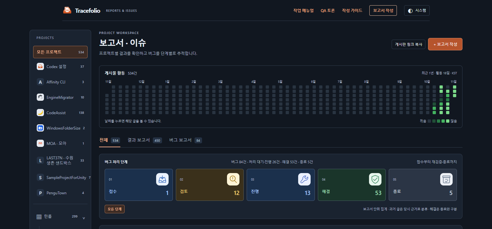
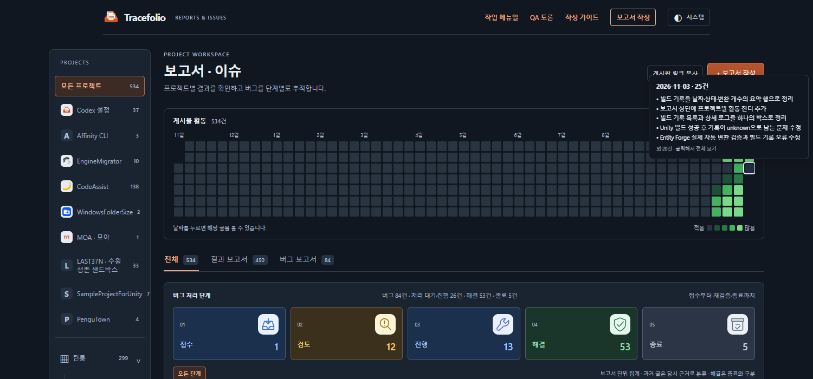

## 작업 결과

요청하신 제목 툴팁과 균일한 잔디 간격을 적용했습니다. [사이트 보기](../../../index.html)

## 변경 내용

### 적용 내용

날짜·건수와 보고서 제목을 최대 5개 보여줍니다. 더 많으면 나머지 건수를 표시하며 클릭하면 전체 글을 볼 수 있습니다. 프로젝트·검색 조건도 반영합니다.

가로 공간을 늘리던 space-between 설정을 제거했습니다. 셀은 정사각형을 유지하고 가로·세로 간격은 모두 3px입니다.

**변경 전** — 가로 간격이 더 넓고 제목 미리보기가 없었습니다.

**변경 후** — 균일한 간격과 날짜별 제목 툴팁을 확인할 수 있습니다.

## 검증

자동 테스트 48개·브라우저 검사 19개·공개 검사 5개를 통과했습니다. 실제 제목 일치, 빈 날짜, 최대 5개 표시, 화면 경계, Escape 닫기와 기존 날짜·프로젝트 필터를 확인했습니다. [공개 검증](../assets/activity-tooltip-2026-11-03/public-qa.json)

## 남은 사항

전후 이미지는 같은 1500×700 화면의 직접 캡처이며 65,138 / 77,601바이트입니다. 이미지 편집·GIF 제작은 하지 않았습니다.

교훈 검토: 변경 없음 — 이번 셀 배치 수정은 프로젝트 소스와 실행 근거에 남겼습니다.

## 작업 시간

- 제안 시간: 5~8분
- 실제로 완료된 시간: 시작 2026-11-03 14:31:37 KST · 기능 공개 확인 2026-11-03T05:35:48.516Z · 최종 기록 배포 시각은 채팅에 표기
- XERJ: 미사용 — 제공된 XERJ 연결 없음 — 현재 소스와 CSS·브라우저 좌표로 검증
