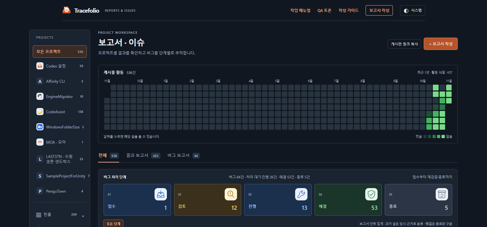
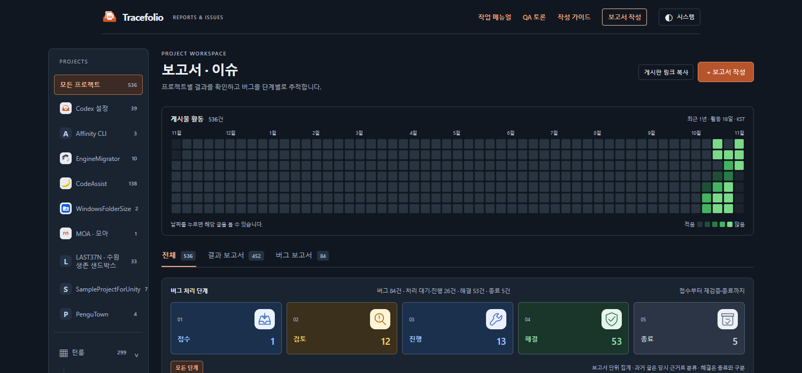

## 작업 결과

양끝의 빈 칸을 채웠습니다. 마지막 주의 미래 날짜는 더 어두운 회색의 비활성 칸입니다. [사이트 보기](../../../index.html)

## 변경 내용

### 적용 내용

53주×7일을 빠짐없이 표시합니다. 집계는 기존 최근365일만 유지하며 앞뒤 기간 밖 날짜는 집계·선택·미리보기에서 제외합니다.

**변경 전**

**변경 후**

## 검증

자동 테스트49개·브라우저25개·공개6개 통과. 요일별 전체 격자, 유효365일·패딩6칸, 기간 밖 호버·클릭 무반응과 기존 필터를 확인했습니다. [공개 확인](../assets/activity-padding-2026-11-03/public-qa.json)

## 남은 사항

없음. 실제 화면을 직접 캡처했으며 이미지 편집·GIF 제작은 하지 않았습니다.

교훈 검토: 변경 없음 — 날짜 패딩의 집계 제외와 비활성 동작을 프로젝트 소스·검증에 기록했습니다.

## 작업 시간

- 제안 시간: 3~5분
- 실제로 완료된 시간: 시작 2026-11-03 15:02:39 KST · 기능 공개 확인 2026-11-03T06:06:03.348Z · 최종 보고서 배포 확인은 채팅에 표기
- XERJ: 미사용 — 연결 미제공 — 현재 날짜 집계·CSS·실행 결과로 검증
