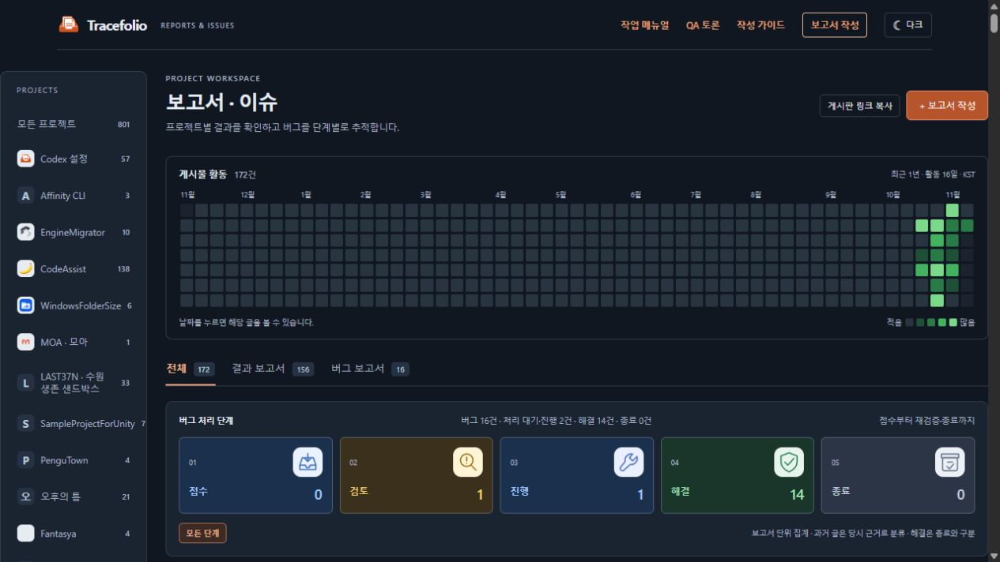
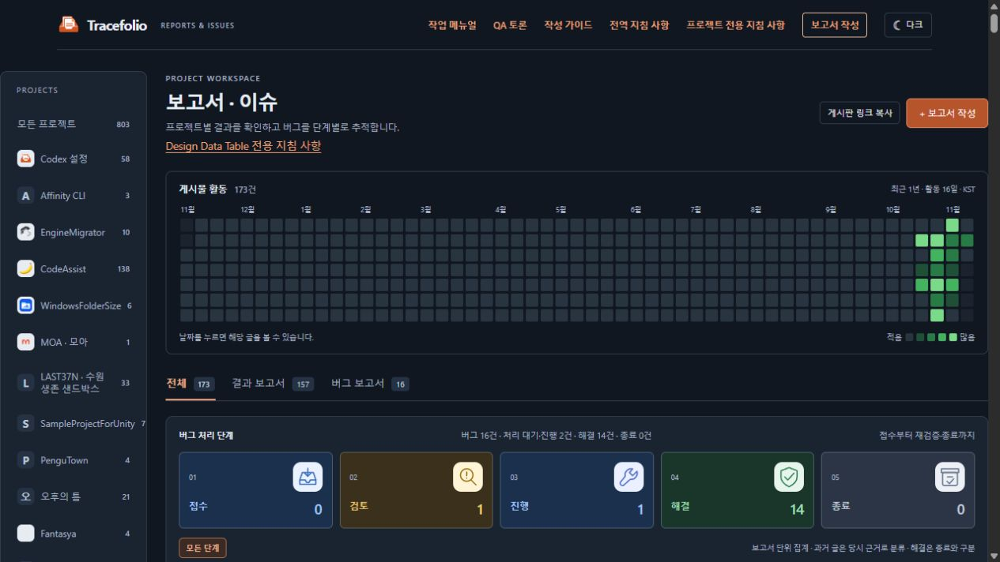
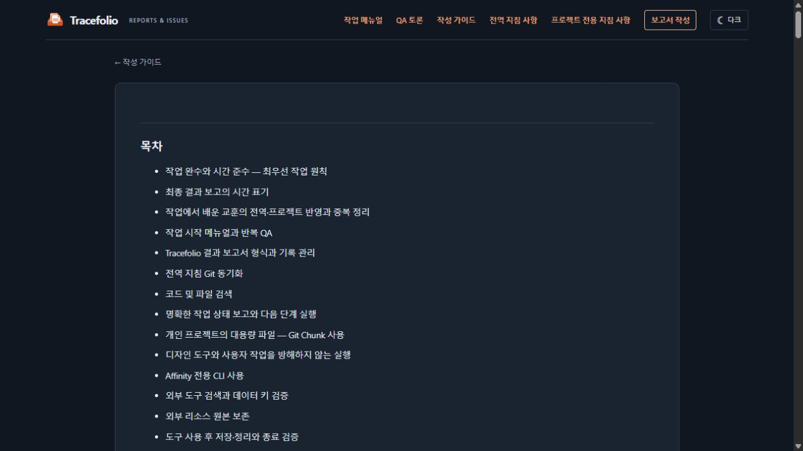
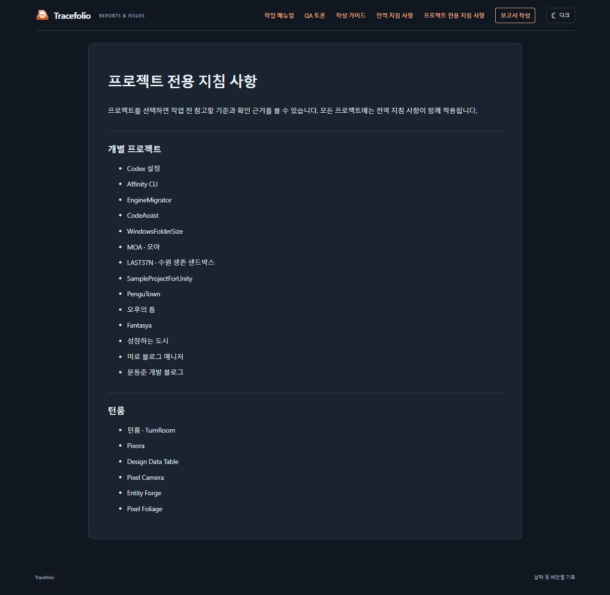
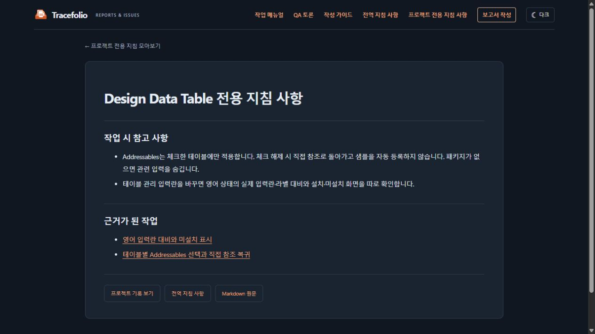
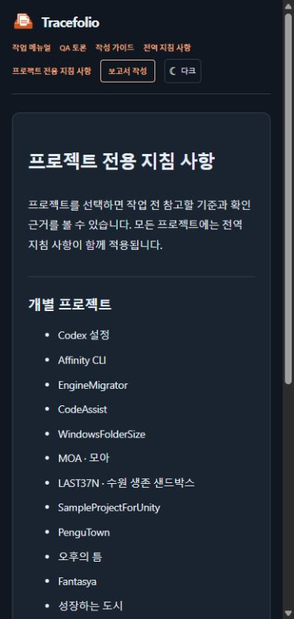

## 작업 결과

[전역 지침 사항](../../../guide/global-instructions.html)과 [프로젝트 전용 지침 사항](../../../guide/project-instructions.html)을 상단에서 바로 열 수 있습니다. 등록 프로젝트 20개에 전용 지침을 각각 작성했습니다.

## 변경 내용

### 적용 내용

- 개별 카테고리는 해당 지침, 턴룸 묶음 카테고리는 묶음 모아보기로 연결했습니다.
- 과거 보고서의 반복 가능한 기준을 프로젝트별 원문에 정리하고 근거를 35개 연결했습니다.
- 교훈 검토: 통합. 작업 시작 때 전용 지침을 확인하고, 종료 전에 전역·전용을 함께 검토합니다. 확인된 교훈은 알맞은 범위에 두고 중복을 통합하거나 제거합니다. 새 교훈이 없으면 변경 없음을 기록합니다.

### 대화 기록
- 사용자(시각 미기록): “탑바 작성가이드 옆에 넣어줘 전역 지침 사항”, “프로젝트별 전용 지침 사항 지금 없으니깐 지금까지 작업 기준으로 하나씩 만들어주고”.
- AI: 상단 바, 프로젝트 카테고리, 모아보기에서 열 수 있도록 연결하고, 기존 작업 기록을 근거로 사용했습니다.

[구현 시점 기록](./2026-11-09-result-20261109145440152-v1.0.0.html)

## 검증

- 공개 배포의 전역 페이지, 프로젝트 모아보기, 전용 HTML·Markdown 20쌍의 패키지 일치를 확인했습니다.
- 실제 브라우저에서 전역 지침, 모아보기, 개별 프로젝트 및 턴룸 묶음의 이동을 확인했습니다. 390px 너비에서 상단 링크가 화면 안에 표시됩니다.
- 설치본과 공개 커밋의 전역 원문을 대조했습니다.

### 실제 화면

변경 전 · Design Data Table 카테고리와 기존 상단 메뉴.

변경 후 · 작성 가이드 옆 전역 메뉴, 프로젝트 제목 아래 전용 지침 링크.

변경 후 · 상단 메뉴에서 연 전역 지침과 목차.

신규 · 상단 메뉴의 프로젝트 전용 지침 모아보기.

신규 · Design Data Table 전용 지침 본문과 근거 보고서.

변경 후 · 좁은 화면에서 줄을 바꾸는 상단 메뉴.

## 남은 사항

기능과 지침의 공개 검증을 마쳤습니다. 이후 작업에서 검증된 교훈이 생기면 기존 항목에 통합합니다.

## 작업 시간

- 제안 시간: 12~18분
- 실제로 완료된 시간: 2026-11-10 00:02:12 KST 기능·공개 화면 확인 기록, 시작 후 12분 58초. 보고서 배포 확인은 별도.
- XERJ: 미사용 — 사용하지 않았습니다.
