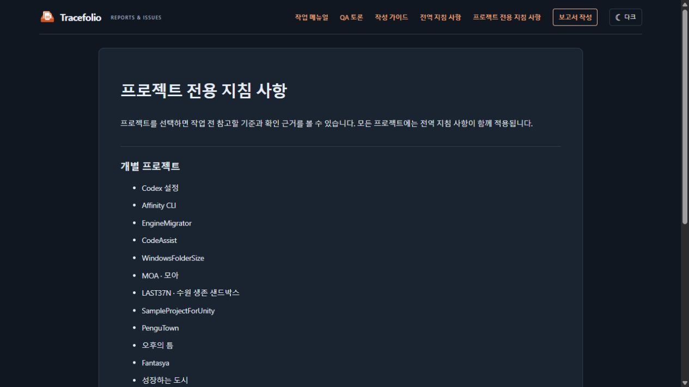
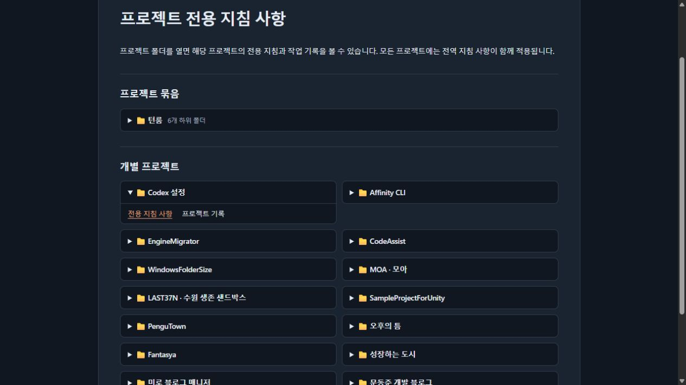
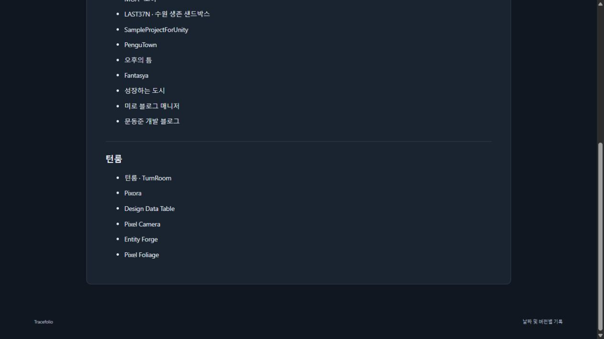
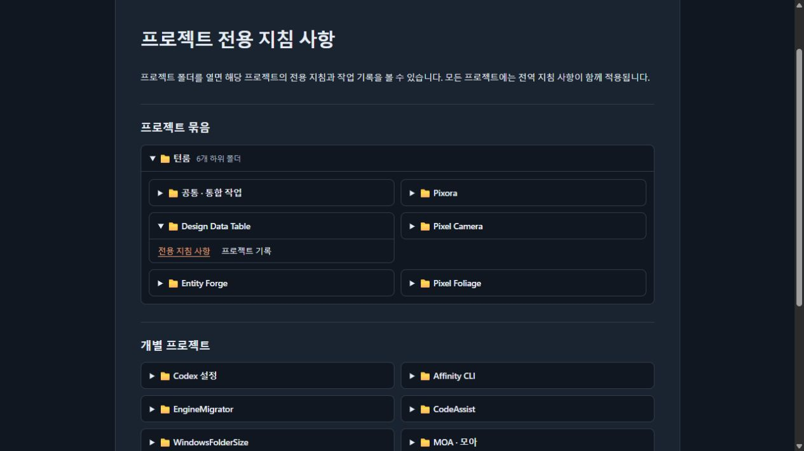

## 작업 결과

[프로젝트 전용 지침 사항](../../../guide/project-instructions.html)에서 프로젝트 폴더를 펼쳐 전용 지침과 프로젝트 기록을 열 수 있습니다.

## 변경 내용

### 적용 내용

- 개별 프로젝트마다 접고 펼칠 수 있는 폴더를 만들고, 턴룸에는 공통·통합과 제품 폴더를 묶었습니다.
- 기존 프로젝트 지침 원문과 개별 URL을 그대로 사용합니다.
- 교훈 검토: 전역·전용 기준 변경 없음. 기존 사이트 분류를 재사용한 화면 개선입니다.

### 대화 기록

- 사용자(시각 미기록): “폴더별로 나누고 폴더 단위로 지침 따로 만들어 전용”.
- 사용자(범위 선택): “Tracefolio 사이트에서 프로젝트를 폴더로 표시”.
- AI: 실제 프로젝트 파일은 수정하지 않고 사이트 모아보기를 폴더 탐색으로 변경했습니다.

## 검증

- 생성본에서 20개 폴더와 해당 프로젝트 지침 URL을 대조했습니다.
- 공개 브라우저에서 개별 프로젝트 폴더를 펼쳐 지침으로 이동하고, 턴룸 묶음을 접었다 펼쳐 DDT 전용 지침을 열었습니다.

변경 전 · 프로젝트 이름이 링크 목록으로 표시됐습니다.

변경 후 · 개별 폴더를 펼치면 전용 지침과 프로젝트 기록이 나타납니다.

변경 전 · 턴룸 제품 이름이 일반 목록으로 표시됐습니다.

변경 후 · 턴룸을 펼쳐 제품별 폴더와 해당 지침 링크를 확인할 수 있습니다.

## 남은 사항

없습니다.

## 작업 시간

- 제안 시간: 사이트 범위 확정 후 6~10분
- 실제로 완료된 시간: 2026-11-10 00:44:17 KST 공개 사이트 동작 확인 기록 (착수 후 9분 7초). 보고서 배포 확인은 별도.
- XERJ: 미사용 — 사용하지 않았습니다.
