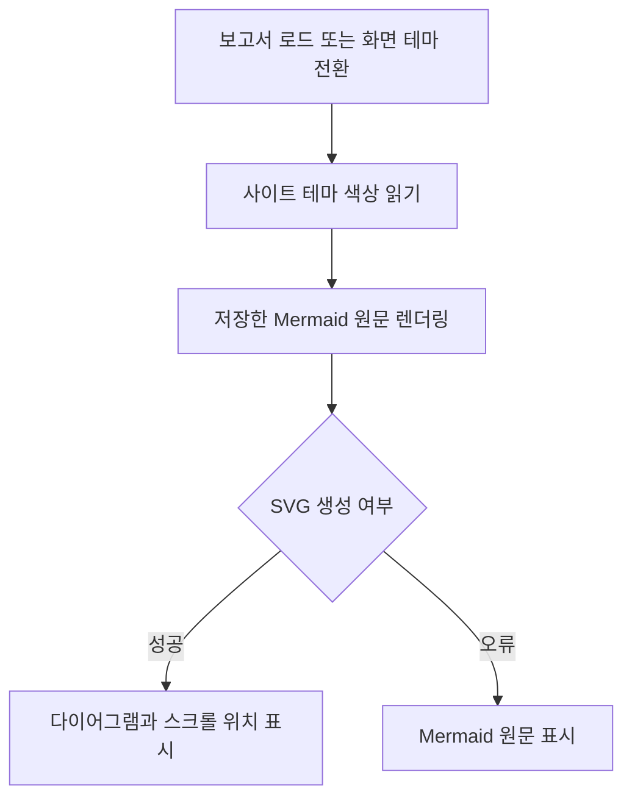
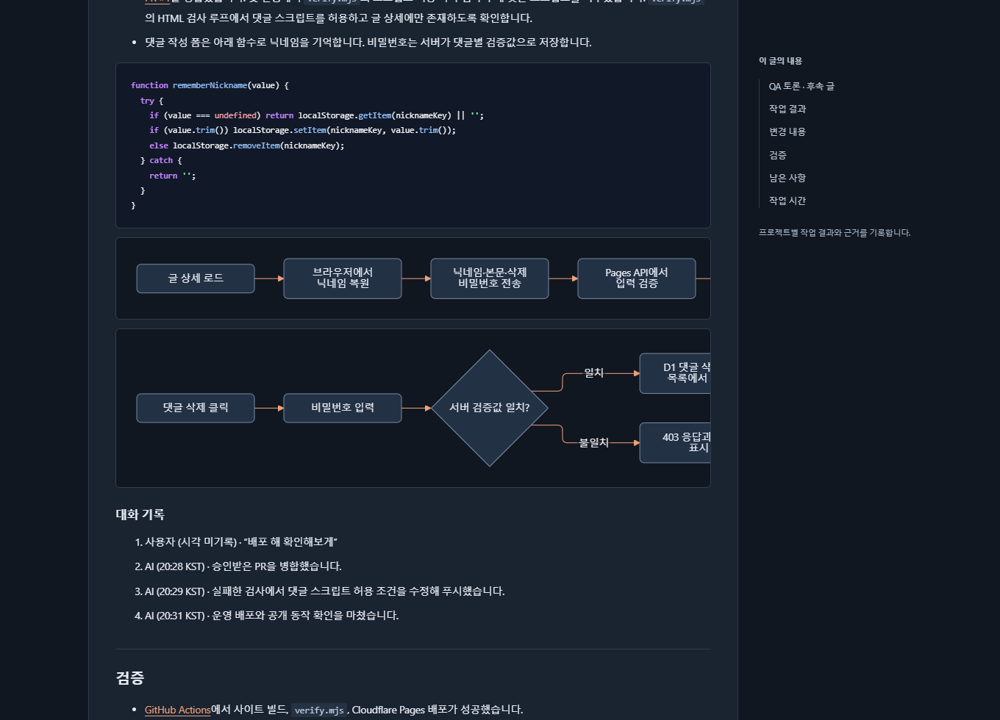
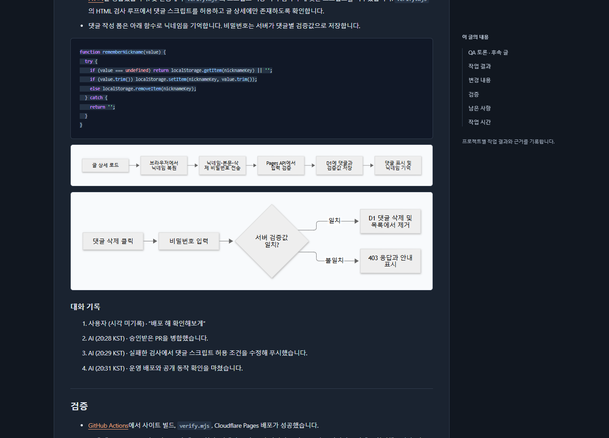
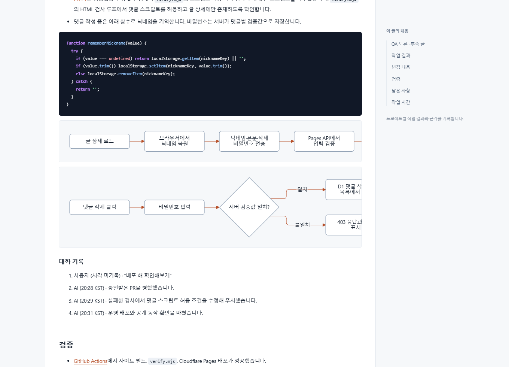
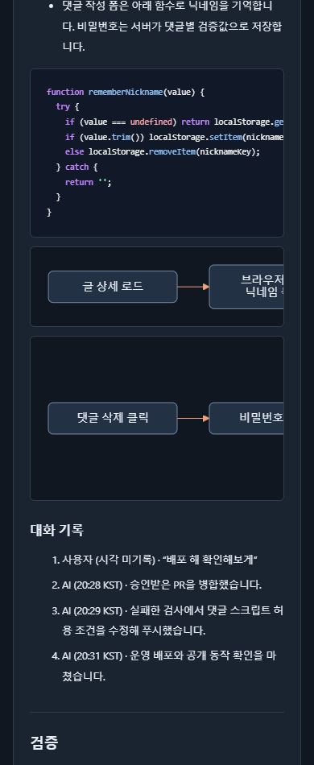

## 작업 결과

코드 블록에 하나의 배경을 적용하고 문장 속 코드 배경과 구문 색상을 유지했습니다. Mermaid는 사이트 테마를 따라 바뀌며 긴 흐름도는 영역 안에서 가로로 스크롤됩니다.

## 변경 내용

### 적용 내용

- `assets/theme.css`에서 인라인 코드의 다크 테마 배경을 블록 코드에서 제외했습니다.

- `assets/report-visuals.js`의 `renderDiagrams`는 현재 테마의 배경·텍스트·강조 색을 읽어 원본 Mermaid를 다시 렌더링합니다. 렌더에 실패하면 원본을 표시합니다.

- `build.mjs`에서 보고서 렌더러의 CSS와 JS에 콘텐츠 기반 버전을 적용했습니다.

- Tracefolio 프로젝트 지침에 코드 배경, 공용 테마, 라이트·다크·모바일 확인 기준을 추가했습니다.

```js
async function renderDiagrams(){
   const theme=root.dataset.theme;
   if(theme===renderedTheme)return;
   renderedTheme=theme;
   const style=getComputedStyle(diagrams[0]);
   const color=name=>style.getPropertyValue(name).trim();
   mermaid.initialize({
    startOnLoad:false,
    securityLevel:'strict',
    htmlLabels:false,
    suppressErrorRendering:true,
    theme:'base',
    look:'classic',
    fontFamily:'Segoe UI, Malgun Gothic, system-ui, sans-serif',
    themeCSS:'.node rect { rx: 6px; }',
    themeVariables:{
     darkMode:theme==='dark',
     fontSize:'14px',
     background:color('--paper'),
     primaryColor:color('--diagram-node'),
     primaryBorderColor:color('--diagram-border'),
     primaryTextColor:color('--ink'),
     lineColor:color('--green'),
     edgeLabelBackground:color('--paper')
    },
    flowchart:{curve:'linear',nodeSpacing:28,rankSpacing:30,padding:10,wrappingWidth:115}
   });
   for(const [index,diagram] of diagrams.entries()){
    const scrollLeft=diagram.scrollLeft;
    const source=sources[index];
    diagram.textContent=source;
    diagram.removeAttribute('data-processed');
    try{
     await mermaid.run({nodes:[diagram]});
     const svg=diagram.querySelector('svg');
     if(svg)svg.style.minWidth=`${svg.viewBox.baseVal.width}px`;
     diagram.scrollLeft=scrollLeft;
    }catch{
     diagram.textContent=source;
    }
   }
  }
```



### 대화 기록

- 사용자(시각 미기록)는 “코드 강조 매줄마다 무슨 드레그한 것 처럼 이상해”라고 지적하고 Mermaid 디자인과 지침 조정을 요청했습니다.
- Codex는 Tracefolio 보고서의 공통 스타일에서 원인을 확인하고 사이트 테마와 프로젝트 전용 지침에 수정 사항을 반영했습니다.

## 검증

첨부에 나온 댓글 배포 결과 보고서를 최신 소스에서 빌드하고 Chrome에서 확인했습니다. 다크 테마 코드의 배경은 투명으로 바뀌었고 인라인 코드는 기존 배경을 유지했습니다. 사이트 버튼으로 라이트와 다크를 전환했을 때 두 도표의 노드와 카드 색이 함께 바뀌었습니다. 390px에서는 도표 영역에만 가로 넘침이 생겼으며 페이지 폭은 390px을 유지했습니다.









## 남은 사항

이 기록을 작성한 시점에는 공개 배포와 외부 접근을 확인하는 단계가 남았습니다.

## 작업 시간

- 제안 시간: 10~15분
- 실제로 완료된 시간: 2026-11-10 20:57 KST 시작. 21:02 KST에 구현·빌드·로컬 화면 확인 완료, 약 5분. 공개 배포 확인은 별도입니다.
- XERJ: 미사용 — 지정 검색 도구를 사용하지 않았습니다.
