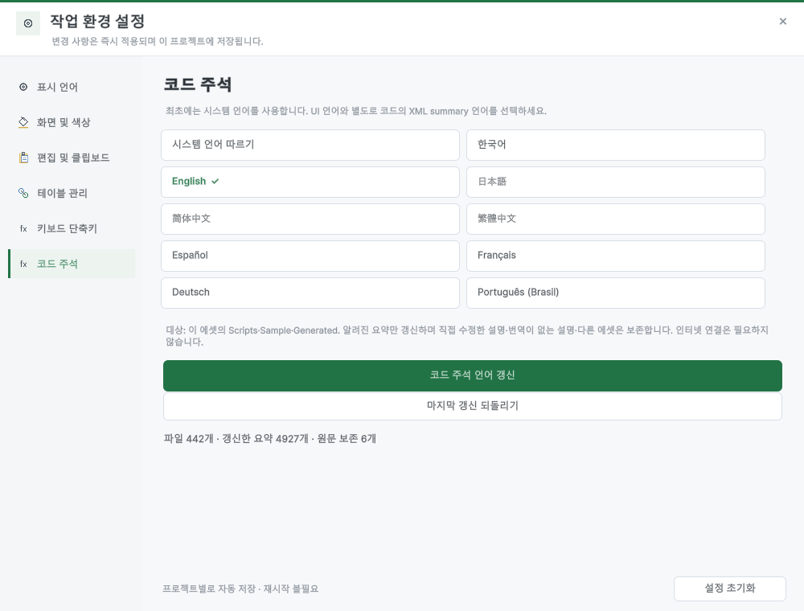
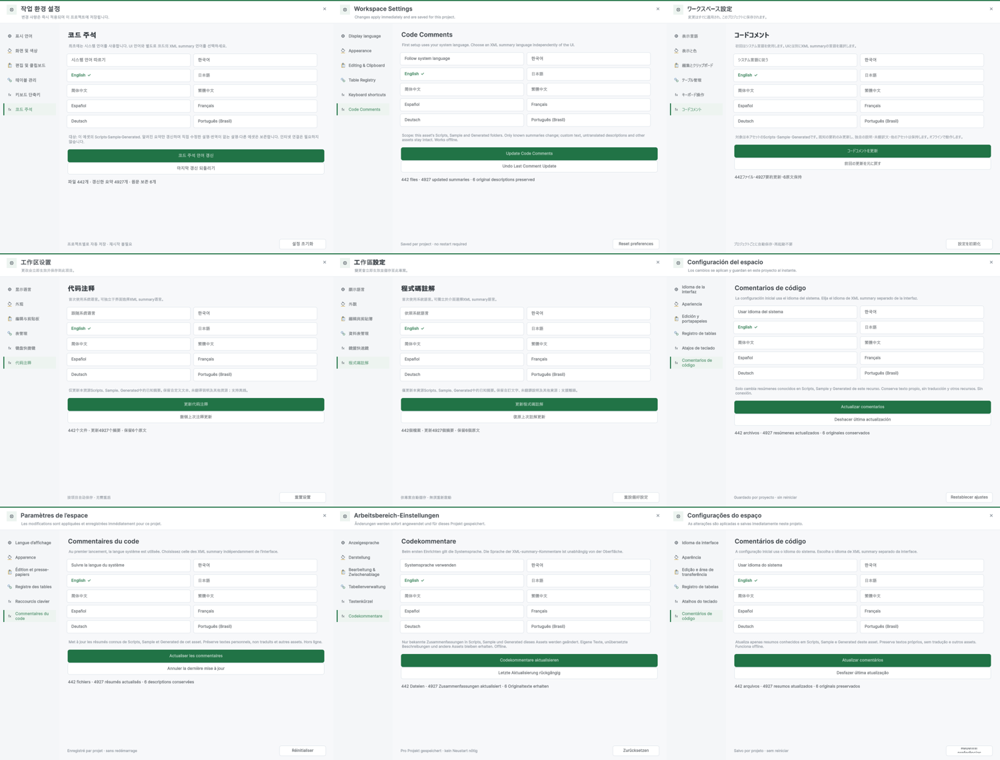

> 보관 기록입니다. 아래 결과는 원문 작성 시점의 내용이며, 이번 편집에서 제품 테스트를 다시 실행하지 않았습니다.

코드 주석 언어 검증

## 코드 주석 언어 갱신

설정 → 코드 주석. 최초 시스템 언어 적용, 이후 별도 언어 선택과 명시적 갱신, 선택 언어로 코드 재생성, 마지막 갱신 복원을 제공합니다.

## 검증 범위

| 항목 | 결과 |
| --- | --- |
| 실제 Unity 검사 | 4633건. 기능 사례, 파일별 원문 복귀, 카탈로그 구조 검사를 합산한 수치입니다. |
| 최초 시스템 언어 | 실제 Korean → ko 적용 및 초기화 상태 저장 |
| 언어 전환 | 9개 언어, 동일 언어 반복, 영어 원문 바이트 복귀 |
| 원본 보존 | 실행 코드·문자열·일반 주석·사용자 설명·타사 폴더·UTF-8 BOM·CRLF |
| 복원 | 백업 체크섬, 후속 사용자 변경 파일 보존, 전체 복원 시 언어 설정 복원 |
| 코드 생성 | 새 필드 요약·로컬 Enum·로컬라이징 코드의 선택 언어 유지, XML 이스케이프 |

준비된 번역 카탈로그를 사용합니다. 모든 임의의 설명을 자동 번역하지 않으며, 미번역·수정된 설명은 원문으로 유지합니다. 식별자와 일부 내부 처리 이름은 영어로 남습니다. 독립된 원어민 감수는 수행하지 않았습니다.

## 9개 언어 실제 화면

이전 시도에서는 Windows 파일 교체 오류를 재현하여 백업을 유지하는 덮어쓰기 경로를 추가했습니다. 이후 기능 검사가 통과했습니다. QA 도구의 타입 이름 충돌과 테스트 기준 불일치도 별도 수정했습니다. 과거 로그는 FirstAttempt.log에 보존합니다.

한글 TC · Unity 검사 결과 · 언어별 실행 토큰·XML 검사 · 컴파일 로그

## 최종 확인

실제 EnumGear 행·로더의 한국어/영어 재생성이 통과했습니다. 바이너리는 불변이고 영어 생성 소스 바이트는 원래 상태로 돌아왔습니다. 독립 Roslyn 검사: 510개 파일·9개 언어·심볼 ON/OFF의 실행 토큰/XML 비교 8,160건 통과. 컴파일 오류·경고 0개. 문서: 9개 언어, 현재 이미지 34개, 브라우저 검사 137건 통과. 영문 PDF 17쪽·한글 PDF 16쪽을 렌더링하여 검토했습니다.

실제 재생성 결과 · 한국어 생성 코드 · [PDF 페이지 검토](../assets/imports/Docs/Testing/2026-10-29/code-comment-languages/PDF-Contact.png)

## 원문과 편집 이력

[보존된 원문 열기](../assets/imports/Docs/Testing/2026-10-29/code-comment-languages/Report.ko.html)

- 원문 SHA-256: `1bfab7af2d622914e250a53896bac8a69c1ac03c533f6ead47a5319157f5999f`
- 표시 날짜는 원본 파일의 수정 시각입니다. 작업 완료 시각은 원문에 있는 값을 기준으로 확인합니다.
