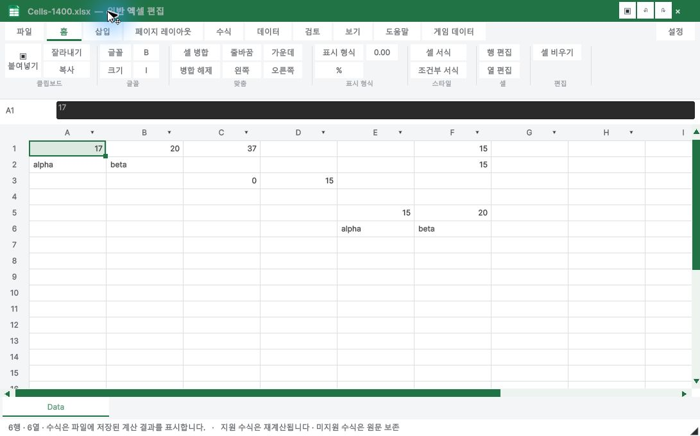
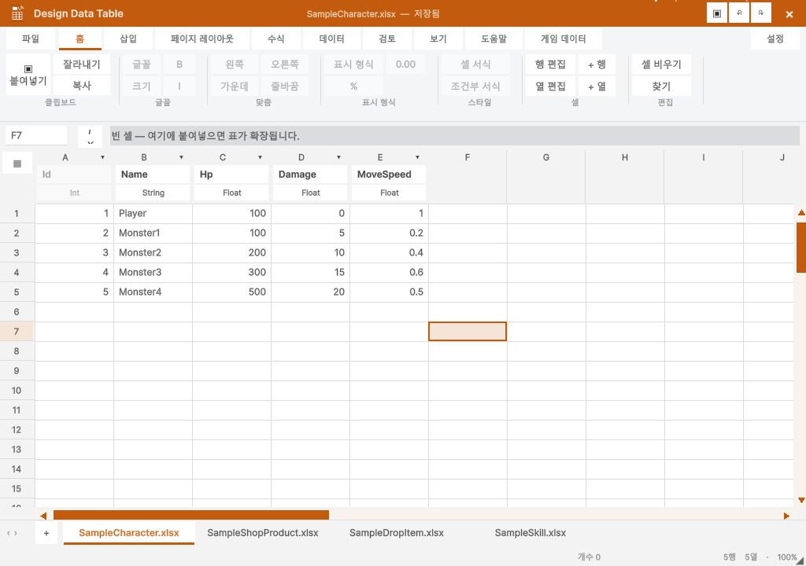

> 보관 기록입니다. 아래 결과는 원문 작성 시점의 내용이며, 이번 편집에서 제품 테스트를 다시 실행하지 않았습니다.

Excel ribbon comparison

## Excel ribbon comparison

Reference: [Microsoft Support screenshots and formatting documentation](https://support.microsoft.com/en-us/excel/format-text-in-cells). The reference covers Excel 2024/2021 and includes desktop and web sections; it is not a verified current Microsoft 365 desktop build. An Excel 2016 desktop training reference was used for tab/group order.

| Area | Applied | Remaining difference |
| --- | --- | --- |
| Tabs | File, Home, Insert, Page Layout, Formulas, Data, Review, View, Help; Game Data extension | Optional Draw/Automate/Developer/contextual tabs are not replicated |
| Home | Clipboard, Font, Alignment, Number, Styles, Cells, Editing; large Paste; quick access | Font/number details use our Format Cells popup; icons and control geometry are not identical |
| Game Data | Same structure, orange identity | Typed game editor does not apply workbook presentation formatting; controls disabled |
| Page Layout / Review | Tab positions retained | Print/page setup and full Excel review commands are not implemented |

## General workbook — actual Unity capture

## Game data — actual Unity capture

Native UI check: A1 bold via Home button, dirty title, Ctrl+Z restored regular font and clean title. This is a layout and supported-command update, not full Excel parity or native Excel execution acceptance.

## 원문과 편집 이력

[보존된 원문 열기](../assets/imports/Docs/Testing/2026-10-21/ExcelReferenceRibbon.html)

- 원문 SHA-256: `588ed8054fd1f3e8bb7fd579b85b9a5fbdd9ac18ac1f4c0612c0a3a59f7bbb5f`
- 표시 날짜는 원본 파일의 수정 시각입니다. 작업 완료 시각은 원문에 있는 값을 기준으로 확인합니다.
