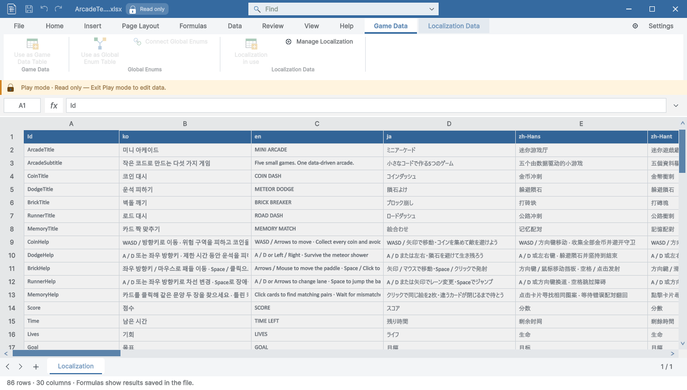

> 보관 기록입니다. 아래 결과는 원문 작성 시점의 내용이며, 이번 편집에서 제품 테스트를 다시 실행하지 않았습니다.

게임 데이터 탭의 창 색상 연동

## 게임 데이터 탭의 창 색상 연동

게임 데이터 탭의 고정 게임 데이터 색상 사용을 제거하고 현재 창의 색상을 따르도록 수정했습니다. 흰 배경과 밝은 색상에 대한 대비 보정은 유지합니다. 로컬라이징 창에서는 로컬라이징 색상, 전역 Enum 창에서는 전역 Enum 색상을 따릅니다.

| 문서 | 창 RGB | 탭 밑줄 RGB | 결과 |
| --- | --- | --- | --- |
| 게임 데이터 | [194, 91, 13] | [194, 91, 13] | 통과 |
| 로컬라이징 | [53, 106, 160] | [53, 106, 160] | 통과 |
| 로컬 Enum | [33, 115, 70] | [33, 115, 70] | 통과 |
| 전역 Enum | [112, 68, 153] | [112, 68, 153] | 통과 |
| 일반 스프레드시트 | [33, 115, 70] | [33, 115, 70] | 통과 |

5종의 실제 네이티브 PNG 픽셀을 비교했습니다. 첫 비교에서 일반 임시 파일의 외부 파일 배지 영역을 샘플링한 것을 확인하고, 배지·문자와 겹치지 않는 순수 제목 표시줄 배경에서 비교했습니다. Play 잠금 33개·상황별 도구 208개 조건도 다시 통과했습니다. 빌드 오류·경고 0개, 영향 이미지 29개 재촬영, 9개 언어 안내·브라우저 140개 조건 확인.

이전 캡처와 소스 해시는 Before 폴더에 보존했습니다. 비표시 실제 Unity HostView를 사용했으며 사용자 화면·키보드·클립보드는 조작하지 않았습니다. 공유 화면은 영문이며 다른 운영체제·모든 언어 네이티브 UI 인증이 아닙니다.

픽셀 비교 · 문서 검사 · 최종 결과

제안: 5–10분. 실제: 7.0분. 완료: 2026-10-29 17:13:55 KST. XERJ: 사용.

## 원문과 편집 이력

[보존된 원문 열기](../assets/imports/Docs/Testing/2026-10-29/game-tab-window-color/Report.ko.html)

- 원문 SHA-256: `cb0c704f4217d8feff4b74c4ec11d96e9703065a95b9b05496bca12fd72393cf`
- 표시 날짜는 원본 파일의 수정 시각입니다. 작업 완료 시각은 원문에 있는 값을 기준으로 확인합니다.
