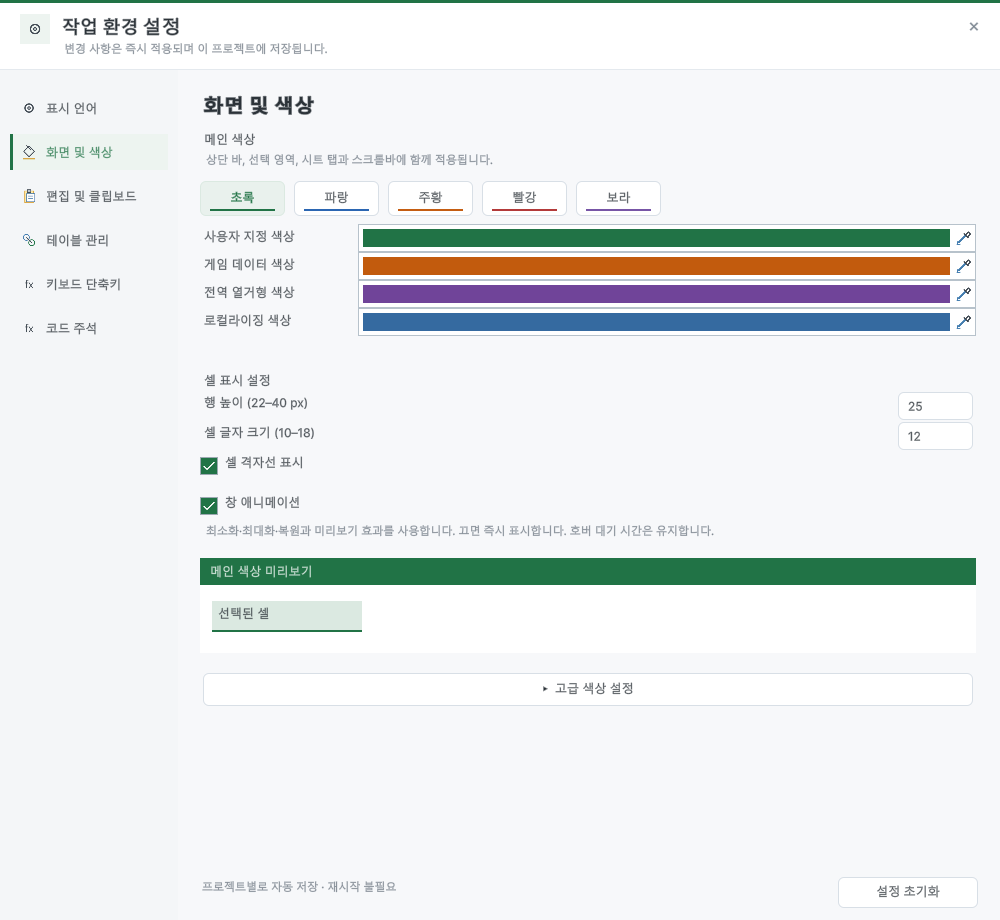
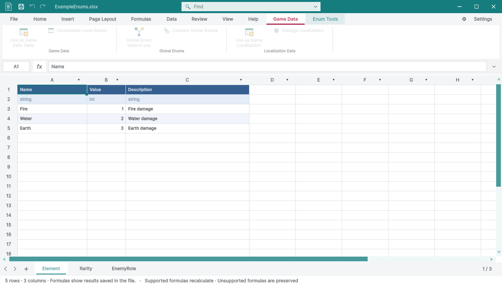

> 보관 기록입니다. 아래 결과는 원문 작성 시점의 내용이며, 이번 편집에서 제품 테스트를 다시 실행하지 않았습니다.

문서 종류별 색상 설정

## 문서 종류별 색상 설정

외형 설정의 기존 사용자 지정 색상 아래에 게임 데이터·전역 열거형·로컬라이징 색상 필드를 추가했습니다. 창·선택·시트 탭·전용 도구와 원본 아이콘에 반영되며 프로젝트별 저장과 기본값 초기화를 지원합니다.

## 검증

50개 조건을 확인했습니다. 열린 문서와 닫힌 원본의 색상, 아이콘 픽셀, 실제 Unity 종료·재시작 뒤 값 유지, 불투명도와 초기화를 검사했습니다. 9개 언어의 설정 화면을 캡처·검토했습니다. 밝은 게임 데이터 색상에서는 탭 글자·선택 밑줄과 시트 글자의 대비를 보완했습니다.

Play 잠금 33개와 상황별 도구 208개 조건을 다시 실행했습니다. 빌드 오류·경고 0개. 영향받은 가이드 이미지 32개를 재촬영하고 9개 언어·현재 이미지 37개 및 브라우저 140개 조건을 확인했습니다. 이전 이미지·해시는 Before 폴더에 보존했습니다.

## 색상 적용 예

일반 스프레드시트 색상은 유지한 채 게임 데이터·전역 열거형·로컬라이징을 서로 다른 색상으로 지정해 확인했습니다.

## 한글 TC

| 검사 | 결과 |
| --- | --- |
| 기존 설정에서 게임 데이터 기본 색상 유지 | 통과 |
| 기존 설정에서 전역 열거형 기본 색상 유지 | 통과 |
| 기존 설정에서 로컬라이징 기본 색상 유지 | 통과 |
| ko — 게임 데이터 색상 번역 확인 | 통과 |
| ko — 전역 열거형 색상 번역 확인 | 통과 |
| ko — 로컬라이징 색상 번역 확인 | 통과 |
| en — 게임 데이터 색상 번역 확인 | 통과 |
| en — 전역 열거형 색상 번역 확인 | 통과 |
| en — 로컬라이징 색상 번역 확인 | 통과 |
| ja — 게임 데이터 색상 번역 확인 | 통과 |
| ja — 전역 열거형 색상 번역 확인 | 통과 |
| ja — 로컬라이징 색상 번역 확인 | 통과 |
| zh-Hans — 게임 데이터 색상 번역 확인 | 통과 |
| zh-Hans — 전역 열거형 색상 번역 확인 | 통과 |
| zh-Hans — 로컬라이징 색상 번역 확인 | 통과 |
| zh-Hant — 게임 데이터 색상 번역 확인 | 통과 |
| zh-Hant — 전역 열거형 색상 번역 확인 | 통과 |
| zh-Hant — 로컬라이징 색상 번역 확인 | 통과 |
| es — 게임 데이터 색상 번역 확인 | 통과 |
| es — 전역 열거형 색상 번역 확인 | 통과 |
| es — 로컬라이징 색상 번역 확인 | 통과 |
| fr — 게임 데이터 색상 번역 확인 | 통과 |
| fr — 전역 열거형 색상 번역 확인 | 통과 |
| fr — 로컬라이징 색상 번역 확인 | 통과 |
| de — 게임 데이터 색상 번역 확인 | 통과 |
| de — 전역 열거형 색상 번역 확인 | 통과 |
| de — 로컬라이징 색상 번역 확인 | 통과 |
| pt-BR — 게임 데이터 색상 번역 확인 | 통과 |
| pt-BR — 전역 열거형 색상 번역 확인 | 통과 |
| pt-BR — 로컬라이징 색상 번역 확인 | 통과 |
| 게임 데이터 — 열린 문서에 변경 즉시 반영 | 통과 |
| 전역 열거형 — 열린 문서에 변경 즉시 반영 | 통과 |
| 로컬라이징 — 열린 문서에 변경 즉시 반영 | 통과 |
| 일반 스프레드시트 — 열린 문서에 변경 즉시 반영 | 통과 |
| 게임 데이터 — 닫힌 원본·프로젝트 아이콘 색상 반영 | 통과 |
| 게임 데이터 — 아이콘 픽셀에 지정 색상 포함 | 통과 |
| 전역 열거형 — 닫힌 원본·프로젝트 아이콘 색상 반영 | 통과 |
| 전역 열거형 — 아이콘 픽셀에 지정 색상 포함 | 통과 |
| 로컬라이징 — 닫힌 원본·프로젝트 아이콘 색상 반영 | 통과 |
| 로컬라이징 — 아이콘 픽셀에 지정 색상 포함 | 통과 |
| 일반 스프레드시트 — 닫힌 원본·프로젝트 아이콘 색상 반영 | 통과 |
| 일반 스프레드시트 — 아이콘 픽셀에 지정 색상 포함 | 통과 |
| 프로젝트 설정 파일에 문서 색상 저장 | 통과 |
| Unity 재시작 후 게임 데이터 색상 유지 | 통과 |
| Unity 재시작 후 전역 열거형 색상 유지 | 통과 |
| Unity 재시작 후 로컬라이징 색상 유지 | 통과 |
| 문서 색상 불투명도 유지 | 통과 |
| 초기화로 게임 데이터 기본 색상 복구 | 통과 |
| 초기화로 전역 열거형 기본 색상 복구 | 통과 |
| 초기화로 로컬라이징 기본 색상 복구 | 통과 |

전체 TC · [9개 언어 화면](../assets/imports/Docs/Testing/2026-10-29/document-colors/Settings-9-Languages.jpg) · [32개 재촬영 화면](../assets/imports/Docs/Testing/2026-10-29/document-colors/Guide-Recaptures.jpg) · 문서 검사 · 결과

Windows Unity 6000.0.83f1의 별도 QA 프로젝트와 비표시 네이티브 HostView를 사용했습니다. 사용자 화면·키보드·클립보드를 조작하지 않았습니다. 설정 화면 외의 모든 UI·다른 플랫폼을 인증한 것은 아닙니다.

제안: 15–25분. 실제: 19.8분. 완료: 2026-10-29 17:05:57 KST. XERJ: 사용 — 후보와 현재 소스 대조.

## 원문과 편집 이력

[보존된 원문 열기](../assets/imports/Docs/Testing/2026-10-29/document-colors/Report.ko.html)

- 원문 SHA-256: `16df70c9709a2d707fb798f021b471b0a3a94c58ec2752d0c66c1637bbe0c54c`
- 표시 날짜는 원본 파일의 수정 시각입니다. 작업 완료 시각은 원문에 있는 값을 기준으로 확인합니다.
