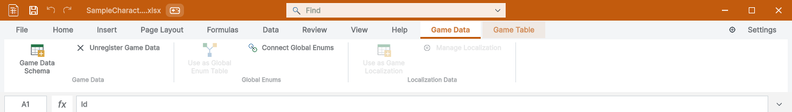
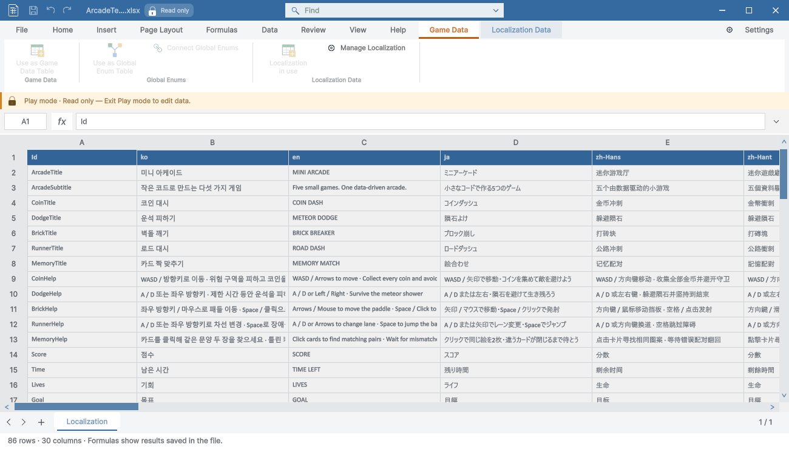
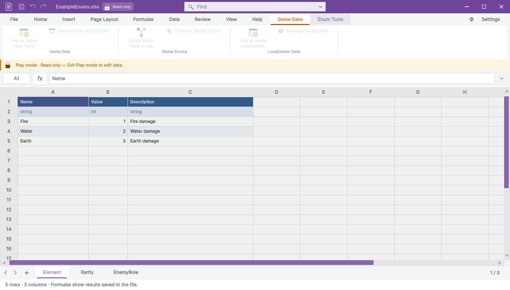

> 보관 기록입니다. 아래 결과는 원문 작성 시점의 내용이며, 이번 편집에서 제품 테스트를 다시 실행하지 않았습니다.

게임 데이터 탭·Play 잠금 검증

## 게임 데이터 탭 색상·공통 Play 잠금

구현·빌드·실제 Unity 실행 검증을 완료했습니다. 게임 데이터 탭은 흰 배경·주황 글씨로 반전하고 주황 선택 밑줄을 유지합니다. Play 중 게임 데이터·등록 로컬라이징·로컬/글로벌 Enum 파일은 같은 잠금 배지·안내·그리드 표시와 편집 차단을 사용합니다.

## 잠금 범위

화면의 편집 가능 상태, 통합 저장, 직접 세션 저장을 검사했습니다. 로컬라이징·글로벌 Enum 재생성도 Play 중 차단합니다. 일반 미등록 스프레드시트는 저장할 수 있으며 Play 종료 후 보호 파일 잠금도 풀립니다. 파일 단위 잠금을 사용합니다.

## 검사 결과

Play 관련 33개 조건, 상황별 리본 208개 조건이 통과했습니다. 빌드 오류·경고는 0개입니다. 가이드 9개 언어·현재 이미지 37개와 브라우저 140개 조건을 확인했습니다. 변경된 기존 이미지 27개를 재촬영하고 실제 Play 잠금 이미지 2개를 추가했습니다. 이전 이미지와 소스 해시는 Before 폴더에 보존했습니다.

탭 배경 RGB(255,255,255), 밑줄 RGB(194,91,13)을 실제 PNG 픽셀에서 확인했습니다. 캡처는 비표시 네이티브 HostView이며 사용자 화면·키보드·클립보드를 조작하지 않았습니다. 영문 공유 이미지와 Windows Unity 6000.0.83f1 범위이며 다른 플랫폼·모든 언어 네이티브 UI의 인증이 아닙니다.

초기 검증 도구의 Repaint 이전 상태 확인과 기존 테스트 파일 재생성 문제를 수정하고 다시 실행했습니다. 초기 기록은 History와 Initial-Test-Error.txt에 보존했습니다.

| 검사 | 결과 |
| --- | --- |
| 게임 데이터 — Play 밖에서 잠금 없음 | 통과 |
| 로컬라이징 — Play 밖에서 잠금 없음 | 통과 |
| 로컬 Enum — Play 밖에서 잠금 없음 | 통과 |
| 글로벌 Enum — Play 밖에서 잠금 없음 | 통과 |
| 게임 데이터 — Play 중 잠금 판정 일치 | 통과 |
| 게임 데이터 — 화면 편집 허용 상태 일치 | 통과 |
| 게임 데이터 — 통합 저장 차단 | 통과 |
| 게임 데이터 — 직접 세션 저장 차단 | 통과 |
| 게임 데이터 — 원본 바이트 보존 | 통과 |
| 로컬라이징 — Play 중 잠금 판정 일치 | 통과 |
| 로컬라이징 — 화면 편집 허용 상태 일치 | 통과 |
| 로컬라이징 — 통합 저장 차단 | 통과 |
| 로컬라이징 — 직접 세션 저장 차단 | 통과 |
| 로컬라이징 — 원본 바이트 보존 | 통과 |
| 로컬 Enum — Play 중 잠금 판정 일치 | 통과 |
| 로컬 Enum — 화면 편집 허용 상태 일치 | 통과 |
| 로컬 Enum — 통합 저장 차단 | 통과 |
| 로컬 Enum — 직접 세션 저장 차단 | 통과 |
| 로컬 Enum — 원본 바이트 보존 | 통과 |
| 글로벌 Enum — Play 중 잠금 판정 일치 | 통과 |
| 글로벌 Enum — 화면 편집 허용 상태 일치 | 통과 |
| 글로벌 Enum — 통합 저장 차단 | 통과 |
| 글로벌 Enum — 직접 세션 저장 차단 | 통과 |
| 글로벌 Enum — 원본 바이트 보존 | 통과 |
| 일반 스프레드시트 — Play 중 잠금 판정 일치 | 통과 |
| 일반 스프레드시트 — 화면 편집 허용 상태 일치 | 통과 |
| 일반 스프레드시트 — Play 중 저장 가능 | 통과 |
| 로컬라이징 — Play 중 재생성 차단 | 통과 |
| 글로벌 Enum — Play 중 재생성 차단 | 통과 |
| 게임 데이터 — Play 종료 후 잠금 해제 | 통과 |
| 로컬라이징 — Play 종료 후 잠금 해제 | 통과 |
| 로컬 Enum — Play 종료 후 잠금 해제 | 통과 |
| 글로벌 Enum — Play 종료 후 잠금 해제 | 통과 |

한글 TC · 문서 검사 · [27개 재촬영 화면](../assets/imports/Docs/Testing/2026-10-29/runtime-data-lock/Recaptured-Contact.jpg) · 최종 결과

제안 시간: 15–25분. 실제 소요: 18.4분. 완료: 2026-10-29 16:45:20 KST. XERJ: 사용 — 후보와 현재 소스 대조.

## 원문과 편집 이력

[보존된 원문 열기](../assets/imports/Docs/Testing/2026-10-29/runtime-data-lock/Report.ko.html)

- 원문 SHA-256: `8e604e2c8e5a06832dcb19a71a325ec085d1da984996c74124eda99458e78773`
- 표시 날짜는 원본 파일의 수정 시각입니다. 작업 완료 시각은 원문에 있는 값을 기준으로 확인합니다.
