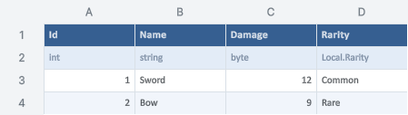

> 보관 기록입니다. 아래 결과는 원문 작성 시점의 내용이며, 이번 편집에서 제품 테스트를 다시 실행하지 않았습니다.

AI 공통 API 검증 결과

## AI 공통 API 검증 결과

구현·빌드와 실제 Unity 실행 검증을 완료했습니다. 새 임시 파일로 53개 TC를 처음부터 다시 실행해 모두 통과했습니다. 사용자 화면은 조작하지 않았습니다.

## 구현 범위

| 기능 | 설명 |
| --- | --- |
| 테이블 | 원본 검색, Id·필드 이름으로 조회·추가·수정·upsert·삭제 |
| 스키마·Enum | 컬럼·설명과 Summary 동기화, 로컬 Enum 정의, 글로벌 연결·제공자, 의존 데이터 검증 |
| 범위·시트 | A1 행렬 읽기·쓰기·지우기, 서식·병합·표 디자인, 시트·행·열 작업 |
| 배치·이미지 | 동일 파일의 여러 작업을 검증 후 한 번 저장, dryRun과 네이티브 PNG |
| AI 발견 | MCP 도구 8개, 편집 작업 25개, --ai-info, --mcp-config, AGENTS·SKILL·플러그인 메타데이터 |

## 검증 근거

- 실제 엔진 TC 53개: 신규·반복 입력, Id 중복, 타입·Enum 오류, 여러 시트 배치, 스키마·Summary, 로컬·글로벌 Enum, CSV, 리비전·초안 보호, 취소, 저장 실패 복원.

- 공식 MCP Python SDK 2.3.0: 11개 검사 통과, 협상 프로토콜 2025-11-25. 도움말·목록·조회·검증·이미지 응답 확인.

- 어댑터 검사 14개: 오프라인 발견, 잘못된 JSON·RPC·인자, 구 프로토콜 도구 스키마, 기존 CLI 진입점, 반복 호출.

- 조회 50회와 PNG 12회 연속 성공. 아래 시간은 큐·파일 왕복을 포함하며 인터랙티브 편집기 FPS 측정이 아닙니다.

- 빌드: 오류 0개·경고 0개. 가이드 9개 언어, 현재 네이티브 이미지 35개 해시·소스 확인, 브라우저 138개 검사 통과.

Id 조회: 중앙값 0.254초, 최댓값 0.305초. PNG: 중앙값 0.255초, 최댓값 0.356초.

## 발견 후 수정한 문제

| 문제 | 수정·재검증 |
| --- | --- |
| 같은 값을 재전송해도 저장 처리 | 세션의 실제 변경 여부를 비교합니다. no-op의 파일 리비전 유지와 committed:false 확인. |
| 헤더 채우기와 글자 대비 누락 | ARGB 색상 해석·영역 클리핑 수정. 실제 Unity PNG와 문서 화면 확인. |
| 잘못된 MCP 도구 이름·취소 Id가 서버를 중단시킬 가능성 | 입력 타입 검사. 손상 요청 후 정상 도움말·ping 응답 확인. |
| 네이티브 미리보기 임시 EditorWindow 해제 누락 | Container·Host·EditorWindow를 각각 해제합니다. 수정 전 30회에 창 30개 잔류 → 수정 후 60회에 0개. RenderTexture는 30·60회 모두 16개로 추가 증가 없음. |
| 시험 코드가 취소 결과를 0.8초만 기다림 | 실제 결과 파일을 최대 15초까지 확인하도록 시험 대기를 수정했습니다. 만료된 요청이 뒤늦게 저장되지 않고 request-expired로 끝난 것을 확인. |

## 실제 결과 이미지

영문 Unity 6000.0.83f1의 범위 전용 엔진 출력입니다. 전체 스프레드시트 창 캡처가 아닙니다. 다른 UI 언어의 레이아웃을 검증한 것으로 간주하지 않습니다.

## 사용 방법·제한

[MCP·CLI·Python 참조](../assets/imports/Assets/DesignDataTable/Documentation/AutomationCLI.html) · 전체 도구·작업 목록 · MCP 실행 근거 · 60회 자원 검사 · 반복 호출 시간 · 9개 언어 문서 검사

Unity가 열려 있고 Play 밖이어야 합니다. 한 배치는 한 워크북에 한정됩니다. 미저장 사용자 초안이 있으면 편집을 거부합니다. 타임아웃 후에는 요청 Id 상태를 먼저 확인합니다. 이미 진행 중인 커밋은 완료될 수 있습니다. 이미지·서식은 현재 편집기의 지원 범위를 따릅니다.

MCP 클라이언트 설정을 자동 설치하지 않았습니다. --mcp-config로 출력한 설정을 연결하면 도구 목록을 발견할 수 있습니다. 연결하지 않은 모든 AI에 강제 적용할 방법은 없습니다. 다른 MCP 클라이언트 및 macOS/Linux 실행은 미확인입니다.

## 전체 TC

| 검사 | 결과 | 초 |
| --- | --- | --- |
| 지원 명령과 새 API 검색 | 통과 | 7.075 |
| 테이블 이름 검색에서 원본 파일·시트 반환 | 통과 | 0.966 |
| 검색 페이지·검색 결과 없음 | 통과 | 0.359 |
| Id와 필드 이름 기반 조회 | 통과 | 0.306 |
| 시트 구조·기본 타입·로컬 Enum 선택값 조회 | 통과 | 0.46 |
| 범위 읽기 행렬과 계산 표시 | 통과 | 0.306 |
| 없는 Id는 빈 결과 | 통과 | 0.204 |
| 없는 필드·잘못된 Id 거부 | 통과 | 0.462 |
| dry-run 수정·이미지와 원본 불변 | 통과 | 0.613 |
| Id 기반 정상 수정 및 저장 후 조회 | 통과 | 3.084 |
| 같은 값을 반복 저장하면 소스 리비전 불변 | 통과 | 0.759 |
| Byte 범위 초과 시 전체 배치 거부 | 통과 | 0.306 |
| 정의되지 않은 Enum 값 거부 | 통과 | 0.206 |
| 알 수 없는 필드·일부 정상 작업도 전체 거부 | 통과 | 0.208 |
| 새 Id 삽입·중복 Id 거부 | 통과 | 2.982 |
| Upsert는 기존 Id를 수정 | 통과 | 1.117 |
| Id 삭제·없는 Id 삭제 거부 | 통과 | 5.757 |
| 같은 파일의 다른 등록 테이블까지 한 배치 적용 | 통과 | 3.442 |
| 스키마 컬럼 추가와 Summary 설명 양방향 반영 | 통과 | 9.82 |
| 스키마 이름 변경·설명 갱신 후 데이터 보존 | 통과 | 8.526 |
| 기존 컬럼 값을 새 타입으로 검증 후 거부 | 통과 | 0.759 |
| Id 스키마 삭제 거부 | 통과 | 0.106 |
| 스키마 컬럼 삭제 및 Summary 정리 | 통과 | 8.529 |
| 로컬 Enum 생성·번호 생략·즉시 게임 컬럼에 사용 | 통과 | 9.235 |
| Enum 기존 번호 유지 및 신규 자동 번호 충돌 회피 | 통과 | 8.837 |
| 사용 중인 Enum 삭제 시 참조 데이터 경고·저장 거부 | 통과 | 0.709 |
| 중복 Enum 숫자·Int32 초과 거부 | 통과 | 0.41 |
| Enum을 사용하는 컬럼과 정의를 같은 배치에서 제거 | 통과 | 0.71 |
| 글로벌 Enum 연결 및 실제 게임 컬럼 사용 | 통과 | 17.281 |
| 사용 중인 글로벌 Enum 연결 해제 거부 | 통과 | 0.66 |
| 새 글로벌 제공자와 Enum을 한 배치에서 생성 | 통과 | 9.279 |
| 글로벌 정의에서 사용 중인 멤버 제거 시 소비자까지 검증 | 통과 | 1.014 |
| 범위 행렬·수식·서식·열 너비·행 높이 일괄 저장 | 통과 | 0.612 |
| 행렬 크기 불일치·부정확한 범위 거부 | 통과 | 0.51 |
| 시트 추가·내용 입력·이름 변경·틀 고정 | 통과 | 0.469 |
| 행·열 삽입과 삭제 | 통과 | 0.461 |
| 범위 병합·해제·내용 지우기 | 통과 | 0.154 |
| 일반 범위를 Excel 표로 생성 | 통과 | 0.205 |
| 시트 삭제와 관리되는 Summary 삭제 거부 | 통과 | 0.46 |
| 타입 없는 일반 엑셀에 게임 타입을 추측하지 않음 | 통과 | 0.255 |
| 최종 범위·도형·차트·게임 표 실제 PNG와 원본 불변 | 통과 | 1.02 |
| 큰 이미지·행 전체 요청 제한 | 통과 | 0.311 |
| 프로젝트 밖 경로 탈출 거부 | 통과 | 0.255 |
| 잘못된 서식 색상·크기 거부 | 통과 | 0.256 |
| 100개 초과 작업·배치 셀 예산 제한 | 통과 | 0.66 |
| 오래된 리비전 수정 거부 | 통과 | 0.306 |
| 미저장 사용자 초안이 있는 파일 수정 거부 | 통과 | 0.509 |
| 동일 요청 Id 재시도는 재실행하지 않음·다른 인자 거부 | 통과 | 0.466 |
| 시간 초과 후 취소·상태 조회·지연 저장 방지 | 통과 | 2.233 |
| CSV 범위 편집과 미지원 서식 혼합 배치 거부 | 통과 | 1.379 |
| 생성 코드 저장 실패 시 원본·출력 롤백 | 통과 | 0.769 |
| 기존 CLI 진입점과 공통 API 응답 일치 | 통과 | 0.687 |
| 기본 셀 쓰기 프로토콜도 유지 | 통과 | 0.205 |

## 시간·검색

제안 시간: 60–90분. 실제 소요: 73.0분. 완료 시각: 2026-10-29 16:16:34 KST.

XERJ: 실패 — 노드 기동 시 데이터 디렉터리 잠금으로 rg를 사용했습니다.

## 원문과 편집 이력

[보존된 원문 열기](../assets/imports/Docs/Testing/2026-10-29/automation-api/Report.ko.html)

- 원문 SHA-256: `78b3689b976a336b935fdfc21345703dcc3afb098b848f655f897b23f92103af`
- 표시 날짜는 원본 파일의 수정 시각입니다. 작업 완료 시각은 원문에 있는 값을 기준으로 확인합니다.
