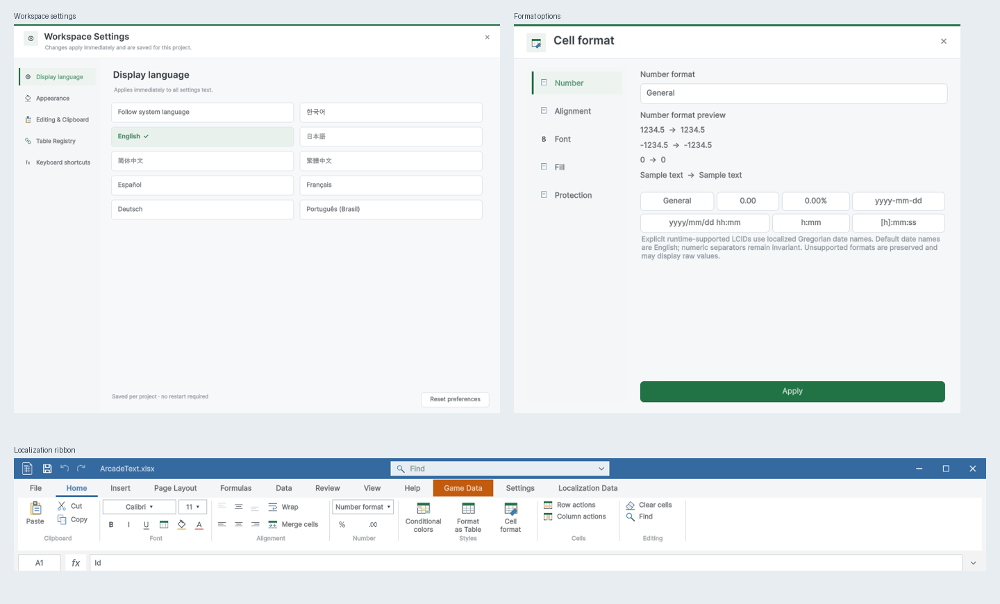

> 보관 기록입니다. 아래 결과는 원문 작성 시점의 내용이며, 이번 편집에서 제품 테스트를 다시 실행하지 않았습니다.

옵션 디자인 및 닫기 검증

## 옵션 디자인 및 닫기 검증

Unity 6000.0.83f1 · 비표시 검증 프로젝트 · 화면 조작 없음

## 확인 범위

옵션 27화면, 최신 가이드 25장, 닫기 9시나리오. 확인창 선택은 테스트 대리자로 주입하고 실제 헤더·단축키 이벤트, 창 생존, 파일 저장 및 복구 기록을 검사했습니다. OS/Unity 전체 종료 및 최소화 카드의 실제 입력은 이번 실행 범위에 포함하지 않았습니다.

| 시나리오 | 결과 | 근거 |
| --- | --- | --- |
| 헤더_취소 | 통과 | 실제 창 생존 상태와 닫기 선택 비교 |
| 헤더_취소 | 통과 | 확인 횟수=1 |
| 헤더_취소 | 통과 | 취소/저장 실패 후 복구 기록 유지 |
| 헤더_저장 | 통과 | 실제 창 생존 상태와 닫기 선택 비교 |
| 헤더_저장 | 통과 | 확인 횟수=1 |
| 헤더_저장 | 통과 | 저장 후 원본 재열기 |
| 헤더_버리기 | 통과 | 실제 창 생존 상태와 닫기 선택 비교 |
| 헤더_버리기 | 통과 | 확인 횟수=1 |
| 헤더_연속클릭_취소 | 통과 | 실제 창 생존 상태와 닫기 선택 비교 |
| 헤더_연속클릭_취소 | 통과 | 확인 횟수=1 |
| 헤더_연속클릭_취소 | 통과 | 취소/저장 실패 후 복구 기록 유지 |
| 인라인초안_취소 | 통과 | 실제 창 생존 상태와 닫기 선택 비교 |
| 인라인초안_취소 | 통과 | 확인 횟수=1 |
| 인라인초안_취소 | 통과 | 취소/저장 실패 후 복구 기록 유지 |
| 수식초안_취소 | 통과 | 실제 창 생존 상태와 닫기 선택 비교 |
| 수식초안_취소 | 통과 | 확인 횟수=1 |
| 수식초안_취소 | 통과 | 취소/저장 실패 후 복구 기록 유지 |
| 외부변경_저장실패 | 통과 | 실제 창 생존 상태와 닫기 선택 비교 |
| 외부변경_저장실패 | 통과 | 확인 횟수=1 |
| 외부변경_저장실패 | 통과 | 저장 실패 후 미저장 상태 유지 |
| 외부변경_저장실패 | 통과 | 취소/저장 실패 후 복구 기록 유지 |
| 깨끗한창_닫기 | 통과 | 실제 창 생존 상태와 닫기 선택 비교 |
| 깨끗한창_닫기 | 통과 | 확인 횟수=0 |
| 단축키_취소 | 통과 | 실제 창 생존 상태와 닫기 선택 비교 |
| 단축키_취소 | 통과 | 확인 횟수=1 |
| 단축키_취소 | 통과 | 취소/저장 실패 후 복구 기록 유지 |

## 복구 후보

EnumAdventure.xlsx와 ShapeCatalogVerification.xlsx 복구본을 RecoveredWorkbooks/2026-10-29-unsaved-close에 별도 저장했습니다. 사용자께서 닫았던 정확한 파일은 미확인입니다. 원본 파일 해시는 변경되지 않았습니다.

## 원문과 편집 이력

[보존된 원문 열기](../assets/imports/Docs/Testing/2026-10-29/options-close-safety/Report.ko.html)

- 원문 SHA-256: `73bc12d712baf577d2bf25857d957a7304b987b0fb6638c3c684c35c24740f2a`
- 표시 날짜는 원본 파일의 수정 시각입니다. 작업 완료 시각은 원문에 있는 값을 기준으로 확인합니다.
