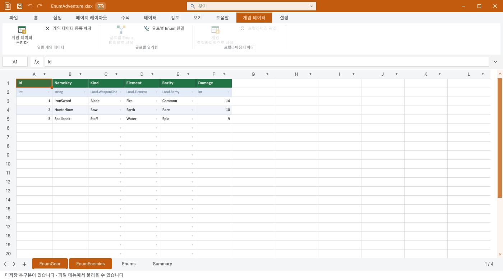

> 보관 기록입니다. 아래 결과는 원문 작성 시점의 내용이며, 이번 편집에서 제품 테스트를 다시 실행하지 않았습니다.

홈 탭과 같은 큰 주 동작·작은 보조 동작·섹션 구분선을 사용했습니다. 일반 게임 데이터, 글로벌 열거형, 로컬라이징을 분리했고 게임 데이터 탭과 시트 관리 창에서 Summary 생성 버튼을 제거했습니다.

## 점검 결과

등록 테이블 24개, 원본 23개, Summary 컬럼 172개를 대조했습니다. 모두 필수 Summary가 이미 있었으며 빠진 파일은 없었습니다. 게임 바이너리 24개도 동일합니다. 신규 게임 파일 기본 포함·필수 Summary 삭제 차단·반복 점검 시 변경 없음·9개 언어 섹션 문구·12개 실제 리본 화면을 포함한 304개 조건을 확인했습니다.

| 원본 | 테이블 | 컬럼 | 결과 |
| --- | --- | --- | --- |
| SampleCharacter.xlsx | 1 | 5 | 필수 Summary 있음 · 변경 불필요 |
| SampleShopProduct.xlsx | 1 | 6 | 필수 Summary 있음 · 변경 불필요 |
| SampleDropItem.xlsx | 1 | 4 | 필수 Summary 있음 · 변경 불필요 |
| SampleSkill.xlsx | 1 | 8 | 필수 Summary 있음 · 변경 불필요 |
| MiniGameBalance.xlsx | 1 | 8 | 필수 Summary 있음 · 변경 불필요 |
| EnumAdventure.xlsx | 2 | 13 | 필수 Summary 있음 · 변경 불필요 |
| ThreeDSettings.xlsx | 1 | 15 | 필수 Summary 있음 · 변경 불필요 |
| CanyonSettings.xlsx | 1 | 7 | 필수 Summary 있음 · 변경 불필요 |
| SkyboundSettings.xlsx | 1 | 6 | 필수 Summary 있음 · 변경 불필요 |
| DefenseSettings.xlsx | 1 | 14 | 필수 Summary 있음 · 변경 불필요 |
| GolfSettings.xlsx | 1 | 7 | 필수 Summary 있음 · 변경 불필요 |
| BowlingSettings.xlsx | 1 | 6 | 필수 Summary 있음 · 변경 불필요 |
| WarehouseSettings.xlsx | 1 | 4 | 필수 Summary 있음 · 변경 불필요 |
| DroneSettings.xlsx | 1 | 10 | 필수 Summary 있음 · 변경 불필요 |
| MarbleSettings.xlsx | 1 | 6 | 필수 Summary 있음 · 변경 불필요 |
| LanderSettings.xlsx | 1 | 9 | 필수 Summary 있음 · 변경 불필요 |
| CourierSettings.xlsx | 1 | 6 | 필수 Summary 있음 · 변경 불필요 |
| PotionSettings.xlsx | 1 | 6 | 필수 Summary 있음 · 변경 불필요 |
| RhythmSettings.xlsx | 1 | 8 | 필수 Summary 있음 · 변경 불필요 |
| BlocksSettings.xlsx | 1 | 5 | 필수 Summary 있음 · 변경 불필요 |
| PinballSettings.xlsx | 1 | 7 | 필수 Summary 있음 · 변경 불필요 |
| Equipment.xlsx | 1 | 5 | 필수 Summary 있음 · 변경 불필요 |
| Enemies.xlsx | 1 | 7 | 필수 Summary 있음 · 변경 불필요 |

전체 검사·원본 해시 · [영어 UI](../assets/imports/Docs/Testing/2026-10-29/game-ribbon-summary/Ribbon-0.png) · [좁은 창 UI](../assets/imports/Docs/Testing/2026-10-29/game-ribbon-summary/Ribbon-8.png)

Windows Unity 6000.0.83f1의 비표시 실제 창을 사용했습니다. 영어·한국어 배치를 확인했으며 다른 7개 언어 배치의 시각 검증을 주장하지 않습니다. 기존 XLSX와 바이너리는 변경하지 않았습니다.

## 제출 패키지

빌드 경고·오류 0개. 패키지 원본·메타데이터·GUID 대조 차이 0개, 실제 새 Unity 프로젝트 임포트 69개 검사 통과. 문서 9개 언어·현재 스크린샷 28개·브라우저 131개 검사를 확인했습니다.

최신 제출 패키지 · 패키지 검사 · 최종 결과 · [Summary 생성 버튼을 제거한 시트 관리 창](../assets/imports/Docs/Testing/2026-10-29/game-ribbon-summary/Sheets.png)

제안 시간: 20~35분 · 실제 소요: 19분 51초 · 완료: 2026-10-29 13:41:07 KST
XERJ: 실패 — 노드 시작 실패, rg 대체

## 원문과 편집 이력

[보존된 원문 열기](../assets/imports/Docs/Testing/2026-10-29/game-ribbon-summary/Report.ko.html)

- 원문 SHA-256: `8c048a7e76f664eadce3bdb1993aed7667d87e81c9f5b97f6e0f6211b80041f7`
- 표시 날짜는 원본 파일의 수정 시각입니다. 작업 완료 시각은 원문에 있는 값을 기준으로 확인합니다.
