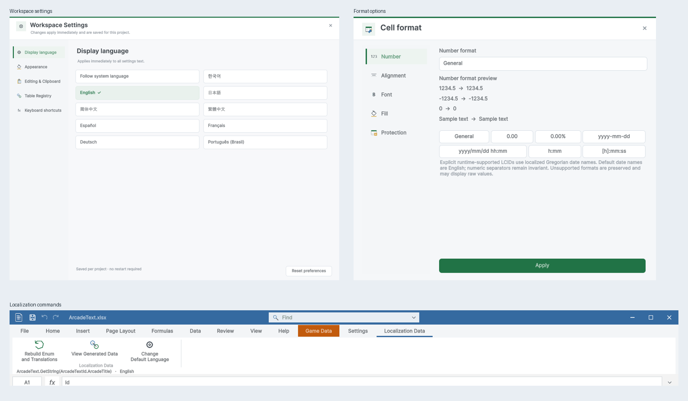

> 보관 기록입니다. 아래 결과는 원문 작성 시점의 내용이며, 이번 편집에서 제품 테스트를 다시 실행하지 않았습니다.

디자인·폴더·CLI 결과

## 디자인·폴더 정리·AI CLI 결과

Unity 6000.0.83f1 / Windows · 화면 조작 없음 · 과거 TC를 재실행한 것처럼 합산하지 않았습니다.

## 완료한 내용

옵션·팝업·로컬라이징 리본을 공통 디자인으로 정리하고 Play 밝기와 미저장 닫기 보호를 적용했습니다. 샘플 최상위 폴더는 15개에서 8개로 정리했으며, 원본 데이터는 Sample/Data에 모았습니다. CLI에는 구조 조회, 저장 없는 변경 미리보기, 셀별 진단과 제한된 변경 목록을 추가했습니다.

[폴더 안내](../assets/imports/PROJECT-MAP.md) · [한글 가이드](../assets/imports/Assets/DesignDataTable/Documentation/UserGuide.ko.html) · [CLI 참조](../assets/imports/Assets/DesignDataTable/Documentation/AutomationCLI.html) · [스토어 자료](../assets/imports/Docs/StoreMedia/Delivery-2026-10-29/index.html)

## 실제 검증

| 항목 | 결과 |
| --- | --- |
| CLI시나리오 | 29 |
| 반복dryRun | 12 |
| 닫기시나리오 | 9 |
| 닫기확인항목 | 26 |
| 씬 | 25 |
| 씬과경로확인항목 | 22559 |
| 이동GUID대조 | 329 |
| 옵션캡처 | 27 |
| 가이드이미지 | 25 |
| 가이드언어 | 9 |
| 브라우저검사 | 128 |
| PDF페이지 | 24 |
| 스토어이미지 | 11 |

## CLI 테스트

| 사례 | 결과 |
| --- | --- |
| 지원 명령 조회 | 통과 |
| 일반 시트 구조 조회 | 통과 |
| 등록 게임 테이블과 byte 타입 조회 | 통과 |
| 로컬 Enum 이름과 후보 조회 | 통과 |
| dry-run 수식 포함 변경 미리보기 및 원본 불변 | 통과 |
| dry-run 오래된 리비전 거부 | 통과 |
| 동일 dry-run 12회 반복 후 원본 불변 | 통과 |
| 일괄 저장 및 재조회 수식 계산 | 통과 |
| 같은 값 재전송은 실제 변경 0개 | 통과 |
| byte 범위 초과 dry-run 진단 | 통과 |
| byte 음수 저장 거부 및 파일 불변 | 통과 |
| 숫자 대신 문자 입력 저장 거부 | 통과 |
| 정상·비정상 혼합 배치 전체 거부 | 통과 |
| 미정의 Enum 후보 입력 시 셀 진단 | 통과 |
| 중복 셀 주소 거부 | 통과 |
| 빈 배치 거부 | 통과 |
| 시트 경계 초과 거부 | 통과 |
| 경로 탈출 거부 | 통과 |
| 정상 byte 저장 후 바이너리 일치 | 통과 |
| 기본 타입 목록 제공 | 통과 |
| 행 좌표 생략은 A1로 간주하지 않고 거부 | 통과 |
| 실수 좌표 거부 | 통과 |
| boolean 좌표 거부 | 통과 |
| 입력 필드 생략은 셀 삭제로 간주하지 않고 거부 | 통과 |
| 숫자 JSON 입력은 문자열 명시 요구 | 통과 |
| 대량 변경 미리보기 기본 100개 제한과 전체 개수 | 통과 |
| CSV 미리보기 원본 불변 및 일괄 저장 | 통과 |
| 일반 엑셀의 2행 값을 데이터 타입으로 추측하지 않음 | 통과 |
| 미리보기 0개 제한 거부 | 통과 |

## 범위와 미확인 사항

- 네이티브 OS/Unity 전체 종료 확인창은 이번 입력 검증 범위가 아닙니다.

- 닫기 선택은 테스트 대리자로 주입하고 실제 Unity 헤더·키보드 이벤트와 창 생존·저장·복구 기록을 확인했습니다.

- 씬 검사는 누락 스크립트·참조·경로 검증이며 모든 게임을 다시 수동 플레이했다는 의미가 아닙니다.

- 사용자가 이전에 닫은 정확한 파일은 미확인입니다. 복구 후보 두 개는 WorkFiles/Recovery에 별도 보관했습니다.

- 공유 스크린샷은 영어 UI입니다. 9개 언어의 네이티브 UI 전체 배치를 인증한 것은 아닙니다.

- 스토어 자료는 로컬 초안이며 업로드·제출하지 않았습니다.

- XERJ 재색인에서 삭제 문서 정리 오류가 발생하고 검색 결과가 누락돼 rg로 검증했습니다.

상세 근거: CLI-TC.ko.json / GUID-Continuity.json / Layout/Results.json / CloseSafety/Results.tsv / Docs/LocalizedDocs.json / Docs/BrowserChecks.json / Docs/PDFChecks.json

## 원문과 편집 이력

[보존된 원문 열기](../assets/imports/Docs/Testing/2026-10-29/automation-folder-design/Report.ko.html)

- 원문 SHA-256: `da11c41cf7e4a0913a7f5bc3ac14856f2fc9a02fb55a874d1edb88c632bb0aea`
- 표시 날짜는 원본 파일의 수정 시각입니다. 작업 완료 시각은 원문에 있는 값을 기준으로 확인합니다.
