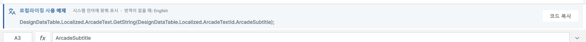
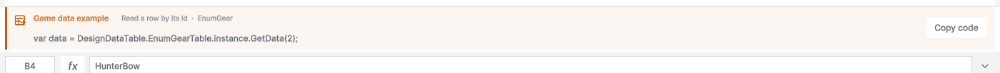
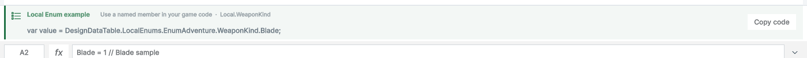
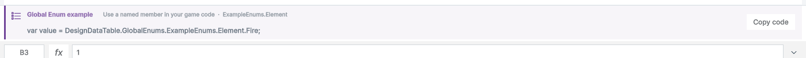

> 보관 기록입니다. 아래 결과는 원문 작성 시점의 내용이며, 이번 편집에서 제품 테스트를 다시 실행하지 않았습니다.

---
title: 파일별 코드 사용 예제 카드
date: 2026-10-29T18:14:16+09:00
version: v1.0.0
status: 완료
category: 개발
summary: 게임 데이터·로컬/전역 Enum·로컬라이징의 실제 선택값을 사용한 안내 카드와 코드 복사 기능.
---
# 파일을 열면 바로 보이는 사용 예제

게임 데이터·열거형·로컬라이징 파일의 리본 아래에 사용 안내 카드를 적용하고 실제 Unity 화면과 코드 동작을 검증했습니다.

## 표시하는 내용

- 게임 데이터: 선택한 Id의 GetData 조회 코드. 헤더나 빈 행에서는 첫 유효 Id를 예로 듭니다.
- 로컬·전역 열거형: 선택한 열과 행의 실제 namespace·타입·멤버를 표시합니다.
- 로컬라이징: 선택한 번역 키의 GetString 코드와 번역이 없을 때 사용할 대체 언어를 구분해 표시합니다. 첫 항목을 고정 표시하던 문구는 제거했습니다.
- Summary: 컬럼 이름·타입·설명이 데이터 시트와 동기화된다는 설명을 표시합니다.
- 홈 탭을 포함한 모든 리본 탭에서 유지됩니다. 일반 엑셀에는 표시하지 않습니다.

## 실제 화면

로컬라이징은 한국어 UI, 나머지 미리보기는 영어 UI입니다. 아래 이미지는 실제 Unity 캡처에서 안내 영역만 잘랐습니다.

## 디자인과 동작

- 문서 강조색의 왼쪽 선과 연한 배경, 기능 아이콘, 설명, 코드 순서로 구성했습니다.
- 코드 복사 버튼은 전체 코드를 복사합니다. 코드에는 namespace를 명시해 별도 using 없이 사용할 수 있습니다.
- 좁은 창에서는 코드가 줄바꿈됩니다. Summary처럼 코드가 아닌 안내에는 복사 버튼을 표시하지 않습니다.
- 예제 갱신 시 Enum 파싱 결과를 재사용합니다. 같은 선택 상태를 1000회 갱신해 캐시 유지 여부를 확인했습니다.

## 검증 결과

- native 사용 예제 검사 20개와 추가 Enum 행·컬럼 전환 검사를 통과했습니다.
- 실제 마우스 이벤트로 복사 버튼을 눌러 전체 코드와 Dirty 상태를 검증했습니다. 테스트 후 기존 클립보드를 복원했습니다.
- UI에 표시한 코드 5개를 그대로 포함한 C# 빌드: 경고 0·오류 0.
- 기존 Play 잠금·상황별 리본·게임 리본·Summary 회귀 검사를 통과했습니다.
- 안내 카드를 9개 UI 언어와 720px 폭으로 실제 촬영했습니다. 가이드 공유 화면은 영어입니다.
- 가이드 32장 재촬영, 9개 언어 및 현재 이미지 37장 검사 오류 0. 브라우저 검사 140개 통과. 영문·한글 PDF 38쪽 텍스트·폰트 검사 통과.
- 한글 TC와 상세 근거: `C:/Projects/DesignDataTable/Docs/Testing/2026-10-29/usage-examples/`

## 미확인·남은 사항

요청한 구현·필수 검증·문서 갱신에 남은 항목은 없습니다. 격리 Unity UI에서 검증했으며 사용자 주 프로젝트의 전 기능 수동 QA로 확대해 보고하지 않습니다. 이번 작업에서는 푸시나 인터넷 게시를 하지 않았습니다.

## 시간과 검색

- 제안 시간: 15–25분.
- 시작: 2026-10-29 17:53:41 KST (UTC+09:00).
- 실제로 완료된 시간: 20분 35초, 2026-10-29 18:14:16 KST (UTC+09:00).
- XERJ: 사용 — GetString 안내 구현 후보를 검색한 뒤 현재 리본·생성 API 소스와 대조했습니다. 추가 레이아웃 검색에는 rg를 사용했습니다.

로컬 HTML 보고서입니다. 공개 배포하지 않았습니다.

## 원문과 편집 이력

[보존된 원문 열기](../assets/imports/Docs/Testing/2026-10-29/usage-examples/2026-10-29-파일별-사용-예제-카드-v1.0.0.md)

- 원문 SHA-256: `58f40140e91aedeb0e460a5c37d5581e4350f37a1b4cf840d489f9be5a7cb57a`
- 표시 날짜는 원본 파일의 수정 시각입니다. 작업 완료 시각은 원문에 있는 값을 기준으로 확인합니다.
