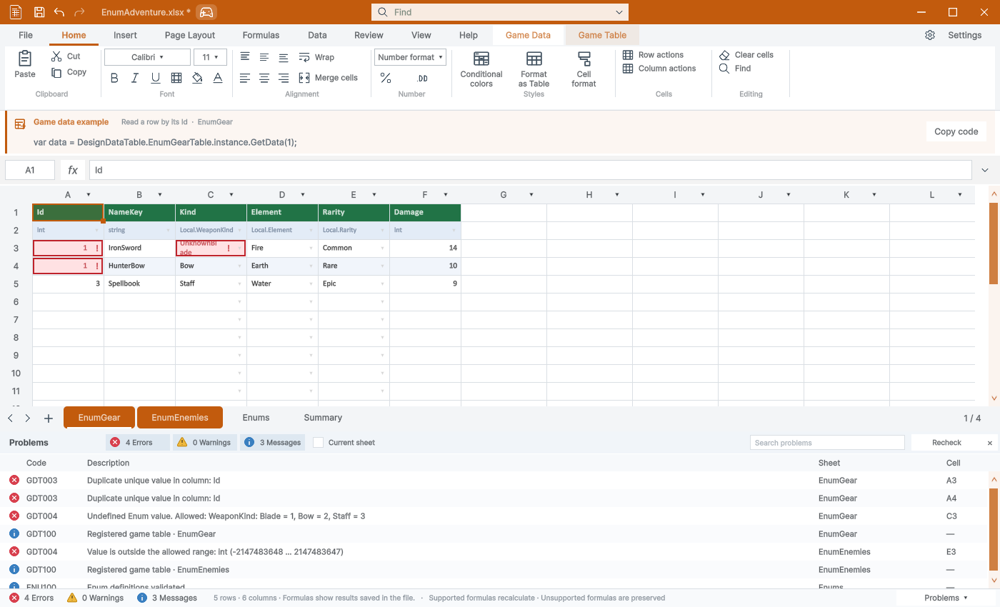

> 보관 기록입니다. 아래 결과는 원문 작성 시점의 내용이며, 이번 편집에서 제품 테스트를 다시 실행하지 않았습니다.

2026-10-29 · Windows / Unity 6000.0.83f1 · 격리 실행 · 사용자 화면 조작 없음

**250**TC 통과 / 전체 250

**0**남은 실패

**8**수정한 문제군

**3271**네이티브 모델 검증 항목

일반 파일·Excel 표·게임 등록·Summary·Enum·로컬라이징·저장·CLI·Play 잠금을 기능·경계·거부 조건으로 검사했습니다. TC 수와 내부 검증 항목 수는 별개입니다.

TC 결과 CSV · 상세 JSON·소스 해시 · [현재 사용자 문서](../assets/imports/Assets/DesignDataTable/Documentation/UserGuide.ko.html)

## 수정 사항

| ID | 문제 | 수정 | 회귀 TC |
| --- | --- | --- | --- |
| BUG-01 | **큰 정수 코드 정밀도** Int64를 넘는 정수 텍스트를 double로 추론해 값이 반올림될 수 있었습니다. | 정수 텍스트가 Int64를 넘으면 string으로 보존합니다. | Int64 범위를 넘는 정수 코드의 정밀도 보존 |
| BUG-02 | **Summary 스키마 검사** 대소문자 중복 및 생성 코드 예약 컬럼 이름 경고가 저장 검사와 일치하지 않았습니다. | 대소문자 무시 중복과 Read/Write/ToString을 검사합니다. | 대소문자만 다른 컬럼 이름 중복 경고 |
| BUG-03 | **등록 API의 정의 시트 보호** 글로벌 Enum 파일과 관리 Summary를 직접 게임 데이터로 등록할 수 있었습니다. | API에서 정의·Summary·차트·없는 시트를 거부하고 메뉴에서도 Enum 정의를 제외합니다. | 글로벌 Enum 제공 파일의 게임 데이터 등록 거부 |
| BUG-04 | **글로벌 Enum 확장자** CSV 경로에 XLSX 바이트를 쓴 뒤 디코딩 오류가 발생했습니다. | 파일 생성 전에 .xlsx 확장자를 검사합니다. | 글로벌 Enum 템플릿의 미지원 확장자 거부 |
| BUG-05 | **잘못된 헤더의 즉시 경고** 예약어·잘못된 이름·중복 헤더가 데이터 셀의 형식 경고만큼 일관되게 표시되지 않았습니다. | 헤더·타입·데이터에 스키마 경고를 적용하고 9개 언어 메시지를 추가했습니다. | 대소문자만 다른 중복 헤더의 양쪽 경고 |
| BUG-06 | **Summary 이름 충돌** 사용자 시트 summary가 있으면 관리 Summary 생성이 실패했습니다. | 대소문자 무시 이름 비교로 고유 관리 시트를 만듭니다. | 소문자 summary 사용자 시트와 이름 충돌 방지 |
| BUG-07 | **Enum 이름 충돌** Element 뒤 element를 추가할 수 있어 유효하지 않은 정의를 만들었습니다. | 추가 단계에서 대소문자 무시 중복을 거부합니다. | 대소문자만 다른 Enum 이름 중복 생성 거부 |
| BUG-08 | **CLI 입력 오류와 잘못된 예약** 잘못된 JSON·객체 형식에서 traceback이 발생하고 잘못된 timeout도 요청을 예약했습니다. | 구조화된 입력 오류, 양수·유한 timeout 및 크기 선검사, UTF-8 입출력을 적용했습니다. | 음수 타임아웃 입력 시 작업 예약 방지 |

## 검사 범위

| 영역 | TC | 결과 |
| --- | --- | --- |
| 파일 생성 | 23 | 통과 |
| 일반 Excel 표 | 34 | 통과 |
| 게임 데이터 변환 | 19 | 통과 |
| Summary 동기화 | 19 | 통과 |
| 로컬 Enum | 19 | 통과 |
| 글로벌 Enum | 9 | 통과 |
| 저장·실행 취소 | 2 | 통과 |
| 게임 데이터 등록 | 12 | 통과 |
| 로컬라이징 | 3 | 통과 |
| 셀 경고 표시 | 8 | 통과 |
| 시트 이름 | 9 | 통과 |
| 컬럼 순서 전체 조합 | 24 | 통과 |
| 글로벌 Enum 연동 | 6 | 통과 |
| 기존 기능 회귀 검사 | 6 | 통과 |
| 표 구조적 참조 회귀 검사 | 4 | 통과 |
| 스프레드시트 회귀 검사 | 1 | 통과 |
| CLI 통합 검사 | 19 | 통과 |
| CLI 입력 사전 검사 | 14 | 통과 |
| Play 모드 보호 | 6 | 통과 |
| 생성 코드 실행 검증 | 13 | 통과 |

## 새 경고 화면

예약 컬럼 이름 Read와 정의되지 않은 Enum 값을 넣은 실제 영어 Unity 화면입니다. 원본 샘플 파일을 저장한 상태가 아니라 캡처용 편집 상태입니다.

## TC 상세

전체 영역파일 생성일반 Excel 표게임 데이터 변환Summary 동기화로컬 Enum글로벌 Enum저장·실행 취소게임 데이터 등록로컬라이징셀 경고 표시시트 이름컬럼 순서 전체 조합글로벌 Enum 연동기존 기능 회귀 검사표 구조적 참조 회귀 검사스프레드시트 회귀 검사CLI 통합 검사CLI 입력 사전 검사Play 모드 보호생성 코드 실행 검증250 / 250

| ID | 영역·TC·절차 | 기대 결과 | 결과 |
| --- | --- | --- | --- |
| TC-001 | **게임 데이터 XLSX 생성 · 영문 파일명(Plain)** 파일 생성  조건·절차·근거    격리 환경에서 TC 전용 새 문서를 준비하고, 거부 검사 전에 저장된 원본을 확보합니다.    1. TC 전용 경로·파일명·확장자를 준비합니다. 2. WorkbookNewSource.Create로 파일을 생성합니다. 3. 파일을 읽거나 거부 전후 원본 바이트를 비교합니다. 개별 조건: 게임 데이터 XLSX 생성 · 영문 파일명(Plain)  원시 실행 결과 | 파일을 열 수 있어야 합니다. 게임 데이터에는 Id:int와 필수 Summary가 있어야 하며 일반 파일은 빈 상태여야 합니다. | 통과 |
| TC-002 | **게임 데이터 XLSX 생성 · 공백 포함 파일명(with spaces)** 파일 생성  조건·절차·근거    격리 환경에서 TC 전용 새 문서를 준비하고, 거부 검사 전에 저장된 원본을 확보합니다.    1. TC 전용 경로·파일명·확장자를 준비합니다. 2. WorkbookNewSource.Create로 파일을 생성합니다. 3. 파일을 읽거나 거부 전후 원본 바이트를 비교합니다. 개별 조건: 게임 데이터 XLSX 생성 · 공백 포함 파일명(with spaces)  원시 실행 결과 | 파일을 열 수 있어야 합니다. 게임 데이터에는 Id:int와 필수 Summary가 있어야 하며 일반 파일은 빈 상태여야 합니다. | 통과 |
| TC-003 | **게임 데이터 XLSX 생성 · 한국어** 파일 생성  조건·절차·근거    격리 환경에서 TC 전용 새 문서를 준비하고, 거부 검사 전에 저장된 원본을 확보합니다.    1. TC 전용 경로·파일명·확장자를 준비합니다. 2. WorkbookNewSource.Create로 파일을 생성합니다. 3. 파일을 읽거나 거부 전후 원본 바이트를 비교합니다. 개별 조건: 게임 데이터 XLSX 생성 · 한국어  원시 실행 결과 | 파일을 열 수 있어야 합니다. 게임 데이터에는 Id:int와 필수 Summary가 있어야 하며 일반 파일은 빈 상태여야 합니다. | 통과 |
| TC-004 | **게임 데이터 XLSX 생성 · 일본어 파일명(日本語)** 파일 생성  조건·절차·근거    격리 환경에서 TC 전용 새 문서를 준비하고, 거부 검사 전에 저장된 원본을 확보합니다.    1. TC 전용 경로·파일명·확장자를 준비합니다. 2. WorkbookNewSource.Create로 파일을 생성합니다. 3. 파일을 읽거나 거부 전후 원본 바이트를 비교합니다. 개별 조건: 게임 데이터 XLSX 생성 · 일본어 파일명(日本語)  원시 실행 결과 | 파일을 열 수 있어야 합니다. 게임 데이터에는 Id:int와 필수 Summary가 있어야 하며 일반 파일은 빈 상태여야 합니다. | 통과 |
| TC-005 | **게임 데이터 XLSX 생성 · 악센트 문자 파일명(éèç)** 파일 생성  조건·절차·근거    격리 환경에서 TC 전용 새 문서를 준비하고, 거부 검사 전에 저장된 원본을 확보합니다.    1. TC 전용 경로·파일명·확장자를 준비합니다. 2. WorkbookNewSource.Create로 파일을 생성합니다. 3. 파일을 읽거나 거부 전후 원본 바이트를 비교합니다. 개별 조건: 게임 데이터 XLSX 생성 · 악센트 문자 파일명(éèç)  원시 실행 결과 | 파일을 열 수 있어야 합니다. 게임 데이터에는 Id:int와 필수 Summary가 있어야 하며 일반 파일은 빈 상태여야 합니다. | 통과 |
| TC-006 | **게임 데이터 XLSX 생성 · 001** 파일 생성  조건·절차·근거    격리 환경에서 TC 전용 새 문서를 준비하고, 거부 검사 전에 저장된 원본을 확보합니다.    1. TC 전용 경로·파일명·확장자를 준비합니다. 2. WorkbookNewSource.Create로 파일을 생성합니다. 3. 파일을 읽거나 거부 전후 원본 바이트를 비교합니다. 개별 조건: 게임 데이터 XLSX 생성 · 001  원시 실행 결과 | 파일을 열 수 있어야 합니다. 게임 데이터에는 Id:int와 필수 Summary가 있어야 하며 일반 파일은 빈 상태여야 합니다. | 통과 |
| TC-007 | **일반 XLSX 생성 · 영문 파일명(Plain)** 파일 생성  조건·절차·근거    격리 환경에서 TC 전용 새 문서를 준비하고, 거부 검사 전에 저장된 원본을 확보합니다.    1. TC 전용 경로·파일명·확장자를 준비합니다. 2. WorkbookNewSource.Create로 파일을 생성합니다. 3. 파일을 읽거나 거부 전후 원본 바이트를 비교합니다. 개별 조건: 일반 XLSX 생성 · 영문 파일명(Plain)  원시 실행 결과 | 파일을 열 수 있어야 합니다. 게임 데이터에는 Id:int와 필수 Summary가 있어야 하며 일반 파일은 빈 상태여야 합니다. | 통과 |
| TC-008 | **일반 XLSX 생성 · 공백 포함 파일명(with spaces)** 파일 생성  조건·절차·근거    격리 환경에서 TC 전용 새 문서를 준비하고, 거부 검사 전에 저장된 원본을 확보합니다.    1. TC 전용 경로·파일명·확장자를 준비합니다. 2. WorkbookNewSource.Create로 파일을 생성합니다. 3. 파일을 읽거나 거부 전후 원본 바이트를 비교합니다. 개별 조건: 일반 XLSX 생성 · 공백 포함 파일명(with spaces)  원시 실행 결과 | 파일을 열 수 있어야 합니다. 게임 데이터에는 Id:int와 필수 Summary가 있어야 하며 일반 파일은 빈 상태여야 합니다. | 통과 |
| TC-009 | **일반 XLSX 생성 · 한국어** 파일 생성  조건·절차·근거    격리 환경에서 TC 전용 새 문서를 준비하고, 거부 검사 전에 저장된 원본을 확보합니다.    1. TC 전용 경로·파일명·확장자를 준비합니다. 2. WorkbookNewSource.Create로 파일을 생성합니다. 3. 파일을 읽거나 거부 전후 원본 바이트를 비교합니다. 개별 조건: 일반 XLSX 생성 · 한국어  원시 실행 결과 | 파일을 열 수 있어야 합니다. 게임 데이터에는 Id:int와 필수 Summary가 있어야 하며 일반 파일은 빈 상태여야 합니다. | 통과 |
| TC-010 | **일반 XLSX 생성 · 일본어 파일명(日本語)** 파일 생성  조건·절차·근거    격리 환경에서 TC 전용 새 문서를 준비하고, 거부 검사 전에 저장된 원본을 확보합니다.    1. TC 전용 경로·파일명·확장자를 준비합니다. 2. WorkbookNewSource.Create로 파일을 생성합니다. 3. 파일을 읽거나 거부 전후 원본 바이트를 비교합니다. 개별 조건: 일반 XLSX 생성 · 일본어 파일명(日本語)  원시 실행 결과 | 파일을 열 수 있어야 합니다. 게임 데이터에는 Id:int와 필수 Summary가 있어야 하며 일반 파일은 빈 상태여야 합니다. | 통과 |
| TC-011 | **일반 XLSX 생성 · 악센트 문자 파일명(éèç)** 파일 생성  조건·절차·근거    격리 환경에서 TC 전용 새 문서를 준비하고, 거부 검사 전에 저장된 원본을 확보합니다.    1. TC 전용 경로·파일명·확장자를 준비합니다. 2. WorkbookNewSource.Create로 파일을 생성합니다. 3. 파일을 읽거나 거부 전후 원본 바이트를 비교합니다. 개별 조건: 일반 XLSX 생성 · 악센트 문자 파일명(éèç)  원시 실행 결과 | 파일을 열 수 있어야 합니다. 게임 데이터에는 Id:int와 필수 Summary가 있어야 하며 일반 파일은 빈 상태여야 합니다. | 통과 |
| TC-012 | **일반 XLSX 생성 · 001** 파일 생성  조건·절차·근거    격리 환경에서 TC 전용 새 문서를 준비하고, 거부 검사 전에 저장된 원본을 확보합니다.    1. TC 전용 경로·파일명·확장자를 준비합니다. 2. WorkbookNewSource.Create로 파일을 생성합니다. 3. 파일을 읽거나 거부 전후 원본 바이트를 비교합니다. 개별 조건: 일반 XLSX 생성 · 001  원시 실행 결과 | 파일을 열 수 있어야 합니다. 게임 데이터에는 Id:int와 필수 Summary가 있어야 하며 일반 파일은 빈 상태여야 합니다. | 통과 |
| TC-013 | **일반 CSV 생성 · 영문 파일명(Plain)** 파일 생성  조건·절차·근거    격리 환경에서 TC 전용 새 문서를 준비하고, 거부 검사 전에 저장된 원본을 확보합니다.    1. TC 전용 경로·파일명·확장자를 준비합니다. 2. WorkbookNewSource.Create로 파일을 생성합니다. 3. 파일을 읽거나 거부 전후 원본 바이트를 비교합니다. 개별 조건: 일반 CSV 생성 · 영문 파일명(Plain)  원시 실행 결과 | 파일을 열 수 있어야 합니다. 게임 데이터에는 Id:int와 필수 Summary가 있어야 하며 일반 파일은 빈 상태여야 합니다. | 통과 |
| TC-014 | **일반 CSV 생성 · 공백 포함 파일명(with spaces)** 파일 생성  조건·절차·근거    격리 환경에서 TC 전용 새 문서를 준비하고, 거부 검사 전에 저장된 원본을 확보합니다.    1. TC 전용 경로·파일명·확장자를 준비합니다. 2. WorkbookNewSource.Create로 파일을 생성합니다. 3. 파일을 읽거나 거부 전후 원본 바이트를 비교합니다. 개별 조건: 일반 CSV 생성 · 공백 포함 파일명(with spaces)  원시 실행 결과 | 파일을 열 수 있어야 합니다. 게임 데이터에는 Id:int와 필수 Summary가 있어야 하며 일반 파일은 빈 상태여야 합니다. | 통과 |
| TC-015 | **일반 CSV 생성 · 한국어** 파일 생성  조건·절차·근거    격리 환경에서 TC 전용 새 문서를 준비하고, 거부 검사 전에 저장된 원본을 확보합니다.    1. TC 전용 경로·파일명·확장자를 준비합니다. 2. WorkbookNewSource.Create로 파일을 생성합니다. 3. 파일을 읽거나 거부 전후 원본 바이트를 비교합니다. 개별 조건: 일반 CSV 생성 · 한국어  원시 실행 결과 | 파일을 열 수 있어야 합니다. 게임 데이터에는 Id:int와 필수 Summary가 있어야 하며 일반 파일은 빈 상태여야 합니다. | 통과 |
| TC-016 | **일반 CSV 생성 · 일본어 파일명(日本語)** 파일 생성  조건·절차·근거    격리 환경에서 TC 전용 새 문서를 준비하고, 거부 검사 전에 저장된 원본을 확보합니다.    1. TC 전용 경로·파일명·확장자를 준비합니다. 2. WorkbookNewSource.Create로 파일을 생성합니다. 3. 파일을 읽거나 거부 전후 원본 바이트를 비교합니다. 개별 조건: 일반 CSV 생성 · 일본어 파일명(日本語)  원시 실행 결과 | 파일을 열 수 있어야 합니다. 게임 데이터에는 Id:int와 필수 Summary가 있어야 하며 일반 파일은 빈 상태여야 합니다. | 통과 |
| TC-017 | **일반 CSV 생성 · 악센트 문자 파일명(éèç)** 파일 생성  조건·절차·근거    격리 환경에서 TC 전용 새 문서를 준비하고, 거부 검사 전에 저장된 원본을 확보합니다.    1. TC 전용 경로·파일명·확장자를 준비합니다. 2. WorkbookNewSource.Create로 파일을 생성합니다. 3. 파일을 읽거나 거부 전후 원본 바이트를 비교합니다. 개별 조건: 일반 CSV 생성 · 악센트 문자 파일명(éèç)  원시 실행 결과 | 파일을 열 수 있어야 합니다. 게임 데이터에는 Id:int와 필수 Summary가 있어야 하며 일반 파일은 빈 상태여야 합니다. | 통과 |
| TC-018 | **일반 CSV 생성 · 001** 파일 생성  조건·절차·근거    격리 환경에서 TC 전용 새 문서를 준비하고, 거부 검사 전에 저장된 원본을 확보합니다.    1. TC 전용 경로·파일명·확장자를 준비합니다. 2. WorkbookNewSource.Create로 파일을 생성합니다. 3. 파일을 읽거나 거부 전후 원본 바이트를 비교합니다. 개별 조건: 일반 CSV 생성 · 001  원시 실행 결과 | 파일을 열 수 있어야 합니다. 게임 데이터에는 Id:int와 필수 Summary가 있어야 하며 일반 파일은 빈 상태여야 합니다. | 통과 |
| TC-019 | **미지원 확장자 거부 · xls** 파일 생성  조건·절차·근거    격리 환경에서 TC 전용 새 문서를 준비하고, 거부 검사 전에 저장된 원본을 확보합니다.    1. TC 전용 경로·파일명·확장자를 준비합니다. 2. WorkbookNewSource.Create로 파일을 생성합니다. 3. 파일을 읽거나 거부 전후 원본 바이트를 비교합니다. 개별 조건: 미지원 확장자 거부 · xls  원시 실행 결과 | 요청을 거부하고 파일을 생성하지 않아야 합니다. | 통과 |
| TC-020 | **미지원 확장자 거부 · txt** 파일 생성  조건·절차·근거    격리 환경에서 TC 전용 새 문서를 준비하고, 거부 검사 전에 저장된 원본을 확보합니다.    1. TC 전용 경로·파일명·확장자를 준비합니다. 2. WorkbookNewSource.Create로 파일을 생성합니다. 3. 파일을 읽거나 거부 전후 원본 바이트를 비교합니다. 개별 조건: 미지원 확장자 거부 · txt  원시 실행 결과 | 요청을 거부하고 파일을 생성하지 않아야 합니다. | 통과 |
| TC-021 | **미지원 확장자 거부 · json** 파일 생성  조건·절차·근거    격리 환경에서 TC 전용 새 문서를 준비하고, 거부 검사 전에 저장된 원본을 확보합니다.    1. TC 전용 경로·파일명·확장자를 준비합니다. 2. WorkbookNewSource.Create로 파일을 생성합니다. 3. 파일을 읽거나 거부 전후 원본 바이트를 비교합니다. 개별 조건: 미지원 확장자 거부 · json  원시 실행 결과 | 요청을 거부하고 파일을 생성하지 않아야 합니다. | 통과 |
| TC-022 | **미지원 확장자 거부 · xlsm** 파일 생성  조건·절차·근거    격리 환경에서 TC 전용 새 문서를 준비하고, 거부 검사 전에 저장된 원본을 확보합니다.    1. TC 전용 경로·파일명·확장자를 준비합니다. 2. WorkbookNewSource.Create로 파일을 생성합니다. 3. 파일을 읽거나 거부 전후 원본 바이트를 비교합니다. 개별 조건: 미지원 확장자 거부 · xlsm  원시 실행 결과 | 요청을 거부하고 파일을 생성하지 않아야 합니다. | 통과 |
| TC-023 | **Assets 유사 경로 및 상위 폴더 이동 차단** 파일 생성  조건·절차·근거    격리 환경에서 TC 전용 새 문서를 준비하고, 거부 검사 전에 저장된 원본을 확보합니다.    1. TC 전용 경로·파일명·확장자를 준비합니다. 2. WorkbookNewSource.Create로 파일을 생성합니다. 3. 파일을 읽거나 거부 전후 원본 바이트를 비교합니다. 개별 조건: Assets 유사 경로 및 상위 폴더 이동 차단  원시 실행 결과 | AssetsOther 같은 유사 경로 및 ../ 상위 경로를 거부해야 합니다. | 통과 |
| TC-024 | **이름을 지정한 표 생성 · Inventory** 일반 Excel 표  조건·절차·근거    격리 환경에서 TC 전용 새 문서를 준비하고, 거부 검사 전에 저장된 원본을 확보합니다.    1. TC별 새 XLSX와 범위·헤더·기존 구조를 준비합니다. 2. 표 생성 또는 범위 변환을 실행합니다. 3. 표 구조·값·재열기 결과 또는 거부 후 상태 보존을 확인합니다. 개별 조건: 이름을 지정한 표 생성 · Inventory  원시 실행 결과 | 저장·재열기 후 표 구조와 데이터 값이 유지되어야 합니다. | 통과 |
| TC-025 | **이름을 지정한 표 생성 · Inventory_2** 일반 Excel 표  조건·절차·근거    격리 환경에서 TC 전용 새 문서를 준비하고, 거부 검사 전에 저장된 원본을 확보합니다.    1. TC별 새 XLSX와 범위·헤더·기존 구조를 준비합니다. 2. 표 생성 또는 범위 변환을 실행합니다. 3. 표 구조·값·재열기 결과 또는 거부 후 상태 보존을 확인합니다. 개별 조건: 이름을 지정한 표 생성 · Inventory_2  원시 실행 결과 | 저장·재열기 후 표 구조와 데이터 값이 유지되어야 합니다. | 통과 |
| TC-026 | **이름을 지정한 표 생성 · 한글표** 일반 Excel 표  조건·절차·근거    격리 환경에서 TC 전용 새 문서를 준비하고, 거부 검사 전에 저장된 원본을 확보합니다.    1. TC별 새 XLSX와 범위·헤더·기존 구조를 준비합니다. 2. 표 생성 또는 범위 변환을 실행합니다. 3. 표 구조·값·재열기 결과 또는 거부 후 상태 보존을 확인합니다. 개별 조건: 이름을 지정한 표 생성 · 한글표  원시 실행 결과 | 저장·재열기 후 표 구조와 데이터 값이 유지되어야 합니다. | 통과 |
| TC-027 | **이름을 지정한 표 생성 · Éléments** 일반 Excel 표  조건·절차·근거    격리 환경에서 TC 전용 새 문서를 준비하고, 거부 검사 전에 저장된 원본을 확보합니다.    1. TC별 새 XLSX와 범위·헤더·기존 구조를 준비합니다. 2. 표 생성 또는 범위 변환을 실행합니다. 3. 표 구조·값·재열기 결과 또는 거부 후 상태 보존을 확인합니다. 개별 조건: 이름을 지정한 표 생성 · Éléments  원시 실행 결과 | 저장·재열기 후 표 구조와 데이터 값이 유지되어야 합니다. | 통과 |
| TC-028 | **이름을 지정한 표 생성 · 255자** 일반 Excel 표  조건·절차·근거    격리 환경에서 TC 전용 새 문서를 준비하고, 거부 검사 전에 저장된 원본을 확보합니다.    1. TC별 새 XLSX와 범위·헤더·기존 구조를 준비합니다. 2. 표 생성 또는 범위 변환을 실행합니다. 3. 표 구조·값·재열기 결과 또는 거부 후 상태 보존을 확인합니다. 개별 조건: 이름을 지정한 표 생성 · 255자  원시 실행 결과 | 저장·재열기 후 표 구조와 데이터 값이 유지되어야 합니다. | 통과 |
| TC-029 | **잘못된 표 이름 거부 · 1Bad** 일반 Excel 표  조건·절차·근거    격리 환경에서 TC 전용 새 문서를 준비하고, 거부 검사 전에 저장된 원본을 확보합니다.    1. TC별 새 XLSX와 범위·헤더·기존 구조를 준비합니다. 2. 표 생성 또는 범위 변환을 실행합니다. 3. 표 구조·값·재열기 결과 또는 거부 후 상태 보존을 확인합니다. 개별 조건: 잘못된 표 이름 거부 · 1Bad  원시 실행 결과 | 셀 내용과 표 개수를 바꾸지 않고 거부해야 합니다. | 통과 |
| TC-030 | **잘못된 표 이름 거부 · A1** 일반 Excel 표  조건·절차·근거    격리 환경에서 TC 전용 새 문서를 준비하고, 거부 검사 전에 저장된 원본을 확보합니다.    1. TC별 새 XLSX와 범위·헤더·기존 구조를 준비합니다. 2. 표 생성 또는 범위 변환을 실행합니다. 3. 표 구조·값·재열기 결과 또는 거부 후 상태 보존을 확인합니다. 개별 조건: 잘못된 표 이름 거부 · A1  원시 실행 결과 | 셀 내용과 표 개수를 바꾸지 않고 거부해야 합니다. | 통과 |
| TC-031 | **잘못된 표 이름 거부 · R1C1** 일반 Excel 표  조건·절차·근거    격리 환경에서 TC 전용 새 문서를 준비하고, 거부 검사 전에 저장된 원본을 확보합니다.    1. TC별 새 XLSX와 범위·헤더·기존 구조를 준비합니다. 2. 표 생성 또는 범위 변환을 실행합니다. 3. 표 구조·값·재열기 결과 또는 거부 후 상태 보존을 확인합니다. 개별 조건: 잘못된 표 이름 거부 · R1C1  원시 실행 결과 | 셀 내용과 표 개수를 바꾸지 않고 거부해야 합니다. | 통과 |
| TC-032 | **잘못된 표 이름 거부 · R** 일반 Excel 표  조건·절차·근거    격리 환경에서 TC 전용 새 문서를 준비하고, 거부 검사 전에 저장된 원본을 확보합니다.    1. TC별 새 XLSX와 범위·헤더·기존 구조를 준비합니다. 2. 표 생성 또는 범위 변환을 실행합니다. 3. 표 구조·값·재열기 결과 또는 거부 후 상태 보존을 확인합니다. 개별 조건: 잘못된 표 이름 거부 · R  원시 실행 결과 | 셀 내용과 표 개수를 바꾸지 않고 거부해야 합니다. | 통과 |
| TC-033 | **잘못된 표 이름 거부 · C** 일반 Excel 표  조건·절차·근거    격리 환경에서 TC 전용 새 문서를 준비하고, 거부 검사 전에 저장된 원본을 확보합니다.    1. TC별 새 XLSX와 범위·헤더·기존 구조를 준비합니다. 2. 표 생성 또는 범위 변환을 실행합니다. 3. 표 구조·값·재열기 결과 또는 거부 후 상태 보존을 확인합니다. 개별 조건: 잘못된 표 이름 거부 · C  원시 실행 결과 | 셀 내용과 표 개수를 바꾸지 않고 거부해야 합니다. | 통과 |
| TC-034 | **잘못된 표 이름 거부 · has space** 일반 Excel 표  조건·절차·근거    격리 환경에서 TC 전용 새 문서를 준비하고, 거부 검사 전에 저장된 원본을 확보합니다.    1. TC별 새 XLSX와 범위·헤더·기존 구조를 준비합니다. 2. 표 생성 또는 범위 변환을 실행합니다. 3. 표 구조·값·재열기 결과 또는 거부 후 상태 보존을 확인합니다. 개별 조건: 잘못된 표 이름 거부 · has space  원시 실행 결과 | 셀 내용과 표 개수를 바꾸지 않고 거부해야 합니다. | 통과 |
| TC-035 | **잘못된 표 이름 거부 · has/slash** 일반 Excel 표  조건·절차·근거    격리 환경에서 TC 전용 새 문서를 준비하고, 거부 검사 전에 저장된 원본을 확보합니다.    1. TC별 새 XLSX와 범위·헤더·기존 구조를 준비합니다. 2. 표 생성 또는 범위 변환을 실행합니다. 3. 표 구조·값·재열기 결과 또는 거부 후 상태 보존을 확인합니다. 개별 조건: 잘못된 표 이름 거부 · has/slash  원시 실행 결과 | 셀 내용과 표 개수를 바꾸지 않고 거부해야 합니다. | 통과 |
| TC-036 | **잘못된 표 이름 거부 · A_x0001_** 일반 Excel 표  조건·절차·근거    격리 환경에서 TC 전용 새 문서를 준비하고, 거부 검사 전에 저장된 원본을 확보합니다.    1. TC별 새 XLSX와 범위·헤더·기존 구조를 준비합니다. 2. 표 생성 또는 범위 변환을 실행합니다. 3. 표 구조·값·재열기 결과 또는 거부 후 상태 보존을 확인합니다. 개별 조건: 잘못된 표 이름 거부 · A_x0001_  원시 실행 결과 | 셀 내용과 표 개수를 바꾸지 않고 거부해야 합니다. | 통과 |
| TC-037 | **잘못된 표 이름 거부 · 256자** 일반 Excel 표  조건·절차·근거    격리 환경에서 TC 전용 새 문서를 준비하고, 거부 검사 전에 저장된 원본을 확보합니다.    1. TC별 새 XLSX와 범위·헤더·기존 구조를 준비합니다. 2. 표 생성 또는 범위 변환을 실행합니다. 3. 표 구조·값·재열기 결과 또는 거부 후 상태 보존을 확인합니다. 개별 조건: 잘못된 표 이름 거부 · 256자  원시 실행 결과 | 셀 내용과 표 개수를 바꾸지 않고 거부해야 합니다. | 통과 |
| TC-038 | **잘못된 표 범위 거부 · -1,0,1,0** 일반 Excel 표  조건·절차·근거    격리 환경에서 TC 전용 새 문서를 준비하고, 거부 검사 전에 저장된 원본을 확보합니다.    1. TC별 새 XLSX와 범위·헤더·기존 구조를 준비합니다. 2. 표 생성 또는 범위 변환을 실행합니다. 3. 표 구조·값·재열기 결과 또는 거부 후 상태 보존을 확인합니다. 개별 조건: 잘못된 표 범위 거부 · -1,0,1,0  원시 실행 결과 | 표 메타데이터나 셀 변경이 일부만 적용되지 않아야 합니다. | 통과 |
| TC-039 | **잘못된 표 범위 거부 · 0,-1,1,0** 일반 Excel 표  조건·절차·근거    격리 환경에서 TC 전용 새 문서를 준비하고, 거부 검사 전에 저장된 원본을 확보합니다.    1. TC별 새 XLSX와 범위·헤더·기존 구조를 준비합니다. 2. 표 생성 또는 범위 변환을 실행합니다. 3. 표 구조·값·재열기 결과 또는 거부 후 상태 보존을 확인합니다. 개별 조건: 잘못된 표 범위 거부 · 0,-1,1,0  원시 실행 결과 | 표 메타데이터나 셀 변경이 일부만 적용되지 않아야 합니다. | 통과 |
| TC-040 | **잘못된 표 범위 거부 · 0,0,0,0** 일반 Excel 표  조건·절차·근거    격리 환경에서 TC 전용 새 문서를 준비하고, 거부 검사 전에 저장된 원본을 확보합니다.    1. TC별 새 XLSX와 범위·헤더·기존 구조를 준비합니다. 2. 표 생성 또는 범위 변환을 실행합니다. 3. 표 구조·값·재열기 결과 또는 거부 후 상태 보존을 확인합니다. 개별 조건: 잘못된 표 범위 거부 · 0,0,0,0  원시 실행 결과 | 표 메타데이터나 셀 변경이 일부만 적용되지 않아야 합니다. | 통과 |
| TC-041 | **잘못된 표 범위 거부 · 2,0,1,0** 일반 Excel 표  조건·절차·근거    격리 환경에서 TC 전용 새 문서를 준비하고, 거부 검사 전에 저장된 원본을 확보합니다.    1. TC별 새 XLSX와 범위·헤더·기존 구조를 준비합니다. 2. 표 생성 또는 범위 변환을 실행합니다. 3. 표 구조·값·재열기 결과 또는 거부 후 상태 보존을 확인합니다. 개별 조건: 잘못된 표 범위 거부 · 2,0,1,0  원시 실행 결과 | 표 메타데이터나 셀 변경이 일부만 적용되지 않아야 합니다. | 통과 |
| TC-042 | **잘못된 표 범위 거부 · 0,2,1,1** 일반 Excel 표  조건·절차·근거    격리 환경에서 TC 전용 새 문서를 준비하고, 거부 검사 전에 저장된 원본을 확보합니다.    1. TC별 새 XLSX와 범위·헤더·기존 구조를 준비합니다. 2. 표 생성 또는 범위 변환을 실행합니다. 3. 표 구조·값·재열기 결과 또는 거부 후 상태 보존을 확인합니다. 개별 조건: 잘못된 표 범위 거부 · 0,2,1,1  원시 실행 결과 | 표 메타데이터나 셀 변경이 일부만 적용되지 않아야 합니다. | 통과 |
| TC-043 | **잘못된 표 범위 거부 · 0,0,1048576,0** 일반 Excel 표  조건·절차·근거    격리 환경에서 TC 전용 새 문서를 준비하고, 거부 검사 전에 저장된 원본을 확보합니다.    1. TC별 새 XLSX와 범위·헤더·기존 구조를 준비합니다. 2. 표 생성 또는 범위 변환을 실행합니다. 3. 표 구조·값·재열기 결과 또는 거부 후 상태 보존을 확인합니다. 개별 조건: 잘못된 표 범위 거부 · 0,0,1048576,0  원시 실행 결과 | 표 메타데이터나 셀 변경이 일부만 적용되지 않아야 합니다. | 통과 |
| TC-044 | **잘못된 표 범위 거부 · 0,0,1,16384** 일반 Excel 표  조건·절차·근거    격리 환경에서 TC 전용 새 문서를 준비하고, 거부 검사 전에 저장된 원본을 확보합니다.    1. TC별 새 XLSX와 범위·헤더·기존 구조를 준비합니다. 2. 표 생성 또는 범위 변환을 실행합니다. 3. 표 구조·값·재열기 결과 또는 거부 후 상태 보존을 확인합니다. 개별 조건: 잘못된 표 범위 거부 · 0,0,1,16384  원시 실행 결과 | 표 메타데이터나 셀 변경이 일부만 적용되지 않아야 합니다. | 통과 |
| TC-045 | **잘못된 표 범위 거부 · 0,0,1000,100** 일반 Excel 표  조건·절차·근거    격리 환경에서 TC 전용 새 문서를 준비하고, 거부 검사 전에 저장된 원본을 확보합니다.    1. TC별 새 XLSX와 범위·헤더·기존 구조를 준비합니다. 2. 표 생성 또는 범위 변환을 실행합니다. 3. 표 구조·값·재열기 결과 또는 거부 후 상태 보존을 확인합니다. 개별 조건: 잘못된 표 범위 거부 · 0,0,1000,100  원시 실행 결과 | 표 메타데이터나 셀 변경이 일부만 적용되지 않아야 합니다. | 통과 |
| TC-046 | **빈 헤더 및 중복 헤더 처리** 일반 Excel 표  조건·절차·근거    격리 환경에서 TC 전용 새 문서를 준비하고, 거부 검사 전에 저장된 원본을 확보합니다.    1. TC별 새 XLSX와 범위·헤더·기존 구조를 준비합니다. 2. 표 생성 또는 범위 변환을 실행합니다. 3. 표 구조·값·재열기 결과 또는 거부 후 상태 보존을 확인합니다. 개별 조건: 빈 헤더 및 중복 헤더 처리  원시 실행 결과 | 빈 헤더를 채우고 대소문자를 구분하지 않는 고유 헤더 이름을 만들어야 합니다. | 통과 |
| TC-047 | **서로 다른 시트에서 표 이름 중복 거부** 일반 Excel 표  조건·절차·근거    격리 환경에서 TC 전용 새 문서를 준비하고, 거부 검사 전에 저장된 원본을 확보합니다.    1. TC별 새 XLSX와 범위·헤더·기존 구조를 준비합니다. 2. 표 생성 또는 범위 변환을 실행합니다. 3. 표 구조·값·재열기 결과 또는 거부 후 상태 보존을 확인합니다. 개별 조건: 서로 다른 시트에서 표 이름 중복 거부  원시 실행 결과 | 워크북 전체에서 대소문자 무시 이름 중복을 막고 두 번째 표가 일부 생성되지 않아야 합니다. | 통과 |
| TC-048 | **기존 표와 겹치는 범위 거부** 일반 Excel 표  조건·절차·근거    격리 환경에서 TC 전용 새 문서를 준비하고, 거부 검사 전에 저장된 원본을 확보합니다.    1. TC별 새 XLSX와 범위·헤더·기존 구조를 준비합니다. 2. 표 생성 또는 범위 변환을 실행합니다. 3. 표 구조·값·재열기 결과 또는 거부 후 상태 보존을 확인합니다. 개별 조건: 기존 표와 겹치는 범위 거부  원시 실행 결과 | 기존 표가 변경되지 않아야 합니다. | 통과 |
| TC-049 | **병합된 헤더 범위의 표 생성 거부** 일반 Excel 표  조건·절차·근거    격리 환경에서 TC 전용 새 문서를 준비하고, 거부 검사 전에 저장된 원본을 확보합니다.    1. TC별 새 XLSX와 범위·헤더·기존 구조를 준비합니다. 2. 표 생성 또는 범위 변환을 실행합니다. 3. 표 구조·값·재열기 결과 또는 거부 후 상태 보존을 확인합니다. 개별 조건: 병합된 헤더 범위의 표 생성 거부  원시 실행 결과 | 병합 셀을 포함한 표 생성을 거부하고 기존 데이터를 보존해야 합니다. | 통과 |
| TC-050 | **수식이 있는 헤더의 표 생성 거부** 일반 Excel 표  조건·절차·근거    격리 환경에서 TC 전용 새 문서를 준비하고, 거부 검사 전에 저장된 원본을 확보합니다.    1. TC별 새 XLSX와 범위·헤더·기존 구조를 준비합니다. 2. 표 생성 또는 범위 변환을 실행합니다. 3. 표 구조·값·재열기 결과 또는 거부 후 상태 보존을 확인합니다. 개별 조건: 수식이 있는 헤더의 표 생성 거부  원시 실행 결과 | 수식 헤더를 거부하고 원래 수식을 보존해야 합니다. | 통과 |
| TC-051 | **길이가 초과된 헤더 거부** 일반 Excel 표  조건·절차·근거    격리 환경에서 TC 전용 새 문서를 준비하고, 거부 검사 전에 저장된 원본을 확보합니다.    1. TC별 새 XLSX와 범위·헤더·기존 구조를 준비합니다. 2. 표 생성 또는 범위 변환을 실행합니다. 3. 표 구조·값·재열기 결과 또는 거부 후 상태 보존을 확인합니다. 개별 조건: 길이가 초과된 헤더 거부  원시 실행 결과 | 256자 헤더를 거부해야 합니다. | 통과 |
| TC-052 | **표 생성 실행 취소·다시 실행** 일반 Excel 표  조건·절차·근거    격리 환경에서 TC 전용 새 문서를 준비하고, 거부 검사 전에 저장된 원본을 확보합니다.    1. TC별 새 XLSX와 범위·헤더·기존 구조를 준비합니다. 2. 표 생성 또는 범위 변환을 실행합니다. 3. 표 구조·값·재열기 결과 또는 거부 후 상태 보존을 확인합니다. 개별 조건: 표 생성 실행 취소·다시 실행  원시 실행 결과 | 한 번의 실행 취소로 표를 제거하고 다시 실행하면 표와 셀을 복원해야 합니다. | 통과 |
| TC-053 | **겹치지 않는 표 두 개 중 하나만 범위로 변환** 일반 Excel 표  조건·절차·근거    격리 환경에서 TC 전용 새 문서를 준비하고, 거부 검사 전에 저장된 원본을 확보합니다.    1. TC별 새 XLSX와 범위·헤더·기존 구조를 준비합니다. 2. 표 생성 또는 범위 변환을 실행합니다. 3. 표 구조·값·재열기 결과 또는 거부 후 상태 보존을 확인합니다. 개별 조건: 겹치지 않는 표 두 개 중 하나만 범위로 변환  원시 실행 결과 | 선택한 표의 메타데이터만 제거하고 데이터와 다른 표는 유지해야 합니다. | 통과 |
| TC-054 | **CSV에서 구조적 표 생성 거부** 일반 Excel 표  조건·절차·근거    격리 환경에서 TC 전용 새 문서를 준비하고, 거부 검사 전에 저장된 원본을 확보합니다.    1. TC별 새 XLSX와 범위·헤더·기존 구조를 준비합니다. 2. 표 생성 또는 범위 변환을 실행합니다. 3. 표 구조·값·재열기 결과 또는 거부 후 상태 보존을 확인합니다. 개별 조건: CSV에서 구조적 표 생성 거부  원시 실행 결과 | CSV에서 지원하지 않는 표 구조를 조용히 버리지 않고 요청을 거부해야 합니다. | 통과 |
| TC-055 | **타입 자동 추론 · 2147483647** 게임 데이터 변환  조건·절차·근거    격리 환경에서 TC 전용 새 문서를 준비하고, 거부 검사 전에 저장된 원본을 확보합니다.    1. 지정한 원본 텍스트·헤더·수식을 준비합니다. 2. 변환 또는 타입 추론을 실행합니다. 3. 추론 타입과 보존된 값 또는 거부 결과를 확인합니다. 개별 조건: 타입 자동 추론 · 2147483647  원시 실행 결과 | 원본 텍스트를 바꾸지 않고 int 타입으로 추론해야 합니다. | 통과 |
| TC-056 | **타입 자동 추론 · 2147483648** 게임 데이터 변환  조건·절차·근거    격리 환경에서 TC 전용 새 문서를 준비하고, 거부 검사 전에 저장된 원본을 확보합니다.    1. 지정한 원본 텍스트·헤더·수식을 준비합니다. 2. 변환 또는 타입 추론을 실행합니다. 3. 추론 타입과 보존된 값 또는 거부 결과를 확인합니다. 개별 조건: 타입 자동 추론 · 2147483648  원시 실행 결과 | 원본 텍스트를 바꾸지 않고 long 타입으로 추론해야 합니다. | 통과 |
| TC-057 | **타입 자동 추론 · 9223372036854775807** 게임 데이터 변환  조건·절차·근거    격리 환경에서 TC 전용 새 문서를 준비하고, 거부 검사 전에 저장된 원본을 확보합니다.    1. 지정한 원본 텍스트·헤더·수식을 준비합니다. 2. 변환 또는 타입 추론을 실행합니다. 3. 추론 타입과 보존된 값 또는 거부 결과를 확인합니다. 개별 조건: 타입 자동 추론 · 9223372036854775807  원시 실행 결과 | 원본 텍스트를 바꾸지 않고 long 타입으로 추론해야 합니다. | 통과 |
| TC-058 | **타입 자동 추론 · 9223372036854775808** 게임 데이터 변환  조건·절차·근거    격리 환경에서 TC 전용 새 문서를 준비하고, 거부 검사 전에 저장된 원본을 확보합니다.    1. 지정한 원본 텍스트·헤더·수식을 준비합니다. 2. 변환 또는 타입 추론을 실행합니다. 3. 추론 타입과 보존된 값 또는 거부 결과를 확인합니다. 개별 조건: 타입 자동 추론 · 9223372036854775808  원시 실행 결과 | 원본 텍스트를 바꾸지 않고 string 타입으로 추론해야 합니다. | 통과 |
| TC-059 | **타입 자동 추론 · 1.5** 게임 데이터 변환  조건·절차·근거    격리 환경에서 TC 전용 새 문서를 준비하고, 거부 검사 전에 저장된 원본을 확보합니다.    1. 지정한 원본 텍스트·헤더·수식을 준비합니다. 2. 변환 또는 타입 추론을 실행합니다. 3. 추론 타입과 보존된 값 또는 거부 결과를 확인합니다. 개별 조건: 타입 자동 추론 · 1.5  원시 실행 결과 | 원본 텍스트를 바꾸지 않고 double 타입으로 추론해야 합니다. | 통과 |
| TC-060 | **타입 자동 추론 · 1e3** 게임 데이터 변환  조건·절차·근거    격리 환경에서 TC 전용 새 문서를 준비하고, 거부 검사 전에 저장된 원본을 확보합니다.    1. 지정한 원본 텍스트·헤더·수식을 준비합니다. 2. 변환 또는 타입 추론을 실행합니다. 3. 추론 타입과 보존된 값 또는 거부 결과를 확인합니다. 개별 조건: 타입 자동 추론 · 1e3  원시 실행 결과 | 원본 텍스트를 바꾸지 않고 double 타입으로 추론해야 합니다. | 통과 |
| TC-061 | **타입 자동 추론 · 001** 게임 데이터 변환  조건·절차·근거    격리 환경에서 TC 전용 새 문서를 준비하고, 거부 검사 전에 저장된 원본을 확보합니다.    1. 지정한 원본 텍스트·헤더·수식을 준비합니다. 2. 변환 또는 타입 추론을 실행합니다. 3. 추론 타입과 보존된 값 또는 거부 결과를 확인합니다. 개별 조건: 타입 자동 추론 · 001  원시 실행 결과 | 원본 텍스트를 바꾸지 않고 string 타입으로 추론해야 합니다. | 통과 |
| TC-062 | **타입 자동 추론 · -001** 게임 데이터 변환  조건·절차·근거    격리 환경에서 TC 전용 새 문서를 준비하고, 거부 검사 전에 저장된 원본을 확보합니다.    1. 지정한 원본 텍스트·헤더·수식을 준비합니다. 2. 변환 또는 타입 추론을 실행합니다. 3. 추론 타입과 보존된 값 또는 거부 결과를 확인합니다. 개별 조건: 타입 자동 추론 · -001  원시 실행 결과 | 원본 텍스트를 바꾸지 않고 string 타입으로 추론해야 합니다. | 통과 |
| TC-063 | **타입 자동 추론 · true** 게임 데이터 변환  조건·절차·근거    격리 환경에서 TC 전용 새 문서를 준비하고, 거부 검사 전에 저장된 원본을 확보합니다.    1. 지정한 원본 텍스트·헤더·수식을 준비합니다. 2. 변환 또는 타입 추론을 실행합니다. 3. 추론 타입과 보존된 값 또는 거부 결과를 확인합니다. 개별 조건: 타입 자동 추론 · true  원시 실행 결과 | 원본 텍스트를 바꾸지 않고 bool 타입으로 추론해야 합니다. | 통과 |
| TC-064 | **타입 자동 추론 · FALSE** 게임 데이터 변환  조건·절차·근거    격리 환경에서 TC 전용 새 문서를 준비하고, 거부 검사 전에 저장된 원본을 확보합니다.    1. 지정한 원본 텍스트·헤더·수식을 준비합니다. 2. 변환 또는 타입 추론을 실행합니다. 3. 추론 타입과 보존된 값 또는 거부 결과를 확인합니다. 개별 조건: 타입 자동 추론 · FALSE  원시 실행 결과 | 원본 텍스트를 바꾸지 않고 bool 타입으로 추론해야 합니다. | 통과 |
| TC-065 | **타입 자동 추론 · NaN** 게임 데이터 변환  조건·절차·근거    격리 환경에서 TC 전용 새 문서를 준비하고, 거부 검사 전에 저장된 원본을 확보합니다.    1. 지정한 원본 텍스트·헤더·수식을 준비합니다. 2. 변환 또는 타입 추론을 실행합니다. 3. 추론 타입과 보존된 값 또는 거부 결과를 확인합니다. 개별 조건: 타입 자동 추론 · NaN  원시 실행 결과 | 원본 텍스트를 바꾸지 않고 string 타입으로 추론해야 합니다. | 통과 |
| TC-066 | **타입 자동 추론 · Infinity** 게임 데이터 변환  조건·절차·근거    격리 환경에서 TC 전용 새 문서를 준비하고, 거부 검사 전에 저장된 원본을 확보합니다.    1. 지정한 원본 텍스트·헤더·수식을 준비합니다. 2. 변환 또는 타입 추론을 실행합니다. 3. 추론 타입과 보존된 값 또는 거부 결과를 확인합니다. 개별 조건: 타입 자동 추론 · Infinity  원시 실행 결과 | 원본 텍스트를 바꾸지 않고 string 타입으로 추론해야 합니다. | 통과 |
| TC-067 | **타입 자동 추론 · 2026-10-29** 게임 데이터 변환  조건·절차·근거    격리 환경에서 TC 전용 새 문서를 준비하고, 거부 검사 전에 저장된 원본을 확보합니다.    1. 지정한 원본 텍스트·헤더·수식을 준비합니다. 2. 변환 또는 타입 추론을 실행합니다. 3. 추론 타입과 보존된 값 또는 거부 결과를 확인합니다. 개별 조건: 타입 자동 추론 · 2026-10-29  원시 실행 결과 | 원본 텍스트를 바꾸지 않고 string 타입으로 추론해야 합니다. | 통과 |
| TC-068 | **타입 자동 추론 · (빈 값)** 게임 데이터 변환  조건·절차·근거    격리 환경에서 TC 전용 새 문서를 준비하고, 거부 검사 전에 저장된 원본을 확보합니다.    1. 지정한 원본 텍스트·헤더·수식을 준비합니다. 2. 변환 또는 타입 추론을 실행합니다. 3. 추론 타입과 보존된 값 또는 거부 결과를 확인합니다. 개별 조건: 타입 자동 추론 · (빈 값)  원시 실행 결과 | 원본 텍스트를 바꾸지 않고 string 타입으로 추론해야 합니다. | 통과 |
| TC-069 | **타입 자동 추론 · 한글** 게임 데이터 변환  조건·절차·근거    격리 환경에서 TC 전용 새 문서를 준비하고, 거부 검사 전에 저장된 원본을 확보합니다.    1. 지정한 원본 텍스트·헤더·수식을 준비합니다. 2. 변환 또는 타입 추론을 실행합니다. 3. 추론 타입과 보존된 값 또는 거부 결과를 확인합니다. 개별 조건: 타입 자동 추론 · 한글  원시 실행 결과 | 원본 텍스트를 바꾸지 않고 string 타입으로 추론해야 합니다. | 통과 |
| TC-070 | **빈 시트 및 헤더만 있는 시트의 변환 거부** 게임 데이터 변환  조건·절차·근거    격리 환경에서 TC 전용 새 문서를 준비하고, 거부 검사 전에 저장된 원본을 확보합니다.    1. 지정한 원본 텍스트·헤더·수식을 준비합니다. 2. 변환 또는 타입 추론을 실행합니다. 3. 추론 타입과 보존된 값 또는 거부 결과를 확인합니다. 개별 조건: 빈 시트 및 헤더만 있는 시트의 변환 거부  원시 실행 결과 | 두 경우 모두 거부하고 존재하지 않는 데이터 행을 만들지 않아야 합니다. | 통과 |
| TC-071 | **중복·예약어·유니코드 헤더의 필드 이름 정규화** 게임 데이터 변환  조건·절차·근거    격리 환경에서 TC 전용 새 문서를 준비하고, 거부 검사 전에 저장된 원본을 확보합니다.    1. 지정한 원본 텍스트·헤더·수식을 준비합니다. 2. 변환 또는 타입 추론을 실행합니다. 3. 추론 타입과 보존된 값 또는 거부 결과를 확인합니다. 개별 조건: 중복·예약어·유니코드 헤더의 필드 이름 정규화  원시 실행 결과 | 모든 필드를 보존하면서 유효하고 고유한 생성 코드 이름을 부여해야 합니다. | 통과 |
| TC-072 | **Int64 범위를 넘는 정수 코드의 정밀도 보존** 게임 데이터 변환  조건·절차·근거    격리 환경에서 TC 전용 새 문서를 준비하고, 거부 검사 전에 저장된 원본을 확보합니다.    1. 지정한 원본 텍스트·헤더·수식을 준비합니다. 2. 변환 또는 타입 추론을 실행합니다. 3. 추론 타입과 보존된 값 또는 거부 결과를 확인합니다. 개별 조건: Int64 범위를 넘는 정수 코드의 정밀도 보존  원시 실행 결과 | Int64 범위를 넘는 정수의 모든 자릿수를 문자열로 정확히 보존해야 합니다. | 통과 |
| TC-073 | **필수 Summary의 중복 생성 및 불필요한 변경 방지** Summary 동기화  조건·절차·근거    격리 환경에서 TC 전용 새 문서를 준비하고, 거부 검사 전에 저장된 원본을 확보합니다.    1. Id:int 데이터와 관리 Summary를 준비합니다. 2. 지정한 이름·행·타입·시트를 변경합니다. 3. 동기화·경고·실행 취소·저장·재열기 결과를 확인합니다. 개별 조건: 필수 Summary의 중복 생성 및 불필요한 변경 방지  원시 실행 결과 | 이미 유효한 문서는 저장·재열기 후 불필요한 미저장 상태가 되지 않아야 합니다. | 통과 |
| TC-074 | **원본 헤더·타입 추가와 Summary 동기화** Summary 동기화  조건·절차·근거    격리 환경에서 TC 전용 새 문서를 준비하고, 거부 검사 전에 저장된 원본을 확보합니다.    1. Id:int 데이터와 관리 Summary를 준비합니다. 2. 지정한 이름·행·타입·시트를 변경합니다. 3. 동기화·경고·실행 취소·저장·재열기 결과를 확인합니다. 개별 조건: 원본 헤더·타입 추가와 Summary 동기화  원시 실행 결과 | 새 헤더의 기본 타입을 string으로 설정하고 대응하는 Summary 행을 만들어야 합니다. | 통과 |
| TC-075 | **Summary에서 컬럼 추가** Summary 동기화  조건·절차·근거    격리 환경에서 TC 전용 새 문서를 준비하고, 거부 검사 전에 저장된 원본을 확보합니다.    1. Id:int 데이터와 관리 Summary를 준비합니다. 2. 지정한 이름·행·타입·시트를 변경합니다. 3. 동기화·경고·실행 취소·저장·재열기 결과를 확인합니다. 개별 조건: Summary에서 컬럼 추가  원시 실행 결과 | 새 Summary 행과 같은 위치에 원본 컬럼을 만들어야 합니다. | 통과 |
| TC-076 | **데이터 시트 이름 변경과 Summary 참조 갱신** Summary 동기화  조건·절차·근거    격리 환경에서 TC 전용 새 문서를 준비하고, 거부 검사 전에 저장된 원본을 확보합니다.    1. Id:int 데이터와 관리 Summary를 준비합니다. 2. 지정한 이름·행·타입·시트를 변경합니다. 3. 동기화·경고·실행 취소·저장·재열기 결과를 확인합니다. 개별 조건: 데이터 시트 이름 변경과 Summary 참조 갱신  원시 실행 결과 | Summary의 대상 시트 이름을 갱신하고 저장 후에도 유지해야 합니다. | 통과 |
| TC-077 | **필수 Summary 삭제 거부** Summary 동기화  조건·절차·근거    격리 환경에서 TC 전용 새 문서를 준비하고, 거부 검사 전에 저장된 원본을 확보합니다.    1. Id:int 데이터와 관리 Summary를 준비합니다. 2. 지정한 이름·행·타입·시트를 변경합니다. 3. 동기화·경고·실행 취소·저장·재열기 결과를 확인합니다. 개별 조건: 필수 Summary 삭제 거부  원시 실행 결과 | 요청을 거부하고 워크북을 보존해야 합니다. | 통과 |
| TC-078 | **Summary 헤더 손상 시 저장 차단** Summary 동기화  조건·절차·근거    격리 환경에서 TC 전용 새 문서를 준비하고, 거부 검사 전에 저장된 원본을 확보합니다.    1. Id:int 데이터와 관리 Summary를 준비합니다. 2. 지정한 이름·행·타입·시트를 변경합니다. 3. 동기화·경고·실행 취소·저장·재열기 결과를 확인합니다. 개별 조건: Summary 헤더 손상 시 저장 차단  원시 실행 결과 | 저장을 거부하고 디스크의 원본 바이트를 보존해야 합니다. | 통과 |
| TC-079 | **Summary 중복·타입·식별자 오류 경고 · Power:int** Summary 동기화  조건·절차·근거    격리 환경에서 TC 전용 새 문서를 준비하고, 거부 검사 전에 저장된 원본을 확보합니다.    1. Id:int 데이터와 관리 Summary를 준비합니다. 2. 지정한 이름·행·타입·시트를 변경합니다. 3. 동기화·경고·실행 취소·저장·재열기 결과를 확인합니다. 개별 조건: Summary 중복·타입·식별자 오류 경고 · Power:int  원시 실행 결과 | 경고를 표시하고 저장을 거부하며 디스크의 원본을 바꾸지 않아야 합니다. | 통과 |
| TC-080 | **Summary 중복·타입·식별자 오류 경고 · Broken:nonsense** Summary 동기화  조건·절차·근거    격리 환경에서 TC 전용 새 문서를 준비하고, 거부 검사 전에 저장된 원본을 확보합니다.    1. Id:int 데이터와 관리 Summary를 준비합니다. 2. 지정한 이름·행·타입·시트를 변경합니다. 3. 동기화·경고·실행 취소·저장·재열기 결과를 확인합니다. 개별 조건: Summary 중복·타입·식별자 오류 경고 · Broken:nonsense  원시 실행 결과 | 경고를 표시하고 저장을 거부하며 디스크의 원본을 바꾸지 않아야 합니다. | 통과 |
| TC-081 | **Summary 중복·타입·식별자 오류 경고 · class:int** Summary 동기화  조건·절차·근거    격리 환경에서 TC 전용 새 문서를 준비하고, 거부 검사 전에 저장된 원본을 확보합니다.    1. Id:int 데이터와 관리 Summary를 준비합니다. 2. 지정한 이름·행·타입·시트를 변경합니다. 3. 동기화·경고·실행 취소·저장·재열기 결과를 확인합니다. 개별 조건: Summary 중복·타입·식별자 오류 경고 · class:int  원시 실행 결과 | 경고를 표시하고 저장을 거부하며 디스크의 원본을 바꾸지 않아야 합니다. | 통과 |
| TC-082 | **Summary 중복·타입·식별자 오류 경고 · Id:string** Summary 동기화  조건·절차·근거    격리 환경에서 TC 전용 새 문서를 준비하고, 거부 검사 전에 저장된 원본을 확보합니다.    1. Id:int 데이터와 관리 Summary를 준비합니다. 2. 지정한 이름·행·타입·시트를 변경합니다. 3. 동기화·경고·실행 취소·저장·재열기 결과를 확인합니다. 개별 조건: Summary 중복·타입·식별자 오류 경고 · Id:string  원시 실행 결과 | 경고를 표시하고 저장을 거부하며 디스크의 원본을 바꾸지 않아야 합니다. | 통과 |
| TC-083 | **기존 Summary 이름의 사용자 시트 보존** Summary 동기화  조건·절차·근거    격리 환경에서 TC 전용 새 문서를 준비하고, 거부 검사 전에 저장된 원본을 확보합니다.    1. Id:int 데이터와 관리 Summary를 준비합니다. 2. 지정한 이름·행·타입·시트를 변경합니다. 3. 동기화·경고·실행 취소·저장·재열기 결과를 확인합니다. 개별 조건: 기존 Summary 이름의 사용자 시트 보존  원시 실행 결과 | 사용자의 Summary 시트를 보존하고 관리 Summary에는 고유한 이름을 부여해야 합니다. | 통과 |
| TC-084 | **관리 Summary의 표시 이름 변경 및 보호 유지** Summary 동기화  조건·절차·근거    격리 환경에서 TC 전용 새 문서를 준비하고, 거부 검사 전에 저장된 원본을 확보합니다.    1. Id:int 데이터와 관리 Summary를 준비합니다. 2. 지정한 이름·행·타입·시트를 변경합니다. 3. 동기화·경고·실행 취소·저장·재열기 결과를 확인합니다. 개별 조건: 관리 Summary의 표시 이름 변경 및 보호 유지  원시 실행 결과 | 표시 이름이 바뀌어도 헤더로 관리 Summary를 식별해야 합니다. | 통과 |
| TC-085 | **두 번째 데이터 시트의 Summary 자동 등록** Summary 동기화  조건·절차·근거    격리 환경에서 TC 전용 새 문서를 준비하고, 거부 검사 전에 저장된 원본을 확보합니다.    1. Id:int 데이터와 관리 Summary를 준비합니다. 2. 지정한 이름·행·타입·시트를 변경합니다. 3. 동기화·경고·실행 취소·저장·재열기 결과를 확인합니다. 개별 조건: 두 번째 데이터 시트의 Summary 자동 등록  원시 실행 결과 | 하나의 Summary에 두 테이블의 스키마가 모두 있어야 합니다. | 통과 |
| TC-086 | **대소문자만 다른 컬럼 이름 중복 경고** Summary 동기화  조건·절차·근거    격리 환경에서 TC 전용 새 문서를 준비하고, 거부 검사 전에 저장된 원본을 확보합니다.    1. Id:int 데이터와 관리 Summary를 준비합니다. 2. 지정한 이름·행·타입·시트를 변경합니다. 3. 동기화·경고·실행 취소·저장·재열기 결과를 확인합니다. 개별 조건: 대소문자만 다른 컬럼 이름 중복 경고  원시 실행 결과 | 대소문자만 다른 C# 멤버 이름을 저장 전에 일관되게 거부해야 합니다. | 통과 |
| TC-087 | **로컬 Enum 생성 · Rarity** 로컬 Enum  조건·절차·근거    격리 환경에서 TC 전용 새 문서를 준비하고, 거부 검사 전에 저장된 원본을 확보합니다.    1. 새 게임 문서에 Enum 정의를 준비합니다. 2. 지정한 이름·멤버·번호 조건을 적용합니다. 3. 타입 목록·정의 검색·값 경고·저장 및 거부 결과를 확인합니다. 개별 조건: 로컬 Enum 생성 · Rarity  원시 실행 결과 | 통합 정의 시트 하나를 사용하고 타입 팝업에 Local 타입이 있어야 합니다. | 통과 |
| TC-088 | **로컬 Enum 생성 · Element** 로컬 Enum  조건·절차·근거    격리 환경에서 TC 전용 새 문서를 준비하고, 거부 검사 전에 저장된 원본을 확보합니다.    1. 새 게임 문서에 Enum 정의를 준비합니다. 2. 지정한 이름·멤버·번호 조건을 적용합니다. 3. 타입 목록·정의 검색·값 경고·저장 및 거부 결과를 확인합니다. 개별 조건: 로컬 Enum 생성 · Element  원시 실행 결과 | 통합 정의 시트 하나를 사용하고 타입 팝업에 Local 타입이 있어야 합니다. | 통과 |
| TC-089 | **로컬 Enum 생성 · EnemyRole** 로컬 Enum  조건·절차·근거    격리 환경에서 TC 전용 새 문서를 준비하고, 거부 검사 전에 저장된 원본을 확보합니다.    1. 새 게임 문서에 Enum 정의를 준비합니다. 2. 지정한 이름·멤버·번호 조건을 적용합니다. 3. 타입 목록·정의 검색·값 경고·저장 및 거부 결과를 확인합니다. 개별 조건: 로컬 Enum 생성 · EnemyRole  원시 실행 결과 | 통합 정의 시트 하나를 사용하고 타입 팝업에 Local 타입이 있어야 합니다. | 통과 |
| TC-090 | **로컬 Enum 생성 · Local** 로컬 Enum  조건·절차·근거    격리 환경에서 TC 전용 새 문서를 준비하고, 거부 검사 전에 저장된 원본을 확보합니다.    1. 새 게임 문서에 Enum 정의를 준비합니다. 2. 지정한 이름·멤버·번호 조건을 적용합니다. 3. 타입 목록·정의 검색·값 경고·저장 및 거부 결과를 확인합니다. 개별 조건: 로컬 Enum 생성 · Local  원시 실행 결과 | 통합 정의 시트 하나를 사용하고 타입 팝업에 Local 타입이 있어야 합니다. | 통과 |
| TC-091 | **잘못된 Enum 이름 거부 · int** 로컬 Enum  조건·절차·근거    격리 환경에서 TC 전용 새 문서를 준비하고, 거부 검사 전에 저장된 원본을 확보합니다.    1. 새 게임 문서에 Enum 정의를 준비합니다. 2. 지정한 이름·멤버·번호 조건을 적용합니다. 3. 타입 목록·정의 검색·값 경고·저장 및 거부 결과를 확인합니다. 개별 조건: 잘못된 Enum 이름 거부 · int  원시 실행 결과 | Enum 데이터를 생성하지 않고 거부해야 합니다. | 통과 |
| TC-092 | **잘못된 Enum 이름 거부 · class** 로컬 Enum  조건·절차·근거    격리 환경에서 TC 전용 새 문서를 준비하고, 거부 검사 전에 저장된 원본을 확보합니다.    1. 새 게임 문서에 Enum 정의를 준비합니다. 2. 지정한 이름·멤버·번호 조건을 적용합니다. 3. 타입 목록·정의 검색·값 경고·저장 및 거부 결과를 확인합니다. 개별 조건: 잘못된 Enum 이름 거부 · class  원시 실행 결과 | Enum 데이터를 생성하지 않고 거부해야 합니다. | 통과 |
| TC-093 | **잘못된 Enum 이름 거부 · 1Bad** 로컬 Enum  조건·절차·근거    격리 환경에서 TC 전용 새 문서를 준비하고, 거부 검사 전에 저장된 원본을 확보합니다.    1. 새 게임 문서에 Enum 정의를 준비합니다. 2. 지정한 이름·멤버·번호 조건을 적용합니다. 3. 타입 목록·정의 검색·값 경고·저장 및 거부 결과를 확인합니다. 개별 조건: 잘못된 Enum 이름 거부 · 1Bad  원시 실행 결과 | Enum 데이터를 생성하지 않고 거부해야 합니다. | 통과 |
| TC-094 | **잘못된 Enum 이름 거부 · Has Space** 로컬 Enum  조건·절차·근거    격리 환경에서 TC 전용 새 문서를 준비하고, 거부 검사 전에 저장된 원본을 확보합니다.    1. 새 게임 문서에 Enum 정의를 준비합니다. 2. 지정한 이름·멤버·번호 조건을 적용합니다. 3. 타입 목록·정의 검색·값 경고·저장 및 거부 결과를 확인합니다. 개별 조건: 잘못된 Enum 이름 거부 · Has Space  원시 실행 결과 | Enum 데이터를 생성하지 않고 거부해야 합니다. | 통과 |
| TC-095 | **Enum 번호 자동 부여와 명시적 번호 혼용** 로컬 Enum  조건·절차·근거    격리 환경에서 TC 전용 새 문서를 준비하고, 거부 검사 전에 저장된 원본을 확보합니다.    1. 새 게임 문서에 Enum 정의를 준비합니다. 2. 지정한 이름·멤버·번호 조건을 적용합니다. 3. 타입 목록·정의 검색·값 경고·저장 및 거부 결과를 확인합니다. 개별 조건: Enum 번호 자동 부여와 명시적 번호 혼용  원시 실행 결과 | 번호 생략 시 0부터 시작하고 명시 번호 다음부터 자동 증가하며 빈 셀은 번호를 소비하지 않아야 합니다. | 통과 |
| TC-096 | **Enum 정의 삭제 시 경고 및 실행 취소 후 복구** 로컬 Enum  조건·절차·근거    격리 환경에서 TC 전용 새 문서를 준비하고, 거부 검사 전에 저장된 원본을 확보합니다.    1. 새 게임 문서에 Enum 정의를 준비합니다. 2. 지정한 이름·멤버·번호 조건을 적용합니다. 3. 타입 목록·정의 검색·값 경고·저장 및 거부 결과를 확인합니다. 개별 조건: Enum 정의 삭제 시 경고 및 실행 취소 후 복구  원시 실행 결과 | Enum 정의 삭제 시 사용하는 셀을 경고하고 실행 취소하면 경고를 해제해야 합니다. | 통과 |
| TC-097 | **정의되지 않은 Enum 멤버·숫자 입력 경고** 로컬 Enum  조건·절차·근거    격리 환경에서 TC 전용 새 문서를 준비하고, 거부 검사 전에 저장된 원본을 확보합니다.    1. 새 게임 문서에 Enum 정의를 준비합니다. 2. 지정한 이름·멤버·번호 조건을 적용합니다. 3. 타입 목록·정의 검색·값 경고·저장 및 거부 결과를 확인합니다. 개별 조건: 정의되지 않은 Enum 멤버·숫자 입력 경고  원시 실행 결과 | 팝업의 정의된 값은 유효하며 알 수 없는 문자열·미정의 번호는 경고해야 합니다. | 통과 |
| TC-098 | **글로벌 Enum 제공 파일 생성 · Shared** 글로벌 Enum  조건·절차·근거    격리 환경에서 TC 전용 새 문서를 준비하고, 거부 검사 전에 저장된 원본을 확보합니다.    1. 새 글로벌 Enum 제공 문서와 대상 경로를 준비합니다. 2. 지정한 네임스페이스·확장자·파일 상태로 생성을 요청합니다. 3. 저장·재열기 또는 거부 후 원본 보존을 확인합니다. 개별 조건: 글로벌 Enum 제공 파일 생성 · Shared  원시 실행 결과 | 저장·재열기 후 제공 파일의 네임스페이스와 정의가 유지되어야 합니다. | 통과 |
| TC-099 | **글로벌 Enum 제공 파일 생성 · CommonEnums** 글로벌 Enum  조건·절차·근거    격리 환경에서 TC 전용 새 문서를 준비하고, 거부 검사 전에 저장된 원본을 확보합니다.    1. 새 글로벌 Enum 제공 문서와 대상 경로를 준비합니다. 2. 지정한 네임스페이스·확장자·파일 상태로 생성을 요청합니다. 3. 저장·재열기 또는 거부 후 원본 보존을 확인합니다. 개별 조건: 글로벌 Enum 제공 파일 생성 · CommonEnums  원시 실행 결과 | 저장·재열기 후 제공 파일의 네임스페이스와 정의가 유지되어야 합니다. | 통과 |
| TC-100 | **잘못된 글로벌 네임스페이스 거부 · Local** 글로벌 Enum  조건·절차·근거    격리 환경에서 TC 전용 새 문서를 준비하고, 거부 검사 전에 저장된 원본을 확보합니다.    1. 새 글로벌 Enum 제공 문서와 대상 경로를 준비합니다. 2. 지정한 네임스페이스·확장자·파일 상태로 생성을 요청합니다. 3. 저장·재열기 또는 거부 후 원본 보존을 확인합니다. 개별 조건: 잘못된 글로벌 네임스페이스 거부 · Local  원시 실행 결과 | 유효하지 않거나 예약된 네임스페이스를 문서 변경 없이 거부해야 합니다. | 통과 |
| TC-101 | **잘못된 글로벌 네임스페이스 거부 · local** 글로벌 Enum  조건·절차·근거    격리 환경에서 TC 전용 새 문서를 준비하고, 거부 검사 전에 저장된 원본을 확보합니다.    1. 새 글로벌 Enum 제공 문서와 대상 경로를 준비합니다. 2. 지정한 네임스페이스·확장자·파일 상태로 생성을 요청합니다. 3. 저장·재열기 또는 거부 후 원본 보존을 확인합니다. 개별 조건: 잘못된 글로벌 네임스페이스 거부 · local  원시 실행 결과 | 유효하지 않거나 예약된 네임스페이스를 문서 변경 없이 거부해야 합니다. | 통과 |
| TC-102 | **잘못된 글로벌 네임스페이스 거부 · class** 글로벌 Enum  조건·절차·근거    격리 환경에서 TC 전용 새 문서를 준비하고, 거부 검사 전에 저장된 원본을 확보합니다.    1. 새 글로벌 Enum 제공 문서와 대상 경로를 준비합니다. 2. 지정한 네임스페이스·확장자·파일 상태로 생성을 요청합니다. 3. 저장·재열기 또는 거부 후 원본 보존을 확인합니다. 개별 조건: 잘못된 글로벌 네임스페이스 거부 · class  원시 실행 결과 | 유효하지 않거나 예약된 네임스페이스를 문서 변경 없이 거부해야 합니다. | 통과 |
| TC-103 | **잘못된 글로벌 네임스페이스 거부 · Bad Space** 글로벌 Enum  조건·절차·근거    격리 환경에서 TC 전용 새 문서를 준비하고, 거부 검사 전에 저장된 원본을 확보합니다.    1. 새 글로벌 Enum 제공 문서와 대상 경로를 준비합니다. 2. 지정한 네임스페이스·확장자·파일 상태로 생성을 요청합니다. 3. 저장·재열기 또는 거부 후 원본 보존을 확인합니다. 개별 조건: 잘못된 글로벌 네임스페이스 거부 · Bad Space  원시 실행 결과 | 유효하지 않거나 예약된 네임스페이스를 문서 변경 없이 거부해야 합니다. | 통과 |
| TC-104 | **잘못된 글로벌 네임스페이스 거부 · (빈 값)** 글로벌 Enum  조건·절차·근거    격리 환경에서 TC 전용 새 문서를 준비하고, 거부 검사 전에 저장된 원본을 확보합니다.    1. 새 글로벌 Enum 제공 문서와 대상 경로를 준비합니다. 2. 지정한 네임스페이스·확장자·파일 상태로 생성을 요청합니다. 3. 저장·재열기 또는 거부 후 원본 보존을 확인합니다. 개별 조건: 잘못된 글로벌 네임스페이스 거부 · (빈 값)  원시 실행 결과 | 유효하지 않거나 예약된 네임스페이스를 문서 변경 없이 거부해야 합니다. | 통과 |
| TC-105 | **이전 저장 버전으로 덮어쓰기 거부** 저장·실행 취소  조건·절차·근거    격리 환경에서 TC 전용 새 문서를 준비하고, 거부 검사 전에 저장된 원본을 확보합니다.    1. 저장된 게임 문서의 편집 세션을 준비합니다. 2. 지정한 동시 저장 또는 실행 취소·다시 실행을 수행합니다. 3. 원본 저장 결과와 Summary의 일관성을 확인합니다. 개별 조건: 이전 저장 버전으로 덮어쓰기 거부  원시 실행 결과 | 서로 다른 두 편집 세션이 상대의 저장 결과를 조용히 덮어쓰지 않아야 합니다. | 통과 |
| TC-106 | **타입 변경 실행 취소·다시 실행 시 Summary 동기화** 저장·실행 취소  조건·절차·근거    격리 환경에서 TC 전용 새 문서를 준비하고, 거부 검사 전에 저장된 원본을 확보합니다.    1. 저장된 게임 문서의 편집 세션을 준비합니다. 2. 지정한 동시 저장 또는 실행 취소·다시 실행을 수행합니다. 3. 원본 저장 결과와 Summary의 일관성을 확인합니다. 개별 조건: 타입 변경 실행 취소·다시 실행 시 Summary 동기화  원시 실행 결과 | 한 번의 실행 취소·다시 실행으로 원본 타입과 Summary를 함께 복원해야 합니다. | 통과 |
| TC-107 | **XLSX 등록과 코드·바이너리·Summary·기본 서식 생성** 게임 데이터 등록  조건·절차·근거    격리 환경에서 TC 전용 새 문서를 준비하고, 거부 검사 전에 저장된 원본을 확보합니다.    1. 격리 프로젝트 Assets에 전용 원본을 만들고 임포트합니다. 2. 지정한 등록·충돌·실패·해제 경로를 실행합니다. 3. 등록 상태와 원본·생성 코드·바이너리를 대조합니다. 개별 조건: XLSX 등록과 코드·바이너리·Summary·기본 서식 생성  원시 실행 결과 | 원본 식별자를 유지하고 코드·일치하는 암호화 바이너리·필수 Summary를 생성하며 기본 헤더는 파란색이어야 합니다. | 통과 |
| TC-108 | **같은 시트의 중복 등록 거부** 게임 데이터 등록  조건·절차·근거    격리 환경에서 TC 전용 새 문서를 준비하고, 거부 검사 전에 저장된 원본을 확보합니다.    1. 격리 프로젝트 Assets에 전용 원본을 만들고 임포트합니다. 2. 지정한 등록·충돌·실패·해제 경로를 실행합니다. 3. 등록 상태와 원본·생성 코드·바이너리를 대조합니다. 개별 조건: 같은 시트의 중복 등록 거부  원시 실행 결과 | 원본을 바꾸거나 두 번째 등록을 만들지 않고 거부해야 합니다. | 통과 |
| TC-109 | **한 워크북의 서로 다른 두 테이블 등록** 게임 데이터 등록  조건·절차·근거    격리 환경에서 TC 전용 새 문서를 준비하고, 거부 검사 전에 저장된 원본을 확보합니다.    1. 격리 프로젝트 Assets에 전용 원본을 만들고 임포트합니다. 2. 지정한 등록·충돌·실패·해제 경로를 실행합니다. 3. 등록 상태와 원본·생성 코드·바이너리를 대조합니다. 개별 조건: 한 워크북의 서로 다른 두 테이블 등록  원시 실행 결과 | 두 시트를 각각 등록·서식 적용·코드 생성하고 Summary에 모두 표시해야 합니다. | 통과 |
| TC-110 | **생성 테이블 이름 충돌 시 원본·출력 보존** 게임 데이터 등록  조건·절차·근거    격리 환경에서 TC 전용 새 문서를 준비하고, 거부 검사 전에 저장된 원본을 확보합니다.    1. 격리 프로젝트 Assets에 전용 원본을 만들고 임포트합니다. 2. 지정한 등록·충돌·실패·해제 경로를 실행합니다. 3. 등록 상태와 원본·생성 코드·바이너리를 대조합니다. 개별 조건: 생성 테이블 이름 충돌 시 원본·출력 보존  원시 실행 결과 | 기존 테이블 출력과 두 번째 원본을 모두 보존해야 합니다. | 통과 |
| TC-111 | **프로젝트 외부 원본의 게임 데이터 등록 거부** 게임 데이터 등록  조건·절차·근거    격리 환경에서 TC 전용 새 문서를 준비하고, 거부 검사 전에 저장된 원본을 확보합니다.    1. 격리 프로젝트 Assets에 전용 원본을 만들고 임포트합니다. 2. 지정한 등록·충돌·실패·해제 경로를 실행합니다. 3. 등록 상태와 원본·생성 코드·바이너리를 대조합니다. 개별 조건: 프로젝트 외부 원본의 게임 데이터 등록 거부  원시 실행 결과 | 외부 원본을 바꾸거나 출력물을 생성하지 않아야 합니다. | 통과 |
| TC-112 | **글로벌 Enum 제공 파일의 게임 데이터 등록 거부** 게임 데이터 등록  조건·절차·근거    격리 환경에서 TC 전용 새 문서를 준비하고, 거부 검사 전에 저장된 원본을 확보합니다.    1. 격리 프로젝트 Assets에 전용 원본을 만들고 임포트합니다. 2. 지정한 등록·충돌·실패·해제 경로를 실행합니다. 3. 등록 상태와 원본·생성 코드·바이너리를 대조합니다. 개별 조건: 글로벌 Enum 제공 파일의 게임 데이터 등록 거부  원시 실행 결과 | 정의 원본을 보존하고 등록 정보를 생성하지 않아야 합니다. | 통과 |
| TC-113 | **관리 Summary 시트의 게임 데이터 등록 거부** 게임 데이터 등록  조건·절차·근거    격리 환경에서 TC 전용 새 문서를 준비하고, 거부 검사 전에 저장된 원본을 확보합니다.    1. 격리 프로젝트 Assets에 전용 원본을 만들고 임포트합니다. 2. 지정한 등록·충돌·실패·해제 경로를 실행합니다. 3. 등록 상태와 원본·생성 코드·바이너리를 대조합니다. 개별 조건: 관리 Summary 시트의 게임 데이터 등록 거부  원시 실행 결과 | Summary 내용과 관리 시트 식별자를 보존해야 합니다. | 통과 |
| TC-114 | **로컬 Enum 정의 시트의 게임 데이터 등록 거부** 게임 데이터 등록  조건·절차·근거    격리 환경에서 TC 전용 새 문서를 준비하고, 거부 검사 전에 저장된 원본을 확보합니다.    1. 격리 프로젝트 Assets에 전용 원본을 만들고 임포트합니다. 2. 지정한 등록·충돌·실패·해제 경로를 실행합니다. 3. 등록 상태와 원본·생성 코드·바이너리를 대조합니다. 개별 조건: 로컬 Enum 정의 시트의 게임 데이터 등록 거부  원시 실행 결과 | Enum 정의 시트를 그대로 보존해야 합니다. | 통과 |
| TC-115 | **존재하지 않는 대상 시트 등록 거부** 게임 데이터 등록  조건·절차·근거    격리 환경에서 TC 전용 새 문서를 준비하고, 거부 검사 전에 저장된 원본을 확보합니다.    1. 격리 프로젝트 Assets에 전용 원본을 만들고 임포트합니다. 2. 지정한 등록·충돌·실패·해제 경로를 실행합니다. 3. 등록 상태와 원본·생성 코드·바이너리를 대조합니다. 개별 조건: 존재하지 않는 대상 시트 등록 거부  원시 실행 결과 | 변경 전에 거부하고 첫 번째 시트로 임의 대체하지 않아야 합니다. | 통과 |
| TC-116 | **기존 출력 파일 충돌 시 덮어쓰기 방지** 게임 데이터 등록  조건·절차·근거    격리 환경에서 TC 전용 새 문서를 준비하고, 거부 검사 전에 저장된 원본을 확보합니다.    1. 격리 프로젝트 Assets에 전용 원본을 만들고 임포트합니다. 2. 지정한 등록·충돌·실패·해제 경로를 실행합니다. 3. 등록 상태와 원본·생성 코드·바이너리를 대조합니다. 개별 조건: 기존 출력 파일 충돌 시 덮어쓰기 방지  원시 실행 결과 | 사전 검사에서 거부하고 원본과 기존 출력 파일을 보존해야 합니다. | 통과 |
| TC-117 | **게임 데이터 등록 해제 후 원본·출력 유지** 게임 데이터 등록  조건·절차·근거    격리 환경에서 TC 전용 새 문서를 준비하고, 거부 검사 전에 저장된 원본을 확보합니다.    1. 격리 프로젝트 Assets에 전용 원본을 만들고 임포트합니다. 2. 지정한 등록·충돌·실패·해제 경로를 실행합니다. 3. 등록 상태와 원본·생성 코드·바이너리를 대조합니다. 개별 조건: 게임 데이터 등록 해제 후 원본·출력 유지  원시 실행 결과 | 등록 정보만 제거하고 편집 가능한 원본과 생성 출력물을 유지해야 합니다. | 통과 |
| TC-118 | **코드 생성 도중 실패 시 원본·등록·출력 롤백** 게임 데이터 등록  조건·절차·근거    격리 환경에서 TC 전용 새 문서를 준비하고, 거부 검사 전에 저장된 원본을 확보합니다.    1. 격리 프로젝트 Assets에 전용 원본을 만들고 임포트합니다. 2. 지정한 등록·충돌·실패·해제 경로를 실행합니다. 3. 등록 상태와 원본·생성 코드·바이너리를 대조합니다. 개별 조건: 코드 생성 도중 실패 시 원본·등록·출력 롤백  원시 실행 결과 | 원본 수정 후 로컬 네임스페이스 충돌이 발생해도 원본·등록 정보·테이블 출력을 이전 상태로 복원해야 합니다. | 통과 |
| TC-119 | **로컬라이징 템플릿의 언어 컬럼·키 행 배치** 로컬라이징  조건·절차·근거    격리 환경에서 TC 전용 새 문서를 준비하고, 거부 검사 전에 저장된 원본을 확보합니다.    1. 전용 로컬라이징 또는 게임 데이터 문서를 준비합니다. 2. 지정한 템플릿 생성·등록 조건을 적용합니다. 3. 행·열 배치와 등록 충돌·기존 파일 보호를 확인합니다. 개별 조건: 로컬라이징 템플릿의 언어 컬럼·키 행 배치  원시 실행 결과 | 첫 행은 Id/korea/english/france 등의 헤더이고 이후 행에는 키와 번역이 있어야 하며 타입 행은 없어야 합니다. | 통과 |
| TC-120 | **게임 데이터 시트의 로컬라이징 중복 등록 거부** 로컬라이징  조건·절차·근거    격리 환경에서 TC 전용 새 문서를 준비하고, 거부 검사 전에 저장된 원본을 확보합니다.    1. 전용 로컬라이징 또는 게임 데이터 문서를 준비합니다. 2. 지정한 템플릿 생성·등록 조건을 적용합니다. 3. 행·열 배치와 등록 충돌·기존 파일 보호를 확인합니다. 개별 조건: 게임 데이터 시트의 로컬라이징 중복 등록 거부  원시 실행 결과 | 기존 원본과 게임 데이터 등록 정보를 유지해야 합니다. | 통과 |
| TC-121 | **글로벌 Enum 템플릿의 미지원 확장자 거부** 글로벌 Enum  조건·절차·근거    격리 환경에서 TC 전용 새 문서를 준비하고, 거부 검사 전에 저장된 원본을 확보합니다.    1. 새 글로벌 Enum 제공 문서와 대상 경로를 준비합니다. 2. 지정한 네임스페이스·확장자·파일 상태로 생성을 요청합니다. 3. 저장·재열기 또는 거부 후 원본 보존을 확인합니다. 개별 조건: 글로벌 Enum 템플릿의 미지원 확장자 거부  원시 실행 결과 | 글로벌 Enum 제공 파일은 XLSX로만 만들고 CSV에 잘못된 내용을 쓰지 않아야 합니다. | 통과 |
| TC-122 | **글로벌 Enum 템플릿 생성 시 기존 파일 보호** 글로벌 Enum  조건·절차·근거    격리 환경에서 TC 전용 새 문서를 준비하고, 거부 검사 전에 저장된 원본을 확보합니다.    1. 새 글로벌 Enum 제공 문서와 대상 경로를 준비합니다. 2. 지정한 네임스페이스·확장자·파일 상태로 생성을 요청합니다. 3. 저장·재열기 또는 거부 후 원본 보존을 확인합니다. 개별 조건: 글로벌 Enum 템플릿 생성 시 기존 파일 보호  원시 실행 결과 | 글로벌 Enum 템플릿으로 기존 워크북을 덮어쓰지 않아야 합니다. | 통과 |
| TC-123 | **로컬라이징 템플릿 생성 시 기존 파일 보호** 로컬라이징  조건·절차·근거    격리 환경에서 TC 전용 새 문서를 준비하고, 거부 검사 전에 저장된 원본을 확보합니다.    1. 전용 로컬라이징 또는 게임 데이터 문서를 준비합니다. 2. 지정한 템플릿 생성·등록 조건을 적용합니다. 3. 행·열 배치와 등록 충돌·기존 파일 보호를 확인합니다. 개별 조건: 로컬라이징 템플릿 생성 시 기존 파일 보호  원시 실행 결과 | 로컬라이징 템플릿으로 기존 워크북을 덮어쓰지 않아야 합니다. | 통과 |
| TC-124 | **잘못된 컬럼 이름 경고 · Read** 셀 경고 표시  조건·절차·근거    격리 환경에서 TC 전용 새 문서를 준비하고, 거부 검사 전에 저장된 원본을 확보합니다.    1. Id:int 게임 데이터 스키마를 준비합니다. 2. 지정한 잘못된 컬럼 이름을 적용합니다. 3. 헤더·타입·데이터 셀의 경고 결과를 확인합니다. 개별 조건: 잘못된 컬럼 이름 경고 · Read  원시 실행 결과 | 저장 전에 컬럼의 헤더·타입·데이터 셀에 경고가 표시되어야 합니다. | 통과 |
| TC-125 | **잘못된 컬럼 이름 경고 · Write** 셀 경고 표시  조건·절차·근거    격리 환경에서 TC 전용 새 문서를 준비하고, 거부 검사 전에 저장된 원본을 확보합니다.    1. Id:int 게임 데이터 스키마를 준비합니다. 2. 지정한 잘못된 컬럼 이름을 적용합니다. 3. 헤더·타입·데이터 셀의 경고 결과를 확인합니다. 개별 조건: 잘못된 컬럼 이름 경고 · Write  원시 실행 결과 | 저장 전에 컬럼의 헤더·타입·데이터 셀에 경고가 표시되어야 합니다. | 통과 |
| TC-126 | **잘못된 컬럼 이름 경고 · ToString** 셀 경고 표시  조건·절차·근거    격리 환경에서 TC 전용 새 문서를 준비하고, 거부 검사 전에 저장된 원본을 확보합니다.    1. Id:int 게임 데이터 스키마를 준비합니다. 2. 지정한 잘못된 컬럼 이름을 적용합니다. 3. 헤더·타입·데이터 셀의 경고 결과를 확인합니다. 개별 조건: 잘못된 컬럼 이름 경고 · ToString  원시 실행 결과 | 저장 전에 컬럼의 헤더·타입·데이터 셀에 경고가 표시되어야 합니다. | 통과 |
| TC-127 | **잘못된 컬럼 이름 경고 · class** 셀 경고 표시  조건·절차·근거    격리 환경에서 TC 전용 새 문서를 준비하고, 거부 검사 전에 저장된 원본을 확보합니다.    1. Id:int 게임 데이터 스키마를 준비합니다. 2. 지정한 잘못된 컬럼 이름을 적용합니다. 3. 헤더·타입·데이터 셀의 경고 결과를 확인합니다. 개별 조건: 잘못된 컬럼 이름 경고 · class  원시 실행 결과 | 저장 전에 컬럼의 헤더·타입·데이터 셀에 경고가 표시되어야 합니다. | 통과 |
| TC-128 | **잘못된 컬럼 이름 경고 · Bad Name** 셀 경고 표시  조건·절차·근거    격리 환경에서 TC 전용 새 문서를 준비하고, 거부 검사 전에 저장된 원본을 확보합니다.    1. Id:int 게임 데이터 스키마를 준비합니다. 2. 지정한 잘못된 컬럼 이름을 적용합니다. 3. 헤더·타입·데이터 셀의 경고 결과를 확인합니다. 개별 조건: 잘못된 컬럼 이름 경고 · Bad Name  원시 실행 결과 | 저장 전에 컬럼의 헤더·타입·데이터 셀에 경고가 표시되어야 합니다. | 통과 |
| TC-129 | **잘못된 컬럼 이름 경고 · 1Bad** 셀 경고 표시  조건·절차·근거    격리 환경에서 TC 전용 새 문서를 준비하고, 거부 검사 전에 저장된 원본을 확보합니다.    1. Id:int 게임 데이터 스키마를 준비합니다. 2. 지정한 잘못된 컬럼 이름을 적용합니다. 3. 헤더·타입·데이터 셀의 경고 결과를 확인합니다. 개별 조건: 잘못된 컬럼 이름 경고 · 1Bad  원시 실행 결과 | 저장 전에 컬럼의 헤더·타입·데이터 셀에 경고가 표시되어야 합니다. | 통과 |
| TC-130 | **잘못된 컬럼 이름 경고 · (빈 값)** 셀 경고 표시  조건·절차·근거    격리 환경에서 TC 전용 새 문서를 준비하고, 거부 검사 전에 저장된 원본을 확보합니다.    1. Id:int 게임 데이터 스키마를 준비합니다. 2. 지정한 잘못된 컬럼 이름을 적용합니다. 3. 헤더·타입·데이터 셀의 경고 결과를 확인합니다. 개별 조건: 잘못된 컬럼 이름 경고 · (빈 값)  원시 실행 결과 | 저장 전에 컬럼의 헤더·타입·데이터 셀에 경고가 표시되어야 합니다. | 통과 |
| TC-131 | **대소문자만 다른 중복 헤더의 양쪽 경고** 셀 경고 표시  조건·절차·근거    격리 환경에서 TC 전용 새 문서를 준비하고, 거부 검사 전에 저장된 원본을 확보합니다.    1. Id:int 게임 데이터 스키마를 준비합니다. 2. 지정한 잘못된 컬럼 이름을 적용합니다. 3. 헤더·타입·데이터 셀의 경고 결과를 확인합니다. 개별 조건: 대소문자만 다른 중복 헤더의 양쪽 경고  원시 실행 결과 | 중복된 두 컬럼 모두 경고해야 합니다. | 통과 |
| TC-132 | **생성 코드 예약 멤버 경고 · Read** Summary 동기화  조건·절차·근거    격리 환경에서 TC 전용 새 문서를 준비하고, 거부 검사 전에 저장된 원본을 확보합니다.    1. Id:int 데이터와 관리 Summary를 준비합니다. 2. 지정한 이름·행·타입·시트를 변경합니다. 3. 동기화·경고·실행 취소·저장·재열기 결과를 확인합니다. 개별 조건: 생성 코드 예약 멤버 경고 · Read  원시 실행 결과 | Summary 경고와 생성 코드 스키마의 거부 기준이 일치해야 합니다. | 통과 |
| TC-133 | **생성 코드 예약 멤버 경고 · Write** Summary 동기화  조건·절차·근거    격리 환경에서 TC 전용 새 문서를 준비하고, 거부 검사 전에 저장된 원본을 확보합니다.    1. Id:int 데이터와 관리 Summary를 준비합니다. 2. 지정한 이름·행·타입·시트를 변경합니다. 3. 동기화·경고·실행 취소·저장·재열기 결과를 확인합니다. 개별 조건: 생성 코드 예약 멤버 경고 · Write  원시 실행 결과 | Summary 경고와 생성 코드 스키마의 거부 기준이 일치해야 합니다. | 통과 |
| TC-134 | **생성 코드 예약 멤버 경고 · ToString** Summary 동기화  조건·절차·근거    격리 환경에서 TC 전용 새 문서를 준비하고, 거부 검사 전에 저장된 원본을 확보합니다.    1. Id:int 데이터와 관리 Summary를 준비합니다. 2. 지정한 이름·행·타입·시트를 변경합니다. 3. 동기화·경고·실행 취소·저장·재열기 결과를 확인합니다. 개별 조건: 생성 코드 예약 멤버 경고 · ToString  원시 실행 결과 | Summary 경고와 생성 코드 스키마의 거부 기준이 일치해야 합니다. | 통과 |
| TC-135 | **최대 100,000셀 범위의 표 생성** 일반 Excel 표  조건·절차·근거    격리 환경에서 TC 전용 새 문서를 준비하고, 거부 검사 전에 저장된 원본을 확보합니다.    1. TC별 새 XLSX와 범위·헤더·기존 구조를 준비합니다. 2. 표 생성 또는 범위 변환을 실행합니다. 3. 표 구조·값·재열기 결과 또는 거부 후 상태 보존을 확인합니다. 개별 조건: 최대 100,000셀 범위의 표 생성  원시 실행 결과 | 최대 지원 범위를 허용하고 저장 후 메타데이터와 헤더를 보존해야 합니다. | 통과 |
| TC-136 | **소문자 summary 사용자 시트와 이름 충돌 방지** Summary 동기화  조건·절차·근거    격리 환경에서 TC 전용 새 문서를 준비하고, 거부 검사 전에 저장된 원본을 확보합니다.    1. Id:int 데이터와 관리 Summary를 준비합니다. 2. 지정한 이름·행·타입·시트를 변경합니다. 3. 동기화·경고·실행 취소·저장·재열기 결과를 확인합니다. 개별 조건: 소문자 summary 사용자 시트와 이름 충돌 방지  원시 실행 결과 | 대소문자만 다른 기존 시트를 보존하고 고유한 관리 Summary를 생성해야 합니다. | 통과 |
| TC-137 | **수식 의존 컬럼 재배치 거부 및 실행 취소 복구** Summary 동기화  조건·절차·근거    격리 환경에서 TC 전용 새 문서를 준비하고, 거부 검사 전에 저장된 원본을 확보합니다.    1. Id:int 데이터와 관리 Summary를 준비합니다. 2. 지정한 이름·행·타입·시트를 변경합니다. 3. 동기화·경고·실행 취소·저장·재열기 결과를 확인합니다. 개별 조건: 수식 의존 컬럼 재배치 거부 및 실행 취소 복구  원시 실행 결과 | 원본 컬럼·수식을 보존하고 저장을 차단하며 실행 취소하면 정상 상태로 복구해야 합니다. | 통과 |
| TC-138 | **표 생성·저장·재열기 후 본문 수식 보존** 일반 Excel 표  조건·절차·근거    격리 환경에서 TC 전용 새 문서를 준비하고, 거부 검사 전에 저장된 원본을 확보합니다.    1. TC별 새 XLSX와 범위·헤더·기존 구조를 준비합니다. 2. 표 생성 또는 범위 변환을 실행합니다. 3. 표 구조·값·재열기 결과 또는 거부 후 상태 보존을 확인합니다. 개별 조건: 표 생성·저장·재열기 후 본문 수식 보존  원시 실행 결과 | 표 생성·저장·재열기 후에도 수식을 수식으로 유지해야 합니다. | 통과 |
| TC-139 | **사용 중인 표 이름을 피한 자동 이름 생성** 일반 Excel 표  조건·절차·근거    격리 환경에서 TC 전용 새 문서를 준비하고, 거부 검사 전에 저장된 원본을 확보합니다.    1. TC별 새 XLSX와 범위·헤더·기존 구조를 준비합니다. 2. 표 생성 또는 범위 변환을 실행합니다. 3. 표 구조·값·재열기 결과 또는 거부 후 상태 보존을 확인합니다. 개별 조건: 사용 중인 표 이름을 피한 자동 이름 생성  원시 실행 결과 | 자동 생성 표 이름이 워크북 전체에서 고유해야 합니다. | 통과 |
| TC-140 | **큰 정수 코드와 소수가 섞인 컬럼의 문자열 보존** 게임 데이터 변환  조건·절차·근거    격리 환경에서 TC 전용 새 문서를 준비하고, 거부 검사 전에 저장된 원본을 확보합니다.    1. 지정한 원본 텍스트·헤더·수식을 준비합니다. 2. 변환 또는 타입 추론을 실행합니다. 3. 추론 타입과 보존된 값 또는 거부 결과를 확인합니다. 개별 조건: 큰 정수 코드와 소수가 섞인 컬럼의 문자열 보존  원시 실행 결과 | 정수 식별자의 반올림을 막도록 컬럼 전체를 문자열로 보존해야 합니다. | 통과 |
| TC-141 | **잘못된 Enum 정의 거부 · A = 1\|B = 1** 로컬 Enum  조건·절차·근거    격리 환경에서 TC 전용 새 문서를 준비하고, 거부 검사 전에 저장된 원본을 확보합니다.    1. 새 게임 문서에 Enum 정의를 준비합니다. 2. 지정한 이름·멤버·번호 조건을 적용합니다. 3. 타입 목록·정의 검색·값 경고·저장 및 거부 결과를 확인합니다. 개별 조건: 잘못된 Enum 정의 거부 · A = 1\|B = 1  원시 실행 결과 | 정의 검색 시 잘못된 이름·중복 번호·범위 초과·수식을 거부해야 합니다. | 통과 |
| TC-142 | **잘못된 Enum 정의 거부 · A\|a** 로컬 Enum  조건·절차·근거    격리 환경에서 TC 전용 새 문서를 준비하고, 거부 검사 전에 저장된 원본을 확보합니다.    1. 새 게임 문서에 Enum 정의를 준비합니다. 2. 지정한 이름·멤버·번호 조건을 적용합니다. 3. 타입 목록·정의 검색·값 경고·저장 및 거부 결과를 확인합니다. 개별 조건: 잘못된 Enum 정의 거부 · A\|a  원시 실행 결과 | 정의 검색 시 잘못된 이름·중복 번호·범위 초과·수식을 거부해야 합니다. | 통과 |
| TC-143 | **잘못된 Enum 정의 거부 · class** 로컬 Enum  조건·절차·근거    격리 환경에서 TC 전용 새 문서를 준비하고, 거부 검사 전에 저장된 원본을 확보합니다.    1. 새 게임 문서에 Enum 정의를 준비합니다. 2. 지정한 이름·멤버·번호 조건을 적용합니다. 3. 타입 목록·정의 검색·값 경고·저장 및 거부 결과를 확인합니다. 개별 조건: 잘못된 Enum 정의 거부 · class  원시 실행 결과 | 정의 검색 시 잘못된 이름·중복 번호·범위 초과·수식을 거부해야 합니다. | 통과 |
| TC-144 | **잘못된 Enum 정의 거부 · A = 2147483648** 로컬 Enum  조건·절차·근거    격리 환경에서 TC 전용 새 문서를 준비하고, 거부 검사 전에 저장된 원본을 확보합니다.    1. 새 게임 문서에 Enum 정의를 준비합니다. 2. 지정한 이름·멤버·번호 조건을 적용합니다. 3. 타입 목록·정의 검색·값 경고·저장 및 거부 결과를 확인합니다. 개별 조건: 잘못된 Enum 정의 거부 · A = 2147483648  원시 실행 결과 | 정의 검색 시 잘못된 이름·중복 번호·범위 초과·수식을 거부해야 합니다. | 통과 |
| TC-145 | **잘못된 Enum 정의 거부 · A = -2147483649** 로컬 Enum  조건·절차·근거    격리 환경에서 TC 전용 새 문서를 준비하고, 거부 검사 전에 저장된 원본을 확보합니다.    1. 새 게임 문서에 Enum 정의를 준비합니다. 2. 지정한 이름·멤버·번호 조건을 적용합니다. 3. 타입 목록·정의 검색·값 경고·저장 및 거부 결과를 확인합니다. 개별 조건: 잘못된 Enum 정의 거부 · A = -2147483649  원시 실행 결과 | 정의 검색 시 잘못된 이름·중복 번호·범위 초과·수식을 거부해야 합니다. | 통과 |
| TC-146 | **잘못된 Enum 정의 거부 · A = no** 로컬 Enum  조건·절차·근거    격리 환경에서 TC 전용 새 문서를 준비하고, 거부 검사 전에 저장된 원본을 확보합니다.    1. 새 게임 문서에 Enum 정의를 준비합니다. 2. 지정한 이름·멤버·번호 조건을 적용합니다. 3. 타입 목록·정의 검색·값 경고·저장 및 거부 결과를 확인합니다. 개별 조건: 잘못된 Enum 정의 거부 · A = no  원시 실행 결과 | 정의 검색 시 잘못된 이름·중복 번호·범위 초과·수식을 거부해야 합니다. | 통과 |
| TC-147 | **잘못된 Enum 정의 거부 · =1+1** 로컬 Enum  조건·절차·근거    격리 환경에서 TC 전용 새 문서를 준비하고, 거부 검사 전에 저장된 원본을 확보합니다.    1. 새 게임 문서에 Enum 정의를 준비합니다. 2. 지정한 이름·멤버·번호 조건을 적용합니다. 3. 타입 목록·정의 검색·값 경고·저장 및 거부 결과를 확인합니다. 개별 조건: 잘못된 Enum 정의 거부 · =1+1  원시 실행 결과 | 정의 검색 시 잘못된 이름·중복 번호·범위 초과·수식을 거부해야 합니다. | 통과 |
| TC-148 | **대소문자만 다른 Enum 이름 중복 생성 거부** 로컬 Enum  조건·절차·근거    격리 환경에서 TC 전용 새 문서를 준비하고, 거부 검사 전에 저장된 원본을 확보합니다.    1. 새 게임 문서에 Enum 정의를 준비합니다. 2. 지정한 이름·멤버·번호 조건을 적용합니다. 3. 타입 목록·정의 검색·값 경고·저장 및 거부 결과를 확인합니다. 개별 조건: 대소문자만 다른 Enum 이름 중복 생성 거부  원시 실행 결과 | 대소문자만 다른 두 번째 이름을 메타데이터 변경 없이 거부해야 합니다. | 통과 |
| TC-149 | **잘못된 시트 이름 거부 · (빈 값)** 시트 이름  조건·절차·근거    격리 환경에서 TC 전용 새 문서를 준비하고, 거부 검사 전에 저장된 원본을 확보합니다.    1. 새 워크북을 준비합니다. 2. 지정한 시트 이름으로 시트 추가를 요청합니다. 3. 유효한 이름의 저장·재열기 또는 거부 후 원본 보존을 확인합니다. 개별 조건: 잘못된 시트 이름 거부 · (빈 값)  원시 실행 결과 | 워크북을 바꾸지 않고 잘못된 Excel 시트 이름을 거부해야 합니다. | 통과 |
| TC-150 | **잘못된 시트 이름 거부 · Has/Slash** 시트 이름  조건·절차·근거    격리 환경에서 TC 전용 새 문서를 준비하고, 거부 검사 전에 저장된 원본을 확보합니다.    1. 새 워크북을 준비합니다. 2. 지정한 시트 이름으로 시트 추가를 요청합니다. 3. 유효한 이름의 저장·재열기 또는 거부 후 원본 보존을 확인합니다. 개별 조건: 잘못된 시트 이름 거부 · Has/Slash  원시 실행 결과 | 워크북을 바꾸지 않고 잘못된 Excel 시트 이름을 거부해야 합니다. | 통과 |
| TC-151 | **잘못된 시트 이름 거부 · Has:Colon** 시트 이름  조건·절차·근거    격리 환경에서 TC 전용 새 문서를 준비하고, 거부 검사 전에 저장된 원본을 확보합니다.    1. 새 워크북을 준비합니다. 2. 지정한 시트 이름으로 시트 추가를 요청합니다. 3. 유효한 이름의 저장·재열기 또는 거부 후 원본 보존을 확인합니다. 개별 조건: 잘못된 시트 이름 거부 · Has:Colon  원시 실행 결과 | 워크북을 바꾸지 않고 잘못된 Excel 시트 이름을 거부해야 합니다. | 통과 |
| TC-152 | **잘못된 시트 이름 거부 · Has?Question** 시트 이름  조건·절차·근거    격리 환경에서 TC 전용 새 문서를 준비하고, 거부 검사 전에 저장된 원본을 확보합니다.    1. 새 워크북을 준비합니다. 2. 지정한 시트 이름으로 시트 추가를 요청합니다. 3. 유효한 이름의 저장·재열기 또는 거부 후 원본 보존을 확인합니다. 개별 조건: 잘못된 시트 이름 거부 · Has?Question  원시 실행 결과 | 워크북을 바꾸지 않고 잘못된 Excel 시트 이름을 거부해야 합니다. | 통과 |
| TC-153 | **잘못된 시트 이름 거부 · Has*Star** 시트 이름  조건·절차·근거    격리 환경에서 TC 전용 새 문서를 준비하고, 거부 검사 전에 저장된 원본을 확보합니다.    1. 새 워크북을 준비합니다. 2. 지정한 시트 이름으로 시트 추가를 요청합니다. 3. 유효한 이름의 저장·재열기 또는 거부 후 원본 보존을 확인합니다. 개별 조건: 잘못된 시트 이름 거부 · Has*Star  원시 실행 결과 | 워크북을 바꾸지 않고 잘못된 Excel 시트 이름을 거부해야 합니다. | 통과 |
| TC-154 | **잘못된 시트 이름 거부 · Has[Bracket]** 시트 이름  조건·절차·근거    격리 환경에서 TC 전용 새 문서를 준비하고, 거부 검사 전에 저장된 원본을 확보합니다.    1. 새 워크북을 준비합니다. 2. 지정한 시트 이름으로 시트 추가를 요청합니다. 3. 유효한 이름의 저장·재열기 또는 거부 후 원본 보존을 확인합니다. 개별 조건: 잘못된 시트 이름 거부 · Has[Bracket]  원시 실행 결과 | 워크북을 바꾸지 않고 잘못된 Excel 시트 이름을 거부해야 합니다. | 통과 |
| TC-155 | **잘못된 시트 이름 거부 · 32자** 시트 이름  조건·절차·근거    격리 환경에서 TC 전용 새 문서를 준비하고, 거부 검사 전에 저장된 원본을 확보합니다.    1. 새 워크북을 준비합니다. 2. 지정한 시트 이름으로 시트 추가를 요청합니다. 3. 유효한 이름의 저장·재열기 또는 거부 후 원본 보존을 확인합니다. 개별 조건: 잘못된 시트 이름 거부 · 32자  원시 실행 결과 | 워크북을 바꾸지 않고 잘못된 Excel 시트 이름을 거부해야 합니다. | 통과 |
| TC-156 | **최대 31자 유니코드 시트 이름 저장·재열기** 시트 이름  조건·절차·근거    격리 환경에서 TC 전용 새 문서를 준비하고, 거부 검사 전에 저장된 원본을 확보합니다.    1. 새 워크북을 준비합니다. 2. 지정한 시트 이름으로 시트 추가를 요청합니다. 3. 유효한 이름의 저장·재열기 또는 거부 후 원본 보존을 확인합니다. 개별 조건: 최대 31자 유니코드 시트 이름 저장·재열기  원시 실행 결과 | 최대 길이의 시트 이름을 허용하고 재열기 후에도 유지해야 합니다. | 통과 |
| TC-157 | **대소문자만 다른 시트 이름 중복 거부** 시트 이름  조건·절차·근거    격리 환경에서 TC 전용 새 문서를 준비하고, 거부 검사 전에 저장된 원본을 확보합니다.    1. 새 워크북을 준비합니다. 2. 지정한 시트 이름으로 시트 추가를 요청합니다. 3. 유효한 이름의 저장·재열기 또는 거부 후 원본 보존을 확인합니다. 개별 조건: 대소문자만 다른 시트 이름 중복 거부  원시 실행 결과 | 대소문자만 다른 이름으로 기존 데이터 시트를 대체하지 않아야 합니다. | 통과 |
| TC-158 | **Summary 컬럼 순서 변경 · 순열 1** 컬럼 순서 전체 조합  조건·절차·근거    격리 환경에서 TC 전용 새 문서를 준비하고, 거부 검사 전에 저장된 원본을 확보합니다.    1. Id,A,B,C,D와 값 101,202,303,404를 준비합니다. 2. 지정한 순열 번호의 컬럼 순서를 Summary에 적용합니다. 3. 저장·재열기 후 필드별 값과 바이너리를 확인합니다. 개별 조건: Summary 컬럼 순서 변경 · 순열 1  원시 실행 결과 | 스키마 순서 변경·저장·재열기 후에도 각 컬럼의 식별자와 값을 보존해야 합니다. | 통과 |
| TC-159 | **Summary 컬럼 순서 변경 · 순열 2** 컬럼 순서 전체 조합  조건·절차·근거    격리 환경에서 TC 전용 새 문서를 준비하고, 거부 검사 전에 저장된 원본을 확보합니다.    1. Id,A,B,C,D와 값 101,202,303,404를 준비합니다. 2. 지정한 순열 번호의 컬럼 순서를 Summary에 적용합니다. 3. 저장·재열기 후 필드별 값과 바이너리를 확인합니다. 개별 조건: Summary 컬럼 순서 변경 · 순열 2  원시 실행 결과 | 스키마 순서 변경·저장·재열기 후에도 각 컬럼의 식별자와 값을 보존해야 합니다. | 통과 |
| TC-160 | **Summary 컬럼 순서 변경 · 순열 3** 컬럼 순서 전체 조합  조건·절차·근거    격리 환경에서 TC 전용 새 문서를 준비하고, 거부 검사 전에 저장된 원본을 확보합니다.    1. Id,A,B,C,D와 값 101,202,303,404를 준비합니다. 2. 지정한 순열 번호의 컬럼 순서를 Summary에 적용합니다. 3. 저장·재열기 후 필드별 값과 바이너리를 확인합니다. 개별 조건: Summary 컬럼 순서 변경 · 순열 3  원시 실행 결과 | 스키마 순서 변경·저장·재열기 후에도 각 컬럼의 식별자와 값을 보존해야 합니다. | 통과 |
| TC-161 | **Summary 컬럼 순서 변경 · 순열 4** 컬럼 순서 전체 조합  조건·절차·근거    격리 환경에서 TC 전용 새 문서를 준비하고, 거부 검사 전에 저장된 원본을 확보합니다.    1. Id,A,B,C,D와 값 101,202,303,404를 준비합니다. 2. 지정한 순열 번호의 컬럼 순서를 Summary에 적용합니다. 3. 저장·재열기 후 필드별 값과 바이너리를 확인합니다. 개별 조건: Summary 컬럼 순서 변경 · 순열 4  원시 실행 결과 | 스키마 순서 변경·저장·재열기 후에도 각 컬럼의 식별자와 값을 보존해야 합니다. | 통과 |
| TC-162 | **Summary 컬럼 순서 변경 · 순열 5** 컬럼 순서 전체 조합  조건·절차·근거    격리 환경에서 TC 전용 새 문서를 준비하고, 거부 검사 전에 저장된 원본을 확보합니다.    1. Id,A,B,C,D와 값 101,202,303,404를 준비합니다. 2. 지정한 순열 번호의 컬럼 순서를 Summary에 적용합니다. 3. 저장·재열기 후 필드별 값과 바이너리를 확인합니다. 개별 조건: Summary 컬럼 순서 변경 · 순열 5  원시 실행 결과 | 스키마 순서 변경·저장·재열기 후에도 각 컬럼의 식별자와 값을 보존해야 합니다. | 통과 |
| TC-163 | **Summary 컬럼 순서 변경 · 순열 6** 컬럼 순서 전체 조합  조건·절차·근거    격리 환경에서 TC 전용 새 문서를 준비하고, 거부 검사 전에 저장된 원본을 확보합니다.    1. Id,A,B,C,D와 값 101,202,303,404를 준비합니다. 2. 지정한 순열 번호의 컬럼 순서를 Summary에 적용합니다. 3. 저장·재열기 후 필드별 값과 바이너리를 확인합니다. 개별 조건: Summary 컬럼 순서 변경 · 순열 6  원시 실행 결과 | 스키마 순서 변경·저장·재열기 후에도 각 컬럼의 식별자와 값을 보존해야 합니다. | 통과 |
| TC-164 | **Summary 컬럼 순서 변경 · 순열 7** 컬럼 순서 전체 조합  조건·절차·근거    격리 환경에서 TC 전용 새 문서를 준비하고, 거부 검사 전에 저장된 원본을 확보합니다.    1. Id,A,B,C,D와 값 101,202,303,404를 준비합니다. 2. 지정한 순열 번호의 컬럼 순서를 Summary에 적용합니다. 3. 저장·재열기 후 필드별 값과 바이너리를 확인합니다. 개별 조건: Summary 컬럼 순서 변경 · 순열 7  원시 실행 결과 | 스키마 순서 변경·저장·재열기 후에도 각 컬럼의 식별자와 값을 보존해야 합니다. | 통과 |
| TC-165 | **Summary 컬럼 순서 변경 · 순열 8** 컬럼 순서 전체 조합  조건·절차·근거    격리 환경에서 TC 전용 새 문서를 준비하고, 거부 검사 전에 저장된 원본을 확보합니다.    1. Id,A,B,C,D와 값 101,202,303,404를 준비합니다. 2. 지정한 순열 번호의 컬럼 순서를 Summary에 적용합니다. 3. 저장·재열기 후 필드별 값과 바이너리를 확인합니다. 개별 조건: Summary 컬럼 순서 변경 · 순열 8  원시 실행 결과 | 스키마 순서 변경·저장·재열기 후에도 각 컬럼의 식별자와 값을 보존해야 합니다. | 통과 |
| TC-166 | **Summary 컬럼 순서 변경 · 순열 9** 컬럼 순서 전체 조합  조건·절차·근거    격리 환경에서 TC 전용 새 문서를 준비하고, 거부 검사 전에 저장된 원본을 확보합니다.    1. Id,A,B,C,D와 값 101,202,303,404를 준비합니다. 2. 지정한 순열 번호의 컬럼 순서를 Summary에 적용합니다. 3. 저장·재열기 후 필드별 값과 바이너리를 확인합니다. 개별 조건: Summary 컬럼 순서 변경 · 순열 9  원시 실행 결과 | 스키마 순서 변경·저장·재열기 후에도 각 컬럼의 식별자와 값을 보존해야 합니다. | 통과 |
| TC-167 | **Summary 컬럼 순서 변경 · 순열 10** 컬럼 순서 전체 조합  조건·절차·근거    격리 환경에서 TC 전용 새 문서를 준비하고, 거부 검사 전에 저장된 원본을 확보합니다.    1. Id,A,B,C,D와 값 101,202,303,404를 준비합니다. 2. 지정한 순열 번호의 컬럼 순서를 Summary에 적용합니다. 3. 저장·재열기 후 필드별 값과 바이너리를 확인합니다. 개별 조건: Summary 컬럼 순서 변경 · 순열 10  원시 실행 결과 | 스키마 순서 변경·저장·재열기 후에도 각 컬럼의 식별자와 값을 보존해야 합니다. | 통과 |
| TC-168 | **Summary 컬럼 순서 변경 · 순열 11** 컬럼 순서 전체 조합  조건·절차·근거    격리 환경에서 TC 전용 새 문서를 준비하고, 거부 검사 전에 저장된 원본을 확보합니다.    1. Id,A,B,C,D와 값 101,202,303,404를 준비합니다. 2. 지정한 순열 번호의 컬럼 순서를 Summary에 적용합니다. 3. 저장·재열기 후 필드별 값과 바이너리를 확인합니다. 개별 조건: Summary 컬럼 순서 변경 · 순열 11  원시 실행 결과 | 스키마 순서 변경·저장·재열기 후에도 각 컬럼의 식별자와 값을 보존해야 합니다. | 통과 |
| TC-169 | **Summary 컬럼 순서 변경 · 순열 12** 컬럼 순서 전체 조합  조건·절차·근거    격리 환경에서 TC 전용 새 문서를 준비하고, 거부 검사 전에 저장된 원본을 확보합니다.    1. Id,A,B,C,D와 값 101,202,303,404를 준비합니다. 2. 지정한 순열 번호의 컬럼 순서를 Summary에 적용합니다. 3. 저장·재열기 후 필드별 값과 바이너리를 확인합니다. 개별 조건: Summary 컬럼 순서 변경 · 순열 12  원시 실행 결과 | 스키마 순서 변경·저장·재열기 후에도 각 컬럼의 식별자와 값을 보존해야 합니다. | 통과 |
| TC-170 | **Summary 컬럼 순서 변경 · 순열 13** 컬럼 순서 전체 조합  조건·절차·근거    격리 환경에서 TC 전용 새 문서를 준비하고, 거부 검사 전에 저장된 원본을 확보합니다.    1. Id,A,B,C,D와 값 101,202,303,404를 준비합니다. 2. 지정한 순열 번호의 컬럼 순서를 Summary에 적용합니다. 3. 저장·재열기 후 필드별 값과 바이너리를 확인합니다. 개별 조건: Summary 컬럼 순서 변경 · 순열 13  원시 실행 결과 | 스키마 순서 변경·저장·재열기 후에도 각 컬럼의 식별자와 값을 보존해야 합니다. | 통과 |
| TC-171 | **Summary 컬럼 순서 변경 · 순열 14** 컬럼 순서 전체 조합  조건·절차·근거    격리 환경에서 TC 전용 새 문서를 준비하고, 거부 검사 전에 저장된 원본을 확보합니다.    1. Id,A,B,C,D와 값 101,202,303,404를 준비합니다. 2. 지정한 순열 번호의 컬럼 순서를 Summary에 적용합니다. 3. 저장·재열기 후 필드별 값과 바이너리를 확인합니다. 개별 조건: Summary 컬럼 순서 변경 · 순열 14  원시 실행 결과 | 스키마 순서 변경·저장·재열기 후에도 각 컬럼의 식별자와 값을 보존해야 합니다. | 통과 |
| TC-172 | **Summary 컬럼 순서 변경 · 순열 15** 컬럼 순서 전체 조합  조건·절차·근거    격리 환경에서 TC 전용 새 문서를 준비하고, 거부 검사 전에 저장된 원본을 확보합니다.    1. Id,A,B,C,D와 값 101,202,303,404를 준비합니다. 2. 지정한 순열 번호의 컬럼 순서를 Summary에 적용합니다. 3. 저장·재열기 후 필드별 값과 바이너리를 확인합니다. 개별 조건: Summary 컬럼 순서 변경 · 순열 15  원시 실행 결과 | 스키마 순서 변경·저장·재열기 후에도 각 컬럼의 식별자와 값을 보존해야 합니다. | 통과 |
| TC-173 | **Summary 컬럼 순서 변경 · 순열 16** 컬럼 순서 전체 조합  조건·절차·근거    격리 환경에서 TC 전용 새 문서를 준비하고, 거부 검사 전에 저장된 원본을 확보합니다.    1. Id,A,B,C,D와 값 101,202,303,404를 준비합니다. 2. 지정한 순열 번호의 컬럼 순서를 Summary에 적용합니다. 3. 저장·재열기 후 필드별 값과 바이너리를 확인합니다. 개별 조건: Summary 컬럼 순서 변경 · 순열 16  원시 실행 결과 | 스키마 순서 변경·저장·재열기 후에도 각 컬럼의 식별자와 값을 보존해야 합니다. | 통과 |
| TC-174 | **Summary 컬럼 순서 변경 · 순열 17** 컬럼 순서 전체 조합  조건·절차·근거    격리 환경에서 TC 전용 새 문서를 준비하고, 거부 검사 전에 저장된 원본을 확보합니다.    1. Id,A,B,C,D와 값 101,202,303,404를 준비합니다. 2. 지정한 순열 번호의 컬럼 순서를 Summary에 적용합니다. 3. 저장·재열기 후 필드별 값과 바이너리를 확인합니다. 개별 조건: Summary 컬럼 순서 변경 · 순열 17  원시 실행 결과 | 스키마 순서 변경·저장·재열기 후에도 각 컬럼의 식별자와 값을 보존해야 합니다. | 통과 |
| TC-175 | **Summary 컬럼 순서 변경 · 순열 18** 컬럼 순서 전체 조합  조건·절차·근거    격리 환경에서 TC 전용 새 문서를 준비하고, 거부 검사 전에 저장된 원본을 확보합니다.    1. Id,A,B,C,D와 값 101,202,303,404를 준비합니다. 2. 지정한 순열 번호의 컬럼 순서를 Summary에 적용합니다. 3. 저장·재열기 후 필드별 값과 바이너리를 확인합니다. 개별 조건: Summary 컬럼 순서 변경 · 순열 18  원시 실행 결과 | 스키마 순서 변경·저장·재열기 후에도 각 컬럼의 식별자와 값을 보존해야 합니다. | 통과 |
| TC-176 | **Summary 컬럼 순서 변경 · 순열 19** 컬럼 순서 전체 조합  조건·절차·근거    격리 환경에서 TC 전용 새 문서를 준비하고, 거부 검사 전에 저장된 원본을 확보합니다.    1. Id,A,B,C,D와 값 101,202,303,404를 준비합니다. 2. 지정한 순열 번호의 컬럼 순서를 Summary에 적용합니다. 3. 저장·재열기 후 필드별 값과 바이너리를 확인합니다. 개별 조건: Summary 컬럼 순서 변경 · 순열 19  원시 실행 결과 | 스키마 순서 변경·저장·재열기 후에도 각 컬럼의 식별자와 값을 보존해야 합니다. | 통과 |
| TC-177 | **Summary 컬럼 순서 변경 · 순열 20** 컬럼 순서 전체 조합  조건·절차·근거    격리 환경에서 TC 전용 새 문서를 준비하고, 거부 검사 전에 저장된 원본을 확보합니다.    1. Id,A,B,C,D와 값 101,202,303,404를 준비합니다. 2. 지정한 순열 번호의 컬럼 순서를 Summary에 적용합니다. 3. 저장·재열기 후 필드별 값과 바이너리를 확인합니다. 개별 조건: Summary 컬럼 순서 변경 · 순열 20  원시 실행 결과 | 스키마 순서 변경·저장·재열기 후에도 각 컬럼의 식별자와 값을 보존해야 합니다. | 통과 |
| TC-178 | **Summary 컬럼 순서 변경 · 순열 21** 컬럼 순서 전체 조합  조건·절차·근거    격리 환경에서 TC 전용 새 문서를 준비하고, 거부 검사 전에 저장된 원본을 확보합니다.    1. Id,A,B,C,D와 값 101,202,303,404를 준비합니다. 2. 지정한 순열 번호의 컬럼 순서를 Summary에 적용합니다. 3. 저장·재열기 후 필드별 값과 바이너리를 확인합니다. 개별 조건: Summary 컬럼 순서 변경 · 순열 21  원시 실행 결과 | 스키마 순서 변경·저장·재열기 후에도 각 컬럼의 식별자와 값을 보존해야 합니다. | 통과 |
| TC-179 | **Summary 컬럼 순서 변경 · 순열 22** 컬럼 순서 전체 조합  조건·절차·근거    격리 환경에서 TC 전용 새 문서를 준비하고, 거부 검사 전에 저장된 원본을 확보합니다.    1. Id,A,B,C,D와 값 101,202,303,404를 준비합니다. 2. 지정한 순열 번호의 컬럼 순서를 Summary에 적용합니다. 3. 저장·재열기 후 필드별 값과 바이너리를 확인합니다. 개별 조건: Summary 컬럼 순서 변경 · 순열 22  원시 실행 결과 | 스키마 순서 변경·저장·재열기 후에도 각 컬럼의 식별자와 값을 보존해야 합니다. | 통과 |
| TC-180 | **Summary 컬럼 순서 변경 · 순열 23** 컬럼 순서 전체 조합  조건·절차·근거    격리 환경에서 TC 전용 새 문서를 준비하고, 거부 검사 전에 저장된 원본을 확보합니다.    1. Id,A,B,C,D와 값 101,202,303,404를 준비합니다. 2. 지정한 순열 번호의 컬럼 순서를 Summary에 적용합니다. 3. 저장·재열기 후 필드별 값과 바이너리를 확인합니다. 개별 조건: Summary 컬럼 순서 변경 · 순열 23  원시 실행 결과 | 스키마 순서 변경·저장·재열기 후에도 각 컬럼의 식별자와 값을 보존해야 합니다. | 통과 |
| TC-181 | **Summary 컬럼 순서 변경 · 순열 24** 컬럼 순서 전체 조합  조건·절차·근거    격리 환경에서 TC 전용 새 문서를 준비하고, 거부 검사 전에 저장된 원본을 확보합니다.    1. Id,A,B,C,D와 값 101,202,303,404를 준비합니다. 2. 지정한 순열 번호의 컬럼 순서를 Summary에 적용합니다. 3. 저장·재열기 후 필드별 값과 바이너리를 확인합니다. 개별 조건: Summary 컬럼 순서 변경 · 순열 24  원시 실행 결과 | 스키마 순서 변경·저장·재열기 후에도 각 컬럼의 식별자와 값을 보존해야 합니다. | 통과 |
| TC-182 | **글로벌 Enum 제공 파일 하나를 등록 테이블 두 개에서 공유** 글로벌 Enum 연동  조건·절차·근거    격리 환경에서 TC 전용 새 문서를 준비하고, 거부 검사 전에 저장된 원본을 확보합니다.    1. 고유 GUID의 제공 파일과 소비 게임 테이블을 만듭니다. 2. 지정한 연결·이동·이름 변경·삭제·복원을 실행합니다. 3. 타입 식별자·바이너리·경고·원본 보존을 확인합니다. 개별 조건: 글로벌 Enum 제공 파일 하나를 등록 테이블 두 개에서 공유  원시 실행 결과 | 두 소비 테이블이 같은 C# Enum 타입을 사용하고 유효한 바이너리를 생성해야 합니다. | 통과 |
| TC-183 | **글로벌 Enum 파일 이동·이름 변경 후 GUID 연결 유지** 글로벌 Enum 연동  조건·절차·근거    격리 환경에서 TC 전용 새 문서를 준비하고, 거부 검사 전에 저장된 원본을 확보합니다.    1. 고유 GUID의 제공 파일과 소비 게임 테이블을 만듭니다. 2. 지정한 연결·이동·이름 변경·삭제·복원을 실행합니다. 3. 타입 식별자·바이너리·경고·원본 보존을 확인합니다. 개별 조건: 글로벌 Enum 파일 이동·이름 변경 후 GUID 연결 유지  원시 실행 결과 | 제공 파일을 이동해도 소비 테이블이 공유 타입과 멤버를 찾을 수 있어야 합니다. | 통과 |
| TC-184 | **Enum 정의 시트 표시 이름 변경 후 타입 식별자 유지** 글로벌 Enum 연동  조건·절차·근거    격리 환경에서 TC 전용 새 문서를 준비하고, 거부 검사 전에 저장된 원본을 확보합니다.    1. 고유 GUID의 제공 파일과 소비 게임 테이블을 만듭니다. 2. 지정한 연결·이동·이름 변경·삭제·복원을 실행합니다. 3. 타입 식별자·바이너리·경고·원본 보존을 확인합니다. 개별 조건: Enum 정의 시트 표시 이름 변경 후 타입 식별자 유지  원시 실행 결과 | 표시 이름을 바꾸어도 타입 식별자와 소비 테이블 값의 유효성을 유지해야 합니다. | 통과 |
| TC-185 | **사용 중인 글로벌 Enum 정의 삭제 차단** 글로벌 Enum 연동  조건·절차·근거    격리 환경에서 TC 전용 새 문서를 준비하고, 거부 검사 전에 저장된 원본을 확보합니다.    1. 고유 GUID의 제공 파일과 소비 게임 테이블을 만듭니다. 2. 지정한 연결·이동·이름 변경·삭제·복원을 실행합니다. 3. 타입 식별자·바이너리·경고·원본 보존을 확인합니다. 개별 조건: 사용 중인 글로벌 Enum 정의 삭제 차단  원시 실행 결과 | 제공 파일의 저장 전 검사에서 거부하고 소비 테이블의 유효성을 유지해야 합니다. | 통과 |
| TC-186 | **글로벌 Enum 연결 해제 경고 및 실행 취소 복구** 글로벌 Enum 연동  조건·절차·근거    격리 환경에서 TC 전용 새 문서를 준비하고, 거부 검사 전에 저장된 원본을 확보합니다.    1. 고유 GUID의 제공 파일과 소비 게임 테이블을 만듭니다. 2. 지정한 연결·이동·이름 변경·삭제·복원을 실행합니다. 3. 타입 식별자·바이너리·경고·원본 보존을 확인합니다. 개별 조건: 글로벌 Enum 연결 해제 경고 및 실행 취소 복구  원시 실행 결과 | 의존 값에 경고하고 저장을 차단하며 실행 취소하면 타입 연결을 복원해야 합니다. | 통과 |
| TC-187 | **글로벌 Enum 제공 파일 누락 경고 및 복원** 글로벌 Enum 연동  조건·절차·근거    격리 환경에서 TC 전용 새 문서를 준비하고, 거부 검사 전에 저장된 원본을 확보합니다.    1. 고유 GUID의 제공 파일과 소비 게임 테이블을 만듭니다. 2. 지정한 연결·이동·이름 변경·삭제·복원을 실행합니다. 3. 타입 식별자·바이너리·경고·원본 보존을 확인합니다. 개별 조건: 글로벌 Enum 제공 파일 누락 경고 및 복원  원시 실행 결과 | 제공 원본 누락 시 셀을 보존하며 경고하고 파일을 복원하면 경고를 해제해야 합니다. | 통과 |
| TC-188 | **원본 파일 생성 기능 회귀 검사** 기존 기능 회귀 검사  조건·절차·근거    격리 환경에서 TC 전용 새 문서를 준비하고, 거부 검사 전에 저장된 원본을 확보합니다.    1. 기존 검증 모음의 전용 입력 문서를 준비합니다. 2. 현재 Unity 소스에서 해당 모음을 실행합니다. 3. 모든 내부 검증 항목의 통과 여부를 확인합니다. 개별 조건: 원본 파일 생성 기능 회귀 검사  원시 실행 결과 | 현재 Unity 소스에서 기존 문서화된 검증 항목이 모두 통과해야 합니다. | 통과 |
| TC-189 | **워크북 변환 기능 회귀 검사** 기존 기능 회귀 검사  조건·절차·근거    격리 환경에서 TC 전용 새 문서를 준비하고, 거부 검사 전에 저장된 원본을 확보합니다.    1. 기존 검증 모음의 전용 입력 문서를 준비합니다. 2. 현재 Unity 소스에서 해당 모음을 실행합니다. 3. 모든 내부 검증 항목의 통과 여부를 확인합니다. 개별 조건: 워크북 변환 기능 회귀 검사  원시 실행 결과 | 현재 Unity 소스에서 기존 문서화된 검증 항목이 모두 통과해야 합니다. | 통과 |
| TC-190 | **Summary·글로벌 Enum 스키마 회귀 검사** 기존 기능 회귀 검사  조건·절차·근거    격리 환경에서 TC 전용 새 문서를 준비하고, 거부 검사 전에 저장된 원본을 확보합니다.    1. 기존 검증 모음의 전용 입력 문서를 준비합니다. 2. 현재 Unity 소스에서 해당 모음을 실행합니다. 3. 모든 내부 검증 항목의 통과 여부를 확인합니다. 개별 조건: Summary·글로벌 Enum 스키마 회귀 검사  원시 실행 결과 | 현재 Unity 소스에서 기존 문서화된 검증 항목이 모두 통과해야 합니다. | 통과 |
| TC-191 | **기존 사용자 정의 Enum 호환성 검사** 기존 기능 회귀 검사  조건·절차·근거    격리 환경에서 TC 전용 새 문서를 준비하고, 거부 검사 전에 저장된 원본을 확보합니다.    1. 기존 검증 모음의 전용 입력 문서를 준비합니다. 2. 현재 Unity 소스에서 해당 모음을 실행합니다. 3. 모든 내부 검증 항목의 통과 여부를 확인합니다. 개별 조건: 기존 사용자 정의 Enum 호환성 검사  원시 실행 결과 | 현재 Unity 소스에서 기존 문서화된 검증 항목이 모두 통과해야 합니다. | 통과 |
| TC-192 | **통합 Enum 정의 시트 회귀 검사** 기존 기능 회귀 검사  조건·절차·근거    격리 환경에서 TC 전용 새 문서를 준비하고, 거부 검사 전에 저장된 원본을 확보합니다.    1. 기존 검증 모음의 전용 입력 문서를 준비합니다. 2. 현재 Unity 소스에서 해당 모음을 실행합니다. 3. 모든 내부 검증 항목의 통과 여부를 확인합니다. 개별 조건: 통합 Enum 정의 시트 회귀 검사  원시 실행 결과 | 현재 Unity 소스에서 기존 문서화된 검증 항목이 모두 통과해야 합니다. | 통과 |
| TC-193 | **게임 데이터 셀 값 검증 회귀 검사** 기존 기능 회귀 검사  조건·절차·근거    격리 환경에서 TC 전용 새 문서를 준비하고, 거부 검사 전에 저장된 원본을 확보합니다.    1. 기존 검증 모음의 전용 입력 문서를 준비합니다. 2. 현재 Unity 소스에서 해당 모음을 실행합니다. 3. 모든 내부 검증 항목의 통과 여부를 확인합니다. 개별 조건: 게임 데이터 셀 값 검증 회귀 검사  원시 실행 결과 | 현재 Unity 소스에서 기존 문서화된 검증 항목이 모두 통과해야 합니다. | 통과 |
| TC-194 | **시트 간 표 전체 복사·붙여넣기 회귀 검사** 표 구조적 참조 회귀 검사  조건·절차·근거    격리 환경에서 TC 전용 새 문서를 준비하고, 거부 검사 전에 저장된 원본을 확보합니다.    1. 표·수식·이름 참조가 포함된 기존 검증 입력을 준비합니다. 2. 지정한 표 복사 또는 변환 모음을 실행합니다. 3. 구조적 참조·수식·이름·값의 보존을 확인합니다. 개별 조건: 시트 간 표 전체 복사·붙여넣기 회귀 검사  원시 실행 결과 | 기존 구조적 참조·수식·이름 보존 검사가 모두 통과해야 합니다. | 통과 |
| TC-195 | **계산된 컬럼이 있는 표의 범위 변환** 표 구조적 참조 회귀 검사  조건·절차·근거    격리 환경에서 TC 전용 새 문서를 준비하고, 거부 검사 전에 저장된 원본을 확보합니다.    1. 표·수식·이름 참조가 포함된 기존 검증 입력을 준비합니다. 2. 지정한 표 복사 또는 변환 모음을 실행합니다. 3. 구조적 참조·수식·이름·값의 보존을 확인합니다. 개별 조건: 계산된 컬럼이 있는 표의 범위 변환  원시 실행 결과 | 기존 구조적 참조·수식·이름 보존 검사가 모두 통과해야 합니다. | 통과 |
| TC-196 | **표 변환 시 정의된 이름 참조 보존** 표 구조적 참조 회귀 검사  조건·절차·근거    격리 환경에서 TC 전용 새 문서를 준비하고, 거부 검사 전에 저장된 원본을 확보합니다.    1. 표·수식·이름 참조가 포함된 기존 검증 입력을 준비합니다. 2. 지정한 표 복사 또는 변환 모음을 실행합니다. 3. 구조적 참조·수식·이름·값의 보존을 확인합니다. 개별 조건: 표 변환 시 정의된 이름 참조 보존  원시 실행 결과 | 기존 구조적 참조·수식·이름 보존 검사가 모두 통과해야 합니다. | 통과 |
| TC-197 | **표 변환 시 셀 참조 보존** 표 구조적 참조 회귀 검사  조건·절차·근거    격리 환경에서 TC 전용 새 문서를 준비하고, 거부 검사 전에 저장된 원본을 확보합니다.    1. 표·수식·이름 참조가 포함된 기존 검증 입력을 준비합니다. 2. 지정한 표 복사 또는 변환 모음을 실행합니다. 3. 구조적 참조·수식·이름·값의 보존을 확인합니다. 개별 조건: 표 변환 시 셀 참조 보존  원시 실행 결과 | 기존 구조적 참조·수식·이름 보존 검사가 모두 통과해야 합니다. | 통과 |
| TC-198 | **일반 스프레드시트 편집 회귀 검사** 스프레드시트 회귀 검사  조건·절차·근거    격리 환경에서 TC 전용 새 문서를 준비하고, 거부 검사 전에 저장된 원본을 확보합니다.    1. 기존 스프레드시트 검증 입력을 준비합니다. 2. 검색·편집·서식·시트 조작 모음을 실행합니다. 3. 기존 동작의 회귀 여부를 확인합니다. 개별 조건: 일반 스프레드시트 편집 회귀 검사  원시 실행 결과 | 기존 검색·편집·서식·시트 동작이 정상이어야 합니다. | 통과 |
| CLI-001 | **지원 CLI 명령 조회** CLI 통합 검사  조건·절차·근거    실행 중인 격리 Unity와 TC 전용 워크북을 사용하며 사용자 화면 입력은 주입하지 않습니다.    1. 격리 Unity와 저장된 전용 워크북을 준비합니다. 2. 지정한 CLI 요청을 JSON으로 전달합니다. 3. 응답·종료 코드·원본 바이트·계산 값 또는 생성 바이너리를 기대 결과와 비교합니다. 개별 조건: 지원 CLI 명령 조회  원시 실행 결과 | 지원 명령 5개를 JSON으로 반환해야 합니다. | 통과 |
| CLI-002 | **저장된 원본의 시트·스키마·버전 조회** CLI 통합 검사  조건·절차·근거    실행 중인 격리 Unity와 TC 전용 워크북을 사용하며 사용자 화면 입력은 주입하지 않습니다.    1. 격리 Unity와 저장된 전용 워크북을 준비합니다. 2. 지정한 CLI 요청을 JSON으로 전달합니다. 3. 응답·종료 코드·원본 바이트·계산 값 또는 생성 바이너리를 기대 결과와 비교합니다. 개별 조건: 저장된 원본의 시트·스키마·버전 조회  원시 실행 결과 | 응답 스키마 버전·시트 이름·원본과 일치하는 저장 버전을 반환해야 합니다. | 통과 |
| CLI-003 | **상수·수식·한글·여러 줄 문자열 저장** CLI 통합 검사  조건·절차·근거    실행 중인 격리 Unity와 TC 전용 워크북을 사용하며 사용자 화면 입력은 주입하지 않습니다.    1. 격리 Unity와 저장된 전용 워크북을 준비합니다. 2. 지정한 CLI 요청을 JSON으로 전달합니다. 3. 응답·종료 코드·원본 바이트·계산 값 또는 생성 바이너리를 기대 결과와 비교합니다. 개별 조건: 상수·수식·한글·여러 줄 문자열 저장  원시 실행 결과 | 저장 후 조회하면 SUM 결과 5와 원래 한글·유니코드 문자열이 나와야 합니다. | 통과 |
| CLI-004 | **이전 원본 버전으로 저장 거부** CLI 통합 검사  조건·절차·근거    실행 중인 격리 Unity와 TC 전용 워크북을 사용하며 사용자 화면 입력은 주입하지 않습니다.    1. 격리 Unity와 저장된 전용 워크북을 준비합니다. 2. 지정한 CLI 요청을 JSON으로 전달합니다. 3. 응답·종료 코드·원본 바이트·계산 값 또는 생성 바이너리를 기대 결과와 비교합니다. 개별 조건: 이전 원본 버전으로 저장 거부  원시 실행 결과 | 디스크의 원본을 덮어쓰지 않아야 합니다. | 통과 |
| CLI-005 | **정상·오류 셀 혼합 저장의 원자성** CLI 통합 검사  조건·절차·근거    실행 중인 격리 Unity와 TC 전용 워크북을 사용하며 사용자 화면 입력은 주입하지 않습니다.    1. 격리 Unity와 저장된 전용 워크북을 준비합니다. 2. 지정한 CLI 요청을 JSON으로 전달합니다. 3. 응답·종료 코드·원본 바이트·계산 값 또는 생성 바이너리를 기대 결과와 비교합니다. 개별 조건: 정상·오류 셀 혼합 저장의 원자성  원시 실행 결과 | 일부 셀만 디스크에 저장되지 않아야 합니다. | 통과 |
| CLI-006 | **같은 셀 주소를 중복 지정한 저장 거부** CLI 통합 검사  조건·절차·근거    실행 중인 격리 Unity와 TC 전용 워크북을 사용하며 사용자 화면 입력은 주입하지 않습니다.    1. 격리 Unity와 저장된 전용 워크북을 준비합니다. 2. 지정한 CLI 요청을 JSON으로 전달합니다. 3. 응답·종료 코드·원본 바이트·계산 값 또는 생성 바이너리를 기대 결과와 비교합니다. 개별 조건: 같은 셀 주소를 중복 지정한 저장 거부  원시 실행 결과 | 같은 셀 주소의 중복 지정을 거부해야 합니다. | 통과 |
| CLI-007 | **존재하지 않는 시트 조회 거부** CLI 통합 검사  조건·절차·근거    실행 중인 격리 Unity와 TC 전용 워크북을 사용하며 사용자 화면 입력은 주입하지 않습니다.    1. 격리 Unity와 저장된 전용 워크북을 준비합니다. 2. 지정한 CLI 요청을 JSON으로 전달합니다. 3. 응답·종료 코드·원본 바이트·계산 값 또는 생성 바이너리를 기대 결과와 비교합니다. 개별 조건: 존재하지 않는 시트 조회 거부  원시 실행 결과 | sheet-not-found 오류 코드를 반환해야 합니다. | 통과 |
| CLI-008 | **잘못된 읽기 범위 거부** CLI 통합 검사  조건·절차·근거    실행 중인 격리 Unity와 TC 전용 워크북을 사용하며 사용자 화면 입력은 주입하지 않습니다.    1. 격리 Unity와 저장된 전용 워크북을 준비합니다. 2. 지정한 CLI 요청을 JSON으로 전달합니다. 3. 응답·종료 코드·원본 바이트·계산 값 또는 생성 바이너리를 기대 결과와 비교합니다. 개별 조건: 잘못된 읽기 범위 거부  원시 실행 결과 | invalid-range 오류 코드를 반환해야 합니다. | 통과 |
| CLI-009 | **읽기 셀 수 제한 초과 거부** CLI 통합 검사  조건·절차·근거    실행 중인 격리 Unity와 TC 전용 워크북을 사용하며 사용자 화면 입력은 주입하지 않습니다.    1. 격리 Unity와 저장된 전용 워크북을 준비합니다. 2. 지정한 CLI 요청을 JSON으로 전달합니다. 3. 응답·종료 코드·원본 바이트·계산 값 또는 생성 바이너리를 기대 결과와 비교합니다. 개별 조건: 읽기 셀 수 제한 초과 거부  원시 실행 결과 | 10,000셀을 초과하는 조회를 거부해야 합니다. | 통과 |
| CLI-010 | **정확히 10,000셀 읽기** CLI 통합 검사  조건·절차·근거    실행 중인 격리 Unity와 TC 전용 워크북을 사용하며 사용자 화면 입력은 주입하지 않습니다.    1. 격리 Unity와 저장된 전용 워크북을 준비합니다. 2. 지정한 CLI 요청을 JSON으로 전달합니다. 3. 응답·종료 코드·원본 바이트·계산 값 또는 생성 바이너리를 기대 결과와 비교합니다. 개별 조건: 정확히 10,000셀 읽기  원시 실행 결과 | 지원 최대 경계의 조회를 허용해야 합니다. | 통과 |
| CLI-011 | **프로젝트 밖으로 벗어나는 경로 거부** CLI 통합 검사  조건·절차·근거    실행 중인 격리 Unity와 TC 전용 워크북을 사용하며 사용자 화면 입력은 주입하지 않습니다.    1. 격리 Unity와 저장된 전용 워크북을 준비합니다. 2. 지정한 CLI 요청을 JSON으로 전달합니다. 3. 응답·종료 코드·원본 바이트·계산 값 또는 생성 바이너리를 기대 결과와 비교합니다. 개별 조건: 프로젝트 밖으로 벗어나는 경로 거부  원시 실행 결과 | 프로젝트 밖의 원본 접근을 거부해야 합니다. | 통과 |
| CLI-012 | **지원하지 않는 명령 거부** CLI 통합 검사  조건·절차·근거    실행 중인 격리 Unity와 TC 전용 워크북을 사용하며 사용자 화면 입력은 주입하지 않습니다.    1. 격리 Unity와 저장된 전용 워크북을 준비합니다. 2. 지정한 CLI 요청을 JSON으로 전달합니다. 3. 응답·종료 코드·원본 바이트·계산 값 또는 생성 바이너리를 기대 결과와 비교합니다. 개별 조건: 지원하지 않는 명령 거부  원시 실행 결과 | unsupported-operation 오류 코드를 반환해야 합니다. | 통과 |
| CLI-013 | **등록된 게임 데이터 조회 및 바이너리 일치 검증** CLI 통합 검사  조건·절차·근거    실행 중인 격리 Unity와 TC 전용 워크북을 사용하며 사용자 화면 입력은 주입하지 않습니다.    1. 격리 Unity와 저장된 전용 워크북을 준비합니다. 2. 지정한 CLI 요청을 JSON으로 전달합니다. 3. 응답·종료 코드·원본 바이트·계산 값 또는 생성 바이너리를 기대 결과와 비교합니다. 개별 조건: 등록된 게임 데이터 조회 및 바이너리 일치 검증  원시 실행 결과 | 게임 데이터 모드를 식별하고 생성 바이너리가 원본과 일치해야 합니다. | 통과 |
| CLI-014 | **게임 데이터 타입에 맞지 않는 값 저장 거부** CLI 통합 검사  조건·절차·근거    실행 중인 격리 Unity와 TC 전용 워크북을 사용하며 사용자 화면 입력은 주입하지 않습니다.    1. 격리 Unity와 저장된 전용 워크북을 준비합니다. 2. 지정한 CLI 요청을 JSON으로 전달합니다. 3. 응답·종료 코드·원본 바이트·계산 값 또는 생성 바이너리를 기대 결과와 비교합니다. 개별 조건: 게임 데이터 타입에 맞지 않는 값 저장 거부  원시 실행 결과 | 유효성 검사에서 거부하고 원본을 바꾸지 않아야 합니다. | 통과 |
| CLI-015 | **정상 게임 데이터 저장 후 바이너리 갱신** CLI 통합 검사  조건·절차·근거    실행 중인 격리 Unity와 TC 전용 워크북을 사용하며 사용자 화면 입력은 주입하지 않습니다.    1. 격리 Unity와 저장된 전용 워크북을 준비합니다. 2. 지정한 CLI 요청을 JSON으로 전달합니다. 3. 응답·종료 코드·원본 바이트·계산 값 또는 생성 바이너리를 기대 결과와 비교합니다. 개별 조건: 정상 게임 데이터 저장 후 바이너리 갱신  원시 실행 결과 | 원본과 생성 바이너리가 일치해야 합니다. | 통과 |
| CLI-016 | **편집기의 미저장 변경과 CLI 저장 충돌 거부** CLI 통합 검사  조건·절차·근거    실행 중인 격리 Unity와 TC 전용 워크북을 사용하며 사용자 화면 입력은 주입하지 않습니다.    1. 격리 Unity와 저장된 전용 워크북을 준비합니다. 2. 지정한 CLI 요청을 JSON으로 전달합니다. 3. 응답·종료 코드·원본 바이트·계산 값 또는 생성 바이너리를 기대 결과와 비교합니다. 개별 조건: 편집기의 미저장 변경과 CLI 저장 충돌 거부  원시 실행 결과 | 열려 있는 편집기의 미저장 변경을 CLI가 덮어쓰지 않아야 합니다. | 통과 |
| CLI-017 | **문법이 잘못된 JSON 입력 거부** CLI 통합 검사  조건·절차·근거    실행 중인 격리 Unity와 TC 전용 워크북을 사용하며 사용자 화면 입력은 주입하지 않습니다.    1. 격리 Unity와 저장된 전용 워크북을 준비합니다. 2. 지정한 CLI 요청을 JSON으로 전달합니다. 3. 응답·종료 코드·원본 바이트·계산 값 또는 생성 바이너리를 기대 결과와 비교합니다. 개별 조건: 문법이 잘못된 JSON 입력 거부  원시 실행 결과 | Python traceback 대신 구조화된 오류 응답을 반환해야 합니다. | 통과 |
| CLI-018 | **JSON 객체가 아닌 요청 거부** CLI 통합 검사  조건·절차·근거    실행 중인 격리 Unity와 TC 전용 워크북을 사용하며 사용자 화면 입력은 주입하지 않습니다.    1. 격리 Unity와 저장된 전용 워크북을 준비합니다. 2. 지정한 CLI 요청을 JSON으로 전달합니다. 3. 응답·종료 코드·원본 바이트·계산 값 또는 생성 바이너리를 기대 결과와 비교합니다. 개별 조건: JSON 객체가 아닌 요청 거부  원시 실행 결과 | invalid-request 코드의 구조화된 거부 응답을 반환해야 합니다. | 통과 |
| CLI-019 | **음수 타임아웃 입력 시 작업 예약 방지** CLI 통합 검사  조건·절차·근거    실행 중인 격리 Unity와 TC 전용 워크북을 사용하며 사용자 화면 입력은 주입하지 않습니다.    1. 격리 Unity와 저장된 전용 워크북을 준비합니다. 2. 지정한 CLI 요청을 JSON으로 전달합니다. 3. 응답·종료 코드·원본 바이트·계산 값 또는 생성 바이너리를 기대 결과와 비교합니다. 개별 조건: 음수 타임아웃 입력 시 작업 예약 방지  원시 실행 결과 | 작업 큐 파일을 쓰기 전에 거부해야 합니다. | 통과 |
| PRE-001 | **객체 형식 또는 operation 필드 오류 거부 · null** CLI 입력 사전 검사  조건·절차·근거    유효한 격리 프로젝트를 사용합니다. Unity를 실행하지 않아도 되는 입력 사전 검사입니다.    1. 작업 큐의 기존 파일 목록을 기록합니다. 2. 지정한 잘못된 입력으로 CLI를 실행합니다. 3. 오류 코드·종료 결과를 확인하고 작업이 예약되지 않았는지 비교합니다. 개별 조건: 객체 형식 또는 operation 필드 오류 거부 · null  원시 실행 결과 | invalid-request 오류를 반환하고 작업 예약 및 traceback 출력을 하지 않아야 합니다. | 통과 |
| PRE-002 | **객체 형식 또는 operation 필드 오류 거부 · []** CLI 입력 사전 검사  조건·절차·근거    유효한 격리 프로젝트를 사용합니다. Unity를 실행하지 않아도 되는 입력 사전 검사입니다.    1. 작업 큐의 기존 파일 목록을 기록합니다. 2. 지정한 잘못된 입력으로 CLI를 실행합니다. 3. 오류 코드·종료 결과를 확인하고 작업이 예약되지 않았는지 비교합니다. 개별 조건: 객체 형식 또는 operation 필드 오류 거부 · []  원시 실행 결과 | invalid-request 오류를 반환하고 작업 예약 및 traceback 출력을 하지 않아야 합니다. | 통과 |
| PRE-003 | **객체 형식 또는 operation 필드 오류 거부 · 123** CLI 입력 사전 검사  조건·절차·근거    유효한 격리 프로젝트를 사용합니다. Unity를 실행하지 않아도 되는 입력 사전 검사입니다.    1. 작업 큐의 기존 파일 목록을 기록합니다. 2. 지정한 잘못된 입력으로 CLI를 실행합니다. 3. 오류 코드·종료 결과를 확인하고 작업이 예약되지 않았는지 비교합니다. 개별 조건: 객체 형식 또는 operation 필드 오류 거부 · 123  원시 실행 결과 | invalid-request 오류를 반환하고 작업 예약 및 traceback 출력을 하지 않아야 합니다. | 통과 |
| PRE-004 | **객체 형식 또는 operation 필드 오류 거부 · "text"** CLI 입력 사전 검사  조건·절차·근거    유효한 격리 프로젝트를 사용합니다. Unity를 실행하지 않아도 되는 입력 사전 검사입니다.    1. 작업 큐의 기존 파일 목록을 기록합니다. 2. 지정한 잘못된 입력으로 CLI를 실행합니다. 3. 오류 코드·종료 결과를 확인하고 작업이 예약되지 않았는지 비교합니다. 개별 조건: 객체 형식 또는 operation 필드 오류 거부 · "text"  원시 실행 결과 | invalid-request 오류를 반환하고 작업 예약 및 traceback 출력을 하지 않아야 합니다. | 통과 |
| PRE-005 | **객체 형식 또는 operation 필드 오류 거부 · {"path":"x"}** CLI 입력 사전 검사  조건·절차·근거    유효한 격리 프로젝트를 사용합니다. Unity를 실행하지 않아도 되는 입력 사전 검사입니다.    1. 작업 큐의 기존 파일 목록을 기록합니다. 2. 지정한 잘못된 입력으로 CLI를 실행합니다. 3. 오류 코드·종료 결과를 확인하고 작업이 예약되지 않았는지 비교합니다. 개별 조건: 객체 형식 또는 operation 필드 오류 거부 · {"path":"x"}  원시 실행 결과 | invalid-request 오류를 반환하고 작업 예약 및 traceback 출력을 하지 않아야 합니다. | 통과 |
| PRE-006 | **객체 형식 또는 operation 필드 오류 거부 · {"operation":""}** CLI 입력 사전 검사  조건·절차·근거    유효한 격리 프로젝트를 사용합니다. Unity를 실행하지 않아도 되는 입력 사전 검사입니다.    1. 작업 큐의 기존 파일 목록을 기록합니다. 2. 지정한 잘못된 입력으로 CLI를 실행합니다. 3. 오류 코드·종료 결과를 확인하고 작업이 예약되지 않았는지 비교합니다. 개별 조건: 객체 형식 또는 operation 필드 오류 거부 · {"operation":""}  원시 실행 결과 | invalid-request 오류를 반환하고 작업 예약 및 traceback 출력을 하지 않아야 합니다. | 통과 |
| PRE-007 | **객체 형식 또는 operation 필드 오류 거부 · {"operation":123}** CLI 입력 사전 검사  조건·절차·근거    유효한 격리 프로젝트를 사용합니다. Unity를 실행하지 않아도 되는 입력 사전 검사입니다.    1. 작업 큐의 기존 파일 목록을 기록합니다. 2. 지정한 잘못된 입력으로 CLI를 실행합니다. 3. 오류 코드·종료 결과를 확인하고 작업이 예약되지 않았는지 비교합니다. 개별 조건: 객체 형식 또는 operation 필드 오류 거부 · {"operation":123}  원시 실행 결과 | invalid-request 오류를 반환하고 작업 예약 및 traceback 출력을 하지 않아야 합니다. | 통과 |
| PRE-008 | **잘못된 타임아웃 거부 · 0** CLI 입력 사전 검사  조건·절차·근거    유효한 격리 프로젝트를 사용합니다. Unity를 실행하지 않아도 되는 입력 사전 검사입니다.    1. 작업 큐의 기존 파일 목록을 기록합니다. 2. 지정한 잘못된 입력으로 CLI를 실행합니다. 3. 오류 코드·종료 결과를 확인하고 작업이 예약되지 않았는지 비교합니다. 개별 조건: 잘못된 타임아웃 거부 · 0  원시 실행 결과 | invalid-timeout 오류를 반환하고 작업 예약 및 traceback 출력을 하지 않아야 합니다. | 통과 |
| PRE-009 | **잘못된 타임아웃 거부 · -1** CLI 입력 사전 검사  조건·절차·근거    유효한 격리 프로젝트를 사용합니다. Unity를 실행하지 않아도 되는 입력 사전 검사입니다.    1. 작업 큐의 기존 파일 목록을 기록합니다. 2. 지정한 잘못된 입력으로 CLI를 실행합니다. 3. 오류 코드·종료 결과를 확인하고 작업이 예약되지 않았는지 비교합니다. 개별 조건: 잘못된 타임아웃 거부 · -1  원시 실행 결과 | invalid-timeout 오류를 반환하고 작업 예약 및 traceback 출력을 하지 않아야 합니다. | 통과 |
| PRE-010 | **잘못된 타임아웃 거부 · nan** CLI 입력 사전 검사  조건·절차·근거    유효한 격리 프로젝트를 사용합니다. Unity를 실행하지 않아도 되는 입력 사전 검사입니다.    1. 작업 큐의 기존 파일 목록을 기록합니다. 2. 지정한 잘못된 입력으로 CLI를 실행합니다. 3. 오류 코드·종료 결과를 확인하고 작업이 예약되지 않았는지 비교합니다. 개별 조건: 잘못된 타임아웃 거부 · nan  원시 실행 결과 | invalid-timeout 오류를 반환하고 작업 예약 및 traceback 출력을 하지 않아야 합니다. | 통과 |
| PRE-011 | **잘못된 타임아웃 거부 · inf** CLI 입력 사전 검사  조건·절차·근거    유효한 격리 프로젝트를 사용합니다. Unity를 실행하지 않아도 되는 입력 사전 검사입니다.    1. 작업 큐의 기존 파일 목록을 기록합니다. 2. 지정한 잘못된 입력으로 CLI를 실행합니다. 3. 오류 코드·종료 결과를 확인하고 작업이 예약되지 않았는지 비교합니다. 개별 조건: 잘못된 타임아웃 거부 · inf  원시 실행 결과 | invalid-timeout 오류를 반환하고 작업 예약 및 traceback 출력을 하지 않아야 합니다. | 통과 |
| PRE-012 | **잘못된 타임아웃 거부 · -inf** CLI 입력 사전 검사  조건·절차·근거    유효한 격리 프로젝트를 사용합니다. Unity를 실행하지 않아도 되는 입력 사전 검사입니다.    1. 작업 큐의 기존 파일 목록을 기록합니다. 2. 지정한 잘못된 입력으로 CLI를 실행합니다. 3. 오류 코드·종료 결과를 확인하고 작업이 예약되지 않았는지 비교합니다. 개별 조건: 잘못된 타임아웃 거부 · -inf  원시 실행 결과 | invalid-timeout 오류를 반환하고 작업 예약 및 traceback 출력을 하지 않아야 합니다. | 통과 |
| PRE-013 | **최대 요청 크기를 넘는 저장 거부** CLI 입력 사전 검사  조건·절차·근거    유효한 격리 프로젝트를 사용합니다. Unity를 실행하지 않아도 되는 입력 사전 검사입니다.    1. 작업 큐의 기존 파일 목록을 기록합니다. 2. 지정한 잘못된 입력으로 CLI를 실행합니다. 3. 오류 코드·종료 결과를 확인하고 작업이 예약되지 않았는지 비교합니다. 개별 조건: 최대 요청 크기를 넘는 저장 거부  원시 실행 결과 | request-too-large 오류를 반환하고 작업 예약 및 traceback 출력을 하지 않아야 합니다. | 통과 |
| PRE-014 | **존재하지 않는 요청 파일 읽기 거부** CLI 입력 사전 검사  조건·절차·근거    유효한 격리 프로젝트를 사용합니다. Unity를 실행하지 않아도 되는 입력 사전 검사입니다.    1. 작업 큐의 기존 파일 목록을 기록합니다. 2. 지정한 잘못된 입력으로 CLI를 실행합니다. 3. 오류 코드·종료 결과를 확인하고 작업이 예약되지 않았는지 비교합니다. 개별 조건: 존재하지 않는 요청 파일 읽기 거부  원시 실행 결과 | request-read-failed 오류를 반환하고 작업 예약 및 traceback 출력을 하지 않아야 합니다. | 통과 |
| PLAY-001 | **Play 중 등록 게임 데이터 저장 차단** Play 모드 보호  조건·절차·근거    Windows의 격리 Unity 6000.0.83f1에서 실제 Play 모드로 검사하며 사용자 화면 입력은 주입하지 않습니다.    1. 격리 Unity에서 실제 Play 모드를 시작합니다. 2. 지정한 문서 열기·등록·저장 요청을 실행합니다. 3. 읽기 전용 상태와 원본 보존 또는 일반 파일의 정상 저장을 확인합니다. 개별 조건: Play 중 등록 게임 데이터 저장 차단  원시 실행 결과 | 원본 파일 바이트를 보존해야 합니다. | 통과 |
| PLAY-002 | **Play 중 게임 데이터 등록 차단** Play 모드 보호  조건·절차·근거    Windows의 격리 Unity 6000.0.83f1에서 실제 Play 모드로 검사하며 사용자 화면 입력은 주입하지 않습니다.    1. 격리 Unity에서 실제 Play 모드를 시작합니다. 2. 지정한 문서 열기·등록·저장 요청을 실행합니다. 3. 읽기 전용 상태와 원본 보존 또는 일반 파일의 정상 저장을 확인합니다. 개별 조건: Play 중 게임 데이터 등록 차단  원시 실행 결과 | CanRegister 결과가 false이고 Register 호출을 거부해야 합니다. | 통과 |
| PLAY-003 | **Play 중 글로벌 Enum 제공 파일 저장 차단** Play 모드 보호  조건·절차·근거    Windows의 격리 Unity 6000.0.83f1에서 실제 Play 모드로 검사하며 사용자 화면 입력은 주입하지 않습니다.    1. 격리 Unity에서 실제 Play 모드를 시작합니다. 2. 지정한 문서 열기·등록·저장 요청을 실행합니다. 3. 읽기 전용 상태와 원본 보존 또는 일반 파일의 정상 저장을 확인합니다. 개별 조건: Play 중 글로벌 Enum 제공 파일 저장 차단  원시 실행 결과 | 글로벌 Enum 제공 파일의 바이트를 보존해야 합니다. | 통과 |
| PLAY-004 | **Play 중 새로 연 편집기의 읽기 전용 상태** Play 모드 보호  조건·절차·근거    Windows의 격리 Unity 6000.0.83f1에서 실제 Play 모드로 검사하며 사용자 화면 입력은 주입하지 않습니다.    1. 격리 Unity에서 실제 Play 모드를 시작합니다. 2. 지정한 문서 열기·등록·저장 요청을 실행합니다. 3. 읽기 전용 상태와 원본 보존 또는 일반 파일의 정상 저장을 확인합니다. 개별 조건: Play 중 새로 연 편집기의 읽기 전용 상태  원시 실행 결과 | 화면을 띄우지 않은 편집기에서 PlayReadOnly는 true, Editable은 false여야 합니다. | 통과 |
| PLAY-005 | **직접 자동화 API로 저장해도 Play 잠금 유지** Play 모드 보호  조건·절차·근거    Windows의 격리 Unity 6000.0.83f1에서 실제 Play 모드로 검사하며 사용자 화면 입력은 주입하지 않습니다.    1. 격리 Unity에서 실제 Play 모드를 시작합니다. 2. 지정한 문서 열기·등록·저장 요청을 실행합니다. 3. 읽기 전용 상태와 원본 보존 또는 일반 파일의 정상 저장을 확인합니다. 개별 조건: 직접 자동화 API로 저장해도 Play 잠금 유지  원시 실행 결과 | 원본을 바꾸기 전에 자동화 API 저장을 거부해야 합니다. | 통과 |
| PLAY-006 | **Play 중 일반 스프레드시트 편집 허용** Play 모드 보호  조건·절차·근거    Windows의 격리 Unity 6000.0.83f1에서 실제 Play 모드로 검사하며 사용자 화면 입력은 주입하지 않습니다.    1. 격리 Unity에서 실제 Play 모드를 시작합니다. 2. 지정한 문서 열기·등록·저장 요청을 실행합니다. 3. 읽기 전용 상태와 원본 보존 또는 일반 파일의 정상 저장을 확인합니다. 개별 조건: Play 중 일반 스프레드시트 편집 허용  원시 실행 결과 | 등록하지 않은 임시 일반 워크북은 Play 중에도 저장할 수 있어야 합니다. | 통과 |
| RUN-001 | **생성 테이블의 로드·Id 조회·타입별 값 대조 · QA66be83435709** 생성 코드 실행 검증  조건·절차·근거    격리 Unity에서 이번 QA로 생성한 C# 테이블을 새로 컴파일한 상태입니다.    1. 생성된 C# 테이블을 격리 Unity에서 컴파일합니다. 2. Load를 실행하고 모든 Id로 GetData를 호출합니다. 3. 각 속성의 타입별 값과 원본·바이너리 보존을 대조합니다. 개별 조건: 생성 테이블의 로드·Id 조회·타입별 값 대조 · QA66be83435709  원시 실행 결과 | 생성된 Load/GetData와 모든 속성이 원본의 타입별 값과 일치하고 원본·바이너리를 보존해야 합니다. | 통과 |
| RUN-002 | **생성 테이블의 로드·Id 조회·타입별 값 대조 · QA8ae116d0856b** 생성 코드 실행 검증  조건·절차·근거    격리 Unity에서 이번 QA로 생성한 C# 테이블을 새로 컴파일한 상태입니다.    1. 생성된 C# 테이블을 격리 Unity에서 컴파일합니다. 2. Load를 실행하고 모든 Id로 GetData를 호출합니다. 3. 각 속성의 타입별 값과 원본·바이너리 보존을 대조합니다. 개별 조건: 생성 테이블의 로드·Id 조회·타입별 값 대조 · QA8ae116d0856b  원시 실행 결과 | 생성된 Load/GetData와 모든 속성이 원본의 타입별 값과 일치하고 원본·바이너리를 보존해야 합니다. | 통과 |
| RUN-003 | **생성 테이블의 로드·Id 조회·타입별 값 대조 · QA21269110ce01** 생성 코드 실행 검증  조건·절차·근거    격리 Unity에서 이번 QA로 생성한 C# 테이블을 새로 컴파일한 상태입니다.    1. 생성된 C# 테이블을 격리 Unity에서 컴파일합니다. 2. Load를 실행하고 모든 Id로 GetData를 호출합니다. 3. 각 속성의 타입별 값과 원본·바이너리 보존을 대조합니다. 개별 조건: 생성 테이블의 로드·Id 조회·타입별 값 대조 · QA21269110ce01  원시 실행 결과 | 생성된 Load/GetData와 모든 속성이 원본의 타입별 값과 일치하고 원본·바이너리를 보존해야 합니다. | 통과 |
| RUN-004 | **생성 테이블의 로드·Id 조회·타입별 값 대조 · QA3355fe16a6a7** 생성 코드 실행 검증  조건·절차·근거    격리 Unity에서 이번 QA로 생성한 C# 테이블을 새로 컴파일한 상태입니다.    1. 생성된 C# 테이블을 격리 Unity에서 컴파일합니다. 2. Load를 실행하고 모든 Id로 GetData를 호출합니다. 3. 각 속성의 타입별 값과 원본·바이너리 보존을 대조합니다. 개별 조건: 생성 테이블의 로드·Id 조회·타입별 값 대조 · QA3355fe16a6a7  원시 실행 결과 | 생성된 Load/GetData와 모든 속성이 원본의 타입별 값과 일치하고 원본·바이너리를 보존해야 합니다. | 통과 |
| RUN-005 | **생성 테이블의 로드·Id 조회·타입별 값 대조 · QAf0b0cfce50b0** 생성 코드 실행 검증  조건·절차·근거    격리 Unity에서 이번 QA로 생성한 C# 테이블을 새로 컴파일한 상태입니다.    1. 생성된 C# 테이블을 격리 Unity에서 컴파일합니다. 2. Load를 실행하고 모든 Id로 GetData를 호출합니다. 3. 각 속성의 타입별 값과 원본·바이너리 보존을 대조합니다. 개별 조건: 생성 테이블의 로드·Id 조회·타입별 값 대조 · QAf0b0cfce50b0  원시 실행 결과 | 생성된 Load/GetData와 모든 속성이 원본의 타입별 값과 일치하고 원본·바이너리를 보존해야 합니다. | 통과 |
| RUN-006 | **생성 테이블의 로드·Id 조회·타입별 값 대조 · QA27be24202e3f** 생성 코드 실행 검증  조건·절차·근거    격리 Unity에서 이번 QA로 생성한 C# 테이블을 새로 컴파일한 상태입니다.    1. 생성된 C# 테이블을 격리 Unity에서 컴파일합니다. 2. Load를 실행하고 모든 Id로 GetData를 호출합니다. 3. 각 속성의 타입별 값과 원본·바이너리 보존을 대조합니다. 개별 조건: 생성 테이블의 로드·Id 조회·타입별 값 대조 · QA27be24202e3f  원시 실행 결과 | 생성된 Load/GetData와 모든 속성이 원본의 타입별 값과 일치하고 원본·바이너리를 보존해야 합니다. | 통과 |
| RUN-007 | **생성 테이블의 로드·Id 조회·타입별 값 대조 · QA60a4c98df264** 생성 코드 실행 검증  조건·절차·근거    격리 Unity에서 이번 QA로 생성한 C# 테이블을 새로 컴파일한 상태입니다.    1. 생성된 C# 테이블을 격리 Unity에서 컴파일합니다. 2. Load를 실행하고 모든 Id로 GetData를 호출합니다. 3. 각 속성의 타입별 값과 원본·바이너리 보존을 대조합니다. 개별 조건: 생성 테이블의 로드·Id 조회·타입별 값 대조 · QA60a4c98df264  원시 실행 결과 | 생성된 Load/GetData와 모든 속성이 원본의 타입별 값과 일치하고 원본·바이너리를 보존해야 합니다. | 통과 |
| RUN-008 | **생성 테이블의 로드·Id 조회·타입별 값 대조 · QA9b33174864e2** 생성 코드 실행 검증  조건·절차·근거    격리 Unity에서 이번 QA로 생성한 C# 테이블을 새로 컴파일한 상태입니다.    1. 생성된 C# 테이블을 격리 Unity에서 컴파일합니다. 2. Load를 실행하고 모든 Id로 GetData를 호출합니다. 3. 각 속성의 타입별 값과 원본·바이너리 보존을 대조합니다. 개별 조건: 생성 테이블의 로드·Id 조회·타입별 값 대조 · QA9b33174864e2  원시 실행 결과 | 생성된 Load/GetData와 모든 속성이 원본의 타입별 값과 일치하고 원본·바이너리를 보존해야 합니다. | 통과 |
| RUN-009 | **생성 테이블의 로드·Id 조회·타입별 값 대조 · QA555b44704268** 생성 코드 실행 검증  조건·절차·근거    격리 Unity에서 이번 QA로 생성한 C# 테이블을 새로 컴파일한 상태입니다.    1. 생성된 C# 테이블을 격리 Unity에서 컴파일합니다. 2. Load를 실행하고 모든 Id로 GetData를 호출합니다. 3. 각 속성의 타입별 값과 원본·바이너리 보존을 대조합니다. 개별 조건: 생성 테이블의 로드·Id 조회·타입별 값 대조 · QA555b44704268  원시 실행 결과 | 생성된 Load/GetData와 모든 속성이 원본의 타입별 값과 일치하고 원본·바이너리를 보존해야 합니다. | 통과 |
| RUN-010 | **생성 테이블의 로드·Id 조회·타입별 값 대조 · QA2cc3f8100115** 생성 코드 실행 검증  조건·절차·근거    격리 Unity에서 이번 QA로 생성한 C# 테이블을 새로 컴파일한 상태입니다.    1. 생성된 C# 테이블을 격리 Unity에서 컴파일합니다. 2. Load를 실행하고 모든 Id로 GetData를 호출합니다. 3. 각 속성의 타입별 값과 원본·바이너리 보존을 대조합니다. 개별 조건: 생성 테이블의 로드·Id 조회·타입별 값 대조 · QA2cc3f8100115  원시 실행 결과 | 생성된 Load/GetData와 모든 속성이 원본의 타입별 값과 일치하고 원본·바이너리를 보존해야 합니다. | 통과 |
| RUN-011 | **생성 테이블의 로드·Id 조회·타입별 값 대조 · QA58d4d6c87d02** 생성 코드 실행 검증  조건·절차·근거    격리 Unity에서 이번 QA로 생성한 C# 테이블을 새로 컴파일한 상태입니다.    1. 생성된 C# 테이블을 격리 Unity에서 컴파일합니다. 2. Load를 실행하고 모든 Id로 GetData를 호출합니다. 3. 각 속성의 타입별 값과 원본·바이너리 보존을 대조합니다. 개별 조건: 생성 테이블의 로드·Id 조회·타입별 값 대조 · QA58d4d6c87d02  원시 실행 결과 | 생성된 Load/GetData와 모든 속성이 원본의 타입별 값과 일치하고 원본·바이너리를 보존해야 합니다. | 통과 |
| RUN-012 | **생성 테이블의 로드·Id 조회·타입별 값 대조 · QAd014944008cf** 생성 코드 실행 검증  조건·절차·근거    격리 Unity에서 이번 QA로 생성한 C# 테이블을 새로 컴파일한 상태입니다.    1. 생성된 C# 테이블을 격리 Unity에서 컴파일합니다. 2. Load를 실행하고 모든 Id로 GetData를 호출합니다. 3. 각 속성의 타입별 값과 원본·바이너리 보존을 대조합니다. 개별 조건: 생성 테이블의 로드·Id 조회·타입별 값 대조 · QAd014944008cf  원시 실행 결과 | 생성된 Load/GetData와 모든 속성이 원본의 타입별 값과 일치하고 원본·바이너리를 보존해야 합니다. | 통과 |
| RUN-013 | **생성 테이블의 로드·Id 조회·타입별 값 대조 · QA96f1a2e7f49e** 생성 코드 실행 검증  조건·절차·근거    격리 Unity에서 이번 QA로 생성한 C# 테이블을 새로 컴파일한 상태입니다.    1. 생성된 C# 테이블을 격리 Unity에서 컴파일합니다. 2. Load를 실행하고 모든 Id로 GetData를 호출합니다. 3. 각 속성의 타입별 값과 원본·바이너리 보존을 대조합니다. 개별 조건: 생성 테이블의 로드·Id 조회·타입별 값 대조 · QA96f1a2e7f49e  원시 실행 결과 | 생성된 Load/GetData와 모든 속성이 원본의 타입별 값과 일치하고 원본·바이너리를 보존해야 합니다. | 통과 |

## 검증 한계

- 유한한 기능·경계·거부 조건 TC입니다. 가능한 모든 XLSX 바이트 조합이나 모든 기능의 완전성을 증명하지 않습니다.

- 사용자 데스크톱 입력·마우스 포커스·메뉴 클릭의 수동 인수 검사는 수행하지 않았습니다.

- Windows Unity 6000.0.83f1만 검증했습니다. macOS/Linux/다른 Unity 버전 및 Excel·Google Sheets 간 픽셀·계산 완전 동등성은 미검증입니다.

- 강제 프로세스 종료·디스크 용량 부족·실제 전원 차단을 주입하지 않았습니다. 생성 충돌과 중간 생성 실패의 롤백은 검사했습니다.

- 네이티브 UI 캡처는 영어입니다. 9개 언어 문서 렌더링은 별도로 검사했으며 모든 언어의 Unity UI 배치는 인증하지 않았습니다.

- 시간과 출력 바이트는 일부 호출의 관측값이며 토큰 절감률·대규모 처리량 벤치마크는 아닙니다.

초기 실패와 TC 하네스 오류 로그를 보존했습니다. CSV 거부 예외 및 Local이라는 유효 Enum 이름에 대한 초기 기대 조건 2건은 TC 오류로 정정했으며 제품 버그 집계에서 제외했습니다. 하네스의 컴파일 정정도 제품 버그로 계산하지 않았습니다.

XERJ: 실패 — 서버 미기동으로 rg 사용. 스토어 업로드·Git 푸시는 수행하지 않았습니다.

## 원문과 편집 이력

[보존된 원문 열기](../assets/imports/Docs/Testing/2026-10-29/table-creation-qa/QA-Report.html)

- 원문 SHA-256: `49e7b0ac291e5b1a5615840051fe5604b3376e078668b974a7c4bd0487d8353b`
- 표시 날짜는 원본 파일의 수정 시각입니다. 작업 완료 시각은 원문에 있는 값을 기준으로 확인합니다.
